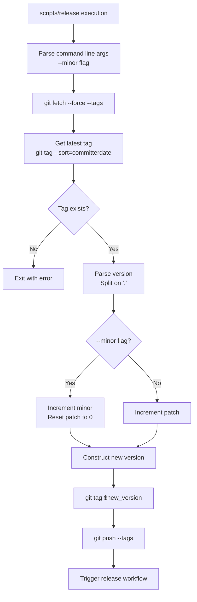
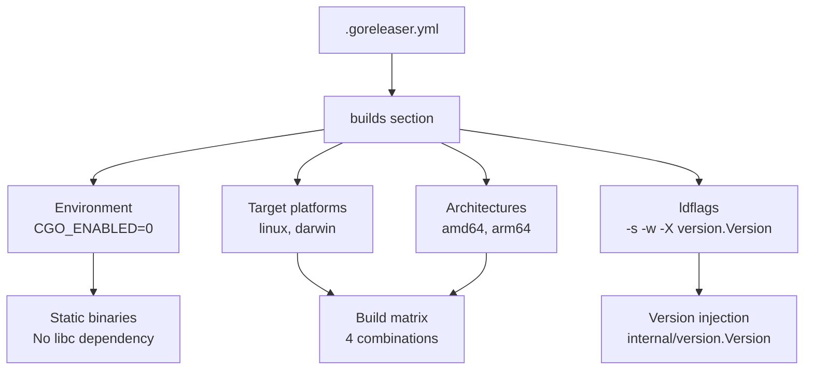
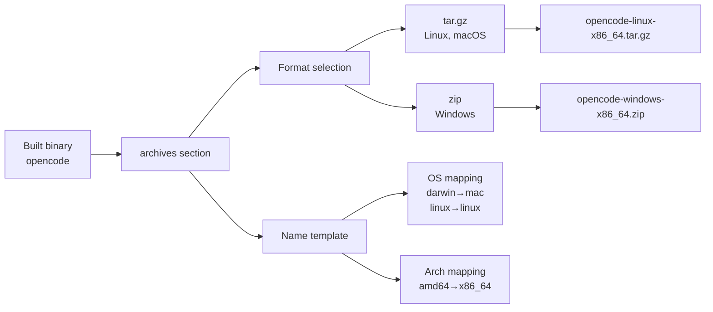
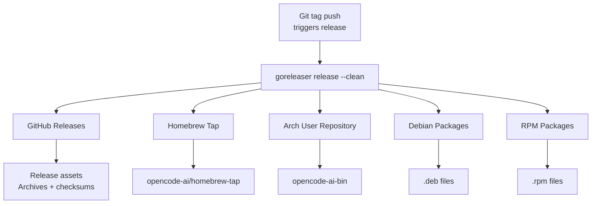
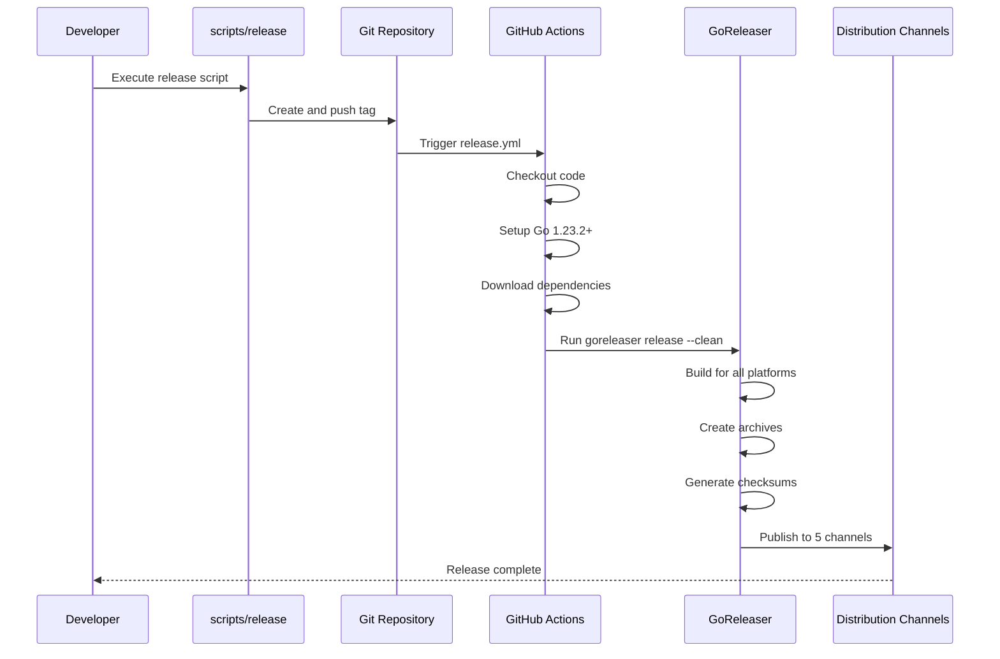
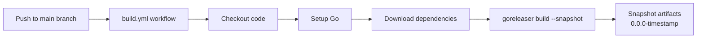
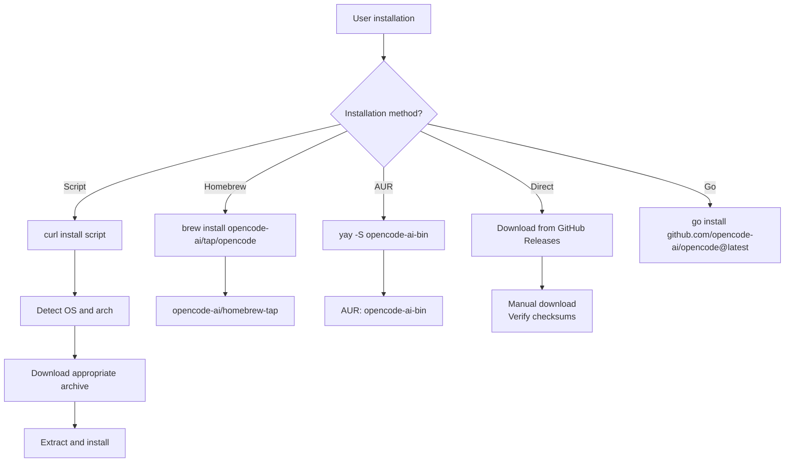

# Build and Release System

<details>
<summary>Relevant source files</summary>

The following files were used as context for generating this wiki page:

- [.github/workflows/build.yml](.github/workflows/build.yml)
- [.github/workflows/release.yml](.github/workflows/release.yml)
- [.goreleaser.yml](.goreleaser.yml)
- [README.md](README.md)
- [scripts/release](scripts/release)
- [scripts/snapshot](scripts/snapshot)

</details>


## Purpose and Scope

This document covers the automated build and release pipeline for OpenCode, including version management, cross-compilation, packaging, and distribution across multiple channels. The system uses GoReleaser as the primary build tool, orchestrated through GitHub Actions workflows and shell scripts.

For information about development setup and building from source for local development, see [Overview](#1). For information about configuration after installation, see [Configuration System](#2).

---

## Overview

The build and release system automates the entire pipeline from version tagging to distribution across five package managers. The system consists of three main components:

1. **Version Management Scripts** - Shell scripts for semantic versioning and Git tag creation
2. **GoReleaser Configuration** - Declarative configuration for compilation, packaging, and distribution
3. **GitHub Actions Workflows** - CI/CD automation for continuous builds and tagged releases

The system produces static binaries with no external dependencies (`CGO_ENABLED=0`) and supports multiple platforms: Linux and macOS on both AMD64 and ARM64 architectures.

**Sources:** [.goreleaser.yml:1-77](), [.github/workflows/release.yml:1-41](), [.github/workflows/build.yml:1-38]()

---

## Version Management

### Release Script

The version management system uses a shell script at [scripts/release:1-44]() that implements semantic versioning for the project.



**Version Increment Logic:**

| Flag | Version Change | Example |
|------|---------------|---------|
| (none) | Patch increment | `v0.1.5` → `v0.1.6` |
| `--minor` | Minor increment, patch reset | `v0.1.5` → `v0.2.0` |

The script performs the following operations:

1. Fetches all Git tags from the remote repository [scripts/release:12]()
2. Identifies the latest semantic version tag [scripts/release:15]()
3. Parses the version into major, minor, and patch components [scripts/release:26]()
4. Increments the version based on the `--minor` flag [scripts/release:28-38]()
5. Creates and pushes the new Git tag [scripts/release:42-43]()

The act of pushing a new tag automatically triggers the release workflow via GitHub Actions [.github/workflows/release.yml:5-7]().

**Sources:** [scripts/release:1-44]()

### Snapshot Builds

The snapshot script provides local build capability without creating releases:

[scripts/snapshot:1-4]() executes `goreleaser build --clean --snapshot --skip validate`, which:
- Builds for all configured platforms
- Does not create a release or push to package managers
- Uses version `0.0.0-<timestamp>` [.goreleaser.yml:35]()
- Useful for local testing and validation

**Sources:** [scripts/snapshot:1-4](), [.goreleaser.yml:34-35]()

---

## GoReleaser Configuration

The `.goreleaser.yml` file is the declarative configuration that defines how OpenCode is built, packaged, and distributed.

### Build Configuration



The build configuration [.goreleaser.yml:6-16]() specifies:

| Setting | Value | Purpose |
|---------|-------|---------|
| `CGO_ENABLED` | `0` | Produces static binaries without C library dependencies |
| `goos` | `linux`, `darwin` | Target operating systems |
| `goarch` | `amd64`, `arm64` | Target architectures |
| `ldflags` | `-s -w -X ...Version={{.Version}}` | Strip debug info and inject version string |

The version is injected into `github.com/opencode-ai/opencode/internal/version.Version` at build time [.goreleaser.yml:15](), allowing the binary to report its version at runtime.

**Sources:** [.goreleaser.yml:6-16]()

### Archive Configuration



Archive configuration [.goreleaser.yml:18-31]() defines:

1. **Archive Format**: `tar.gz` for Unix-like systems, `zip` for Windows [.goreleaser.yml:19-31]()
2. **Naming Template**: Produces names like `opencode-linux-x86_64.tar.gz` or `opencode-mac-arm64.tar.gz` [.goreleaser.yml:20-28]()
3. **Checksum Generation**: Creates `checksums.txt` for all archives [.goreleaser.yml:32-33]()

**Sources:** [.goreleaser.yml:18-33]()

---

## Distribution Channels

GoReleaser automatically publishes to five distribution channels on each release:



### GitHub Releases

All archives and checksums are automatically uploaded as GitHub release assets [.goreleaser.yml:32-33](). Users can download platform-specific archives directly from the releases page.

**Sources:** [.goreleaser.yml:32-33]()

### Homebrew Tap

The Homebrew configuration [.goreleaser.yml:51-54]() publishes formulas to the `opencode-ai/homebrew-tap` repository. Users install via:

```bash
brew install opencode-ai/tap/opencode
```

The tap repository is automatically updated with each release using the `HOMEBREW_GITHUB_TOKEN` secret [.github/workflows/release.yml:39]().

**Sources:** [.goreleaser.yml:51-54](), [.github/workflows/release.yml:39]()

### Arch User Repository (AUR)

The AUR configuration [.goreleaser.yml:36-50]() defines:

| Field | Value |
|-------|-------|
| Package Name | `opencode-ai-bin` |
| Repository | `ssh://aur@aur.archlinux.org/opencode-ai-bin.git` |
| Provides | `opencode` |
| Conflicts | `opencode` |

The package is published using the `AUR_KEY` secret for SSH authentication [.github/workflows/release.yml:40](). Users install via:

```bash
yay -S opencode-ai-bin
# or
paru -S opencode-ai-bin
```

**Sources:** [.goreleaser.yml:36-50](), [.github/workflows/release.yml:40]()

### Native Packages (Debian and RPM)

The `nfpms` section [.goreleaser.yml:55-64]() generates native packages for Debian-based and Red Hat-based distributions:

- **Debian (`.deb`)**: For Ubuntu, Debian, and derivatives
- **RPM (`.rpm`)**: For Fedora, CentOS, RHEL, and derivatives

Package file names follow the pattern: `opencode-linux-amd64.deb` or `opencode-linux-arm64.rpm` [.goreleaser.yml:61-64]().

**Sources:** [.goreleaser.yml:55-64]()

---

## GitHub Actions Workflows

### Release Workflow

The release workflow [.github/workflows/release.yml:1-41]() is triggered by:
- Manual dispatch (workflow_dispatch)
- Git tag pushes matching any pattern [.github/workflows/release.yml:4-7]()



**Workflow Steps:**

1. **Checkout**: Fetches full Git history with tags [.github/workflows/release.yml:19-21]()
2. **Force Tag Fetch**: Ensures all tags are available [.github/workflows/release.yml:23]()
3. **Go Setup**: Installs Go 1.23.2 or higher with dependency caching [.github/workflows/release.yml:25-29]()
4. **Dependencies**: Downloads Go modules [.github/workflows/release.yml:31]()
5. **Release**: Executes `goreleaser release --clean` [.github/workflows/release.yml:33-40]()

**Secrets Required:**

| Secret | Purpose |
|--------|---------|
| `HOMEBREW_GITHUB_TOKEN` | Push to Homebrew tap repository |
| `AUR_KEY` | SSH authentication for AUR |

**Sources:** [.github/workflows/release.yml:1-41]()

### Build Workflow

The build workflow [.github/workflows/build.yml:1-38]() runs on every push to the `main` branch [.github/workflows/build.yml:5-7]().



This workflow provides continuous validation by:
- Building for all platforms on every commit to `main`
- Using `--snapshot` flag to avoid creating releases [.github/workflows/build.yml:37]()
- Generating snapshot binaries with version `0.0.0-<timestamp>` [.goreleaser.yml:35]()

The snapshot artifacts are not published or uploaded, serving only as build validation.

**Sources:** [.github/workflows/build.yml:1-38](), [.goreleaser.yml:34-35]()

---

## Build Artifacts

### Binary Naming and Versioning

Each build produces binaries named `opencode` without platform suffixes in the archive. The archive names encode the platform information:

| Platform | Archive Name |
|----------|-------------|
| Linux AMD64 | `opencode-linux-x86_64.tar.gz` |
| Linux ARM64 | `opencode-linux-arm64.tar.gz` |
| macOS AMD64 | `opencode-mac-x86_64.tar.gz` |
| macOS ARM64 | `opencode-mac-arm64.tar.gz` |

Version information is embedded in the binary via ldflags at build time [.goreleaser.yml:15]().

**Sources:** [.goreleaser.yml:18-28]()

### Checksums

The `checksums.txt` file [.goreleaser.yml:32-33]() contains SHA256 hashes for all archives, enabling users to verify download integrity:

```
<sha256>  opencode-linux-x86_64.tar.gz
<sha256>  opencode-linux-arm64.tar.gz
<sha256>  opencode-mac-x86_64.tar.gz
<sha256>  opencode-mac-arm64.tar.gz
```

**Sources:** [.goreleaser.yml:32-33]()

---

## Changelog Generation

GoReleaser automatically generates release notes from Git commit messages [.goreleaser.yml:66-76](). The changelog:

- Sorts commits in ascending order [.goreleaser.yml:67]()
- Excludes commits with specific prefixes: `docs:`, `doc:`, `test:`, `ci:`, `ignore:`, `example:`, `wip:` [.goreleaser.yml:69-76]()

This ensures release notes focus on user-facing changes and bug fixes.

**Sources:** [.goreleaser.yml:66-76]()

---

## Installation Methods

The multi-channel distribution enables users to install OpenCode through their preferred package manager:



Each installation method is documented in the README [README.md:42-74]().

**Sources:** [README.md:42-74]()

---

## Key Features

### Static Binary Compilation

The use of `CGO_ENABLED=0` [.goreleaser.yml:7]() ensures binaries are statically linked, with several benefits:

1. **No external dependencies**: Binaries work without libc or other shared libraries
2. **Portability**: Same binary runs on any Linux distribution or macOS version
3. **Simplified deployment**: No package conflicts or missing dependencies

**Sources:** [.goreleaser.yml:7]()

### Cross-Platform Support

The build matrix produces four binary combinations:
- `linux/amd64`
- `linux/arm64`
- `darwin/amd64` (Intel Macs)
- `darwin/arm64` (Apple Silicon Macs)

This covers the vast majority of development environments [.goreleaser.yml:8-12]().

**Sources:** [.goreleaser.yml:8-12]()

### Automated Distribution

The entire release process, from version increment to package manager updates, is fully automated:

1. Developer runs `scripts/release` (optionally with `--minor`)
2. Script creates and pushes Git tag
3. GitHub Actions detects tag and triggers release workflow
4. GoReleaser builds, packages, and distributes to all channels
5. Users can install updates through their preferred package manager

This automation ensures consistent releases and reduces manual effort.

**Sources:** [scripts/release:1-44](), [.github/workflows/release.yml:1-41](), [.goreleaser.yml:1-77]()