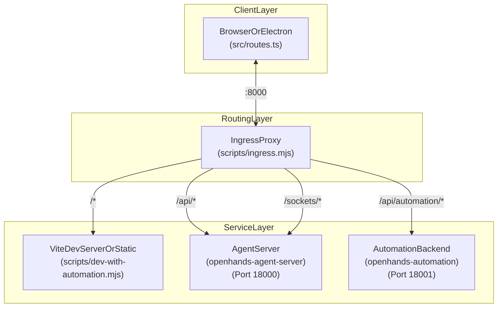
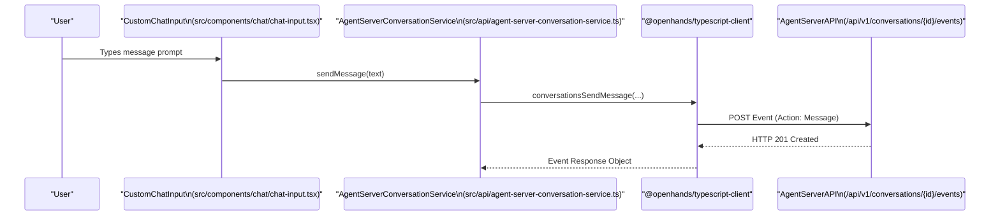

# Architecture Overview

Relevant source files

The following files were used as context for generating this wiki page:

- [.release-please-manifest.json](.release-please-manifest.json)
- [AGENTS.md](AGENTS.md)
- [README.md](README.md)
- [README.windows.md](README.windows.md)
- [__tests__/scripts/dev-safe.test.ts](__tests__/scripts/dev-safe.test.ts)
- [__tests__/scripts/dev-static.test.ts](__tests__/scripts/dev-static.test.ts)
- [__tests__/scripts/dev-with-automation.test.ts](__tests__/scripts/dev-with-automation.test.ts)
- [__tests__/scripts/ingress.test.ts](__tests__/scripts/ingress.test.ts)
- [__tests__/scripts/static-server.test.ts](__tests__/scripts/static-server.test.ts)
- [config/defaults.json](config/defaults.json)
- [docker/entrypoint.sh](docker/entrypoint.sh)
- [helm/agent-canvas/Chart.yaml](helm/agent-canvas/Chart.yaml)
- [package-lock.json](package-lock.json)
- [package.json](package.json)
- [scripts/check-sdk-version-sync.mjs](scripts/check-sdk-version-sync.mjs)
- [scripts/dev-safe.mjs](scripts/dev-safe.mjs)
- [scripts/dev-static.mjs](scripts/dev-static.mjs)
- [scripts/dev-with-automation.mjs](scripts/dev-with-automation.mjs)
- [scripts/ingress.mjs](scripts/ingress.mjs)
- [scripts/proxy-utils.mjs](scripts/proxy-utils.mjs)
- [scripts/runtime-services-info.mjs](scripts/runtime-services-info.mjs)
- [scripts/static-server.mjs](scripts/static-server.mjs)

## Purpose and Scope

Agent Canvas (`@openhands/agent-canvas`) is the React/TypeScript frontend and developer control center for managing coding agents and automated workflows [README.md:5-7](), [package.json:2-4](). 

The system is responsible for:
*   **UI Rendering**: Providing a visual interface for chat, file editing, terminal operations, and settings management [package.json:4-5]().
*   **State Management**: Orchestrating frontend application state via Zustand and TanStack Query [package.json:31,73]().
*   **API Translation**: Converting user actions into standardized client calls targeting the Agent Server and Automation backends through `@openhands/typescript-client` [package.json:27](), [AGENTS.md:28-33]().
*   **Distribution**: Packaging the application as an npm library, a standalone CLI binary, a Docker container image, and an Electron desktop app [package.json:16-18,106-112]().

Agent Canvas is **not** responsible for:
*   **Agent Execution**: The core agent logic, reasoning loops, and tool execution reside in the `software-agent-sdk` [AGENTS.md:33]().
*   **Sandboxing**: Providing isolated container or process execution environments (handled by the agent-server's workspace/Docker sandbox architecture) [README.md:82-100]().
*   **Credential Hosting**: LLM API keys and secrets are managed securely by the backend services, while the UI merely renders configuration forms.

Sources: [README.md:5-7](), [package.json:2-4,27,31,73,106-112](), [AGENTS.md:28-33]()

---

## System Boundaries

Agent Canvas sits between the user browser interface and the multi-service backend execution layer. It abstracts communication with local, remote, or cloud agent instances [README.md:35]().

Sources: [README.md:35]()

---

## The Three-Service Stack

The Agent Canvas local and self-hosted environments operate as a three-service stack orchestrated by an ingress proxy [scripts/dev-with-automation.mjs:9-15]().

**Diagram: System Service Stack**

Sources: [scripts/dev-with-automation.mjs:9-22](), [config/defaults.json:15-21]()

### 1. Frontend (`agent-canvas`)
The React Single Page Application built with Vite and React Router [package.json:56,69](). It consumes `@openhands/typescript-client` to communicate with backends [package.json:27]().

### 2. Agent Server (`openhands-agent-server`)
A Python-based service responsible for managing agent sessions, conversation history, and tool execution [config/defaults.json:4,12]().

### 3. Automation Backend (`openhands-automation`)
A specialized service for running long-lived, event-driven workflows, webhooks, and scheduled triggers, sharing the session authentication model [scripts/dev-with-automation.mjs:38-45](), [config/defaults.json:6,17]().

Sources: [package.json:27,56,69](), [config/defaults.json:4,6,12,17](), [scripts/dev-with-automation.mjs:38-45]()

---

## Ingress Proxy and Routing Model

The `scripts/ingress.mjs` script acts as the single entry point, routing traffic across multiple underlying ports to provide a unified origin. This avoids CORS complexity during development and production self-hosting.

**Routing Rules:**
*   **`/api/automation/*`**: Routed to the Automation Backend [scripts/dev-with-automation.mjs:12]().
*   **`/api/*` & `/sockets`**: Routed to the Agent Server [scripts/dev-with-automation.mjs:13]().
*   **`/*`**: Default route for the Vite dev server or static file server [scripts/dev-with-automation.mjs:14]().

Additionally, the proxy injects runtime configuration (`window.__AGENT_CANVAS_RUNTIME_SERVICES`) into the HTML response via `buildRuntimeServicesInfo` [scripts/dev-safe.mjs:28](), [scripts/runtime-services-info.mjs:1-10]().

Sources: [scripts/ingress.mjs:1-50](), [scripts/dev-safe.mjs:28](), [scripts/dev-with-automation.mjs:9-15]()

---

## Runtime Modes

Agent Canvas supports multiple execution modes defined in package scripts:

| Mode | Command | Orchestrator Script | Description |
| :--- | :--- | :--- | :--- |
| **Dev (Full)** | `npm run dev` | `scripts/dev-with-automation.mjs` | Runs Vite, Agent Server (`uvx`), and Automation (`uvx`) behind ingress [package.json:76]() |
| **Dev (Minimal)** | `npm run dev:minimal` | `scripts/dev-safe.mjs` | Runs Vite and Agent Server only; skips automation [package.json:79]() |
| **Dev (Static)** | `npm run dev:static` | `scripts/dev-static.mjs` | Runs a production build of the frontend with live backends [package.json:77]() |
| **Production (Docker)** | `docker run ...` | `docker/entrypoint.sh` | Bundles all three services into a single container image [README.md:95-100](), [docker/entrypoint.sh:1-20]() |
| **Desktop** | `npm run desktop` | `electron/main.mjs` | Wraps the full stack in an Electron shell, bundling `uv` [package.json:111]() |

Sources: [package.json:76-79,111](), [README.md:95-100](), [docker/entrypoint.sh:1-20]()

---

## Data Flow: Natural Language to Code Entity

This sequence diagram illustrates how a user message flows from UI components down to the Agent Server API client.

**Diagram: Message Data Flow**

Sources: [package.json:27](), [AGENTS.md:9]()

---

## Authentication and Security Boundaries

Communication between the ingress proxy and backend services is secured using `LOCAL_BACKEND_API_KEY` (passed via the `X-Session-API-Key` header) [scripts/dev-with-automation.mjs:38-42]().

1.  **Key Generation**: Dev scripts generate a cryptographically secure 256-bit hex key via `generateRandomApiKey` [scripts/dev-safe.mjs:68-70]() and persist it to `~/.openhands/agent-canvas/api-key.txt` via `getOrCreatePersistedApiKey` [scripts/dev-safe.mjs:80-85,144-176]().
2.  **Injection**: The key is injected into the frontend via `VITE_SESSION_API_KEY` and provided to backend processes as an environment variable [scripts/dev-with-automation.mjs:39-41]().
3.  **Validation**: Ingress and backend endpoints validate this header on requests to guard filesystem and LLM credential access.

Sources: [scripts/dev-safe.mjs:68-85,144-176](), [scripts/dev-with-automation.mjs:38-45]()