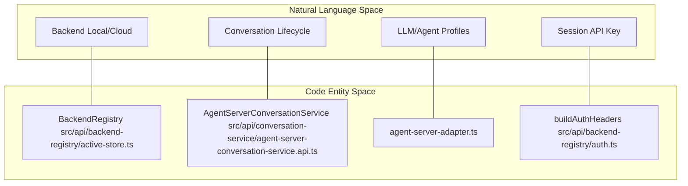
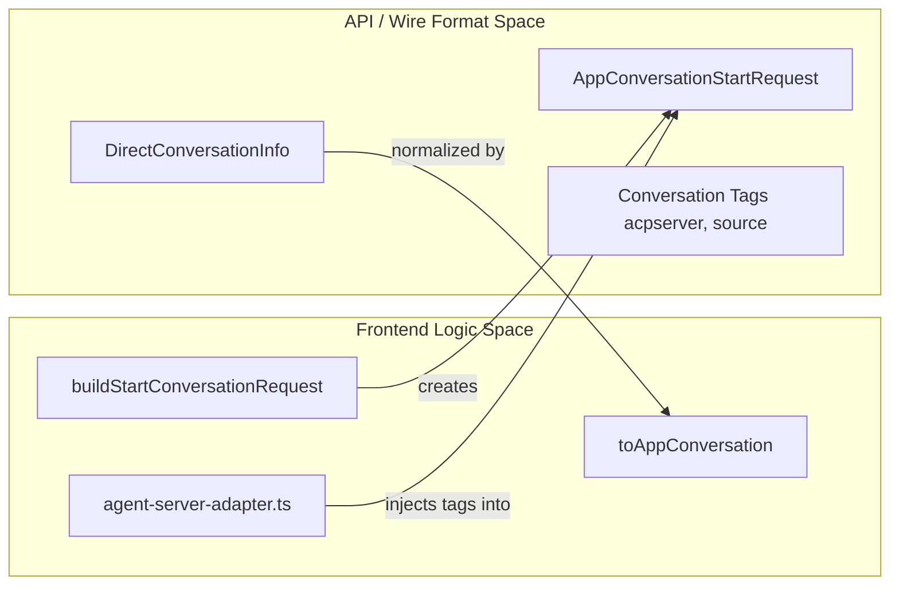
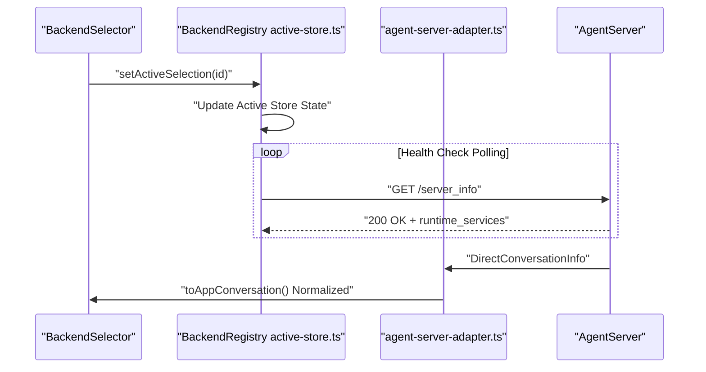

# Key Concepts

Relevant source files

The following files were used as context for generating this wiki page:

- [.release-please-manifest.json](.release-please-manifest.json)
- [AGENTS.md](AGENTS.md)
- [README.md](README.md)
- [README.windows.md](README.windows.md)
- [__tests__/api/agent-server-adapter.test.ts](__tests__/api/agent-server-adapter.test.ts)
- [__tests__/api/agent-server-conversation-service.test.ts](__tests__/api/agent-server-conversation-service.test.ts)
- [__tests__/api/use-create-conversation-metadata.test.ts](__tests__/api/use-create-conversation-metadata.test.ts)
- [__tests__/hooks/mutation/use-create-conversation.test.tsx](__tests__/hooks/mutation/use-create-conversation.test.tsx)
- [__tests__/hooks/mutation/use-switch-llm-profile-and-log.test.tsx](__tests__/hooks/mutation/use-switch-llm-profile-and-log.test.tsx)
- [__tests__/scripts/dev-safe.test.ts](__tests__/scripts/dev-safe.test.ts)
- [config/defaults.json](config/defaults.json)
- [helm/agent-canvas/Chart.yaml](helm/agent-canvas/Chart.yaml)
- [package-lock.json](package-lock.json)
- [package.json](package.json)
- [scripts/check-sdk-version-sync.mjs](scripts/check-sdk-version-sync.mjs)
- [scripts/dev-safe.mjs](scripts/dev-safe.mjs)
- [src/api/agent-server-adapter.ts](src/api/agent-server-adapter.ts)
- [src/api/conversation-metadata-store.ts](src/api/conversation-metadata-store.ts)
- [src/api/conversation-service/agent-server-conversation-service.api.ts](src/api/conversation-service/agent-server-conversation-service.api.ts)
- [src/api/conversation-service/agent-server-conversation-service.types.ts](src/api/conversation-service/agent-server-conversation-service.types.ts)
- [src/hooks/mutation/use-create-conversation.ts](src/hooks/mutation/use-create-conversation.ts)
- [src/hooks/mutation/use-switch-llm-profile-and-log.ts](src/hooks/mutation/use-switch-llm-profile-and-log.ts)
- [src/i18n/translation.json](src/i18n/translation.json)

This document defines the core terminology and technical concepts for the **Agent Canvas** codebase. It bridges the gap between high-level product features and the underlying React/TypeScript implementation.

---

## Backend Infrastructure & Ingress Proxy

Agent Canvas follows a "bring your own backend" model. It distinguishes between where the UI is served and where the agent logic executes.

### Backends (Local vs. Cloud)
A **Backend** is an instance of the `agent-server` (and optionally the `automation` backend). 
*   **Local Backend**: Typically runs on `localhost:18000` (managed via `config/defaults.json` [config/defaults.json:15-17]()). It is managed via the `BackendRegistry` and stored in `localStorage` [src/api/backend-registry/active-store.ts:1-25]().
*   **Cloud Backend**: A managed OpenHands environment. Authentication is handled via a **Device Authorization Grant** (OAuth 2.0).

### Ingress Proxy
The ingress routing model acts as the unified entry point (default port `8000` [config/defaults.json:15-18]()). It routes traffic based on path prefixes:
*   `/api/automation/*` → Automation Backend (port `18001` [config/defaults.json:15-17]()).
*   `/api/*` → Agent Server (port `18000` [config/defaults.json:15-17]()).
*   `/*` → Frontend (Vite dev server or static files).

### Session API Keys
To secure local backends without complex OAuth, Agent Canvas uses a **Session API Key**. This key is passed via request headers [src/api/backend-registry/auth.ts:1-18](). In development, it is generated or loaded via `getOrCreatePersistedApiKey` [scripts/dev-safe.mjs:119-146]() and persisted in `.openhands/agent-canvas/api-key.txt` [scripts/dev-safe.mjs:80-85]().

### Runtime Services Info
The `RuntimeServicesInfo` block is a JSON metadata object served by backends [src/api/agent-server-adapter.ts:176-182](). It informs the agent what URLs are reachable from *inside* its sandbox. The block is parsed by `parseRuntimeServicesInfo` [src/api/agent-server-adapter.ts:1-25]() and consumed by the agent's system prompt.

Sources: [config/defaults.json:15-46](), [src/api/backend-registry/active-store.ts:1-25](), [scripts/dev-safe.mjs:68-146](), [src/api/agent-server-adapter.ts:176-182]()

---

## Agent Architecture & Profiles

Agent Canvas supports multiple agent "kinds" and specialized configuration profiles.

### Agent Kinds
*   **OpenHands**: The native agent (e.g., `CodeActAgent`) running directly in the Python `agent-server` [src/api/agent-server-adapter.ts:1-50]().
*   **ACP (Agent Client Protocol)**: Third-party agents like Claude Code, Codex, or Gemini CLI. These run as subprocesses managed by the agent-server, identified via the `kind` discriminator in `DirectConversationInfo` [src/api/agent-server-adapter.ts:112-130]().

### Profiles (LLM and Agent)
*   **LLM Profile**: A named configuration containing a specific model, API key, and base URL managed via settings services [src/api/settings-service/settings-service.api.ts:1-30]().
*   **Agent Profile**: Combines an Agent Kind with specific LLM profiles and tool configurations [src/api/agent-server-adapter.ts:146-150]().

### MCP Servers
The **Model Context Protocol (MCP)** allows agents to connect to external tools and data sources. MCP configurations are managed in settings and utilized by the agent-server to extend model capabilities.

Sources: [src/api/agent-server-adapter.ts:1-150](), [src/api/settings-service/settings-service.api.ts:1-30]()

---

## Conversation Lifecycle & Workspaces

A **Conversation** tracks the state of an interaction between a user and an agent, encapsulated in the `AppConversation` type [src/api/conversation-service/agent-server-conversation-service.types.ts:1-40]().

### Workspaces
A **Workspace** defines the filesystem boundary for the agent. In local mode, this is derived from the project path configuration [README.md:92-98](). The `working_dir` is sent in the `workspace` block of conversation start requests [src/api/agent-server-adapter.ts:134-136]().

Sources: [src/api/conversation-service/agent-server-conversation-service.types.ts:1-40](), [src/api/agent-server-adapter.ts:134-136](), [README.md:92-98]()

---

## Extensions, Skills, and Automations

### Skills
**Skills** are reusable agent capabilities bundled from `@openhands/extensions` [src/api/agent-server-adapter.ts:1-15](). They are injected into agent context during conversation startup so the SDK can perform trigger matching.

### Automations
**Automations** are background workflows and scheduled tasks managed by the automation backend [package.json:75-77](). They integrate with webhook events, GitHub issues, and messaging services.

Sources: [src/api/agent-server-adapter.ts:1-15](), [package.json:75-77]()

---

## Bridge: Code Entity Space to Natural Language Space

These diagrams map product concepts to specific TypeScript classes and API structures, bridging natural language spaces to code entities.

### Diagram: UI Concepts to Frontend Entities

Sources: [src/api/backend-registry/active-store.ts:1-25](), [src/api/conversation-service/agent-server-conversation-service.api.ts:1-50](), [src/api/agent-server-adapter.ts:1-50]()

### Diagram: Request Payload Construction Flow

Sources: [src/api/agent-server-adapter.ts:54-150](), [__tests__/api/agent-server-adapter.test.ts:143-200]()

---

## Data Flow: Backend Selection and Health

The `ActiveBackendContext` provides connection details across the application, while `toAppConversation` normalizes raw backend data for the UI.

Sources: [src/api/backend-registry/active-store.ts:1-30](), [src/api/agent-server-adapter.ts:54-150](), [src/api/conversation-service/agent-server-conversation-service.api.ts:1-50]()