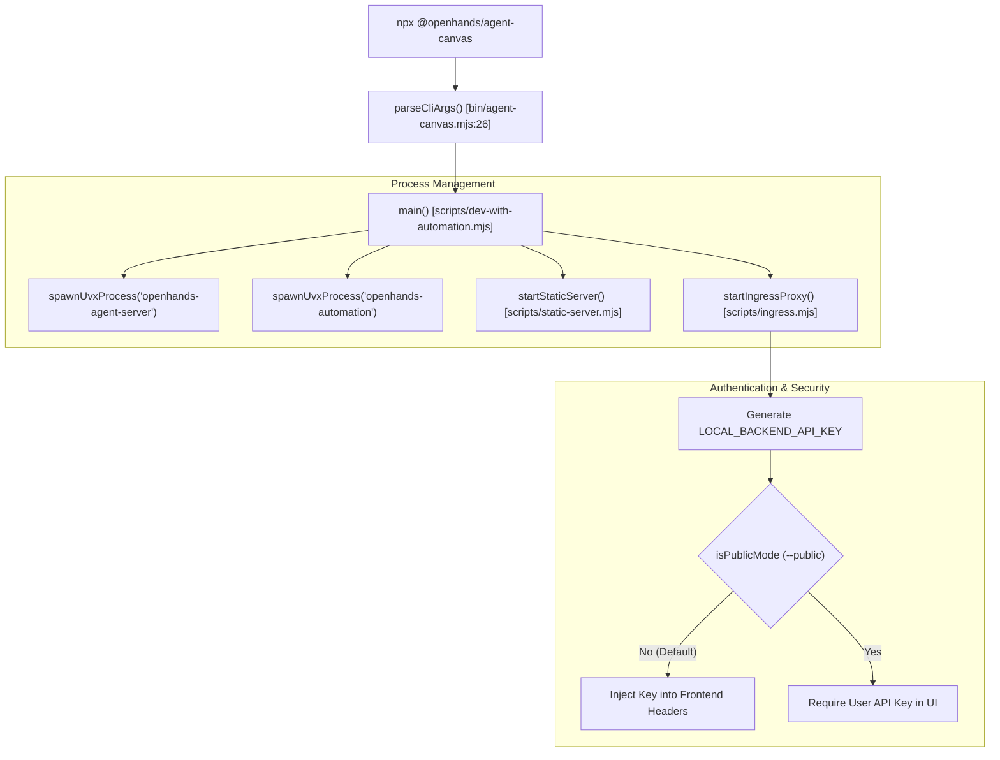
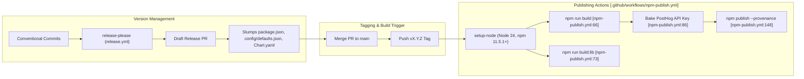

# Packaging and Distribution

Relevant source files

The following files were used as context for generating this wiki page:

- [.agents/skills/release.md](.agents/skills/release.md)
- [.github/release.yml](.github/release.yml)
- [.github/workflows/npm-publish.yml](.github/workflows/npm-publish.yml)
- [.github/workflows/pr.yml](.github/workflows/pr.yml)
- [.github/workflows/release-ready.yml](.github/workflows/release-ready.yml)
- [.github/workflows/release.yml](.github/workflows/release.yml)
- [__tests__/components/onboarding/onboarding-preview.test.ts](__tests__/components/onboarding/onboarding-preview.test.ts)
- [__tests__/components/shared/modals/modal-backdrop.test.tsx](__tests__/components/shared/modals/modal-backdrop.test.tsx)
- [__tests__/github-workflows/npm-publish.test.ts](__tests__/github-workflows/npm-publish.test.ts)
- [__tests__/hooks/use-telemetry.test.tsx](__tests__/hooks/use-telemetry.test.tsx)
- [release-please-config.json](release-please-config.json)
- [specs/canvas-extensions.md](specs/canvas-extensions.md)
- [src/api/agent-canvas-updates.test.ts](src/api/agent-canvas-updates.test.ts)
- [src/api/agent-canvas-updates.ts](src/api/agent-canvas-updates.ts)
- [src/api/canvas-extensions-service.test.ts](src/api/canvas-extensions-service.test.ts)
- [src/api/canvas-extensions-service.ts](src/api/canvas-extensions-service.ts)
- [src/components/features/analytics/telemetry-consent-banner.tsx](src/components/features/analytics/telemetry-consent-banner.tsx)
- [src/components/features/canvas-extensions/canvas-extension-card.tsx](src/components/features/canvas-extensions/canvas-extension-card.tsx)
- [src/components/features/canvas-extensions/canvas-extensions-runtime.test.tsx](src/components/features/canvas-extensions/canvas-extensions-runtime.test.tsx)
- [src/components/features/canvas-extensions/canvas-extensions-runtime.tsx](src/components/features/canvas-extensions/canvas-extensions-runtime.tsx)
- [src/components/features/onboarding/onboarding-preview.ts](src/components/features/onboarding/onboarding-preview.ts)
- [src/components/shared/modals/modal-backdrop.tsx](src/components/shared/modals/modal-backdrop.tsx)
- [src/fixtures/canvas-extensions/demo-page/extension.js](src/fixtures/canvas-extensions/demo-page/extension.js)
- [src/hooks/query/use-latest-agent-canvas-version.ts](src/hooks/query/use-latest-agent-canvas-version.ts)
- [src/hooks/use-telemetry.ts](src/hooks/use-telemetry.ts)
- [src/lib/index.ts](src/lib/index.ts)
- [src/types/canvas-extension.ts](src/types/canvas-extension.ts)
- [tests/e2e/mock-llm/canvas-extensions/mock-llm-canvas-extensions.spec.ts](tests/e2e/mock-llm/canvas-extensions/mock-llm-canvas-extensions.spec.ts)

## Purpose and Scope

Agent Canvas (`@openhands/agent-canvas`) is the React/TypeScript frontend and unified client for the OpenHands ecosystem. It is distributed as a multi-purpose package that functions as a standalone web application, a command-line tool, a reusable React component library, an Electron desktop application, and a containerized Kubernetes service. This document details the implementation of these distribution channels, the library entrypoint architecture (`src/lib/index.ts`), CLI orchestration, and the automated release pipeline.

Sources: [package.json:2-18](), [src/lib/index.ts:1-75](), [release-please-config.json:1-26]()

---

## Distribution Channels

Agent Canvas is packaged into primary formats to support diverse integration scenarios:

1. **NPM Package (`@openhands/agent-canvas`)**: The primary distribution artifact published to the npm registry, containing the pre-built frontend bundle, CLI binary, and library modules [package.json:2-18]().
2. **CLI Binary (`agent-canvas`)**: A Node-based executable script that orchestrates the local stack (frontend static server, `openhands-agent-server`, and automation backends) [bin/agent-canvas.mjs:1-12]().
3. **Library Entrypoints**: A modular entrypoint (`src/lib/index.ts`) allowing external React applications to consume core components, hooks, stores, and utilities [src/lib/index.ts:1-75]().
4. **Container & Helm Chart**: Multi-stage Docker images and a Helm chart (`helm/agent-canvas/`) for production Kubernetes deployments [helm/agent-canvas/Chart.yaml:1-28]().

Sources: [package.json:2-18](), [bin/agent-canvas.mjs:1-12](), [src/lib/index.ts:1-75](), [helm/agent-canvas/Chart.yaml:1-28]()

---

## The Agent Canvas CLI and Stack Orchestration

The CLI entrypoint provides an out-of-the-box local execution environment by serving pre-built static assets via a static server rather than requiring a Vite development server [bin/agent-canvas.mjs:10-12](). It leverages Python runtime tools like `uvx` to launch the backend `openhands-agent-server` and `openhands-automation` services automatically [bin/agent-canvas.mjs:5-9]().

### CLI Execution Flow

Title: "CLI Stack Orchestration and Process Lifecycle"

Sources: [bin/agent-canvas.mjs:5-12](), [bin/agent-canvas.mjs:26-53](), [bin/agent-canvas.mjs:68-75]()

### Authentication Modes
The CLI supports two operational security models governed by the `--public` flag [bin/agent-canvas.mjs:68-75]():
* **Local Mode (Default)**: The CLI automatically provisions a secure session token (`LOCAL_BACKEND_API_KEY`) and injects it into client-server communication headers [bin/agent-canvas.mjs:69-70]().
* **Public Mode (`--public`)**: The CLI omits automatic session token injection. Users connecting to the endpoint must manually authenticate or provide credentials through the UI [bin/agent-canvas.mjs:72-74]().

Sources: [bin/agent-canvas.mjs:68-75](), [bin/agent-canvas.mjs:104-105]()

---

## Library Entrypoints (`src/lib/index.ts`)

For consumers embedding Agent Canvas into custom React shells, the package exposes a clean API contract via `src/lib/index.ts`.

### Exported Modules Summary

| Subsystem | Exported Entities / Symbols | Source Reference |
| :--- | :--- | :--- |
| **Components** | Browser, Conversation, Files, Settings, Sidebar, Terminal components | [src/lib/index.ts:1-6]() |
| **Providers** | `AgentServerUIProviders`, `AgentServerUIRoot`, `CloudOrganizationBoundary` | [src/lib/index.ts:7-16]() |
| **Query Client** | `createAgentServerQueryClient`, `getDefaultQueryClient`, `queryClient` | [src/lib/index.ts:17-23]() |
| **Internationalization** | `AvailableLanguages`, `createAgentServerI18n`, `translationResources` | [src/lib/index.ts:24-33]() |
| **Theming & Styles** | `AGENT_SERVER_UI_DEFAULT_THEME`, `AGENT_SERVER_UI_SCOPE_ATTRIBUTE` | [src/lib/index.ts:34-42]() |
| **Canvas Extensions** | `CANVAS_EXTENSION_HOST_API_VERSION`, extension types | [src/lib/index.ts:43-59]() |
| **Telemetry** | `useTelemetry`, `configureTelemetry`, `trackEvent`, `trackInstall` | [src/lib/index.ts:60-75]() |

Sources: [src/lib/index.ts:1-75]()

---

## Helm Chart and Kubernetes Deployment

The Helm chart located at `helm/agent-canvas/` packages Agent Canvas for enterprise Kubernetes clusters. It deploys the application as a `StatefulSet` to ensure persistent storage for local conversation state, vector indexes, and user configuration files [helm/agent-canvas/Chart.yaml:1-28]().

* **Version Syncing**: The chart version and application version are synchronized automatically with `config/defaults.json` and `package.json` via release automation [release-please-config.json:11-25]().
* **Stateful Execution**: Persistent volume claims guarantee that session histories survive pod restarts or rescheduling.

Sources: [helm/agent-canvas/Chart.yaml:1-28](), [release-please-config.json:11-25]()

---

## Automated Release Pipeline and Publishing

Releases are fully automated using `release-please` and GitHub Actions workflows, implementing trunk-based development principles governed by Conventional Commits [release-please-config.json:1-26](), [.agents/skills/release.md:16-23]().

### Release Data Flow and Publishing Pipeline

Title: "Release Automation and Publishing Pipeline"

Sources: [.github/workflows/npm-publish.yml:1-148](), [release-please-config.json:1-26](), [.agents/skills/release.md:1-31]()

### Release Configuration Surfaces
Managed file targets are declared in `release-please-config.json`, ensuring consistency across version numbers:
* `package.json` and `package-lock.json`
* `config/defaults.json` (under `versions.agentCanvas`) [release-please-config.json:11-16]()
* `helm/agent-canvas/Chart.yaml` (via generic YAML updating) [release-please-config.json:18-21]()
* `README.md` and `README.windows.md` documentation pins [release-please-config.json:22-23]()

Sources: [release-please-config.json:1-26]()

---

## Telemetry and Analytics Distribution

Production packages bake telemetry configurations into built artifacts. During the npm publish workflow, PostHog production credentials are injected into default configurations (`config/defaults.json`) so CLI and standalone consumers report telemetry correctly under user consent [package.json:65-88]().

* **Consent Integration**: Users manage tracking permissions via the `TelemetryConsentBanner`, which persists state to backend settings tables [src/components/features/analytics/telemetry-consent-banner.tsx:64-70]().
* **PostHog Isolation**: The `telemetry.ts` service wraps PostHog initialization, guaranteeing that events adhere to user opt-in status [src/lib/index.ts:60-75]().

Sources: [package.json:65-88](), [src/components/features/analytics/telemetry-consent-banner.tsx:1-128](), [src/lib/index.ts:60-75]()