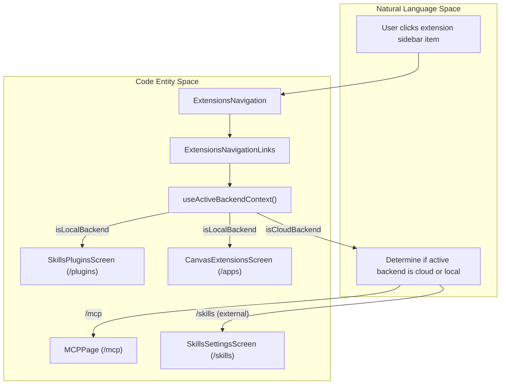
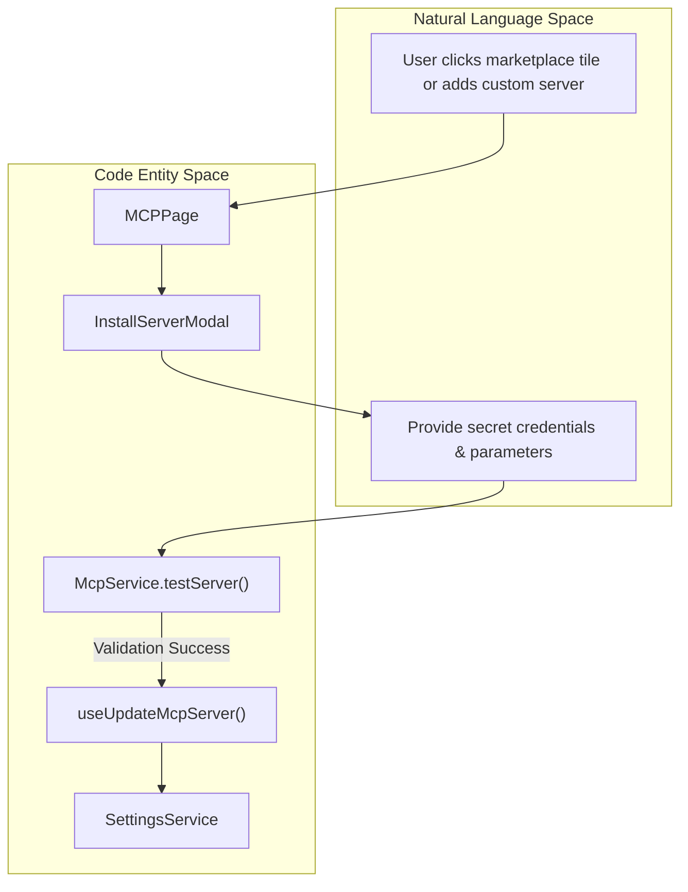

# Skills and Extensions

Relevant source files

The following files were used as context for generating this wiki page:

- [__tests__/components/features/settings/settings-layout.test.tsx](__tests__/components/features/settings/settings-layout.test.tsx)
- [__tests__/components/features/skills/extensions-mobile-hub.test.tsx](__tests__/components/features/skills/extensions-mobile-hub.test.tsx)
- [__tests__/components/features/skills/extensions-navigation.test.tsx](__tests__/components/features/skills/extensions-navigation.test.tsx)
- [__tests__/components/features/skills/get-skill-chat-launch-message.test.ts](__tests__/components/features/skills/get-skill-chat-launch-message.test.ts)
- [__tests__/i18n/translation-completeness.test.ts](__tests__/i18n/translation-completeness.test.ts)
- [__tests__/routes/mcp-page.test.tsx](__tests__/routes/mcp-page.test.tsx)
- [__tests__/routes/settings.test.tsx](__tests__/routes/settings.test.tsx)
- [__tests__/routes/skills-settings.test.tsx](__tests__/routes/skills-settings.test.tsx)
- [src/components/features/mcp-page/mcp-section-filter-dropdown.tsx](src/components/features/mcp-page/mcp-section-filter-dropdown.tsx)
- [src/components/features/settings/settings-desktop-sidebar.tsx](src/components/features/settings/settings-desktop-sidebar.tsx)
- [src/components/features/settings/settings-layout.tsx](src/components/features/settings/settings-layout.tsx)
- [src/components/features/skills/extensions-navigation.tsx](src/components/features/skills/extensions-navigation.tsx)
- [src/components/shared/compact-section-navigation.tsx](src/components/shared/compact-section-navigation.tsx)
- [src/components/shared/modals/confirmation-modal.tsx](src/components/shared/modals/confirmation-modal.tsx)
- [src/constants/skills-docs.ts](src/constants/skills-docs.ts)
- [src/routes/canvas-extensions.tsx](src/routes/canvas-extensions.tsx)
- [src/routes/mcp.tsx](src/routes/mcp.tsx)
- [src/routes/settings.tsx](src/routes/settings.tsx)
- [src/routes/skills-plugins.tsx](src/routes/skills-plugins.tsx)
- [src/routes/skills-settings.tsx](src/routes/skills-settings.tsx)
- [src/utils/sdk-settings-field-metadata.test.ts](src/utils/sdk-settings-field-metadata.test.ts)

## Purpose and Scope

The **Skills and Extensions** system provides the architecture for discovering, managing, and extending agent capabilities within OpenHands. It bridges the gap between core agent execution logic and external tools, specialized knowledge, specialized environments, and standardized protocol servers. 

The system is organized into four primary pillars:
- **Skills**: Fine-grained capabilities, knowledge files, and tool triggers managed via `SkillsSettingsScreen` [src/routes/skills-settings.tsx:42-130]().
- **Plugins**: Extension bundles combining scripts, skills, and dependencies managed via `SkillsPluginsScreen` [src/routes/skills-plugins.tsx:38-125]().
- **MCP Marketplace**: Standardized third-party tool integrations via the Model Context Protocol managed via `MCPPage` [src/routes/mcp.tsx:42-171]().
- **Canvas Extensions**: Local frontend and runtime extensions managed via `CanvasExtensionsScreen` [src/routes/canvas-extensions.tsx:41-126]().

Since this is a parent page, it provides a high-level architectural overview. For detailed implementation mechanics, refer to the child pages:
- [Skills System](#10.1)
- [Plugins System](#10.2)
- [MCP Marketplace](#10.3)
- [Canvas Extensions](#10.4)

Sources: [src/routes/skills-settings.tsx:42-130](), [src/routes/skills-plugins.tsx:38-125](), [src/routes/mcp.tsx:42-171](), [src/routes/canvas-extensions.tsx:41-126]()

---

## Extensions Navigation and Discovery

The `ExtensionsNavigation` component acts as the primary sidebar hub for navigating between extension domains on desktop layouts [src/components/features/skills/extensions-navigation.tsx:75-92](). It renders distinct navigation links (`EXTENSIONS_NAV_ITEMS`) for MCP Servers, Skills, Plugins, and Apps [src/components/features/skills/extensions-navigation.tsx:31-73]().

### Extension Availability by Backend

Backend type (`local` vs `cloud`) determines feature availability. For instance, cloud backends redirect the **Skills** link to an external cloud settings host and hide local-only **Plugins** and **Apps** [src/components/features/skills/extensions-navigation.tsx:19-21](), [src/components/features/skills/extensions-navigation.tsx:94-148]().

| Extension Type | Local Backend | Cloud Backend |
| :--- | :--- | :--- |
| **MCP Servers** | Available in-app (`/mcp`) [src/components/features/skills/extensions-navigation.tsx:31-37]() | Available in-app [__tests__/components/features/skills/extensions-navigation.test.tsx:182-192]() |
| **Skills** | In-app settings (`/skills`) [src/components/features/skills/extensions-navigation.tsx:38-43]() | External Cloud link (`/settings/skills`) [src/components/features/skills/extensions-navigation.tsx:125-147]() |
| **Plugins** | Full management (`/plugins`) [src/components/features/skills/extensions-navigation.tsx:44-66]() | **Hidden** [src/components/features/skills/extensions-navigation.test.tsx:167-180]() |
| **Apps (Canvas Extensions)** | Local management (`/apps`) [src/components/features/skills/extensions-navigation.tsx:67-73]() | **Hidden** [src/components/features/skills/extensions-navigation.test.tsx:167-180]() |

### Navigation Flow: Natural Language to Code Entity Space

Sources: [src/components/features/skills/extensions-navigation.tsx:31-148](), [__tests__/components/features/skills/extensions-navigation.test.tsx:146-192]()

---

## Skills System Overview

The **Skills System** manages domain-specific instructions, markdown documentation, and prompt triggers for agents. The interface is hosted at `SkillsSettingsScreen` [src/routes/skills-settings.tsx:42-130]() and relies on `useSkills` [src/routes/skills-settings.tsx:46]() to fetch registered metadata.

Users can search, filter via facet groups (`buildSkillFacetGroups`), and toggle individual skills [src/routes/skills-settings.tsx:70-128](). Enabled/disabled state is tracked using `useSkillEnablement` [src/routes/skills-settings.tsx:47]().

For detailed information on skill configuration files, schema formatting, and chat invocation, see [Skills System](#10.1).

Sources: [src/routes/skills-settings.tsx:42-130]()

---

## Plugins System Overview

The **Plugins System** handles extension modules that bundle custom execution logic and dependencies. Managed via `SkillsPluginsScreen` [src/routes/skills-plugins.tsx:38-125](), it reconciles marketplace definitions with locally installed plugins [src/routes/skills-plugins.tsx:60-63]().

Key hooks power plugin mutation workflows:
- `useInstallPlugin` and `useUninstallPlugin` [src/routes/skills-plugins.tsx:49-51]() manage installation lifecycle.
- `useSetPluginEnabled` [src/routes/skills-plugins.tsx:23]() controls active status.
- `useRefreshPlugin` [src/routes/skills-plugins.tsx:25]() syncs updates.

For detailed information on plugin cards, detail modals, and view models, see [Plugins System](#10.2).

Sources: [src/routes/skills-plugins.tsx:20-53](), [src/routes/skills-plugins.tsx:60-125]()

---

## MCP Marketplace Overview

The Model Context Protocol (MCP) Marketplace (`MCPPage`) allows users to discover, configure, and install standardized tool servers (`MCPServerConfig`) [src/routes/mcp.tsx:42-171](). 

MCP configurations are stored in settings (`settings.mcp_config`) and are forwarded to agent subprocesses at session creation time [src/routes/mcp.tsx:55-58]().

### MCP Installation Flow: Natural Language to Code Entity Space

For detailed instructions on custom server editing, credential redaction, and marketplace utilities, see [MCP Marketplace](#10.3).

Sources: [src/routes/mcp.tsx:42-171](), [__tests__/routes/mcp-page.test.tsx:47-108]()

---

## Canvas Extensions Overview

The **Canvas Extensions** system enables frontend and runtime extensions within Agent Canvas (`CanvasExtensionsScreen`) [src/routes/canvas-extensions.tsx:41-126](). It allows installing, enabling, refreshing, and uninstalling custom extension modules when connected to a local backend (`backend.kind === "local"`) [src/routes/canvas-extensions.tsx:52-56]().

When extensions are unsupported or unavailable on cloud backends, `CanvasExtensionsUnsupportedError` is thrown [src/routes/canvas-extensions.tsx:136-150]().

For detailed information on extension runtimes, cards, and mutation hooks, see [Canvas Extensions](#10.4).

Sources: [src/routes/canvas-extensions.tsx:41-150]()

---

## Child Pages Reference

| Child Page | Description |
| :--- | :--- |
| [Skills System](#10.1) | Managing core agent behaviors, filtering, and preferences. |
| [Plugins System](#10.2) | Plugin installation, file viewing, and local discovery. |
| [MCP Marketplace](#10.3) | Standardized tool integration via Model Context Protocol. |
| [Canvas Extensions](#10.4) | Frontend and runtime extensions management. |

Sources: [src/components/features/skills/extensions-navigation.tsx:31-73]()