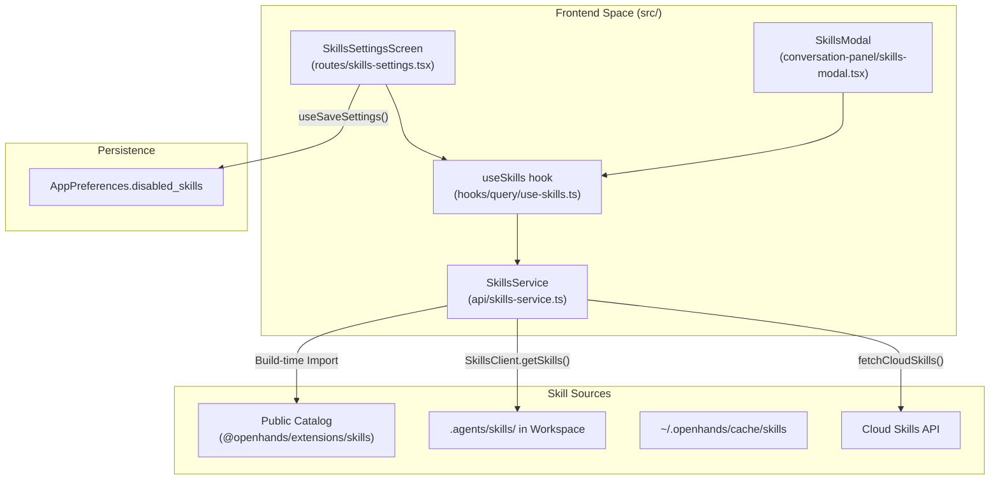
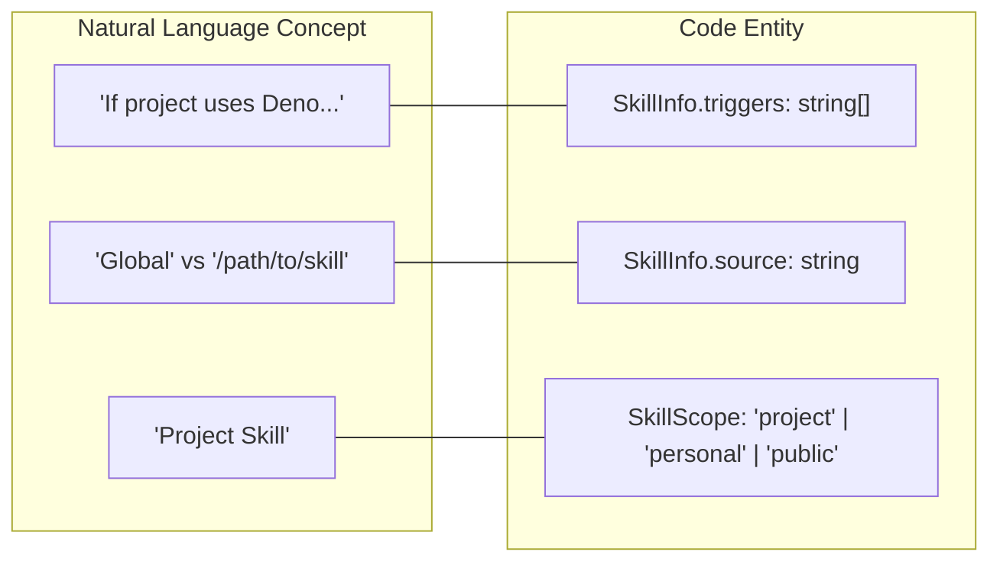

# Skills System

Relevant source files

The following files were used as context for generating this wiki page:

- [__tests__/components/automations/create-instructions.test.tsx](__tests__/components/automations/create-instructions.test.tsx)
- [__tests__/components/features/conversation-panel/conversation-lg-modals-viewport.test.tsx](__tests__/components/features/conversation-panel/conversation-lg-modals-viewport.test.tsx)
- [__tests__/components/features/skills/get-skill-chat-launch-message.test.ts](__tests__/components/features/skills/get-skill-chat-launch-message.test.ts)
- [__tests__/components/features/skills/skill-card-pill-row.test.tsx](__tests__/components/features/skills/skill-card-pill-row.test.tsx)
- [__tests__/components/features/skills/skill-detail-modal.test.tsx](__tests__/components/features/skills/skill-detail-modal.test.tsx)
- [__tests__/components/modals/skills/skill-modal.test.tsx](__tests__/components/modals/skills/skill-modal.test.tsx)
- [__tests__/i18n/translation-completeness.test.ts](__tests__/i18n/translation-completeness.test.ts)
- [__tests__/routes/skills-settings.test.tsx](__tests__/routes/skills-settings.test.tsx)
- [__tests__/stores/conversation-store.test.ts](__tests__/stores/conversation-store.test.ts)
- [__tests__/utils/skill-scope.test.ts](__tests__/utils/skill-scope.test.ts)
- [src/components/features/automations/create-instructions.tsx](src/components/features/automations/create-instructions.tsx)
- [src/components/features/chat/interactive-chat-box.tsx](src/components/features/chat/interactive-chat-box.tsx)
- [src/components/features/chat/open-repository-modal.tsx](src/components/features/chat/open-repository-modal.tsx)
- [src/components/features/chat/uploaded-files.tsx](src/components/features/chat/uploaded-files.tsx)
- [src/components/features/conversation-panel/hooks-modal-header.tsx](src/components/features/conversation-panel/hooks-modal-header.tsx)
- [src/components/features/conversation-panel/hooks-modal.tsx](src/components/features/conversation-panel/hooks-modal.tsx)
- [src/components/features/conversation-panel/plugins-modal.tsx](src/components/features/conversation-panel/plugins-modal.tsx)
- [src/components/features/conversation-panel/skill-item.tsx](src/components/features/conversation-panel/skill-item.tsx)
- [src/components/features/conversation-panel/skill-triggers.tsx](src/components/features/conversation-panel/skill-triggers.tsx)
- [src/components/features/conversation-panel/skills-modal-header.tsx](src/components/features/conversation-panel/skills-modal-header.tsx)
- [src/components/features/conversation-panel/skills-modal-section.tsx](src/components/features/conversation-panel/skills-modal-section.tsx)
- [src/components/features/conversation-panel/skills-modal.tsx](src/components/features/conversation-panel/skills-modal.tsx)
- [src/components/features/conversation-panel/system-message-modal.tsx](src/components/features/conversation-panel/system-message-modal.tsx)
- [src/components/features/conversation-panel/system-message-modal/system-message-header.tsx](src/components/features/conversation-panel/system-message-modal/system-message-header.tsx)
- [src/components/features/mcp-page/mcp-section-filter-dropdown.tsx](src/components/features/mcp-page/mcp-section-filter-dropdown.tsx)
- [src/components/features/skills/skill-card-pill-row.tsx](src/components/features/skills/skill-card-pill-row.tsx)
- [src/constants/skills-docs.ts](src/constants/skills-docs.ts)
- [src/hooks/chat/use-chat-input-logic.ts](src/hooks/chat/use-chat-input-logic.ts)
- [src/hooks/use-launch-skill-in-chat.ts](src/hooks/use-launch-skill-in-chat.ts)
- [src/stores/conversation-store.ts](src/stores/conversation-store.ts)
- [src/utils/sdk-settings-field-metadata.test.ts](src/utils/sdk-settings-field-metadata.test.ts)

The Skills System provides a centralized mechanism for discovering, managing, and loading agent capabilities. Skills are reusable code snippets, instructions, or knowledge bases that extend agent capabilities through keyword or task-based triggers. The system coordinates between the frontend (Agent Canvas), the agent-server (executing inside sandboxes), and a bundled catalog of public skills.

## System Architecture

The architecture uses a multi-tiered discovery model where skills are aggregated from local files, remote organization repositories, and a build-time snapshot of public skills.

### Natural Language to Code Entity Space: Architecture

**Sources:** [src/api/skills-service.ts:1-67](), [src/routes/skills-settings.tsx:41-65](), [src/components/features/conversation-panel/skills-modal.tsx:30-48]()

## Skill Discovery and Loading

Skills are loaded from multiple scopes. When skills with the same name exist in multiple sources, the system categorizes them by scope to help users understand their origin.

### Skill Scopes and Priority

| Scope | Location | Description |
|-------|----------|-------------|
| **Public** | `@openhands/extensions` | Immutable build-time snapshot bundled with the frontend [src/api/skills-service.ts:26-34](). |
| **User/Personal** | `~/.openhands/cache/skills` | User-specific skills stored in the local home directory. |
| **Project/Repo** | `.agents/skills/` | Project-specific skills bundled within the active workspace [src/api/agent-server-config.ts:6-7](). |
| **Cloud** | Remote Backend | Managed skills provided by the OpenHands Cloud platform [src/api/skills-service.ts:38-40](). |

**Sources:** [src/api/skills-service.ts:12-64](), [src/components/features/conversation-panel/skills-modal.tsx:24-28]()

### Skills Service API

The `SkillsService` class acts as the primary orchestrator for skill retrieval. It differentiates between Cloud and Local backends:

- **Cloud Mode**: Directly calls `fetchCloudSkills()` to retrieve managed skills [src/api/skills-service.ts:38-40]().
- **Local Mode**: Combines the bundled `PUBLIC_SKILLS` catalog with local skills fetched from the agent-server via the `SkillsClient` from `@openhands/typescript-client` [src/api/skills-service.ts:46-63]().

**Sources:** [src/api/skills-service.ts:36-65]()

## UI Components and Data Flow

### Skills Settings Route
The `skills-settings` route provides a full-page management interface for discovering and enabling/disabling skills.

- **SkillCard**: Displays skill metadata including `description`, `source`, `triggers`, and `type` [__tests__/routes/skills-settings.test.tsx:151-170]().
- **SkillTypeBadge**: Visual indicator of the skill category (e.g., "knowledge") [__tests__/routes/skills-settings.test.tsx:167-170]().
- **SkillsToolbar**: Provides search and filter capabilities [src/components/features/skills/skills-toolbar.tsx:1-22]().
- **Search and URL Sync**: The route uses `useSearchParams` to sync the `q` parameter with the search input. It implements a debounced write to the URL to prevent excessive history entries [src/routes/skills-settings.tsx:88-109]().

**Sources:** [src/routes/skills-settings.tsx:39-165](), [src/components/features/skills/skills-toolbar.tsx:1-81]()

### Skills Modal
The `SkillsModal` is accessible from the conversation panel, allowing users to view skills currently active in their session.

- **SkillItem**: A collapsible list item showing the skill name and a toggle for details [src/components/features/conversation-panel/skills-modal.tsx:104-109]().
- **Filtering**: The modal uses `useSkillEnabledFilter` to only display skills that are not explicitly disabled in `AppPreferences` [src/components/features/conversation-panel/skills-modal.tsx:49-52]().
- **Grouping**: Uses `groupSkillsByScope` to organize the display into Project, Personal, and Public sections [src/components/features/conversation-panel/skills-modal.tsx:54-57]().

**Sources:** [src/components/features/conversation-panel/skills-modal.tsx:30-122]()

### Skill Launch in Chat
Skills can be launched directly into a conversation or pre-filled into the Home composer using action hooks and the conversation store.

- **useLaunchSkillInChat**: Pre-fills the chat input with skill execution commands (e.g., `/docker`, `/deno`) [__tests__/components/features/skills/skill-detail-modal.test.tsx:147-172]().
- **Message Dispatch**: Interacts with `useConversationStore` to queue message payloads targeting either active conversations or the home composer [src/hooks/chat/use-chat-input-logic.ts:43-50]().

**Sources:** [src/hooks/chat/use-chat-input-logic.ts:43-50](), [__tests__/components/features/skills/skill-detail-modal.test.tsx:147-172]()

### Extensions Navigation
The `ExtensionsNavigation` component provides the sidebar links for "MCP Servers", "Skills", and "Plugins". 

- **Cloud Handling**: On Cloud backends, "Plugins" and "Extensions" are hidden [src/components/features/skills/extensions-navigation.tsx:19-20](). The "Skills" link is transformed into an external `<a>` tag pointing to the Cloud dashboard [src/components/features/skills/extensions-navigation.tsx:112-135]().
- **Mobile Support**: The `ExtensionsMobileHub` provides a similar navigation structure optimized for mobile viewports [src/components/features/skills/extensions-mobile-hub.tsx:23-84]().

**Sources:** [src/components/features/skills/extensions-navigation.tsx:16-165](), [src/routes/extensions-hub.tsx:5-13]()

## Implementation Detail: NL to Code Entity Space

**Sources:** [src/api/skills-service.ts:12-23](), [__tests__/routes/skills-settings.test.tsx:47-65]()

## Hooks and State Management

- **useSkills**: A TanStack Query hook that fetches the aggregate list of all available skills for the settings page.
- **useConversationSkills**: A specialized hook that scopes the skill catalog to the active conversation's workspace, ensuring the UI matches the agent's runtime capabilities [src/components/features/conversation-panel/skills-modal.tsx:38-44]().
- **useSkillEnablement / useSkillEnabledFilter**: Manages the `disabled_skills` and `enabled_skills` preference configurations derived from `AppPreferences` [src/components/features/conversation-panel/skills-modal.tsx:49-52]().
- **Search Sync**: The `SkillsSettingsScreen` uses a debounced effect to sync the search input with the `q` URL search parameter, allowing for shareable filtered views [src/routes/skills-settings.tsx:88-109]().

**Sources:** [src/routes/skills-settings.tsx:41-57](), [src/components/features/conversation-panel/skills-modal.tsx:38-52]()