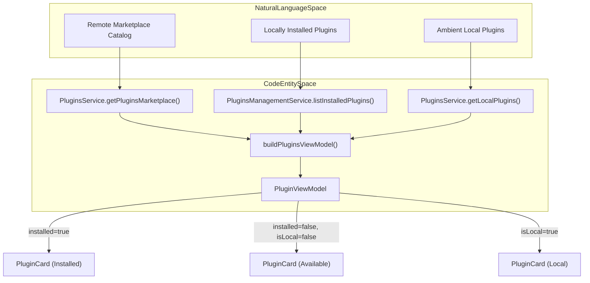
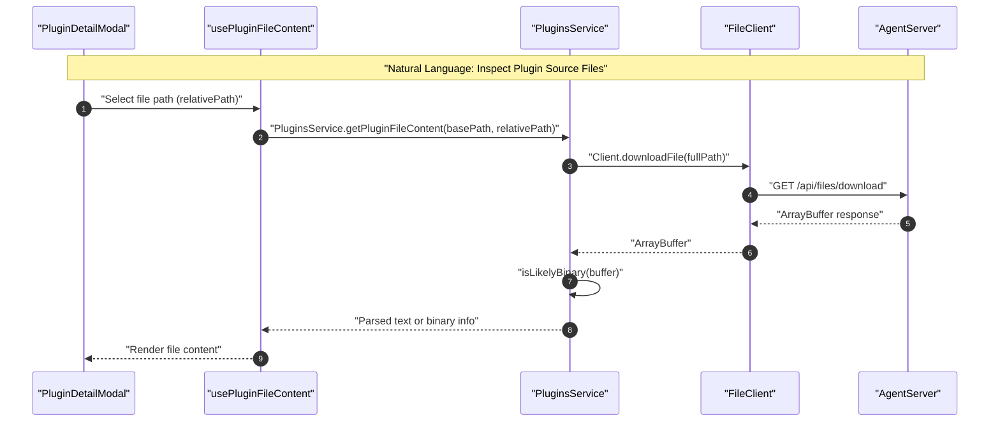

# Plugins System

Relevant source files

The following files were used as context for generating this wiki page:

- [__tests__/components/automations/toggle-switch.test.tsx](__tests__/components/automations/toggle-switch.test.tsx)
- [__tests__/components/features/launch/plugin-launch-modal.test.tsx](__tests__/components/features/launch/plugin-launch-modal.test.tsx)
- [__tests__/components/features/plugins/build-plugins-view-model.test.ts](__tests__/components/features/plugins/build-plugins-view-model.test.ts)
- [__tests__/components/features/plugins/plugin-files-section.test.tsx](__tests__/components/features/plugins/plugin-files-section.test.tsx)
- [__tests__/components/features/plugins/plugins-toolbar.test.tsx](__tests__/components/features/plugins/plugins-toolbar.test.tsx)
- [__tests__/hooks/mutation/use-install-canvas-extension.test.ts](__tests__/hooks/mutation/use-install-canvas-extension.test.ts)
- [__tests__/hooks/mutation/use-plugin-mutations.test.ts](__tests__/hooks/mutation/use-plugin-mutations.test.ts)
- [__tests__/routes/canvas-extensions.test.tsx](__tests__/routes/canvas-extensions.test.tsx)
- [__tests__/routes/launch.test.tsx](__tests__/routes/launch.test.tsx)
- [__tests__/routes/plugins-page.test.tsx](__tests__/routes/plugins-page.test.tsx)
- [__tests__/utils/api-error-message.test.ts](__tests__/utils/api-error-message.test.ts)
- [docs/CANVAS_EXTENSIONS_TESTING.md](docs/CANVAS_EXTENSIONS_TESTING.md)
- [src/api/plugins-management-service.ts](src/api/plugins-management-service.ts)
- [src/api/plugins-service.test.ts](src/api/plugins-service.test.ts)
- [src/api/plugins-service.ts](src/api/plugins-service.ts)
- [src/components/features/launch/plugin-launch-modal.tsx](src/components/features/launch/plugin-launch-modal.tsx)
- [src/components/features/plugins/build-plugins-view-model.ts](src/components/features/plugins/build-plugins-view-model.ts)
- [src/components/features/plugins/plugin-card.tsx](src/components/features/plugins/plugin-card.tsx)
- [src/components/features/plugins/plugin-detail-modal.tsx](src/components/features/plugins/plugin-detail-modal.tsx)
- [src/components/features/plugins/plugin-files-section.tsx](src/components/features/plugins/plugin-files-section.tsx)
- [src/components/features/plugins/plugins-toolbar.tsx](src/components/features/plugins/plugins-toolbar.tsx)
- [src/hooks/mutation/use-install-plugin.ts](src/hooks/mutation/use-install-plugin.ts)
- [src/hooks/mutation/use-manage-canvas-extensions.ts](src/hooks/mutation/use-manage-canvas-extensions.ts)
- [src/hooks/mutation/use-refresh-plugin.ts](src/hooks/mutation/use-refresh-plugin.ts)
- [src/hooks/mutation/use-set-plugin-enabled.ts](src/hooks/mutation/use-set-plugin-enabled.ts)
- [src/hooks/mutation/use-uninstall-plugin.ts](src/hooks/mutation/use-uninstall-plugin.ts)
- [src/utils/api-error-message.ts](src/utils/api-error-message.ts)
- [src/utils/custom-toast-handlers.tsx](src/utils/custom-toast-handlers.tsx)

The Plugins System provides a mechanism for discovering, installing, and managing extensions that enhance agent capabilities. It reconciles a dynamic marketplace catalog with locally-installed plugins and ambient "local" plugins found in the user's environment.

---

## 1. Architecture and Data Flow

The frontend interacts with the plugin system through two primary service layers: `PluginsService` for read-only discovery and file inspection [src/api/plugins-service.ts:1-150](), and `PluginsManagementService` for lifecycle operations like installation and enabling/disabling [src/api/plugins-management-service.ts:1-136]().

### Plugin Reconciliation Model
The system uses `buildPluginsViewModel` to merge data from three distinct sources into a unified UI state [src/components/features/plugins/build-plugins-view-model.ts:51-130]().

| Source | Entity Type | Role | Code Reference |
| :--- | :--- | :--- | :--- |
| **Marketplace** | `MarketplacePlugin` | Remote catalog of available plugins | [src/api/plugins-service.ts:21-31]() |
| **Installed** | `InstalledPluginInfo` | Plugins explicitly installed to disk | [src/api/plugins-management-service.ts:13-25]() |
| **Local** | `LocalPlugin` | Ambient plugins discovered in workspace paths | [src/api/plugins-service.ts:41-48]() |

### Diagram: Plugin Reconciliation Architecture
The following diagram bridges natural language concepts of plugin discovery to their concrete code entities and service functions in the codebase.

**Sources:** [src/components/features/plugins/build-plugins-view-model.ts:51-130](), [src/api/plugins-service.ts:67-117](), [src/api/plugins-management-service.ts:13-25]()

---

## 2. Frontend Components and Routing

### SkillsPluginsScreen (`/settings/skills/plugins`)
The main route orchestrates the fetching of plugin data using TanStack Query hooks (`usePluginsMarketplace`, `usePlugins`, and `useLocalPlugins`) [__tests__/routes/plugins-page.test.tsx:5-10]().

- **PluginsToolbar**: Provides real-time free-text search input and status filtering (`all`, `installed`, `available`, `local`) [src/components/features/plugins/plugins-toolbar.tsx:14-97]().
- **PluginCard**: Renders individual plugin metadata, source paths, version pills, and action buttons (`CirclePlusCheckToggle` for installed plugins or `BrandButton` for marketplace installs) [src/components/features/plugins/plugin-card.tsx:25-132]().
- **PluginDetailModal**: Provides a comprehensive modal view displaying the plugin description, source metadata, bundled tools/skills, and an integrated file inspection section [src/components/features/plugins/plugin-detail-modal.tsx:26-141]().

**Sources:** [src/components/features/plugins/plugins-toolbar.tsx:1-98](), [src/components/features/plugins/plugin-card.tsx:1-133](), [src/components/features/plugins/plugin-detail-modal.tsx:1-181]()

---

## 3. API and Service Layer

### PluginsService
Handles read-only communication with the `PluginsClient` and `FileClient` from the `@openhands/typescript-client` [src/api/plugins-service.ts:1-66]().

- `getPluginsMarketplace()`: Fetches the dynamic catalog [src/api/plugins-service.ts:76-91]().
- `getLocalPlugins()`: Fetches ambient plugins found in user directories [src/api/plugins-service.ts:104-117]().
- `getPluginFileContent(basePath, relativePath)`: Downloads a specific file and evaluates binary safety via null-byte inspection heuristics [src/api/plugins-service.ts:56-65](), [src/api/plugins-service.ts:127-147]().

### PluginsManagementService
Drives mutation endpoints on the agent-server [src/api/plugins-management-service.ts:1-135]().

- `installPlugin(request)`: Installs a plugin from a git or local source [src/api/plugins-management-service.ts:92-101]().
- `setPluginEnabled(name, enabled)`: Toggles automatic loading into new conversations [src/api/plugins-management-service.ts:103-113]().
- `uninstallPlugin(name)`: Removes an installed plugin [src/api/plugins-management-service.ts:115-122]().
- `refreshPlugin(name)`: Triggers a re-pull or re-load of an installed plugin [src/api/plugins-management-service.ts:124-133]().

### Diagram: Plugin File Inspection Sequence
The sequence below maps natural language file inspection to code entities involved in downloading and rendering plugin files.

**Sources:** [src/api/plugins-service.ts:127-147](), [src/hooks/query/use-plugin-file-content.ts:9-23](), [src/components/features/plugins/plugin-detail-modal.tsx:138-140]()

---

## 4. Plugin Mutation Hooks

State modifications are encapsulated in TanStack Query mutation hooks that handle cache invalidation and user toast feedback [src/hooks/mutation/use-install-plugin.ts:1-46](), [src/hooks/mutation/use-uninstall-plugin.ts]().

- **`useInstallPlugin`**: Invokes `PluginsManagementService.installPlugin`, invalidates installed and marketplace query keys, and handles `409 Conflict` errors by prompting the user to update or uninstall via the detail modal [src/hooks/mutation/use-install-plugin.ts:20-45]().
- **`useRefreshPlugin`**: Re-installs an app from its recorded source coordinates (`force=true`) [__tests__/hooks/mutation/use-install-canvas-extension.test.ts:54-72]().
- **`useSetPluginEnabled`**: Updates the enabled/disabled state of installed plugins [__tests__/routes/plugins-page.test.tsx:150-166]().
- **`useUninstallPlugin`**: Removes installed plugins and triggers query refetching [__tests__/routes/plugins-page.test.tsx:168-187]().

**Sources:** [src/hooks/mutation/use-install-plugin.ts:1-46](), [__tests__/hooks/mutation/use-plugin-mutations.test.ts:1-172]()

---

## 5. Plugin Launch Modal and Routing

Plugins can be launched directly into a new conversation session via the `/launch` route and `PluginLaunchModal` [__tests__/routes/launch.test.tsx:1-154]().

- **Query Parameter Parsing**: Decodes base64-encoded plugin specs (`?plugins=...`) or simple query parameters (`?plugin_source=...&plugin_ref=...`) [__tests__/routes/launch.test.tsx:63-146]().
- **Security Sanitization**: Sanitizes incoming launch messages to prevent XSS injection or malicious payload execution before initializing conversation creation [__tests__/routes/launch.test.tsx:156-190]().

**Sources:** [__tests__/routes/launch.test.tsx:1-190](), [src/utils/plugin-launch-url.ts:1-17]()

---

## 6. Constraints and Error Handling

- **Local Backend Constraint**: Most plugin management and file reading features require direct filesystem access, restricting them to local backend configurations [src/api/plugins-management-service.ts:71-75]().
- **De-duplication**: If a plugin is discovered as both local and installed, the managed installed entry takes precedence in `buildPluginsViewModel` [src/components/features/plugins/build-plugins-view-model.ts:98-101]().
- **Error Formatting**: API failures utilize `getApiErrorMessage` and `displayApiErrorToast` to extract FastAPI validation errors or server exception details cleanly without exposing raw transport text [src/utils/api-error-message.ts:70-113](), [src/utils/custom-toast-handlers.tsx:125-132]().

**Sources:** [src/utils/api-error-message.ts:70-113](), [src/utils/custom-toast-handlers.tsx:125-132](), [src/components/features/plugins/build-plugins-view-model.ts:51-130]()