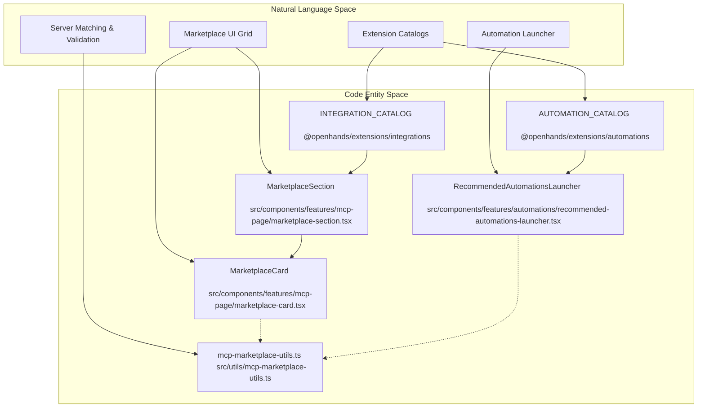
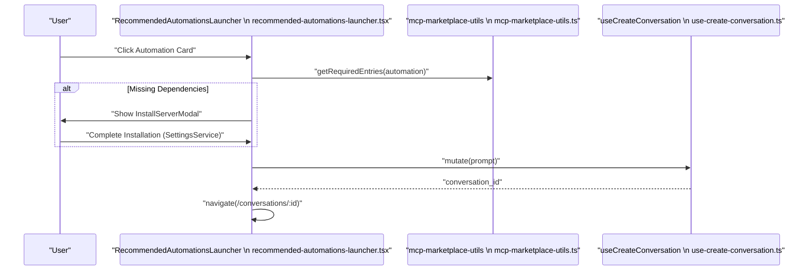

# MCP Marketplace

Relevant source files

The following files were used as context for generating this wiki page:

- [__tests__/components/automations/recommended-automations.test.tsx](__tests__/components/automations/recommended-automations.test.tsx)
- [__tests__/constants/extensions-catalogs.test.ts](__tests__/constants/extensions-catalogs.test.ts)
- [__tests__/utils/mcp-marketplace-utils.test.ts](__tests__/utils/mcp-marketplace-utils.test.ts)
- [src/components/features/automations/recommended-automations-launcher.tsx](src/components/features/automations/recommended-automations-launcher.tsx)
- [src/components/features/automations/recommended-automations-section.tsx](src/components/features/automations/recommended-automations-section.tsx)
- [src/components/features/mcp-logo-badge.tsx](src/components/features/mcp-logo-badge.tsx)
- [src/components/features/mcp-page/installed-server-card.tsx](src/components/features/mcp-page/installed-server-card.tsx)
- [src/components/features/mcp-page/installed-servers-section.tsx](src/components/features/mcp-page/installed-servers-section.tsx)
- [src/components/features/mcp-page/marketplace-card.tsx](src/components/features/mcp-page/marketplace-card.tsx)
- [src/components/features/mcp-page/marketplace-section.tsx](src/components/features/mcp-page/marketplace-section.tsx)
- [src/components/features/mcp-page/mcp-logo-stack-badge.tsx](src/components/features/mcp-page/mcp-logo-stack-badge.tsx)
- [src/utils/mcp-marketplace-utils.ts](src/utils/mcp-marketplace-utils.ts)

The MCP Marketplace provides a user interface for discovering, installing, and managing Model Context Protocol (MCP) servers and pre-built automations that leverage these servers. It serves as the primary extension catalog within Agent Canvas, allowing users to expand agent capabilities with tools like Slack, GitHub, Linear, and Tavily.

## Architecture and Data Flow

The marketplace is built on top of static catalogs defined in the `@openhands/extensions` package (`INTEGRATION_CATALOG` and `AUTOMATION_CATALOG`). It bridges these static definitions with the active runtime state (installed servers and secrets) managed by `SettingsService` and `McpService`.

### Marketplace Discovery and Code Mapping

The following diagram bridges natural language discovery concepts to the exact code entities implementing the MCP marketplace architecture.

Title: "MCP Marketplace Architecture & Code Mapping"

Sources: [src/components/features/mcp-page/marketplace-section.tsx:1-73](), [src/components/features/automations/recommended-automations-launcher.tsx:1-45](), [src/utils/mcp-marketplace-utils.ts:1-184]()

## Key Components

### Marketplace UI Components

*   **`MarketplaceSection`**: The top-level container for the MCP library. It handles filtering and sorting entries by popularity using `getMarketplaceEntriesByPopularity` [src/components/features/mcp-page/marketplace-section.tsx:32-35](), [src/utils/mcp-marketplace-utils.ts:9-10]().
*   **`MarketplaceCard`**: Renders an individual integration from the catalog. It displays the transport type (e.g., `STDIO`, `HTTP`, `SSE`) and provides an add toggle button [src/components/features/mcp-page/marketplace-card.tsx:24-36](), [src/components/features/mcp-page/marketplace-card.tsx:72-82]().
*   **`McpLogoBadge`**: A specialized component for rendering integration logos. It handles remote URLs from the catalog, falling back to bundled local icons (like Slack) or a default bot icon if the remote URL fails to load [src/components/features/mcp-page/mcp-logo-badge.tsx:32-79]().
*   **`McpLogoStackBadge`**: Used in automation cards to show multiple integrations at once. It supports different layouts: single logo, overlapping pair, or a 2x2 quadrant grid for 3-4 logos [src/components/features/mcp-page/mcp-logo-stack-badge.tsx:40-106]().
*   **`InstalledServerCard`**: Displays servers currently configured in `mcp_config`. It shows real-time health status via `McpServerHealthSection` and allows toggling the server's enabled state without deleting the configuration [src/components/features/mcp-page/installed-server-card.tsx:49-142]().
*   **`InstalledServersSection`**: Renders the list of installed MCP servers or empty state handlers when search queries yield no matches [src/components/features/mcp-page/installed-servers-section.tsx:27-85]().

Sources: [src/components/features/mcp-page/marketplace-section.tsx:1-73](), [src/components/features/mcp-page/marketplace-card.tsx:1-91](), [src/components/features/mcp-page/mcp-logo-badge.tsx:1-82](), [src/components/features/mcp-page/mcp-logo-stack-badge.tsx:1-106](), [src/components/features/mcp-page/installed-server-card.tsx:1-142](), [src/components/features/mcp-page/installed-servers-section.tsx:1-85]()

## Recommended Automations Launcher

The `RecommendedAutomationsLauncher` surfaces MCP-backed automations (e.g., GitHub PR monitors). It manages the complex state of ensuring all required MCP servers are installed before launching a conversation [src/components/features/automations/recommended-automations-launcher.tsx:86-162]().

*   **Dependency Resolution**: It uses `getRequiredEntries` to determine which catalog integrations are needed for a specific automation [src/components/features/automations/recommended-automations-launcher.tsx:64-68]().
*   **Install Queue**: If dependencies are missing, it populates an `installQueue` and presents the `InstallServerModal` to the user before proceeding [src/components/features/automations/recommended-automations-launcher.tsx:111-112](), [src/components/features/automations/recommended-automations-launcher.tsx:25-25]().
*   **Conversation Injection**: Once dependencies are met, it creates a new conversation and injects a specialized prompt to trigger the automation workflow [src/components/features/automations/recommended-automations-launcher.tsx:139-165]().

Sources: [src/components/features/automations/recommended-automations-launcher.tsx:1-173](), [src/components/features/automations/recommended-automations-section.tsx:1-100]()

## Implementation Utilities

The `src/utils/mcp-marketplace-utils.ts` file contains core logic for matching catalog entries against runtime configuration.

| Function | Purpose |
| :--- | :--- |
| `getMcpMarketplaceCatalog` | Filters the raw integration catalog for entries that support MCP [src/utils/mcp-marketplace-utils.ts:110-114](). |
| `findInstalledEntryMatch` | Checks if a specific catalog entry is already configured in the user's `MCPServerConfig` list [src/utils/mcp-marketplace-utils.ts:175-184](). |
| `urlsMatch` | A defensive URL comparison utility that ignores trailing slashes and query parameters when matching HTTP/SSE servers [src/utils/mcp-marketplace-utils.ts:145-159](). |
| `isMcpInstallableEntry` | Determines if a catalog entry has connection options compatible with the current backend [src/utils/mcp-marketplace-utils.ts:122-124](). |
| `getInstallableMcpConnectionOption` | Prefers local-compatible transports (like `stdio`) over provider-hosted OAuth for local backends [src/utils/mcp-marketplace-utils.ts:66-70](). |

Sources: [src/utils/mcp-marketplace-utils.ts:1-210]()

## Data Flow: Automation Launch Sequence

The following diagram bridges the automation launch requirements to code execution pathways within `RecommendedAutomationsLauncher` and `mcp-marketplace-utils.ts`.

Title: "Automation Launch & Dependency Resolution Sequence"

Sources: [src/components/features/automations/recommended-automations-launcher.tsx:64-162](), [src/utils/mcp-marketplace-utils.ts:175-184]()

## Extensions Catalog Constants

The marketplace is driven by two primary catalogs imported from `@openhands/extensions`:

1.  **`INTEGRATION_CATALOG`**: Contains definitions for tools like Slack, GitHub, and Linear. It includes metadata like `logoUrl`, `docsUrl`, and `connectionOptions` (transport types and auth strategies) [__tests__/constants/extensions-catalogs.test.ts:3-11]().
2.  **`AUTOMATION_CATALOG`**: Contains pre-defined agent workflows. Each automation maps to one or more `integrationIds` from the integration catalog [__tests__/constants/extensions-catalogs.test.ts:2-15]().

Sources: [__tests__/constants/extensions-catalogs.test.ts:1-40](), [src/components/features/automations/recommended-automations-section.tsx:6-12]()