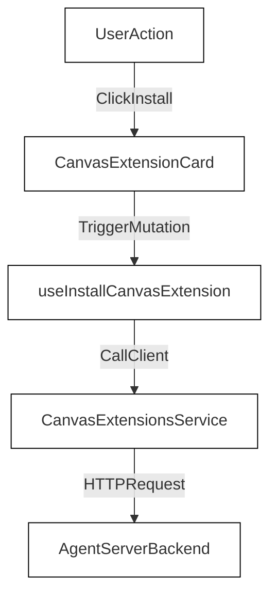
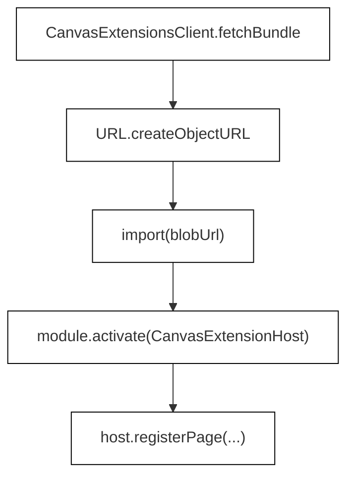

# Canvas Extensions

Relevant source files

The following files were used as context for generating this wiki page:

- [__tests__/components/onboarding/onboarding-preview.test.ts](__tests__/components/onboarding/onboarding-preview.test.ts)
- [__tests__/components/shared/modals/modal-backdrop.test.tsx](__tests__/components/shared/modals/modal-backdrop.test.tsx)
- [__tests__/hooks/mutation/use-install-canvas-extension.test.ts](__tests__/hooks/mutation/use-install-canvas-extension.test.ts)
- [__tests__/hooks/mutation/use-plugin-mutations.test.ts](__tests__/hooks/mutation/use-plugin-mutations.test.ts)
- [__tests__/hooks/use-telemetry.test.tsx](__tests__/hooks/use-telemetry.test.tsx)
- [__tests__/utils/api-error-message.test.ts](__tests__/utils/api-error-message.test.ts)
- [specs/canvas-extensions.md](specs/canvas-extensions.md)
- [src/api/canvas-extensions-service.test.ts](src/api/canvas-extensions-service.test.ts)
- [src/api/canvas-extensions-service.ts](src/api/canvas-extensions-service.ts)
- [src/components/features/analytics/telemetry-consent-banner.tsx](src/components/features/analytics/telemetry-consent-banner.tsx)
- [src/components/features/canvas-extensions/canvas-extension-card.tsx](src/components/features/canvas-extensions/canvas-extension-card.tsx)
- [src/components/features/canvas-extensions/canvas-extensions-runtime.test.tsx](src/components/features/canvas-extensions/canvas-extensions-runtime.test.tsx)
- [src/components/features/canvas-extensions/canvas-extensions-runtime.tsx](src/components/features/canvas-extensions/canvas-extensions-runtime.tsx)
- [src/components/features/onboarding/onboarding-preview.ts](src/components/features/onboarding/onboarding-preview.ts)
- [src/components/shared/modals/modal-backdrop.tsx](src/components/shared/modals/modal-backdrop.tsx)
- [src/fixtures/canvas-extensions/demo-page/extension.js](src/fixtures/canvas-extensions/demo-page/extension.js)
- [src/hooks/mutation/use-install-plugin.ts](src/hooks/mutation/use-install-plugin.ts)
- [src/hooks/mutation/use-manage-canvas-extensions.ts](src/hooks/mutation/use-manage-canvas-extensions.ts)
- [src/hooks/mutation/use-refresh-plugin.ts](src/hooks/mutation/use-refresh-plugin.ts)
- [src/hooks/mutation/use-set-plugin-enabled.ts](src/hooks/mutation/use-set-plugin-enabled.ts)
- [src/hooks/mutation/use-uninstall-plugin.ts](src/hooks/mutation/use-uninstall-plugin.ts)
- [src/hooks/use-telemetry.ts](src/hooks/use-telemetry.ts)
- [src/lib/index.ts](src/lib/index.ts)
- [src/types/canvas-extension.ts](src/types/canvas-extension.ts)
- [src/utils/api-error-message.ts](src/utils/api-error-message.ts)
- [src/utils/custom-toast-handlers.tsx](src/utils/custom-toast-handlers.tsx)
- [tests/e2e/mock-llm/canvas-extensions/mock-llm-canvas-extensions.spec.ts](tests/e2e/mock-llm/canvas-extensions/mock-llm-canvas-extensions.spec.ts)

## Purpose and Scope

Canvas Extensions are installable packages that extend the Agent Canvas frontend itself by contributing custom UI elements, routed pages, conversation panels, and rendering logic. Unlike skills and plugins—which modify the behavior and tools available to the OpenHands agent—Canvas Extensions modify the host application interface. 

This document details the architectural implementation of the Canvas Extensions subsystem, including the API client layer (`CanvasExtensionsService`), the extension runtime environment (`canvas-extensions-runtime`), management mutation hooks, UI components like `CanvasExtensionCard`, and the manifest/fixtures specification.

Sources:
- `specs/canvas-extensions.md:1-20` [specs/canvas-extensions.md]()

---

## Architecture and Service Layer (`canvas-extensions-service`)

The active Agent Server owns and stores all installed extensions. The frontend communicates with the backend via `CanvasExtensionsService` (`[src/api/canvas-extensions-service.ts:1-217]()`), which interfaces with the `/api/canvas-extensions` endpoints.

*Figure 1: Natural Language Space to Code Entity Space mapping for extension installation lifecycle.*

Sources:
- `src/api/canvas-extensions-service.ts:1-217` [src/api/canvas-extensions-service.ts]()

---

## Extension Runtime and Loading (`canvas-extensions-runtime`)

Extensions are loaded dynamically at runtime via ES module import. Because modules must carry the session API key and authenticate against the backend, the runtime fetches bundles as authenticated text and instantiates them via temporary Blob URLs (`[specs/canvas-extensions.md:106-131]()`).

*Figure 2: Extension compilation and activation data flow inside `canvas-extensions-runtime`.*

Sources:
- `src/lib/index.ts:43-59` [src/lib/index.ts]()
- `specs/canvas-extensions.md:106-131` [specs/canvas-extensions.md]()

---

## UI Components: `CanvasExtensionCard`

The `CanvasExtensionCard` component (`[src/components/features/canvas-extensions/canvas-extension-card.tsx:1-142]()`) provides the administrative interface for individual extensions within the Customize > Apps view. It renders metadata, version information, contributor route counts, a toggle switch for hot enablement, and controls for refreshing or uninstalling the extension.

Sources:
- `src/components/features/canvas-extensions/canvas-extension-card.tsx:1-142` [src/components/features/canvas-extensions/canvas-extension-card.tsx]()

---

## Install and Manage Mutation Hooks

State modifications for extensions are handled by TanStack Query mutation hooks located in `[src/hooks/mutation/use-manage-canvas-extensions.ts:1-94]`. These hooks manage cache invalidation via query keys and handle API error propagation.

- `useInstallCanvasExtension`: Submits an installation payload (`InstallCanvasExtensionRequest`), handles `409 Conflict` errors when an extension is already present, and invalidates extension query caches (`[src/hooks/mutation/use-manage-canvas-extensions.ts:25-48]()`).
- `useRefreshCanvasExtension`: Re-installs an app from recorded source coordinates with `force: true` to preserve enabled state (`[src/hooks/mutation/use-manage-canvas-extensions.ts:54-72]()`).
- `useSetCanvasExtensionEnabled`: Toggles active runtime status for a given extension name (`[src/hooks/mutation/use-manage-canvas-extensions.ts:74-81]()`).
- `useUninstallCanvasExtension`: Removes the extension bundle and metadata from the backend (`[src/hooks/mutation/use-manage-canvas-extensions.ts:83-93]()`).

Sources:
- `src/hooks/mutation/use-manage-canvas-extensions.ts:1-94` [src/hooks/mutation/use-manage-canvas-extensions.ts]()

---

## Extension Fixtures and Demo Pages

The repository includes fixtures and test cases for validating extension behavior, such as the demo page extension (`[src/fixtures/canvas-extensions/demo-page/extension.js]()`). These mock extensions provide reference implementations for manifest definitions (`canvas-extension.json`), page contributions, and lifecycle cleanup hooks.

Sources:
- `specs/canvas-extensions.md:66-115` [specs/canvas-extensions.md]()