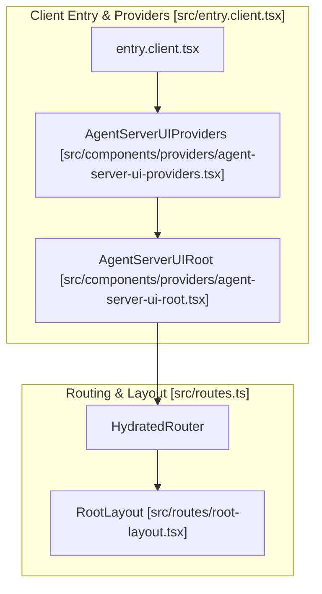
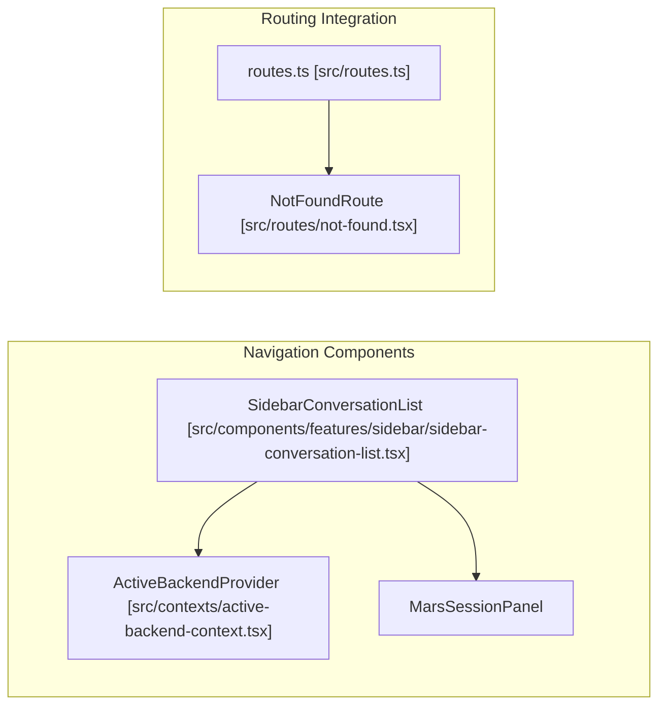
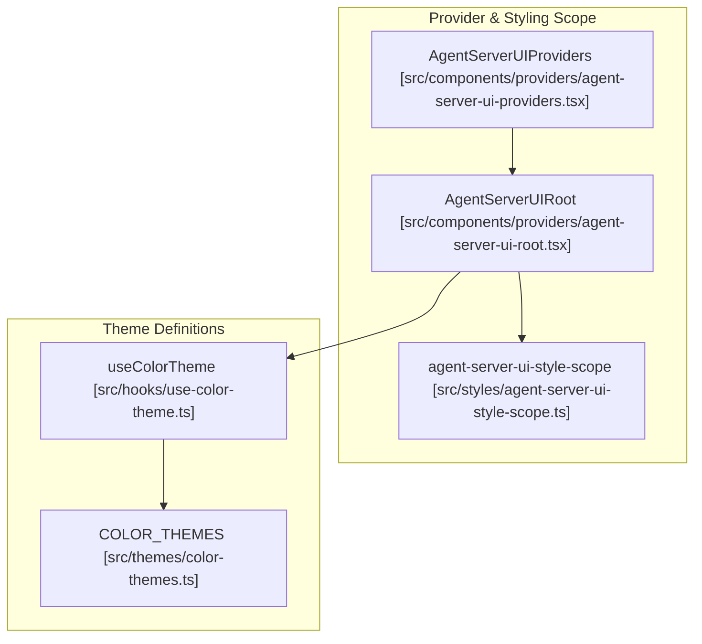

# Frontend Application Architecture

Relevant source files

The following files were used as context for generating this wiki page:

- [__tests__/agent-server-ui-providers.test.tsx](__tests__/agent-server-ui-providers.test.tsx)
- [__tests__/agent-server-ui-style-scope.test.ts](__tests__/agent-server-ui-style-scope.test.ts)
- [__tests__/hooks/query/use-cloud-current-user-id.test.tsx](__tests__/hooks/query/use-cloud-current-user-id.test.tsx)
- [__tests__/routes/not-found.test.tsx](__tests__/routes/not-found.test.tsx)
- [global.d.ts](global.d.ts)
- [src/components/features/sidebar/sidebar-conversation-list.tsx](src/components/features/sidebar/sidebar-conversation-list.tsx)
- [src/components/providers/agent-server-ui-providers.tsx](src/components/providers/agent-server-ui-providers.tsx)
- [src/components/providers/agent-server-ui-root.tsx](src/components/providers/agent-server-ui-root.tsx)
- [src/components/providers/index.ts](src/components/providers/index.ts)
- [src/entry.client.tsx](src/entry.client.tsx)
- [src/routes.ts](src/routes.ts)
- [src/routes/not-found.tsx](src/routes/not-found.tsx)

The OpenHands frontend, known as **Agent Canvas**, is a React-based single-page application (SPA) built with **Vite** and **React Router 7**. It serves as the primary interface for interacting with AI agents, managing workspaces, and orchestrating automated workflows. The application is designed to be highly portable, functioning as a standalone web app, an Electron desktop application, or an embedded library via the `@openhands/agent-canvas` package.

For details on the backend services the frontend communicates with, see [Conversation System](#7).

Sources: [src/routes.ts:1-50](), [src/entry.client.tsx:1-53]()

---

## Architecture Overview

Agent Canvas acts as a thin client that translates user intent into actions executed by the **agent-server** and **automation backend**. It is responsible for UI rendering, event streaming visualization, and state management, but it does not execute agents or host LLM credentials directly.

### System Boundaries and Service Stack
The application operates within a three-service stack, often orchestrated via an **Ingress Proxy** that routes traffic based on path prefixes:
*   `/api/automation/*` → Automation Backend
*   `/api/*` → Agent Server (OpenHands or ACP)
*   `/*` → Frontend Static Assets

### Component Relationship Diagram
This diagram maps the high-level React entry points and providers to their primary infrastructure responsibilities.

Sources: [src/entry.client.tsx:1-53](), [src/components/providers/agent-server-ui-providers.tsx:62-145](), [src/components/providers/agent-server-ui-root.tsx:21-59](), [src/routes.ts:1-50]()

---

## Application Structure and Routing

The application uses file-based routing defined via React Router 7 (`src/routes.ts`), mapping paths to components such as home views, conversation panels, settings pages, and automations. Client entry is initialized in `src/entry.client.tsx`, which wraps the application in `AgentServerUIProviders` to supply global query clients, internationalization instances, and active backend contexts.

For a comprehensive explanation of route structures, root guards in `root.tsx`, layouts, and entry-point providers, see [Application Structure and Routing](#11.1).

Sources: [src/routes.ts:1-50](), [src/entry.client.tsx:1-53](), [src/components/providers/agent-server-ui-providers.tsx:62-145]()

---

## State Management

Agent Canvas employs a dual-state strategy separating server-side data from client-side UI state. Server state is managed via TanStack Query with pre-fetching capabilities, while client-side UI states, panel preferences, error messages, and active conversation models are maintained through Zustand stores. Persistence patterns ensure layout choices and configurations survive session reloads.

For detailed documentation on Zustand stores, TanStack Query configuration, query keys, and persistence strategies, see [State Management](#11.2).

Sources: [src/components/providers/agent-server-ui-providers.tsx:62-145](), [__tests__/hooks/query/use-cloud-current-user-id.test.tsx:33-45]()

---

## Sidebar and Navigation

The navigation infrastructure accommodates both desktop rail views and mobile drawer layouts through components like `SidebarConversationList`. It integrates onboarding checklists, command menus, and dynamic settings navigation items that adapt to backend capabilities.

### Navigation Code Entity Mapping
This diagram bridges navigation concepts to the code entities responsible for rendering sidebar lists and routing.

For full details on the sidebar structure, mobile drawers, onboarding checklists, and the `CommandMenu`, see [Sidebar and Navigation](#11.3).

Sources: [src/components/features/sidebar/sidebar-conversation-list.tsx:26-55](), [src/routes.ts:1-50](), [src/routes/not-found.tsx:11-33]()

---

## Internationalization

Internationalization is powered by `i18next`, supporting multi-language bundles, translation key types (`I18nKey`), and available language definitions. Continuous integration workflows enforce translation completeness via automated validation scripts.

For details on i18next integration, translation structure, and CI validation rules, see [Internationalization](#11.4).

Sources: [src/components/providers/agent-server-ui-providers.tsx:139-144](), [__tests__/agent-server-ui-providers.test.tsx:65-87]()

---

## Theming and Styling

Styling is built on Tailwind CSS alongside HeroUI integrations, configurable color themes in `src/themes`, and scoped styles via `agent-server-ui-style-scope` for embedded deployments. Global styles and variable overrides are anchored by `AgentServerUIRoot`.

### Theming Code Entity Mapping
This diagram links styling configurations and root elements to their supporting code files.

For details on Tailwind configuration, theme colors, HeroUI integration, and styling lint rules, see [Theming and Styling](#11.5).

Sources: [src/components/providers/agent-server-ui-providers.tsx:124-136](), [src/components/providers/agent-server-ui-root.tsx:21-59](), [__tests__/agent-server-ui-style-scope.test.ts:1-52]()