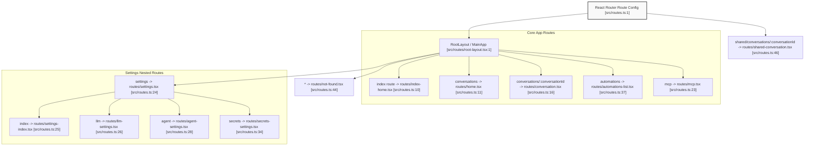
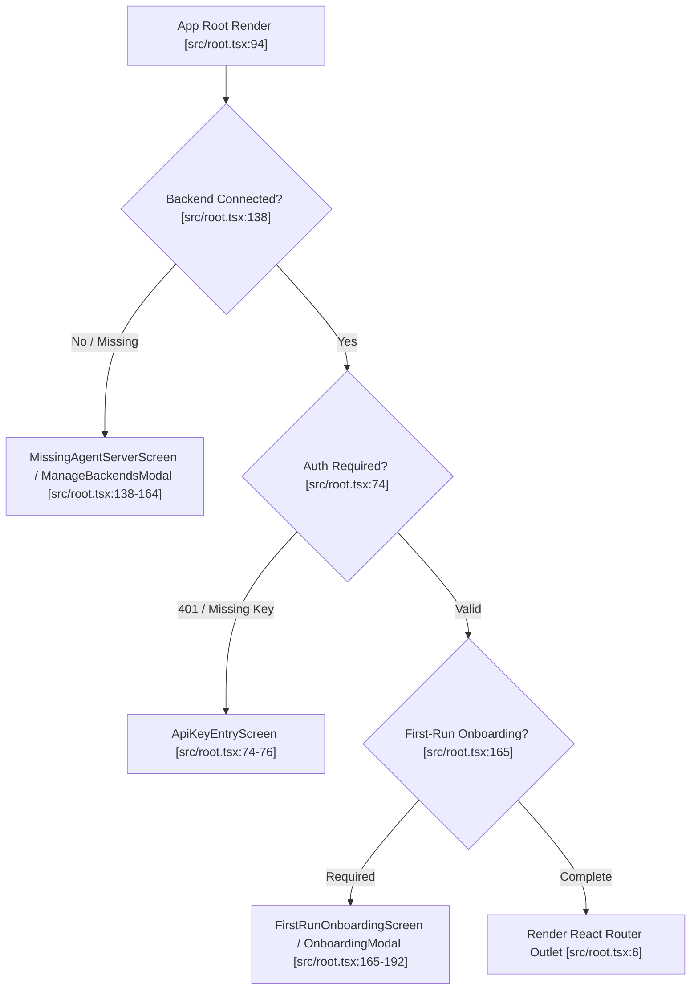
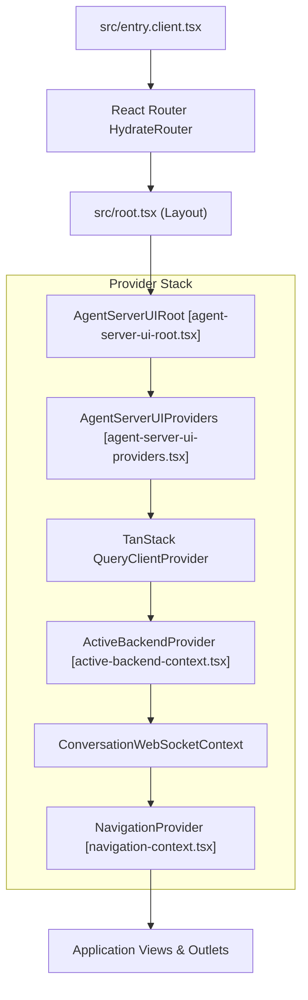
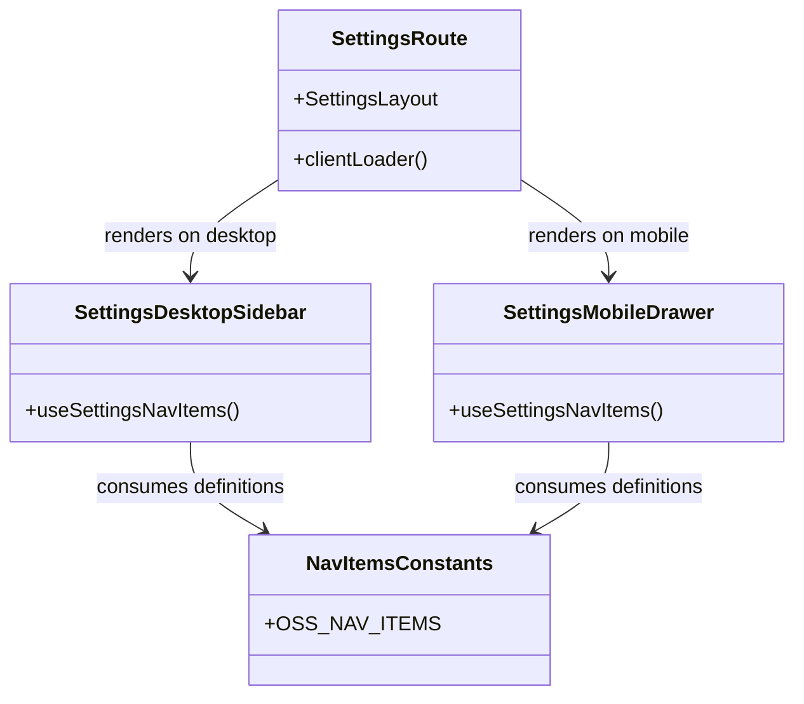

# Application Structure and Routing

Relevant source files

The following files were used as context for generating this wiki page:

- [__tests__/agent-server-ui-providers.test.tsx](__tests__/agent-server-ui-providers.test.tsx)
- [__tests__/agent-server-ui-style-scope.test.ts](__tests__/agent-server-ui-style-scope.test.ts)
- [__tests__/api/option-service.test.ts](__tests__/api/option-service.test.ts)
- [__tests__/components/backends/add-backend-modal.test.tsx](__tests__/components/backends/add-backend-modal.test.tsx)
- [__tests__/components/backends/backend-form-modal.test.tsx](__tests__/components/backends/backend-form-modal.test.tsx)
- [__tests__/components/backends/manage-backends-modal.test.tsx](__tests__/components/backends/manage-backends-modal.test.tsx)
- [__tests__/hooks/query/use-backends-health.test.tsx](__tests__/hooks/query/use-backends-health.test.tsx)
- [__tests__/hooks/query/use-cloud-current-user-id.test.tsx](__tests__/hooks/query/use-cloud-current-user-id.test.tsx)
- [__tests__/root.test.tsx](__tests__/root.test.tsx)
- [__tests__/routes/extensions-hub.test.tsx](__tests__/routes/extensions-hub.test.tsx)
- [__tests__/routes/not-found.test.tsx](__tests__/routes/not-found.test.tsx)
- [global.d.ts](global.d.ts)
- [src/api/agent-server-compatibility.ts](src/api/agent-server-compatibility.ts)
- [src/api/option-service/option-service.api.ts](src/api/option-service/option-service.api.ts)
- [src/components/features/backends/backend-form-modal.tsx](src/components/features/backends/backend-form-modal.tsx)
- [src/components/features/backends/backend-row.tsx](src/components/features/backends/backend-row.tsx)
- [src/components/features/backends/backend-version.tsx](src/components/features/backends/backend-version.tsx)
- [src/components/features/backends/manage-backends-modal.tsx](src/components/features/backends/manage-backends-modal.tsx)
- [src/components/features/manifest/manifest-subpage-layout.tsx](src/components/features/manifest/manifest-subpage-layout.tsx)
- [src/components/features/settings/settings-mobile-hub.tsx](src/components/features/settings/settings-mobile-hub.tsx)
- [src/components/features/sidebar/sidebar-conversation-list.tsx](src/components/features/sidebar/sidebar-conversation-list.tsx)
- [src/components/features/skills/extensions-mobile-hub.tsx](src/components/features/skills/extensions-mobile-hub.tsx)
- [src/components/providers/agent-server-ui-providers.tsx](src/components/providers/agent-server-ui-providers.tsx)
- [src/components/providers/agent-server-ui-root.tsx](src/components/providers/agent-server-ui-root.tsx)
- [src/components/providers/index.ts](src/components/providers/index.ts)
- [src/entry.client.tsx](src/entry.client.tsx)
- [src/hooks/query/use-backends-health.ts](src/hooks/query/use-backends-health.ts)
- [src/hooks/query/use-config.ts](src/hooks/query/use-config.ts)
- [src/hooks/use-breakpoint.ts](src/hooks/use-breakpoint.ts)
- [src/root.tsx](src/root.tsx)
- [src/routes.ts](src/routes.ts)
- [src/routes/extensions-hub.tsx](src/routes/extensions-hub.tsx)
- [src/routes/not-found.tsx](src/routes/not-found.tsx)
- [src/routes/settings-index.tsx](src/routes/settings-index.tsx)

This page details the frontend application architecture of Agent Canvas, focusing on the React Router 7 route structure (`src/routes.ts`, `src/routes/`) [src/routes.ts:1-50](), the application root guard and hydration container in `src/root.tsx` [src/root.tsx:1-192](), the root layout orchestrator (`root-layout.tsx`), the global providers (`src/entry.client.tsx`, `agent-server-ui-providers`) [src/root.tsx:106-112](), and the settings navigation subsystem.

## 1. React Router Route Structure

Agent Canvas uses **React Router 7** to manage its single-page application route tree and build-time code splitting [src/routes.ts:1-50](). The routes are defined centrally in `src/routes.ts` using nested layouts and route groupings [src/routes.ts:1-50]().

### Route Map and Hierarchy

Sources: [src/routes.ts:1-50]()

## 2. App Root Guard and Lifecycle (`root.tsx`)

The root module `src/root.tsx` implements the HTML shell (`Layout`) and acts as the top-level error/bootstrap gatekeeper [src/root.tsx:94-118](). It governs backend health validation, public mode API key entry screens, and first-run onboarding states before allowing child routes to mount [src/root.tsx:165-192]().

### Root Guard State Machine

### Key Components in `root.tsx`
- **`Layout`**: Defines the document `<html>`, `<head>`, metadata, color theme bootstrap script injection, and the root wrapper `<AgentServerUIRoot>` [src/root.tsx:94-118]().
- **`MissingAgentServerScreen`**: Rendered when the active backend is unreachable or unconfigured, opening `ManageBackendsModal` in recovery mode [src/root.tsx:138-164]().
- **`ApiKeyEntryScreen`**: Loaded lazily when public mode requires an explicit user session API key [src/root.tsx:74-76]().
- **`FirstRunOnboardingScreen`**: Evaluates whether the user needs initial configuration or guided tour steps [src/root.tsx:165-192]().

Sources: [src/root.tsx:1-192](), [src/components/features/backends/manage-backends-modal.tsx:72-174]()

## 3. Root Layout and Lifecycle (`root-layout.tsx`)

The `RootLayout` component (mapped to `routes/root-layout.tsx`) wraps all authenticated primary routes, establishing global context synchronization, telemetry binding, and structural UI chrome.

### Implementation Details
1. **Configuration Gate**: Suspends rendering via `useConfig` until global application feature flags and runtime parameters are fetched [src/hooks/query/use-config.ts:1-24]().
2. **Telemetry Synchronization**: Triggers `useSyncTelemetryConsent` and `useTelemetryIdentity` to align analytics tracking state [src/services/telemetry.ts:1-100]().
3. **Active Profile Assurance**: Executes `useEnsureActiveProfile` to ensure a default model profile is selected [src/api/backend-registry/active-store.ts:1-50]().
4. **Shell Composition**: Renders the persistent desktop rail / mobile drawer (`Sidebar`), maintenance alert banners, and the primary `<Outlet />` container [src/routes.ts:1-50]().

Sources: [src/routes.ts:1-50](), [src/hooks/query/use-config.ts:1-24]()

## 4. Providers Architecture

Agent Canvas leverages a layered provider hierarchy initialized at entry points like `src/entry.client.tsx` and consolidated via `AgentServerUIRoot` [src/root.tsx:106-112]().

### Provider Dependency Stack

### Provider Responsibilities
- **`AgentServerUIRoot`**: Injects styling scopes (`data-agent-server-ui`) and toast notification handlers [src/root.tsx:106-112]().
- **`ActiveBackendProvider`**: Manages multi-backend registry states, persistence in local storage, active backend selection, and health store synchronization [src/contexts/active-backend-context.tsx:1-100]().
- **`TanStack Query`**: Configures global caching, query invalidation, and polling intervals for server health checks (`useBackendsHealth`) [src/hooks/query/use-backends-health.ts:1-120]().

Sources: [src/root.tsx:94-118](), [src/hooks/query/use-backends-health.ts:1-120]()

## 5. Settings Navigation and Layout

The settings subsystem uses a parent layout (`routes/settings.tsx`) with nested child routes for LLM configuration, agent profiles, secrets, and application preferences [src/routes.ts:24-35]().

### Settings Entity and Navigation Structure

### Navigation Rules and Access Control
- **Navigation Items**: Defined in configuration constants and filtered dynamically by `useSettingsNavItems` based on active feature flags and backend server capabilities.
- **Client Loader Redirects**: The `clientLoader` function in `src/routes/settings.tsx` checks feature flags (e.g., `hide_llm_settings`). If an unauthorized route is requested, it redirects the user to an allowed fallback subroute [src/routes/settings.tsx:1-106]().

Sources: [src/routes.ts:24-35](), [src/routes/settings.tsx:1-106]()