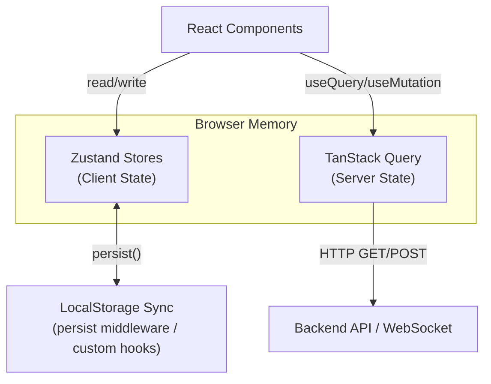
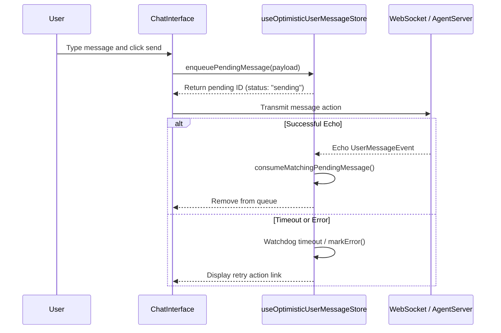
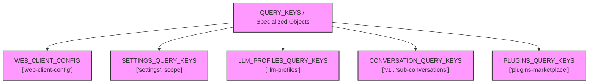
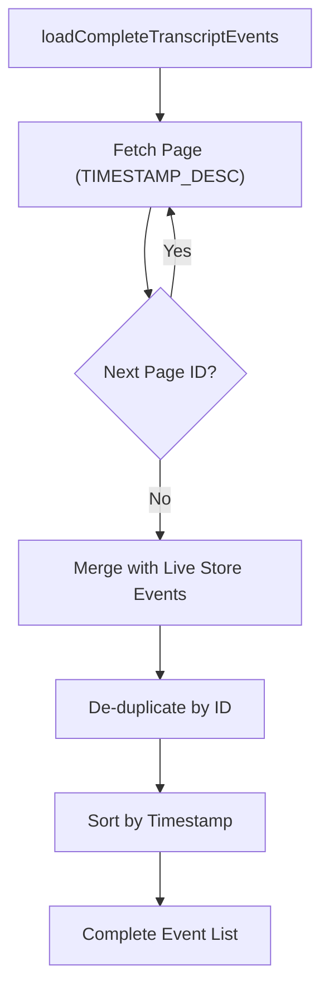

# State Management

<details>
<summary>Relevant source files</summary>

The following files were used as context for generating this wiki page:

- [__tests__/components/features/chat/pending-user-messages.test.tsx](__tests__/components/features/chat/pending-user-messages.test.tsx)
- [__tests__/components/features/chat/plan-preview.test.tsx](__tests__/components/features/chat/plan-preview.test.tsx)
- [__tests__/e2e/mock-llm-reporting.test.ts](__tests__/e2e/mock-llm-reporting.test.ts)
- [__tests__/hooks/mutation/use-mcp-server-mutations-error-toast.test.ts](__tests__/hooks/mutation/use-mcp-server-mutations-error-toast.test.ts)
- [__tests__/hooks/query/use-conversation-skills.test.tsx](__tests__/hooks/query/use-conversation-skills.test.tsx)
- [__tests__/hooks/query/use-paginated-conversations.test.tsx](__tests__/hooks/query/use-paginated-conversations.test.tsx)
- [__tests__/hooks/query/use-task-polling.test.tsx](__tests__/hooks/query/use-task-polling.test.tsx)
- [__tests__/hooks/query/use-user-conversation.test.tsx](__tests__/hooks/query/use-user-conversation.test.tsx)
- [__tests__/hooks/use-handle-build-plan-click.test.ts](__tests__/hooks/use-handle-build-plan-click.test.ts)
- [__tests__/stores/optimistic-user-message-store.test.ts](__tests__/stores/optimistic-user-message-store.test.ts)
- [src/api/cloud/proxy.test.ts](src/api/cloud/proxy.test.ts)
- [src/components/features/conversation/conversation-overview-mcp-panel.tsx](src/components/features/conversation/conversation-overview-mcp-panel.tsx)
- [src/hooks/mutation/use-add-mcp-server.ts](src/hooks/mutation/use-add-mcp-server.ts)
- [src/hooks/mutation/use-delete-mcp-server.ts](src/hooks/mutation/use-delete-mcp-server.ts)
- [src/hooks/mutation/use-save-settings.ts](src/hooks/mutation/use-save-settings.ts)
- [src/hooks/mutation/use-update-mcp-server.ts](src/hooks/mutation/use-update-mcp-server.ts)
- [src/hooks/query/query-keys.test.ts](src/hooks/query/query-keys.test.ts)
- [src/hooks/query/query-keys.ts](src/hooks/query/query-keys.ts)
- [src/hooks/query/use-paginated-conversations.ts](src/hooks/query/use-paginated-conversations.ts)
- [src/hooks/query/use-sub-conversations.ts](src/hooks/query/use-sub-conversations.ts)
- [src/hooks/query/use-task-polling.ts](src/hooks/query/use-task-polling.ts)
- [src/hooks/query/use-user-conversation.ts](src/hooks/query/use-user-conversation.ts)
- [src/query-client-config.ts](src/query-client-config.ts)
- [src/stores/optimistic-user-message-store.ts](src/stores/optimistic-user-message-store.ts)
- [tests/e2e/mock-llm/scripts/upsert-pr-comment.mjs](tests/e2e/mock-llm/scripts/upsert-pr-comment.mjs)

</details>


## Purpose and Scope

This document covers frontend state management in the OpenHands React application. It details the dual-state architecture utilizing **Zustand** for lightweight client-side global and UI state, **TanStack Query** for asynchronous server state synchronization, and custom persistence patterns targeting `localStorage` for cross-session continuity.

---

## State Management Architecture Overview

OpenHands employs a structured multi-tier state management architecture that separates concerns between browser-local client state, server-synchronized queries, and real-time event streams:

1.  **Client State (Zustand)**: Ephemeral and persistent UI state existing solely in the browser, including panel visibilities, active tabs, error banners, input drafts, and optimistic message queues.
2.  **Server State (TanStack Query)**: Data fetched from backend agent-servers and cloud APIs (settings, configurations, paginated conversations, plugins), governed by centralized query keys and jittered backoff policies [src/hooks/query/query-keys.ts:1-146](), [src/query-client-config.ts:32-92]().
3.  **Persistent UI State (LocalStorage)**: Specialized hooks and middleware synchronizing user preferences, pinned tabs, and unpinned states across page reloads [src/stores/conversation-store.ts:113-164]().



Sources: [src/hooks/query/query-keys.ts:1-146](), [src/stores/conversation-store.ts:113-200](), [src/query-client-config.ts:32-92]()

---

## Zustand Stores for Client State

OpenHands utilizes **Zustand** stores to manage granular, high-frequency UI updates without triggering React context re-renders across the entire tree.

### Key Zustand Stores

| Store | Purpose |
|-------|---------|
| `useConversationStore` | Manages active conversation UI state: right panel visibility, selected tabs, file/image upload queues, and draft messages [src/stores/conversation-store.ts:113-164](). |
| `useOptimisticUserMessageStore` | Manages optimistic user message queues (`sending`, `error`), watchdog timeouts, and content matching against incoming server echoes [src/stores/optimistic-user-message-store.ts:20-94](). |
| `useErrorMessageStore` | A global registry for error banners, allowing the UI to display and dismiss critical system errors. |
| `useBtwStore` | Manages "By The Way" (BTW) notification states and interaction tracking. |
| `useConversationPanelPreferencesStore` | Persists sidebar display preferences like `organizeMode` and `automationFilterMode`. |
| `useEventStore` | Manages live WebSocket event transcripts for active conversations. |

### Optimistic User Message Queue Mechanics
The `useOptimisticUserMessageStore` ensures instant UI feedback when users send messages. Messages are enqueued with a `sending` status and a watchdog timer (`PENDING_MESSAGE_TIMEOUT_MS`) that automatically flags timeouts [src/stores/optimistic-user-message-store.ts:18-163]().



Sources: [src/stores/optimistic-user-message-store.ts:20-163](), [src/stores/conversation-store.ts:113-164]()

---

## TanStack Query Configuration and Query Keys

**TanStack Query** manages all asynchronous server interactions. The global query client is configured with jittered exponential backoffs and specialized error/success caching interceptors [src/query-client-config.ts:32-92]().

### Centralized Query Keys
All query keys are centralized in `src/hooks/query/query-keys.ts` to guarantee type safety and prevent cache invalidation typos [src/hooks/query/query-keys.ts:1-146]().



### Query Client Configuration
The query client setup in `src/query-client-config.ts` handles 401 authentication invalidations, automatic toast error suppression via meta flags, and active backend health recording [src/query-client-config.ts:32-92]().

```typescript
// Example from src/query-client-config.ts showing queryCache success hooks
queryCache: new QueryCache({
  onSuccess: (_data, query) => {
    const backendId = query.meta?.backendId ?? query.options.meta?.backendId;
    if (typeof backendId === "string") {
      recordBackendSuccess(backendId);
    }
  },
  // ...
})
```

Sources: [src/hooks/query/query-keys.ts:1-146](), [src/query-client-config.ts:32-92](), [src/hooks/query/use-user-conversation.ts:23-84]()

---

## Persistence Patterns and LocalStorage Integration

OpenHands bridges React state with `localStorage` to preserve user workflows across page refreshes.

### Conversation-Specific and Global Persistence
- **Conversation State**: Stored per conversation using utility functions [src/utils/conversation-local-storage.ts:1-50]() to manage drafts, unpinned tabs, and sidebar metrics.
- **Optimistic Queue Isolation**: Filtered by active conversation IDs so messages enqueued in one thread never leak into another when switching tabs [src/stores/optimistic-user-message-store.ts:20-27]().
- **Query Caching Isolation**: Queries such as `useUserConversation` and `usePaginatedConversations` incorporate active backend IDs and organization scopes into their `queryKey` vectors, preventing cross-tenant data bleed during rapid workspace switches [src/hooks/query/use-user-conversation.ts:47-55](), [src/hooks/query/use-paginated-conversations.ts:18-30]().

Sources: [src/stores/optimistic-user-message-store.ts:20-94](), [src/hooks/query/use-user-conversation.ts:47-55](), [src/hooks/query/use-paginated-conversations.ts:18-30]()

---

## Event and Transcript State Management

Managing conversation event streams requires reconciling live WebSocket streams with historical persistence.

### Transcript Loading Logic
The complete transcript loading utility fetches historical events via cursor pagination, merging them with active event store items while de-duplicating by event ID [src/utils/transcript-export/load-complete-events.ts:33-162]().



Sources: [src/utils/transcript-export/load-complete-events.ts:33-162](), [src/stores/use-event-store.ts:1-100]()