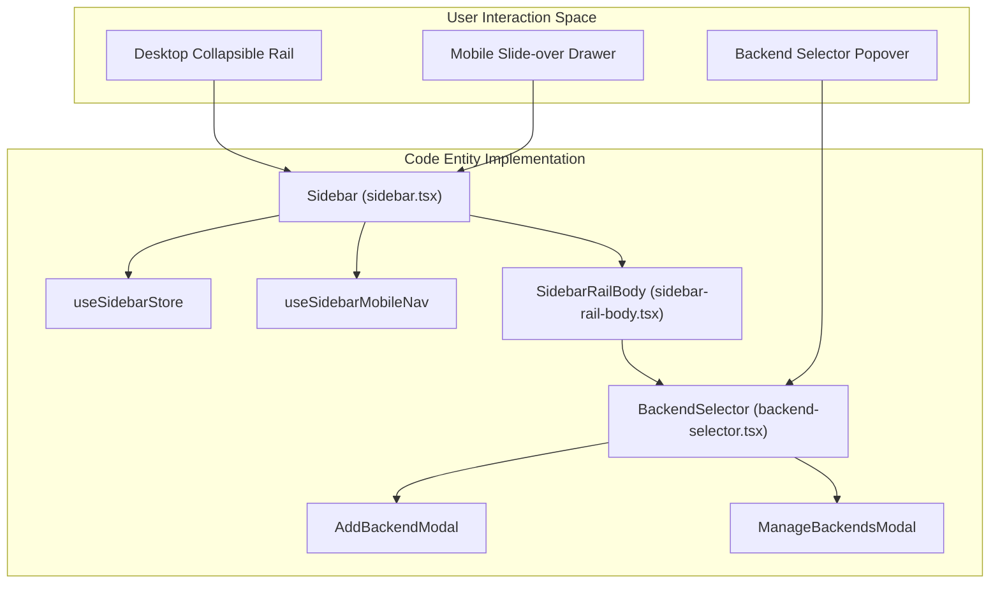
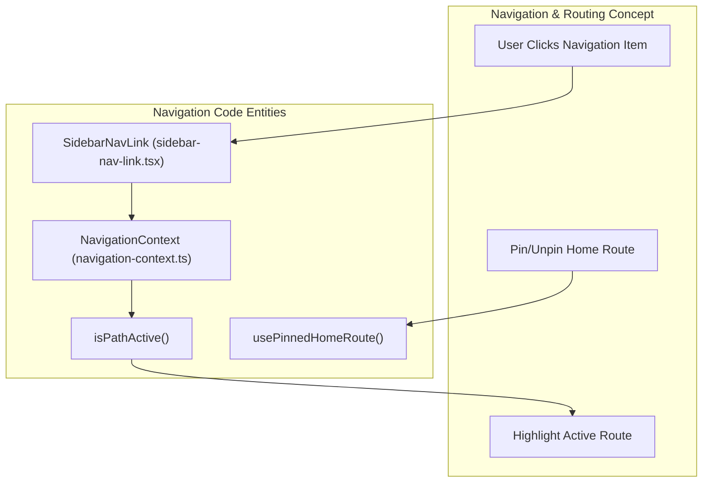

# Sidebar and Navigation

Relevant source files

The following files were used as context for generating this wiki page:

- [.github/pr-assets/pr-17571-test-results.svg](.github/pr-assets/pr-17571-test-results.svg)
- [__tests__/components/backends/backend-selector.test.tsx](__tests__/components/backends/backend-selector.test.tsx)
- [__tests__/components/features/command-menu/command-menu-items.test.tsx](__tests__/components/features/command-menu/command-menu-items.test.tsx)
- [__tests__/components/features/command-menu/command-menu.test.tsx](__tests__/components/features/command-menu/command-menu.test.tsx)
- [__tests__/components/features/conversation-panel/start-task-status-badge.test.tsx](__tests__/components/features/conversation-panel/start-task-status-badge.test.tsx)
- [__tests__/components/features/sidebar/sidebar-cloud-settings.test.tsx](__tests__/components/features/sidebar/sidebar-cloud-settings.test.tsx)
- [__tests__/components/features/sidebar/sidebar-onboarding-checklist.test.tsx](__tests__/components/features/sidebar/sidebar-onboarding-checklist.test.tsx)
- [__tests__/components/features/sidebar/sidebar.test.tsx](__tests__/components/features/sidebar/sidebar.test.tsx)
- [__tests__/hooks/mutation/use-add-mcp-server.test.ts](__tests__/hooks/mutation/use-add-mcp-server.test.ts)
- [__tests__/hooks/query/use-cloud-organizations.test.tsx](__tests__/hooks/query/use-cloud-organizations.test.tsx)
- [__tests__/routes/root-layout.test.tsx](__tests__/routes/root-layout.test.tsx)
- [__tests__/utils/browser-and-file-utilities.test.ts](__tests__/utils/browser-and-file-utilities.test.ts)
- [__tests__/utils/desktop-shell.test.ts](__tests__/utils/desktop-shell.test.ts)
- [__tests__/utils/git-and-task-utilities.test.ts](__tests__/utils/git-and-task-utilities.test.ts)
- [__tests__/utils/utils.test.ts](__tests__/utils/utils.test.ts)
- [electron/preload-main.cjs](electron/preload-main.cjs)
- [src/api/cloud/setup-state-service.api.ts](src/api/cloud/setup-state-service.api.ts)
- [src/api/cloud/types.ts](src/api/cloud/types.ts)
- [src/components/features/backends/backend-selector.tsx](src/components/features/backends/backend-selector.tsx)
- [src/components/features/command-menu/command-menu-items.tsx](src/components/features/command-menu/command-menu-items.tsx)
- [src/components/features/command-menu/command-menu-trigger.tsx](src/components/features/command-menu/command-menu-trigger.tsx)
- [src/components/features/command-menu/command-menu.tsx](src/components/features/command-menu/command-menu.tsx)
- [src/components/features/conversation-panel/start-task-card/start-task-status-badge.tsx](src/components/features/conversation-panel/start-task-card/start-task-status-badge.tsx)
- [src/components/features/setup-guide/super-admin-setup-guide.constants.ts](src/components/features/setup-guide/super-admin-setup-guide.constants.ts)
- [src/components/features/setup-guide/use-super-admin-setup-guide.ts](src/components/features/setup-guide/use-super-admin-setup-guide.ts)
- [src/components/features/sidebar/sidebar-nav-link.tsx](src/components/features/sidebar/sidebar-nav-link.tsx)
- [src/components/features/sidebar/sidebar-rail-body.tsx](src/components/features/sidebar/sidebar-rail-body.tsx)
- [src/components/features/sidebar/sidebar.tsx](src/components/features/sidebar/sidebar.tsx)
- [src/components/features/sidebar/use-sidebar-onboarding-checklist.ts](src/components/features/sidebar/use-sidebar-onboarding-checklist.ts)
- [src/hooks/chat/use-chat-input-events.ts](src/hooks/chat/use-chat-input-events.ts)
- [src/hooks/query/use-cloud-current-user-id.ts](src/hooks/query/use-cloud-current-user-id.ts)
- [src/hooks/query/use-cloud-organizations.ts](src/hooks/query/use-cloud-organizations.ts)
- [src/hooks/use-desktop-full-screen.ts](src/hooks/use-desktop-full-screen.ts)
- [src/routes/root-layout.tsx](src/routes/root-layout.tsx)
- [src/utils/desktop-shell.ts](src/utils/desktop-shell.ts)
- [src/utils/utils.ts](src/utils/utils.ts)

## Purpose and Scope

This document details the Sidebar and Navigation architecture of the OpenHands frontend. It covers the responsive `Sidebar` component (including the desktop collapsible rail and mobile drawer), `SidebarRailBody`, `SidebarNavLink`, `SidebarConversationList`, the onboarding checklist, desktop shell integration, and the keyboard-driven `CommandMenu`.

Sources: `[src/components/features/sidebar/sidebar.tsx:1-40]()`, `[src/routes/root-layout.tsx:1-71]()`

---

## Sidebar Component Architecture

The `Sidebar` component `[src/components/features/sidebar/sidebar.tsx:40-100]()` serves as the primary navigation hub. It adapts dynamically between a desktop collapsible rail and a mobile slide-over drawer.

### Responsive Layout and States
- **Desktop Rail**: A persistent vertical bar supporting a `collapsed` state managed by `useSidebarStore` `[src/components/features/sidebar/sidebar.tsx:52-53]()`.
- **Mobile Drawer**: A slide-over menu controlled via `useSidebarMobileNav` `[src/components/features/sidebar/sidebar.tsx:70-71]()` with a transition timer of `MOBILE_DRAWER_TRANSITION_MS` (`250ms`) `[src/components/features/sidebar/sidebar.tsx:38]()`.
- **Click-Outside & Escape Handling**: Dismisses popovers and mobile drawers using `useClickOutsideElement` `[src/components/features/sidebar/sidebar.tsx:74-76]()` and `useCloseOnEscape` `[src/components/features/sidebar/sidebar.tsx:100]`.
- **Modals Lifting**: Backend management modals (`AddBackendModal`, `ManageBackendsModal`) and `SettingsModal` are lifted into the sidebar scope `[src/components/features/sidebar/sidebar.tsx:18-36]()` so they survive collapsed-rail popover unmounting.

*Figure 1: Sidebar Architecture mapping user interaction modes to React components and state stores.*

Sources: `[src/components/features/sidebar/sidebar.tsx:18-76]()`, `[src/components/features/sidebar/sidebar-rail-body.tsx:76-128]()`

---

## Navigation and Active State Logic

Navigation links within the sidebar rail and mobile drawer are rendered using `SidebarNavLink` `[src/components/features/sidebar/sidebar-nav-link.tsx:57-163]()`.

### Active State Detection and Pinning
- **Strict vs Sub-route Matching**: `isPathActive` `[src/components/features/sidebar/sidebar-nav-link.tsx:16-26]()` evaluates whether a link is active based on exact matches (`end = true`) or sub-route prefix matching (`current.startsWith(\`${to}/\`)`).
- **Force Active**: The `forceActive` prop allows manual active state overrides, used for grouping extensions like `/mcp`, `/plugins`, and `/skills` under the `/customize` route `[src/components/features/sidebar/sidebar-nav-link.tsx:51]`, `[src/components/features/sidebar/sidebar.tsx:169-174]()`.
- **Route Pinning**: Users can pin specific landing routes via `usePinnedHomeRoute` (`[src/components/features/sidebar/sidebar-rail-body.tsx:100-112]()`), rendering a hover-reveal action button on `SidebarNavLink` `[src/components/features/sidebar/sidebar-nav-link.tsx:126-148]()`.
- **Collapsed Tooltips**: When the sidebar is collapsed, links wrap their icons in `StyledTooltip` components `[src/components/features/sidebar/sidebar-nav-link.tsx:153-161]()`.

*Figure 2: Navigation event flow linking user navigation actions to routing helpers and state hooks.*

Sources: `[src/components/features/sidebar/sidebar-nav-link.tsx:16-163]()`, `[src/components/features/sidebar/sidebar-rail-body.tsx:97-127]()`

---

## Onboarding Checklist

The onboarding checklist component provides guided steps for first-time users directly inside the sidebar rail `[src/components/features/sidebar/sidebar-onboarding-checklist.tsx]`.

### Checklist State and Completion Rules
The `useSidebarOnboardingChecklist` hook `[src/components/features/sidebar/use-sidebar-onboarding-checklist.ts:40-176]()` manages checklist item states by evaluating application settings, LLM profiles, and database records:
- **`configure-llm`**: Evaluated via `isConfigureLlmChecklistItemComplete` `[src/components/features/sidebar/sidebar-onboarding-checklist-llm-complete.ts]()`.
- **`connect-mcp`**: Checked via `hasConfiguredMcpServers` parsing `settings?.agent_settings?.mcp_config` `[src/components/features/sidebar/use-sidebar-onboarding-checklist.ts:36-38]()`.
- **`start-conversation`**: Evaluated by verifying paginated conversation counts `[src/components/features/sidebar/use-sidebar-onboarding-checklist.ts:85]()`.
- **`schedule-task`**: Evaluated via automation query totals `[src/components/features/sidebar/use-sidebar-onboarding-checklist.ts:86]()`.
- **`customize-agent` & `join-slack`**: Persistent local state trackers `[src/components/features/sidebar/use-sidebar-onboarding-checklist.ts:52-57]()`.

Sources: `[src/components/features/sidebar/use-sidebar-onboarding-checklist.ts:40-176]()`

---

## Command Menu and Quick Actions

The `CommandMenu` `[src/components/features/command-menu/command-menu.tsx:62-216]()` offers a modal command palette for quick navigation and feature execution.

### Key Behaviors
- **Shortcut Listener**: Registers a global window keydown listener capturing `Cmd+K` or `Ctrl+K` to toggle state via `useCommandMenuStore` `[src/components/features/command-menu/command-menu.tsx:73-86]()`.
- **Portal Rendering**: Rendered via `createPortal` `[src/components/features/command-menu/command-menu.tsx:199]()` with backdrop blur and trap focus management.
- **Fuzzy Search & Indexing**: `matchesQuery` filters command definitions across translated titles, descriptions, and keywords `[src/components/features/command-menu/command-menu.tsx:36-60]`.
- **Keyboard Navigation**: Handles `ArrowDown`, `ArrowUp`, and `Enter` key events to scroll results into view and invoke matched item actions `[src/components/features/command-menu/command-menu.tsx:168-191]()`.

Sources: `[src/components/features/command-menu/command-menu.tsx:62-192]()`

---

## Desktop Shell Integration

In desktop runtime modes (such as Electron on macOS), the application shell coordinates window frames with the sidebar layout `[src/routes/root-layout.tsx:56-81]()`.

- **`useShowTitleBarBand()`**: Checks `isMacDesktopShell()` and full-screen mode status `[src/routes/root-layout.tsx:56-60]()`.
- **`TitleBarDragRegion`**: Reserves a `28px` top band (`pt-7`) configured with `.app-region-drag` to let users drag the frameless macOS window while keeping traffic-light controls clear `[src/routes/root-layout.tsx:62-71]()`.

Sources: `[src/routes/root-layout.tsx:56-81]()`, `[src/utils/desktop-shell.ts:1-20]()`