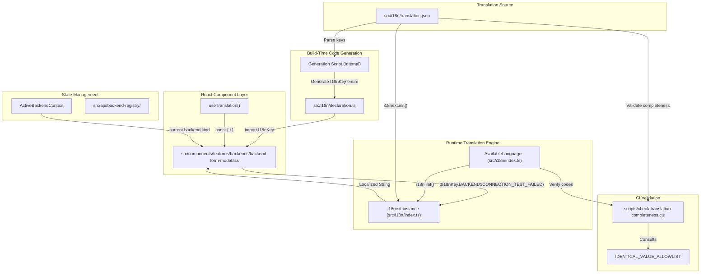
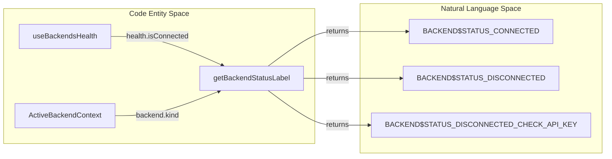

# Internationalization

<details>
<summary>Relevant source files</summary>

The following files were used as context for generating this wiki page:

- [__tests__/api/agent-server-adapter.test.ts](__tests__/api/agent-server-adapter.test.ts)
- [__tests__/api/agent-server-conversation-service.test.ts](__tests__/api/agent-server-conversation-service.test.ts)
- [__tests__/api/use-create-conversation-metadata.test.ts](__tests__/api/use-create-conversation-metadata.test.ts)
- [__tests__/hooks/mutation/use-create-conversation.test.tsx](__tests__/hooks/mutation/use-create-conversation.test.tsx)
- [__tests__/hooks/mutation/use-switch-llm-profile-and-log.test.tsx](__tests__/hooks/mutation/use-switch-llm-profile-and-log.test.tsx)
- [scripts/check-translation-completeness.cjs](scripts/check-translation-completeness.cjs)
- [src/api/agent-server-adapter.ts](src/api/agent-server-adapter.ts)
- [src/api/conversation-metadata-store.ts](src/api/conversation-metadata-store.ts)
- [src/api/conversation-service/agent-server-conversation-service.api.ts](src/api/conversation-service/agent-server-conversation-service.api.ts)
- [src/api/conversation-service/agent-server-conversation-service.types.ts](src/api/conversation-service/agent-server-conversation-service.types.ts)
- [src/components/features/settings/agent-canvas-update-card.test.tsx](src/components/features/settings/agent-canvas-update-card.test.tsx)
- [src/components/features/settings/agent-canvas-update-card.tsx](src/components/features/settings/agent-canvas-update-card.tsx)
- [src/components/features/settings/agent-canvas-version-modal.tsx](src/components/features/settings/agent-canvas-version-modal.tsx)
- [src/components/features/settings/agent-canvas-version-tile.tsx](src/components/features/settings/agent-canvas-version-tile.tsx)
- [src/components/features/settings/settings-mobile-drawer.tsx](src/components/features/settings/settings-mobile-drawer.tsx)
- [src/hooks/mutation/use-create-conversation.ts](src/hooks/mutation/use-create-conversation.ts)
- [src/hooks/mutation/use-switch-llm-profile-and-log.ts](src/hooks/mutation/use-switch-llm-profile-and-log.ts)
- [src/i18n/translation.json](src/i18n/translation.json)
- [src/icons/docker.svg](src/icons/docker.svg)

</details>


This document explains the internationalization (i18n) architecture used in the OpenHands frontend application (`@openhands/agent-canvas`). It covers the `i18next` integration, the structure of `translation.json`, the auto-generated `I18nKey` type system, the `AvailableLanguages` registry, the `check-translation-completeness.cjs` CI validation script, and the library namespace isolation model.

---

## System Architecture

The i18n subsystem is built on top of `i18next` and `react-i18next`. Localization keys are centralized in a single JSON document [src/i18n/translation.json:1-120](), while TypeScript types (`I18nKey`) are generated to provide compile-time safety across component render trees.

Title: Internationalization Data Flow


Sources: [src/i18n/translation.json:1-18](), [src/i18n/declaration.ts:1-29](), [src/components/features/backends/backend-form-modal.tsx:1-40](), [scripts/check-translation-completeness.cjs:15-70](), [src/i18n/index.ts:1-25]()

---

## Core Components and Data Structure

### 1. Translation Configuration (`src/i18n/index.ts`)
The initialization module configures resource binding, locale resolution, and interpolation parameters for `i18next`.
- **AvailableLanguages:** An exported array defining the supported locales (e.g., `en`, `ja`, `zh-CN`, `es`, `fr`, etc.) along with their native display names [src/i18n/index.ts:6-22]().
- **Interpolation Protection:** `escapeValue` is set to `false` because React inherently guards against XSS injections. This configuration is essential for rendering format strings containing HTML-like interpolation tokens or inline command tags (e.g., `<cmd>{{name}}</cmd>`) [src/i18n/translation.json:53-69]().

### 2. Translation JSON Structure (`src/i18n/translation.json`)
Translations reside in a flat key-value dictionary where each entry is a dictionary mapping language codes to localized strings. This includes structured namespaces for file discovery configurations, error states, and modal dialogs [src/i18n/translation.json:1-120]().

### 3. CI Completeness Validation (`scripts/check-translation-completeness.cjs`)
To prevent incomplete localizations from entering production builds, the test and commit pipeline executes `check-translation-completeness.cjs` [scripts/check-translation-completeness.cjs:1-7]().
- **Completeness Verification:** Extracts active language codes from `src/i18n/index.ts` using regular expressions [scripts/check-translation-completeness.cjs:80-93]() and asserts that every key in `translation.json` possesses a matching translation [scripts/check-translation-completeness.cjs:97-117]().
- **Verbatim Detection:** Flags keys where all non-English language values are identical to the English string, which indicates an untranslated placeholder [scripts/check-translation-completeness.cjs:128-139]().
- **Allowlist Bypass:** `IDENTICAL_VALUE_ALLOWLIST` exempts brand names, technical identifiers, and symbols (such as `BRANDING$OPENHANDS` or `API$TAVILY_KEY_EXAMPLE`) that remain uniform across all supported tongues [scripts/check-translation-completeness.cjs:15-77]().

Sources: [src/i18n/index.ts:6-22](), [src/i18n/translation.json:1-120](), [scripts/check-translation-completeness.cjs:1-149]()

---

## I18nKey Type System

The `I18nKey` type definition guarantees type-safety when developers invoke translation lookups via `react-i18next`. Passing an invalid or mistyped string key triggers a TypeScript compilation error.

### Component Integration Pattern
React components import `useTranslation` and reference type-safe keys via the `I18nKey` enum:

```tsx
// Example pattern in mobile navigation and drawer components
const { t } = useTranslation("openhands");
const title = t(I18nKey.SETTINGS$TITLE);
```

### Key Naming Taxonomy
Keys follow a convention-based `CATEGORY$SUB_KEY` structure:
- `COMMON$*`: Shared user interface fragments (e.g., confirmations, pagination labels).
- `BACKEND$*`: Backend registry descriptors, health metrics, and authorization diagnostics [src/components/features/backends/backend-form-modal.tsx:31]().
- `ONBOARDING$*`: First-run setup wizards, ACP token prompts, and validation guides [src/i18n/translation.json:1-120]().
- `FILES$*`: File discovery workspace preferences, exclusion patterns, and symlink flags [src/i18n/translation.json:2-103]().

Sources: [src/components/features/settings/settings-mobile-drawer.tsx:32-54](), [src/i18n/translation.json:1-103](), [src/components/features/backends/backend-form-modal.tsx:1-40]()

---

## Library Namespace and Embedded Usage

When embedded in larger host frameworks, Agent Canvas isolates its localization resources using specific i18next namespaces (typically `openhands`) to avoid global key collisions.

### Backend Health and Localization Mapping
The i18n layer coordinates closely with `ActiveBackendContext` and backend health telemetry hooks to surface localized connection feedback directly in the UI [src/contexts/active-backend-context.tsx:1](), [src/hooks/query/use-backends-health.ts:1-10]().

Title: Mapping Backend Health Status to Localized Strings


Sources: [src/contexts/active-backend-context.tsx:1-50](), [src/hooks/query/use-backends-health.ts:1-180](), [src/components/features/backends/backend-status-label.ts:1-50]()

---

## Summary of Key Entities

| Entity | Role | File Path |
|--------|------|-----------|
| `I18nKey` | Type-safe enum for translation keys | [src/i18n/declaration.ts:1-29]() |
| `AvailableLanguages` | List of supported UI locales and display metadata | [src/i18n/index.ts:6-22]() |
| `translation.json` | Centralized multi-language dictionary store | [src/i18n/translation.json:1-120]() |
| `check-translation-completeness.cjs` | CI validation script checking translation coverage | [scripts/check-translation-completeness.cjs:1-149]() |
| `useBackendsHealth` | Hook providing status telemetry for backend connectivity | [src/hooks/query/use-backends-health.ts:1-70]() |
| `SettingsMobileDrawer` | Component utilizing translation keys for mobile menus | [src/components/features/settings/settings-mobile-drawer.tsx:32-54]() |

Sources: [src/i18n/declaration.ts:1-29](), [src/i18n/index.ts:6-22](), [src/i18n/translation.json:1-120](), [scripts/check-translation-completeness.cjs:1-149](), [src/hooks/query/use-backends-health.ts:1-70](), [src/components/features/settings/settings-mobile-drawer.tsx:32-54]()