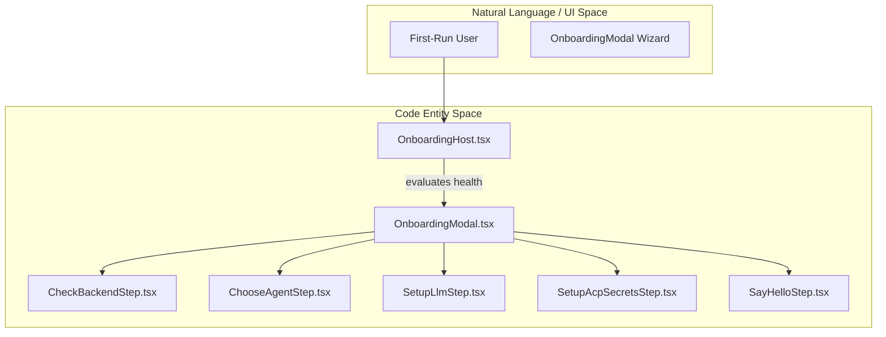
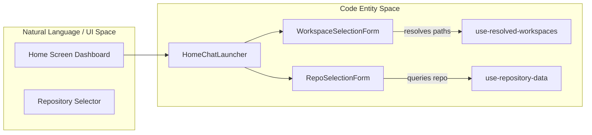

# Onboarding Flow

Relevant source files

The following files were used as context for generating this wiki page:

- [.agents/skills/frontend-api-contracts/references/guide.md](.agents/skills/frontend-api-contracts/references/guide.md)
- [__tests__/components/onboarding/onboarding-modal.test.tsx](__tests__/components/onboarding/onboarding-modal.test.tsx)
- [__tests__/components/onboarding/setup-llm-step.test.tsx](__tests__/components/onboarding/setup-llm-step.test.tsx)
- [__tests__/components/settings/llm-profiles/llm-settings-local-view.test.tsx](__tests__/components/settings/llm-profiles/llm-settings-local-view.test.tsx)
- [__tests__/routes/llm-settings.test.tsx](__tests__/routes/llm-settings.test.tsx)
- [src/components/features/onboarding/onboarding-modal.tsx](src/components/features/onboarding/onboarding-modal.tsx)
- [src/components/features/onboarding/steps/check-backend-step.tsx](src/components/features/onboarding/steps/check-backend-step.tsx)
- [src/components/features/onboarding/steps/setup-llm-step.tsx](src/components/features/onboarding/steps/setup-llm-step.tsx)
- [src/components/features/settings/llm-profiles/llm-profile-form.ts](src/components/features/settings/llm-profiles/llm-profile-form.ts)
- [src/components/features/settings/llm-profiles/llm-settings-local-view.tsx](src/components/features/settings/llm-profiles/llm-settings-local-view.tsx)
- [src/components/features/settings/llm-settings/openai-subscription-auth-card.tsx](src/components/features/settings/llm-settings/openai-subscription-auth-card.tsx)
- [src/constants/llm-provider-connection.ts](src/constants/llm-provider-connection.ts)
- [src/routes/home.tsx](src/routes/home.tsx)
- [src/routes/llm-settings.tsx](src/routes/llm-settings.tsx)
- [tests/e2e/mock-llm/onboarding/mock-llm-onboarding-happy-path.spec.ts](tests/e2e/mock-llm/onboarding/mock-llm-onboarding-happy-path.spec.ts)
- [tests/e2e/mock-llm/onboarding/mock-llm-onboarding-regressions.spec.ts](tests/e2e/mock-llm/onboarding/mock-llm-onboarding-regressions.spec.ts)

The purpose of this page is to document the first-run onboarding experience and home screen entry points for Agent Canvas, linking to child pages for the onboarding modal, home/workspace selection, and the setup guide tour.

For detailed information, refer to the child pages:
- [Onboarding Modal and Steps](#12.1)
- [Home Screen and Workspace Selection](#12.2)
- [Setup Guide Tour](#12.3)

---

## 12.1. Onboarding Modal and Steps

The onboarding flow is managed by `OnboardingHost` [src/components/features/onboarding/onboarding-host.tsx:39-72](), which evaluates backend health and existing settings to determine whether to render the `OnboardingModal` [src/components/features/onboarding/onboarding-modal.tsx:135-298](). The modal acts as a multi-step wizard tracking phases like `backend`, `agent`, `setup`, and `hello` [src/components/features/onboarding/onboarding-modal.tsx:40-52]().

Each step is housed within a sliding rail container where inactive steps are absolutely positioned and active steps drive the layout height [src/components/features/onboarding/onboarding-modal.tsx:83-104]().

**Onboarding Wizard Architecture**

Key steps include:
- `CheckBackendStep`: Validates connectivity via `useBackendsHealth` [src/components/features/onboarding/steps/check-backend-step.tsx:154-156]() and handles cloud token replacement in locked modes [src/components/features/onboarding/steps/check-backend-step.tsx:136-142]().
- `ChooseAgentStep`: Selects target agent kinds (`openhands` or ACP agents) [src/components/features/onboarding/steps/choose-agent-step.tsx:24-28]().
- `SetupLlmStep`: Configures language model profiles and default parameters like `ONBOARDING_DEFAULT_LLM_MODEL` [src/components/features/onboarding/steps/setup-llm-step.tsx:52-52]().
- `SetupAcpSecretsStep`: Prompts for required credentials if an ACP provider is chosen.
- `SayHelloStep`: Initializes the first conversation thread via `useCreateConversation` [src/components/features/onboarding/steps/say-hello-step.tsx:56-68]().

For details, see [Onboarding Modal and Steps](#12.1).

Sources: [src/components/features/onboarding/onboarding-host.tsx:39-72](), [src/components/features/onboarding/onboarding-modal.tsx:40-52](), [src/components/features/onboarding/onboarding-modal.tsx:83-104](), [src/components/features/onboarding/onboarding-modal.tsx:135-298](), [src/components/features/onboarding/steps/check-backend-step.tsx:136-142](), [src/components/features/onboarding/steps/check-backend-step.tsx:154-156](), [src/components/features/onboarding/steps/choose-agent-step.tsx:24-28](), [src/components/features/onboarding/steps/setup-llm-step.tsx:52-52](), [src/components/features/onboarding/steps/say-hello-step.tsx:56-68]().

---

## 12.2. Home Screen and Workspace Selection

Once onboarding completes or is bypassed, users land on the main entry interface. This view integrates workspace configuration forms, git repository selection menus, and initial chat launchers [src/routes/home.tsx]().

**Home Workspace and Repository Binding**

- `WorkspaceSelectionForm`: Manages local folder browser inputs and cloud workspace targets using `use-resolved-workspaces`.
- `RepoSelectionForm`: Handles git repository, branch, and provider selections via `use-repository-data`.
- Checklist persistence is controlled via local storage flags such as `SIDEBAR_ONBOARDING_CHECKLIST_DISMISSED_STORAGE_KEY` [__tests__/components/onboarding/onboarding-modal.test.tsx:17-17]().

For details, see [Home Screen and Workspace Selection](#12.2).

Sources: [src/routes/home.tsx](), [__tests__/components/onboarding/onboarding-modal.test.tsx:17-17]().

---

## 12.3. Setup Guide Tour

To assist new system administrators or enterprise users, Agent Canvas includes a super-admin setup guide and tour system. The tour engine highlights critical platform configuration controls, backend connection health endpoints, and cloud setup states.

- **Tour Engine & Types**: Coordinates step sequences, tooltips, and overlay themes.
- **Super-Admin Integration**: Governed by `use-super-admin-setup-guide` hooks to present relevant guides based on runtime capabilities.

For details, see [Setup Guide Tour](#12.3).

Sources: [src/components/features/onboarding/onboarding-host.tsx:39-72]()