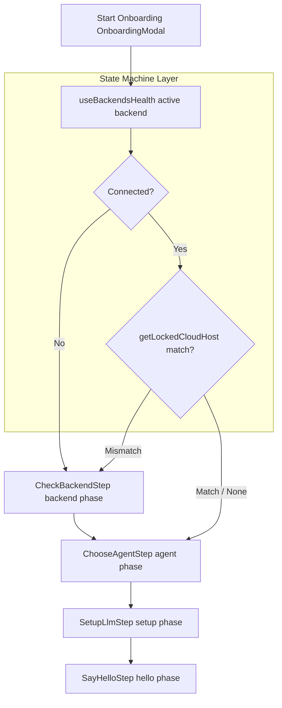
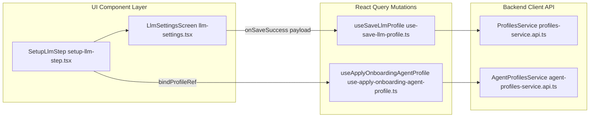

# Onboarding Modal and Steps

Relevant source files

The following files were used as context for generating this wiki page:

- [.agents/skills/frontend-api-contracts/references/guide.md](.agents/skills/frontend-api-contracts/references/guide.md)
- [__tests__/api/acp-service/acp-service.api.test.ts](__tests__/api/acp-service/acp-service.api.test.ts)
- [__tests__/components/onboarding/choose-agent-step.test.tsx](__tests__/components/onboarding/choose-agent-step.test.tsx)
- [__tests__/components/onboarding/onboarding-modal.test.tsx](__tests__/components/onboarding/onboarding-modal.test.tsx)
- [__tests__/components/onboarding/onboarding-progress-bar.test.tsx](__tests__/components/onboarding/onboarding-progress-bar.test.tsx)
- [__tests__/components/onboarding/setup-acp-secrets-step.test.tsx](__tests__/components/onboarding/setup-acp-secrets-step.test.tsx)
- [__tests__/components/onboarding/setup-llm-step.test.tsx](__tests__/components/onboarding/setup-llm-step.test.tsx)
- [__tests__/components/onboarding/use-onboarding-completion.test.tsx](__tests__/components/onboarding/use-onboarding-completion.test.tsx)
- [__tests__/components/settings/acp-auth-status-banner.test.tsx](__tests__/components/settings/acp-auth-status-banner.test.tsx)
- [__tests__/components/settings/acp-credentials-section-cloud.test.tsx](__tests__/components/settings/acp-credentials-section-cloud.test.tsx)
- [__tests__/components/settings/acp-credentials-section.test.tsx](__tests__/components/settings/acp-credentials-section.test.tsx)
- [__tests__/components/settings/llm-profiles/llm-settings-local-view.test.tsx](__tests__/components/settings/llm-profiles/llm-settings-local-view.test.tsx)
- [__tests__/constants/acp-providers.test.ts](__tests__/constants/acp-providers.test.ts)
- [__tests__/hooks/query/use-acp-auth-status.test.tsx](__tests__/hooks/query/use-acp-auth-status.test.tsx)
- [__tests__/routes/llm-settings.test.tsx](__tests__/routes/llm-settings.test.tsx)
- [__tests__/utils/acp-auth-display.test.ts](__tests__/utils/acp-auth-display.test.ts)
- [docs/ACP_AGENTS.md](docs/ACP_AGENTS.md)
- [docs/README.md](docs/README.md)
- [src/api/acp-service/acp-service.api.ts](src/api/acp-service/acp-service.api.ts)
- [src/components/features/onboarding/onboarding-modal.tsx](src/components/features/onboarding/onboarding-modal.tsx)
- [src/components/features/onboarding/onboarding-progress-bar.tsx](src/components/features/onboarding/onboarding-progress-bar.tsx)
- [src/components/features/onboarding/steps/check-backend-step.tsx](src/components/features/onboarding/steps/check-backend-step.tsx)
- [src/components/features/onboarding/steps/choose-agent-step.tsx](src/components/features/onboarding/steps/choose-agent-step.tsx)
- [src/components/features/onboarding/steps/setup-acp-secrets-step.tsx](src/components/features/onboarding/steps/setup-acp-secrets-step.tsx)
- [src/components/features/onboarding/steps/setup-llm-step.tsx](src/components/features/onboarding/steps/setup-llm-step.tsx)
- [src/components/features/settings/acp-auth-status-banner.tsx](src/components/features/settings/acp-auth-status-banner.tsx)
- [src/components/features/settings/acp-credentials-section.tsx](src/components/features/settings/acp-credentials-section.tsx)
- [src/components/features/settings/llm-profiles/llm-profile-form.ts](src/components/features/settings/llm-profiles/llm-profile-form.ts)
- [src/components/features/settings/llm-profiles/llm-settings-local-view.tsx](src/components/features/settings/llm-profiles/llm-settings-local-view.tsx)
- [src/components/features/settings/llm-settings/openai-subscription-auth-card.tsx](src/components/features/settings/llm-settings/openai-subscription-auth-card.tsx)
- [src/constants/acp-providers.test.ts](src/constants/acp-providers.test.ts)
- [src/constants/acp-providers.ts](src/constants/acp-providers.ts)
- [src/constants/llm-provider-connection.ts](src/constants/llm-provider-connection.ts)
- [src/hooks/use-acp-credential-form.ts](src/hooks/use-acp-credential-form.ts)
- [src/hooks/use-save-acp-secrets.ts](src/hooks/use-save-acp-secrets.ts)
- [src/routes/home.tsx](src/routes/home.tsx)
- [src/routes/llm-settings.tsx](src/routes/llm-settings.tsx)
- [tests/e2e/mock-llm/onboarding/mock-llm-onboarding-happy-path.spec.ts](tests/e2e/mock-llm/onboarding/mock-llm-onboarding-happy-path.spec.ts)
- [tests/e2e/mock-llm/onboarding/mock-llm-onboarding-regressions.spec.ts](tests/e2e/mock-llm/onboarding/mock-llm-onboarding-regressions.spec.ts)

This technical documentation page covers the first-run onboarding experience in OpenHands (`@openhands/agent-canvas`), focusing on the multi-step wizard orchestrator `OnboardingModal`, state management phases, progress visualization, and individual implementation steps: `CheckBackendStep`, `ChooseAgentStep`, `SetupLlmStep`, `SetupAcpSecretsStep`, and `SayHelloStep`.

## Architecture and Phase-Based Orchestration

The onboarding system uses a phase-based state machine rather than simple numeric indices to handle dynamic step skipping (e.g., when a backend is already healthy and reachable). The top-level orchestrator is `OnboardingModal` defined in `src/components/features/onboarding/onboarding-modal.tsx`, which manages `OnboardingPhase` transitions (`"backend" | "agent" | "setup" | "hello"`) [src/components/features/onboarding/onboarding-modal.tsx:40-52]().

### Natural Language to Code Entity Mapping: Onboarding Stack

| Natural Language Concept | Code Symbol / Entity | File Path |
|:---|:---|:---|
| Onboarding Orchestrator | `OnboardingModal` | [src/components/features/onboarding/onboarding-modal.tsx:135-139]() |
| Slide Viewport Rail | `Slide` | [src/components/features/onboarding/onboarding-modal.tsx:83-84]() |
| Progress Indicator | `OnboardingProgressBar` | [src/components/features/onboarding/onboarding-progress-bar.tsx:10-14]() |
| Backend Health Probe | `useBackendsHealth` | [src/hooks/query/use-backends-health.ts:1-15]() |
| Cloud Lock Guard | `getLockedCloudHost`, `isSameCloudHost` | [src/api/agent-server-config.ts:1-30]() |
| Connectivity Check Step | `CheckBackendStep` | [src/components/features/onboarding/steps/check-backend-step.tsx:26-26]() |
| Agent Selection Step | `ChooseAgentStep` | [src/components/features/onboarding/steps/choose-agent-step.tsx:41-41]() |
| LLM Profile Setup Step | `SetupLlmStep` | [src/components/features/onboarding/steps/setup-llm-step.tsx:43-43]() |
| ACP Secrets Collection | `SetupAcpSecretsStep` | [src/components/features/onboarding/steps/setup-acp-secrets-step.tsx:32-32]() |
| Final Conversation Launch | `SayHelloStep` | [src/components/features/onboarding/steps/say-hello-step.tsx:28-28]() |

### Onboarding Flow & Skip Logic

**Sources:** [src/components/features/onboarding/onboarding-modal.tsx:149-173](), [src/api/agent-server-config.ts:1-50]()

---

## Key Components and Step Implementations

### OnboardingModal and Slide Rail
`OnboardingModal` renders a sliding viewport container where inactive slides are positioned absolutely (`inset-0`, `pointer-events-none`) and the active step dictates container dimensions [src/components/features/onboarding/onboarding-modal.tsx:83-104](). The horizontal slide offset is computed dynamically via `(index - currentStep) * 100%` [src/components/features/onboarding/onboarding-modal.tsx:78-85]().

### CheckBackendStep
Implemented in `src/components/features/onboarding/steps/check-backend-step.tsx`, this step evaluates active backend connectivity. When no backend is selected (`isNoBackend`), it presents backend registration options and invokes `useBackendsHealth` to poll endpoint availability [src/components/features/onboarding/onboarding-modal.tsx:151-154]().

### ChooseAgentStep
Implemented in `src/components/features/onboarding/steps/choose-agent-step.tsx`, this step allows users to pick between standard OpenHands execution agents and ACP (Agent Client Protocol) providers (e.g., Claude Code, Codex, Gemini CLI). Selecting an ACP provider dynamically injects `SetupAcpSecretsStep` into the active wizard sequence.

### SetupLlmStep
Implemented in `src/components/features/onboarding/steps/setup-llm-step.tsx`, this step embeds `LlmSettingsScreen` in an `embedded` profile configuration mode [src/routes/llm-settings.tsx:122-141]().
- **Default Model:** Pre-fills the form with `ONBOARDING_DEFAULT_LLM_MODEL` (`openai/gpt-5.6-sol`), matching `DEFAULT_SETTINGS.llm_model` [src/components/features/onboarding/steps/setup-llm-step.tsx:52-52]().
- **Profile Seeding:** `useOnboardingProfileSeed` reads active profiles or initializes a fresh profile configuration [src/components/features/onboarding/steps/setup-llm-step.tsx:106-165](). Saving coordinates through `useSaveLlmProfile` and `useApplyOnboardingAgentProfile` [src/components/features/onboarding/steps/setup-llm-step.tsx:17-19]().

### SetupAcpSecretsStep
Implemented in `src/components/features/onboarding/steps/setup-acp-secrets-step.tsx`, this step collects required containerized credentials and secrets (e.g., `ANTHROPIC_API_KEY`, `CODEX_AUTH_JSON`) using definitions supplied by `getAcpProviderSecrets` [src/constants/acp-providers.ts:1-12]() and persisted via `SecretsService` [src/api/secrets-service/index.ts:1-20]().

### SayHelloStep
Implemented in `src/components/features/onboarding/steps/say-hello-step.tsx`, this concluding step renders onboarding starter prompts and invokes `useCreateConversation` to initialize the user's first active session before closing the modal [src/components/features/onboarding/onboarding-modal.tsx:124-124]().

**Sources:** [src/components/features/onboarding/onboarding-modal.tsx:83-173](), [src/components/features/onboarding/steps/setup-llm-step.tsx:42-165](), [src/constants/acp-providers.ts:88-140]()

---

## Data Flow: Settings and Profile Persistence

When completing LLM configuration during onboarding, settings flow through specialized mutations interacting with profile services and API endpoints.

### Natural Language to Code Entity Mapping: Profile Persistence

**Sources:** [src/components/features/onboarding/steps/setup-llm-step.tsx:17-20](), [src/api/profiles-service/profiles-service.api.ts:1-35](), [src/api/agent-profiles-service/agent-profiles-service.api.ts:1-30]()

---

## Technical Implementation Details

### Analytics Tracking and Storage Keys
- **Telemetry:** Onboarding lifecycle milestones are tracked via `useTracking` bindings (`trackOnboardingStarted`, `trackOnboardingStepViewed`, `trackOnboardingCompleted`, `trackOnboardingSkipped`) [src/components/features/onboarding/onboarding-modal.tsx:143-148]().
- **Checklist Dismissal:** Sidebar onboarding checklists respect `SIDEBAR_ONBOARDING_CHECKLIST_DISMISSED_STORAGE_KEY` [__tests__/components/onboarding/onboarding-modal.test.tsx:17-17]().

### Testing Infrastructure
- **Component Tests:** `__tests__/components/onboarding/onboarding-modal.test.tsx` mocks `ServerClient`, `ProfilesClient`, and `AgentProfilesClient` to test step progression, backend auto-skipping, and default model propagation [__tests__/components/onboarding/onboarding-modal.test.tsx:42-81]().

**Sources:** [src/components/features/onboarding/onboarding-modal.tsx:143-148](), [__tests__/components/onboarding/onboarding-modal.test.tsx:40-120]()