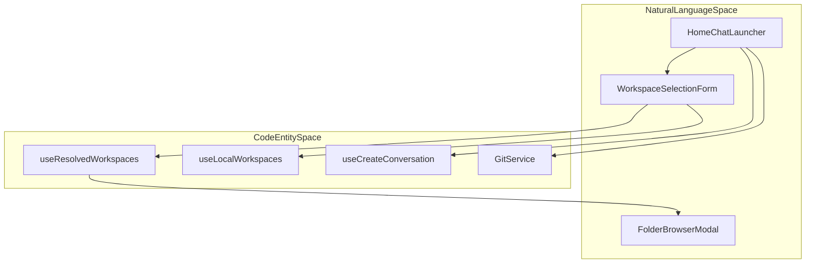
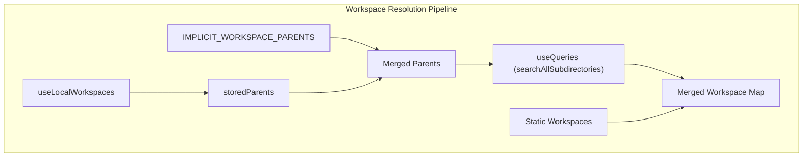

# Home Screen and Workspace Selection

Relevant source files

The following files were used as context for generating this wiki page:

- [__tests__/api/agent-profiles-service.test.ts](__tests__/api/agent-profiles-service.test.ts)
- [__tests__/api/automation-setup-handoff-store.test.ts](__tests__/api/automation-setup-handoff-store.test.ts)
- [__tests__/api/git-provider-items-service.test.ts](__tests__/api/git-provider-items-service.test.ts)
- [__tests__/api/git-service.test.ts](__tests__/api/git-service.test.ts)
- [__tests__/api/workspaces-service.test.ts](__tests__/api/workspaces-service.test.ts)
- [__tests__/components/features/chat/components/chat-input-field.test.tsx](__tests__/components/features/chat/components/chat-input-field.test.tsx)
- [__tests__/components/features/conversation-panel/cloud-new-conversation-menu.test.tsx](__tests__/components/features/conversation-panel/cloud-new-conversation-menu.test.tsx)
- [__tests__/components/features/home/generic-dropdown-menu.test.tsx](__tests__/components/features/home/generic-dropdown-menu.test.tsx)
- [__tests__/components/features/home/home-chat-launcher-failed-launch.test.tsx](__tests__/components/features/home/home-chat-launcher-failed-launch.test.tsx)
- [__tests__/components/features/home/home-chat-launcher.test.tsx](__tests__/components/features/home/home-chat-launcher.test.tsx)
- [__tests__/components/features/home/use-url-search.test.tsx](__tests__/components/features/home/use-url-search.test.tsx)
- [__tests__/components/features/home/workspace-dropdown.test.tsx](__tests__/components/features/home/workspace-dropdown.test.tsx)
- [__tests__/components/features/home/workspace-selection-form.test.tsx](__tests__/components/features/home/workspace-selection-form.test.tsx)
- [__tests__/hooks/query/use-git-repositories.test.ts](__tests__/hooks/query/use-git-repositories.test.ts)
- [src/api/automation-setup-handoff-store.ts](src/api/automation-setup-handoff-store.ts)
- [src/api/git-provider-items-service.ts](src/api/git-provider-items-service.ts)
- [src/api/git-service/git-service.api.ts](src/api/git-service/git-service.api.ts)
- [src/api/workspaces-service/workspaces-service.api.ts](src/api/workspaces-service/workspaces-service.api.ts)
- [src/components/features/chat/components/chat-input-container.tsx](src/components/features/chat/components/chat-input-container.tsx)
- [src/components/features/chat/custom-chat-input.tsx](src/components/features/chat/custom-chat-input.tsx)
- [src/components/features/conversation-panel/cloud-new-conversation-menu.tsx](src/components/features/conversation-panel/cloud-new-conversation-menu.tsx)
- [src/components/features/conversation-panel/local-new-conversation-menu.tsx](src/components/features/conversation-panel/local-new-conversation-menu.tsx)
- [src/components/features/home/git-repo-dropdown/use-url-search.tsx](src/components/features/home/git-repo-dropdown/use-url-search.tsx)
- [src/components/features/home/home-chat-launcher.tsx](src/components/features/home/home-chat-launcher.tsx)
- [src/components/features/home/home-launcher-mode-toggle.tsx](src/components/features/home/home-launcher-mode-toggle.tsx)
- [src/components/features/home/shared/dropdown-item.tsx](src/components/features/home/shared/dropdown-item.tsx)
- [src/components/features/home/shared/generic-dropdown-menu.tsx](src/components/features/home/shared/generic-dropdown-menu.tsx)
- [src/components/features/home/workspace-dropdown/folder-browser-modal.tsx](src/components/features/home/workspace-dropdown/folder-browser-modal.tsx)
- [src/components/features/home/workspace-dropdown/manage-workspaces-modal.tsx](src/components/features/home/workspace-dropdown/manage-workspaces-modal.tsx)
- [src/components/features/home/workspace-dropdown/workspace-dropdown.tsx](src/components/features/home/workspace-dropdown/workspace-dropdown.tsx)
- [src/components/features/home/workspace-selection-form.tsx](src/components/features/home/workspace-selection-form.tsx)
- [src/hooks/query/use-app-installations.ts](src/hooks/query/use-app-installations.ts)
- [src/hooks/query/use-git-repositories.ts](src/hooks/query/use-git-repositories.ts)
- [src/hooks/query/use-local-workspaces.ts](src/hooks/query/use-local-workspaces.ts)
- [src/hooks/query/use-resolved-workspaces.ts](src/hooks/query/use-resolved-workspaces.ts)
- [src/hooks/query/use-search-subdirs.ts](src/hooks/query/use-search-subdirs.ts)

The Home Screen and Workspace Selection system provides the primary entry point for users to initialize agent sessions. It facilitates the selection of local filesystem directories or remote Git repositories, branch management, plugin configuration, and prompt drafting before a conversation begins.

## Purpose and Scope

This document details the architecture, state management, and data flow of the home route interface in OpenHands. It covers `HomeChatLauncher`, `WorkspaceSelectionForm`, `RepoSelectionForm`, the workspace dropdown, the folder browser modal, git integration hooks, and the conversation creation pipeline.

---

## 1. Overview and Architecture

The home route centers around `HomeChatLauncher` (`src/components/features/home/home-chat-launcher.tsx`), which serves as the orchestrator for starting new tasks [src/components/features/home/home-chat-launcher.tsx:52](). Depending on the active backend type (Local vs. Cloud), the launcher toggles between selection forms: `WorkspaceSelectionForm` for local directory browsing [src/components/features/home/workspace-selection-form.tsx:68]() and repository selection components for cloud workflows.

Title: "Home Screen Architecture and Flow"

Sources: [src/components/features/home/home-chat-launcher.tsx:52-114](), [src/components/features/home/workspace-selection-form.tsx:68-105](), [src/hooks/query/use-resolved-workspaces.ts:52-88]()

---

## 2. Local Workspace Selection and Resolution

For local backends, workspaces are resolved dynamically via the `useResolvedWorkspaces` hook [src/hooks/query/use-resolved-workspaces.ts:52](). Workspaces are aggregated from three distinct sources:
1. **Explicitly Added**: Workspaces manually added by the user using `FolderBrowserModal` [src/components/features/home/workspace-dropdown/folder-browser-modal.tsx:125]().
2. **Parent-Derived**: Immediate subdirectories of saved workspace parent paths [src/hooks/query/use-resolved-workspaces.ts:44-45]().
3. **Implicit Parents**: Well-known directories such as `/projects` (included automatically in development mode via `INCLUDE_IMPLICIT_WORKSPACE_PARENTS`) [src/hooks/query/use-resolved-workspaces.ts:35-39]().

### Workspace Resolution Pipeline
The `useResolvedWorkspaces` hook executes the following logic:
- Fetches stored static workspaces and parent paths using `useLocalWorkspaces` [src/hooks/query/use-resolved-workspaces.ts:53-58]().
- Dispatches parallel directory searches using `useQueries` and `searchAllSubdirectories` [src/hooks/query/use-resolved-workspaces.ts:77-85]().
- Merges static workspaces and dynamic subdirectories, ensuring static (user-added) workspaces take precedence over dynamic matches on colliding paths [src/hooks/query/use-resolved-workspaces.ts:121-124]().

Title: "Workspace Resolution Data Flow"

Sources: [src/hooks/query/use-resolved-workspaces.ts:52-136]()

### Folder Browser Modal
The `FolderBrowserModal` component enables users to navigate the remote or local agent-server filesystem interactively [src/components/features/home/workspace-dropdown/folder-browser-modal.tsx:125](). It leverages `useSearchSubdirs` for directory listings and `useHomeDirectory` to determine the initial starting path [src/components/features/home/workspace-dropdown/folder-browser-modal.tsx:135-160]().

Sources: [src/hooks/query/use-resolved-workspaces.ts:52-136](), [src/components/features/home/workspace-dropdown/folder-browser-modal.tsx:125-180]()

---

## 3. Git Repository Selection and Dropdowns

When operating with cloud backends or repository-based workflows, repository selection is handled via `GitService` and dedicated React hooks.

| Component / Hook | Role | Data Source |
|------------------|------|-------------|
| `GitProviderDropdown` | Selects git provider (GitHub, GitLab) | `useUserProviders` |
| `GitRepoDropdown` | Searchable repository picker | `GitService.searchGitRepositories` [src/api/git-service/git-service.api.ts:61-86]() |
| `GitBranchDropdown` | Branch selector | `GitService.getRepositoryBranches` [src/api/git-service/git-service.api.ts:132-149]() |
| `useUrlSearch` | URL parser and repository finder | `GitService.searchGitRepositories` |

Sources: [src/api/git-service/git-service.api.ts:60-217](), [__tests__/hooks/query/use-git-repositories.test.ts:102-216]()

---

## 4. Conversation Initialization and Payload Construction

When a user submits a prompt in `HomeChatLauncher`, the `handleSubmit` method constructs the mutation payload for conversation creation [src/components/features/home/home-chat-launcher.tsx:119]().

### Submission Logic and Attachments
- **Payload Building**: Combines working directories (for local backends) or repository/branch metadata (for cloud backends) with optional plugin specs (`PluginSpec`) [src/components/features/home/home-chat-launcher.tsx:134-144]().
- **Attachment Handling**: If images or files are attached to the home launcher input, the system creates the conversation first, queues pending task attachments via `setPendingTaskAttachments`, and delivers the message via `sendMessageWithAttachments` [src/components/features/home/home-chat-launcher.tsx:129-160]().

Sources: [src/components/features/home/home-chat-launcher.tsx:119-170](), [src/components/features/chat/custom-chat-input.tsx:32-82]()

---

## 5. Navigation and Persistence

The system persists the user's selected local workspace path in `sessionStorage` under the key `HOME_SELECTED_WORKSPACE_PATH_KEY` (`oh:home-selected-workspace-path`) [src/components/features/home/workspace-selection-form.tsx:38](). When returning to the home screen, a `useEffect` hook in `WorkspaceSelectionForm` restores the previous workspace selection automatically if valid [src/components/features/home/workspace-selection-form.tsx:118-140]().

Navigation to the active session is managed via `useNavigation`, transitioning from the root route (`/`) to `/conversations/:id` upon successful creation [src/components/features/home/workspace-selection-form.tsx:171]().

Sources: [src/components/features/home/workspace-selection-form.tsx:38-140](), [__tests__/components/features/home/workspace-selection-form.test.tsx:161-197]()