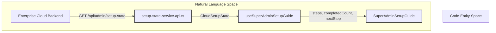
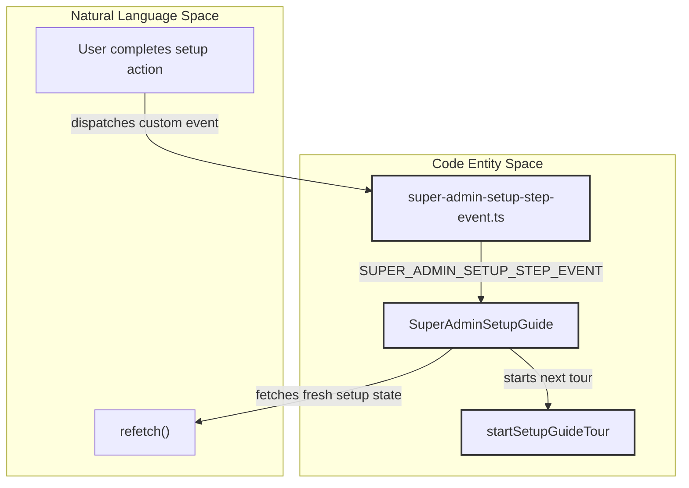

# Setup Guide Tour

<details>
<summary>Relevant source files</summary>

The following files were used as context for generating this wiki page:

- [__tests__/components/features/setup-guide/setup-guide-tour.test.ts](__tests__/components/features/setup-guide/setup-guide-tour.test.ts)
- [__tests__/components/features/setup-guide/super-admin-setup-guide.test.tsx](__tests__/components/features/setup-guide/super-admin-setup-guide.test.tsx)
- [__tests__/components/features/setup-guide/tour-engine.test.ts](__tests__/components/features/setup-guide/tour-engine.test.ts)
- [__tests__/components/features/sidebar/sidebar-onboarding-checklist.test.tsx](__tests__/components/features/sidebar/sidebar-onboarding-checklist.test.tsx)
- [__tests__/hooks/mutation/use-add-mcp-server.test.ts](__tests__/hooks/mutation/use-add-mcp-server.test.ts)
- [__tests__/hooks/query/use-cloud-organizations.test.tsx](__tests__/hooks/query/use-cloud-organizations.test.tsx)
- [src/api/cloud/setup-state-service.api.ts](src/api/cloud/setup-state-service.api.ts)
- [src/api/cloud/types.ts](src/api/cloud/types.ts)
- [src/components/features/setup-guide/super-admin-setup-guide.constants.ts](src/components/features/setup-guide/super-admin-setup-guide.constants.ts)
- [src/components/features/setup-guide/super-admin-setup-guide.tsx](src/components/features/setup-guide/super-admin-setup-guide.tsx)
- [src/components/features/setup-guide/tour/setup-guide-tour.ts](src/components/features/setup-guide/tour/setup-guide-tour.ts)
- [src/components/features/setup-guide/tour/tour-engine.ts](src/components/features/setup-guide/tour/tour-engine.ts)
- [src/components/features/setup-guide/tour/tour-theme.css](src/components/features/setup-guide/tour/tour-theme.css)
- [src/components/features/setup-guide/tour/tour-types.ts](src/components/features/setup-guide/tour/tour-types.ts)
- [src/components/features/setup-guide/use-super-admin-setup-guide.ts](src/components/features/setup-guide/use-super-admin-setup-guide.ts)
- [src/components/features/sidebar/use-sidebar-onboarding-checklist.ts](src/components/features/sidebar/use-sidebar-onboarding-checklist.ts)
- [src/hooks/query/use-cloud-current-user-id.ts](src/hooks/query/use-cloud-current-user-id.ts)
- [src/hooks/query/use-cloud-organizations.ts](src/hooks/query/use-cloud-organizations.ts)

</details>


## Purpose and Scope
This document provides comprehensive technical documentation for the Super-Admin Setup Guide and interactive Tour Engine in Agent Canvas (`src/components/features/setup-guide/` [src/components/features/setup-guide/super-admin-setup-guide.tsx:1-79]()). It covers the underlying cloud setup-state architecture, the React hooks managing guide progression, tour specification data structures, the wrapper around `driver.js` (`src/components/features/setup-guide/tour/tour-engine.ts` [src/components/features/setup-guide/tour/tour-engine.ts:1-15]()), custom theming, and event-driven tour step completion lifecycles.

---

## 1. Cloud Setup-State Architecture and Hooks

The setup guide is driven by server-side state retrieved from an OpenHands Enterprise backend (`src/api/cloud/setup-state-service.api.ts`()). The hook `useSuperAdminSetupGuide` queries `GET /api/admin/setup-state` to determine the visibility of the guide, the assigned organization ID, and the completion status of individual onboarding tasks (`src/api/cloud/types.ts` [src/api/cloud/types.ts:66-85]()).

### Data Flow and State Definitions
The state payload consists of `CloudSetupState` which contains optional `guide_steps` for the primary Super Admin (`src/api/cloud/types.ts` [src/api/cloud/types.ts:81-85]()).



* **Sources:** `src/api/cloud/types.ts` [src/api/cloud/types.ts:66-85](), `__tests__/components/features/setup-guide/super-admin-setup-guide.test.tsx` [__tests__/components/features/setup-guide/super-admin-setup-guide.test.tsx:106-110]()

---

## 2. Super Admin Setup Guide Widget

The floating lower-right guide widget (`src/components/features/setup-guide/super-admin-setup-guide.tsx` [src/components/features/setup-guide/super-admin-setup-guide.tsx:77-79]()) renders the progress bar, completion counts, and links or triggers for each setup step.

### Step Navigation and Event Listeners
When a user completes an action, custom events (`SUPER_ADMIN_SETUP_STEP_EVENT`) trigger progression or automatic launching of the next step's tour (`src/components/features/setup-guide/super-admin-setup-guide.tsx` [src/components/features/setup-guide/super-admin-setup-guide.tsx:130-166]()).



* **Sources:** `src/components/features/setup-guide/super-admin-setup-guide.tsx` [src/components/features/setup-guide/super-admin-setup-guide.tsx:1-178]()

---

## 3. Tour Types and Specifications

Tours are defined statically via specifications (`src/components/features/setup-guide/tour/setup-guide-tour.ts` [src/components/features/setup-guide/tour/setup-guide-tour.ts:18-63]()) using types declared in `tour-types.ts` [src/components/features/setup-guide/tour/tour-types.ts:5-34]()).

### Key Interfaces
* `GuidedTourStop`: Defines individual spotlight popovers, targeting CSS selectors via `anchor`, specifying `route`, and setting completion hooks such as `waitForComplete` or `advanceOnClick` [src/components/features/setup-guide/tour/tour-types.ts:5-34]().
* `GuidedTour`: Groups an ordered collection of `GuidedTourStop` entries under a unique `id` [src/components/features/setup-guide/tour/tour-types.ts:36-39]().

```typescript
export interface GuidedTourStop {
  id: string;
  route?: string;
  anchor: string;
  title: string;
  body: string;
  side?: GuidedTourSide;
  advanceOnClick?: string;
  waitForComplete?: SuperAdminSetupStepId;
  interactive?: boolean;
  hideFooter?: boolean;
}
```

* **Sources:** `src/components/features/setup-guide/tour/tour-types.ts` [src/components/features/setup-guide/tour/tour-types.ts:1-46](), `src/components/features/setup-guide/tour/setup-guide-tour.ts` [src/components/features/setup-guide/tour/setup-guide-tour.ts:1-63]()

---

## 4. Tour Engine & driver.js Integration

The tour engine (`src/components/features/setup-guide/tour/tour-engine.ts` [src/components/features/setup-guide/tour/tour-engine.ts:1-15]()) wraps `driver.js` to manage multi-step spotlights across route transitions, asynchronous DOM element resolution, and event-driven step termination.

### Execution Lifecycle
1. **Initialization:** `startGuidedTour` clears existing drivers, verifies the target route, and resolves the first anchor element with a timeout (`src/components/features/setup-guide/tour/tour-engine.ts` [src/components/features/setup-guide/tour/tour-engine.ts:179-197]()).
2. **Waiting States:** If a stop relies on `waitForComplete`, the engine attaches listeners to `SUPER_ADMIN_SETUP_STEP_EVENT` to automatically advance or conclude the tour (`__tests__/components/features/setup-guide/tour-engine.test.ts` [__tests__/components/features/setup-guide/tour-engine.test.ts:86-101]()).
3. **Interactive Overlays:** Stops marked `interactive` allow click events to pass through background overlays while keeping the target element highlighted (`src/components/features/setup-guide/tour/tour-engine.ts` [src/components/features/setup-guide/tour/tour-engine.ts:71-76]()).

* **Sources:** `src/components/features/setup-guide/tour/tour-engine.ts` [src/components/features/setup-guide/tour/tour-engine.ts:1-222](), `__tests__/components/features/setup-guide/tour-engine.test.ts` [__tests__/components/features/setup-guide/tour-engine.test.ts:1-102]()

---

## 5. Tour Theming & CSS Scoping

Visual styling for the driver.js popovers and spotlight overlays is isolated in `tour-theme.css` [src/components/features/setup-guide/tour/tour-theme.css:1-1]() and imported directly by `tour-engine.ts` [src/components/features/setup-guide/tour/tour-engine.ts:1-10]()).

* **Body Classes:** Controls layout flags like `.oh-setup-tour-interactive` and `.oh-setup-tour-waiting` during asynchronous DOM element resolution (`src/components/features/setup-guide/tour/tour-engine.ts` [src/components/features/setup-guide/tour/tour-engine.ts:17-22]()).

* **Sources:** `src/components/features/setup-guide/tour/tour-theme.css` [src/components/features/setup-guide/tour/tour-theme.css:1-1](), `src/components/features/setup-guide/tour/tour-engine.ts` [src/components/features/setup-guide/tour/tour-engine.ts:1-22]()