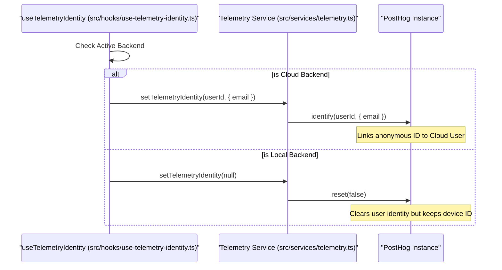

# Telemetry and Analytics

<details>
<summary>Relevant source files</summary>

The following files were used as context for generating this wiki page:

- [__tests__/components/features/conversation-panel/local-new-conversation-menu.test.tsx](__tests__/components/features/conversation-panel/local-new-conversation-menu.test.tsx)
- [__tests__/components/providers/telemetry-provider.test.tsx](__tests__/components/providers/telemetry-provider.test.tsx)
- [__tests__/hooks/mutation/use-new-conversation-command.test.tsx](__tests__/hooks/mutation/use-new-conversation-command.test.tsx)
- [__tests__/hooks/use-telemetry-identity.test.ts](__tests__/hooks/use-telemetry-identity.test.ts)
- [__tests__/hooks/use-tracking.test.ts](__tests__/hooks/use-tracking.test.ts)
- [__tests__/services/cloud-funnel-analytics.test.ts](__tests__/services/cloud-funnel-analytics.test.ts)
- [__tests__/services/telemetry-bootstrap.test.ts](__tests__/services/telemetry-bootstrap.test.ts)
- [__tests__/services/telemetry-delivery.test.ts](__tests__/services/telemetry-delivery.test.ts)
- [__tests__/services/telemetry.test.ts](__tests__/services/telemetry.test.ts)
- [src/components/providers/telemetry-provider.tsx](src/components/providers/telemetry-provider.tsx)
- [src/hooks/use-telemetry-identity.ts](src/hooks/use-telemetry-identity.ts)
- [src/hooks/use-tracking.ts](src/hooks/use-tracking.ts)
- [src/services/cloud-funnel-analytics.ts](src/services/cloud-funnel-analytics.ts)
- [src/services/telemetry-context.ts](src/services/telemetry-context.ts)
- [src/services/telemetry.ts](src/services/telemetry.ts)

</details>


## Purpose and Scope

This document describes the telemetry and analytics infrastructure for the `@openhands/agent-canvas` package. The system is designed to provide insights into library usage, feature adoption, and error rates while strictly adhering to user privacy and consent requirements.

The architecture centers around a **PostHog** integration that handles event delivery, identity reconciliation across different backend types (Local vs. Cloud), and consent management.

For implementation details, see:
- [Telemetry Service](#13.1) — Detailed documentation of the telemetry service (`src/services/telemetry.ts`), PostHog instance isolation, and backend context decoration.
- [Tracking Hooks and Identity](#13.2) — Documentation on React hooks for event tracking (`useTracking`), identity synchronization (`useTelemetryIdentity`), and cross-service consent propagation.

---

## System Architecture

The telemetry system bridges the frontend application with PostHog's ingestion infrastructure. It uses a reverse proxy (`z.openhands.dev`) by default to ensure reliable delivery through ad-blockers [src/services/telemetry.ts:76-77]().

### Telemetry Component Flow

```mermaid
graph TD
    subgraph "Natural Language Space"
        UserAction[""User Action (e.g. Start Chat)""]
        Consent[""User Consent Decision""]
    end

    subgraph "Code Entity Space (Agent Canvas Frontend)"
        TH[""useTracking Hook (src/hooks/use-tracking.ts)""]
        TS[""Telemetry Service (src/services/telemetry.ts)""]
        TID[""useTelemetryIdentity (src/hooks/use-telemetry-identity.ts)""]
        TC[""telemetry-context.ts utilities""]
    end

    subgraph "External Ingestion"
        PH[""PostHog JS Instance ('agent-canvas')""]
        PROXY[""Reverse Proxy (z.openhands.dev)""]
    end

    UserAction --> TH
    Consent --> TS
    TH --> TS
    TID --> TS
    TS -- "addCanvasEventProperties" --> TC
    TS -- "capture" --> PH
    PH --> PROXY
```

**Sources:** [src/services/telemetry.ts:64-77](), [src/hooks/use-tracking.ts:48-81](), [src/hooks/use-telemetry-identity.ts:54-65]()

---

## Consent and Privacy

OpenHands follows an "opt-in" philosophy for all behavioral tracking. Only an anonymous installation event is sent by default to track package reach.

### Consent Lifecycle
1.  **Installation**: A `canvas_install` event is sent immediately on first use, regardless of consent. This is anonymous and contains no PII [src/services/telemetry.ts:9-10]().
2.  **Consent Persistence**: Consent is stored in `localStorage` under `openhands-telemetry-consent` [src/services/telemetry.ts:54]().
3.  **Revocation**: When consent is denied, `posthog.opt_out_capturing()` is called. A pending revocation ID is tracked to allow synchronization with backends [src/services/telemetry.ts:57-58]().
4.  **Automation Sync**: For local backends, consent is propagated to the automation sidecar.

### Telemetry Configuration
| Property | Code Symbol / Default | Code Reference |
| :--- | :--- | :--- |
| **Instance Name** | `agent-canvas` | [src/services/telemetry.ts:64]() |
| **Default Host** | `https://z.openhands.dev` | [src/services/telemetry.ts:76]() |
| **Consent Key** | `openhands-telemetry-consent` | [src/services/telemetry.ts:54]() |
| **Package Name** | `@openhands/agent-canvas` | [src/services/telemetry.ts:164]() |

**Sources:** [src/services/telemetry.ts:35-64]()

---

## Identity Reconciliation

The system reconciles anonymous frontend sessions with authenticated backend identities, specifically for Cloud users, while maintaining isolation for local users.



**Sources:** [src/hooks/use-telemetry-identity.ts:54-86]()

---

## Event Tracking and Decoration

Events are decorated with rich metadata via a `before_send` interceptor before ingestion by PostHog.

### Automatic Context Injection
Every event captured automatically includes properties derived from `telemetry-context.ts`:
*   **Backend Context**: `backend_kind`, `agent_server_version`, and `automation_sdk_version` [src/services/telemetry-context.ts:15-21]().
*   **Cloud Context**: `cloud_user_id`, `cloud_user_email`, and `cloud_org_id` [src/services/telemetry-context.ts:9-13]().
*   **Package Info**: `package_name` and `package_version` from `package.json` [src/services/telemetry.ts:164-165]().

### High-Level Tracking Methods
The `useTracking` hook provides semantic wrappers for tracking:
*   `trackConversationCreated`: Logs `conversation_id`, `agent_type`, and workspace parameters [src/hooks/use-tracking.ts:87-123]().
*   `trackAutomationSetupCreated`: Monitors the automation creation funnel [src/hooks/use-tracking.ts:181-192]().
*   `trackLoginButtonClick`: Logs authentication clicks [src/hooks/use-tracking.ts:83-85]().

**Sources:** [src/hooks/use-tracking.ts:48-81](), [src/services/telemetry-context.ts:9-21]()