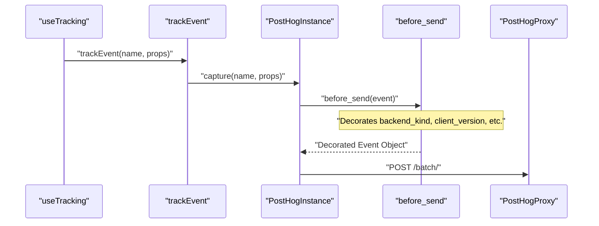
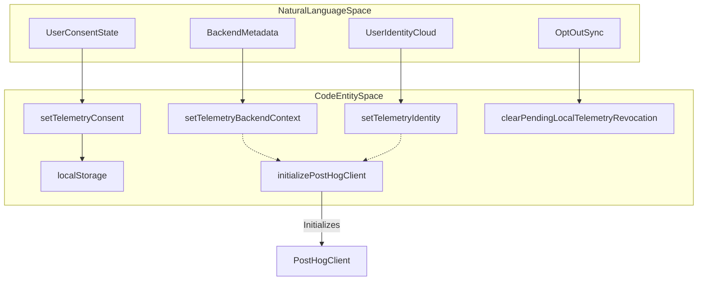

# Telemetry Service

Relevant source files

The following files were used as context for generating this wiki page:

- [__tests__/components/features/conversation-panel/local-new-conversation-menu.test.tsx](__tests__/components/features/conversation-panel/local-new-conversation-menu.test.tsx)
- [__tests__/components/providers/telemetry-provider.test.tsx](__tests__/components/providers/telemetry-provider.test.tsx)
- [__tests__/hooks/mutation/use-new-conversation-command.test.tsx](__tests__/hooks/mutation/use-new-conversation-command.test.tsx)
- [__tests__/hooks/use-telemetry-identity.test.ts](__tests__/hooks/use-telemetry-identity.test.ts)
- [__tests__/hooks/use-tracking.test.ts](__tests__/hooks/use-tracking.test.ts)
- [__tests__/services/cloud-funnel-analytics.test.ts](__tests__/services/cloud-funnel-analytics.test.ts)
- [__tests__/services/telemetry-bootstrap.test.ts](__tests__/services/telemetry-bootstrap.test.ts)
- [__tests__/services/telemetry-delivery.test.ts](__tests__/services/telemetry-delivery.test.ts)
- [__tests__/services/telemetry.test.ts](__tests__/services/telemetry.test.ts)
- [src/components/providers/telemetry-provider.tsx](src/components/providers/telemetry-provider.tsx)
- [src/hooks/use-telemetry-identity.ts](src/hooks/use-telemetry-identity.ts)
- [src/hooks/use-tracking.ts](src/hooks/use-tracking.ts)
- [src/services/cloud-funnel-analytics.ts](src/services/cloud-funnel-analytics.ts)
- [src/services/telemetry-context.ts](src/services/telemetry-context.ts)
- [src/services/telemetry.ts](src/services/telemetry.ts)

The Telemetry service provides anonymous usage tracking for the `@openhands/agent-canvas` package. It utilizes the PostHog SDK for reliable event delivery with built-in batching, retry logic, and offline support [src/services/telemetry.ts:1-7](). The service balances product telemetry needs with user privacy, enforcing a strict consent model and supporting complete opt-out mechanisms.

## Tracking Philosophy and Architecture

The service operates under a tiered tracking model:
1.  **Install Event (`canvas_install`)**: Sent immediately upon first use to track unique installations. This is anonymous and contains no PII [src/services/telemetry.ts:8-10]().
2.  **Session/Custom Events**: Only captured after a user explicitly grants consent via the consent banner [src/services/telemetry.ts:11-12]().
3.  **Ad Blocker Resilience**: Telemetry is routed through OpenHands' reverse proxy (`https://z.openhands.dev`) to avoid ad blockers, though library consumers can override this via `VITE_POSTHOG_HOST` [src/services/telemetry.ts:14-18]().
4.  **Hard Disables**: Telemetry can be entirely disabled via `VITE_DO_NOT_TRACK`, the browser's Do Not Track setting, or runtime injection of `window.__AGENT_CANVAS_DO_NOT_TRACK__ = true` by the static server [src/services/telemetry.ts:24-32](). Under any of these conditions, the PostHog client is never initialized.

### Named Instance Isolation
To prevent conflicts with other PostHog instances in host applications, the service initializes a named PostHog instance identified as `agent-canvas` [src/services/telemetry.ts:64](). This ensures persistence and configuration remain strictly isolated to the library's scope [src/services/telemetry.ts:122-133]().

Sources: [src/services/telemetry.ts:1-33](), [src/services/telemetry.ts:64-83]()

## Implementation Detail

### Core Data Flow

The following diagram illustrates the lifecycle of a telemetry event, from the UI invocation to final PostHog ingestion, including backend context decoration.

Sources: [src/services/telemetry.ts:151-192](), [src/__tests__/services/telemetry.test.ts:134-154]()

### System Entities Mapping

This diagram maps conceptual telemetry operations to their underlying code entities.

Sources: [src/services/telemetry.ts:54-63](), [src/services/telemetry.ts:184-215](), [src/services/telemetry.ts:245-277]()

## Key Functions and Classes

The telemetry module exposes a functional API to manage configuration, identity, and consent:

| Function / Symbol | Purpose |
| :--- | :--- |
| `configureTelemetry` | Configures PostHog API keys, API hosts, and UI hosts at runtime [src/services/telemetry.ts:84-91]() |
| `setTelemetryConsent` | Persists user consent state (`granted`, `denied`) to `localStorage` [src/services/telemetry.ts:108-114]() |
| `trackInstall` | Captures the one-time anonymous `canvas_install` telemetry event [src/services/telemetry.ts:326-340]() |
| `initializePostHogClient` | Asynchronously initializes the named `agent-canvas` PostHog instance [src/services/telemetry.ts:184-215]() |
| `setTelemetryIdentity` | Links distinct user IDs and custom properties to the active telemetry session [src/services/telemetry.ts:149-160]() |

Sources: [src/services/telemetry.ts:84-340]()

## Context Decoration (`before_send`)

Every event captured by the `agent-canvas` PostHog instance passes through a `before_send` interceptor. This function automatically injects standard client and deployment metadata into every event payload:
*   `client_source`: Source client identifier [src/api/client-source.ts:1-5]()
*   `client_version`: Version string of the Agent Canvas client [src/api/client-source.ts:1-10]()
*   `backend_kind`: Active backend deployment kind (`local` or `remote`) [src/services/telemetry-context.ts:5-41]()
*   `agent_server_version`: Version of the connected agent server instance [src/services/telemetry-context.ts:15-21]()
*   `automation_sdk_version`: Version of the automation sidecar SDK [src/services/telemetry-context.ts:15-21]()

Sources: [src/services/telemetry.ts:151-192](), [src/services/telemetry-context.ts:43-67]()

## Consent Persistence and Revocation

### Local Persistence
Consent states are stored in `localStorage` under keys such as `openhands-telemetry-consent` [src/services/telemetry.ts:54](). 

### Pending Revocation Mechanism
When a user revokes consent, the service records a pending revocation key (`openhands-telemetry-consent-pending-local-revocation`) to ensure state synchronization with sidecar services (such as automation backends) even during intermittent connectivity issues [src/services/telemetry.ts:57-58](). Once acknowledged by the backend, the pending marker is cleared via `clearPendingLocalTelemetryRevocation` [src/__tests__/services/telemetry.test.ts:41]().

Sources: [src/services/telemetry.ts:54-61](), [src/__tests__/services/telemetry.test.ts:39-61]()