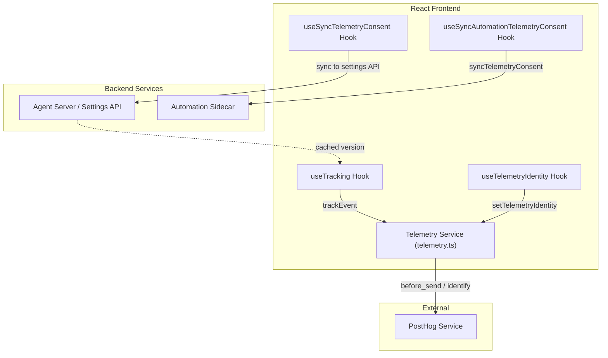
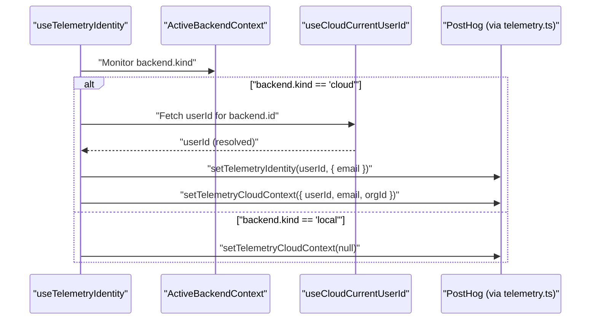

# Tracking Hooks and Identity

Relevant source files

The following files were used as context for generating this wiki page:

- [.github/pr-assets/pr-16982-validation.png](.github/pr-assets/pr-16982-validation.png)
- [__tests__/components/analytics/telemetry-consent-banner.test.tsx](__tests__/components/analytics/telemetry-consent-banner.test.tsx)
- [__tests__/components/features/conversation-panel/local-new-conversation-menu.test.tsx](__tests__/components/features/conversation-panel/local-new-conversation-menu.test.tsx)
- [__tests__/components/modals/settings/model-selector.test.tsx](__tests__/components/modals/settings/model-selector.test.tsx)
- [__tests__/components/providers/telemetry-provider.test.tsx](__tests__/components/providers/telemetry-provider.test.tsx)
- [__tests__/hooks/mutation/use-new-conversation-command.test.tsx](__tests__/hooks/mutation/use-new-conversation-command.test.tsx)
- [__tests__/hooks/query/use-automation-sdk-version.test.tsx](__tests__/hooks/query/use-automation-sdk-version.test.tsx)
- [__tests__/hooks/query/use-free-models.test.tsx](__tests__/hooks/query/use-free-models.test.tsx)
- [__tests__/hooks/query/use-git-sync.test.tsx](__tests__/hooks/query/use-git-sync.test.tsx)
- [__tests__/hooks/use-sync-automation-telemetry-consent.test.ts](__tests__/hooks/use-sync-automation-telemetry-consent.test.ts)
- [__tests__/hooks/use-sync-telemetry-consent.test.ts](__tests__/hooks/use-sync-telemetry-consent.test.ts)
- [__tests__/hooks/use-telemetry-identity.test.ts](__tests__/hooks/use-telemetry-identity.test.ts)
- [__tests__/hooks/use-tracking.test.ts](__tests__/hooks/use-tracking.test.ts)
- [__tests__/routes/automation-git-sync.test.tsx](__tests__/routes/automation-git-sync.test.tsx)
- [__tests__/services/cloud-funnel-analytics.test.ts](__tests__/services/cloud-funnel-analytics.test.ts)
- [__tests__/services/telemetry-bootstrap.test.ts](__tests__/services/telemetry-bootstrap.test.ts)
- [__tests__/services/telemetry-delivery.test.ts](__tests__/services/telemetry-delivery.test.ts)
- [__tests__/services/telemetry.test.ts](__tests__/services/telemetry.test.ts)
- [src/api/automation-service/automation-service.api.test.ts](src/api/automation-service/automation-service.api.test.ts)
- [src/components/features/automations/git-sync/git-sync-config-form.test.tsx](src/components/features/automations/git-sync/git-sync-config-form.test.tsx)
- [src/components/features/automations/git-sync/git-sync-config-form.tsx](src/components/features/automations/git-sync/git-sync-config-form.tsx)
- [src/components/providers/telemetry-provider.tsx](src/components/providers/telemetry-provider.tsx)
- [src/hooks/query/use-automation-sdk-version.ts](src/hooks/query/use-automation-sdk-version.ts)
- [src/hooks/query/use-free-models.ts](src/hooks/query/use-free-models.ts)
- [src/hooks/query/use-git-sync.ts](src/hooks/query/use-git-sync.ts)
- [src/hooks/use-sync-automation-telemetry-consent.ts](src/hooks/use-sync-automation-telemetry-consent.ts)
- [src/hooks/use-sync-telemetry-consent.ts](src/hooks/use-sync-telemetry-consent.ts)
- [src/hooks/use-telemetry-identity.ts](src/hooks/use-telemetry-identity.ts)
- [src/hooks/use-tracking.ts](src/hooks/use-tracking.ts)
- [src/routes/automation-git-sync.tsx](src/routes/automation-git-sync.tsx)
- [src/services/cloud-funnel-analytics.ts](src/services/cloud-funnel-analytics.ts)
- [src/services/telemetry-context.ts](src/services/telemetry-context.ts)
- [src/services/telemetry.ts](src/services/telemetry.ts)
- [tests/e2e/mock-llm/backends/mock-llm-auth-modes.spec.ts](tests/e2e/mock-llm/backends/mock-llm-auth-modes.spec.ts)
- [tests/e2e/mock-llm/backends/mock-llm-cross-connect.spec.ts](tests/e2e/mock-llm/backends/mock-llm-cross-connect.spec.ts)

## Purpose and Scope

This document describes the telemetry and analytics infrastructure within the `@openhands/agent-canvas` package. It covers the `useTracking` hook for event capture, the `useTelemetryIdentity` hook for user reconciliation, the `useSyncTelemetryConsent` and `useSyncAutomationTelemetryConsent` hooks for consent propagation, the consent banner component, and cloud-funnel-analytics.

The system is built on **PostHog** for reliable event delivery with batching and retry logic. Telemetry is designed to be anonymous by default, requiring explicit user consent for session-level tracking, except for an initial anonymous install event `[src/services/telemetry.ts:8-13]()`.

## Architecture Overview

The tracking architecture bridges the React frontend with both the PostHog analytics service and backend or automation services.

**Sources:** `[src/services/telemetry.ts:1-32]`, `[src/hooks/use-tracking.ts:48-62]`, `[src/hooks/use-sync-automation-telemetry-consent.ts:10-38]`, `[src/hooks/use-sync-telemetry-consent.ts:1-35]()`

## Tracking Hook (`useTracking`)

The `useTracking` hook is the primary interface for components to report user actions. It automatically injects backend context (e.g., server versions and backend kind) into every event `[src/hooks/use-tracking.ts:48-62]()`.

### Automatic Property Injection
Every event captured through `track()` includes `commonProperties` like the `current_url` `[src/hooks/use-tracking.ts:69-71]()`. Additionally, a `before_send` interceptor in the telemetry service decorates all events with package metadata and backend versions `[src/services/telemetry.ts:151-165]()`.

### Key Tracking Functions

| Function | Event Name | Purpose |
| :--- | :--- | :--- |
| `trackConversationCreated` | `conversation_start_requested` | Tracks conversation initialization including repository, workspace mode, and entry point `[src/hooks/use-tracking.ts:87-123]()`. |
| `trackBackendAdded` | `backend_added` | Logs new backend connections, identifying the `connectionMethod` (manual, cloud_login, cloud_cookie) `[src/hooks/use-tracking.ts:257-275]()`. |
| `trackUserMessageSent` | `user_message_sent` | Monitors engagement via message count and length `[src/hooks/use-tracking.ts:223-234]()`. |
| `trackAutomationSetupCreated` | `automation_setup_created` | Part of the automation setup funnel tracking `[src/hooks/use-tracking.ts:181-192]()`. |
| `trackOnboardingLinkClicked` | `onboarding_link_clicked` | Tracks interactions with the sidebar onboarding checklist `[src/hooks/use-tracking.ts:285-303]()`. |

**Sources:** `[src/hooks/use-tracking.ts:48-324]`, `[src/services/telemetry-context.ts:33-56]`, `[src/services/telemetry.ts:139-150]()`

## Identity Management (`useTelemetryIdentity`)

The `useTelemetryIdentity` hook reconciles Cloud user IDs and emails with PostHog's identity system. It ensures that events are attributed to the correct user when switching between Cloud and Local backends.

### Identity Flow

**Sources:** `[src/hooks/use-telemetry-identity.ts:54-110]`, `[src/services/telemetry.ts:219-245]()`

### Key Behaviors
- **Context Alignment**: If the active backend is not Cloud, the Cloud context is cleared to prevent cross-contamination of local usage data `[src/hooks/use-telemetry-identity.ts:71-74]()`.
- **Email Resolution**: The hook prioritizes the primary email from settings, falling back to `git_user_email` `[src/hooks/use-telemetry-identity.ts:63-64]()`.
- **Deduplication**: It uses `sessionStorage` to ensure that "Cloud Cookie Backend Added" events are only tracked once per browser session `[src/hooks/use-telemetry-identity.ts:87-99]()`.

## Consent Synchronization Hooks

### Telemetry Consent Sync (`useSyncTelemetryConsent`)
The `useSyncTelemetryConsent` hook synchronizes user consent settings between the client-side telemetry store and the backend preferences API. It reads the local consent status via `getTelemetryConsent()` and updates backend user preferences accordingly.

### Automation Sidecar Sync (`useSyncAutomationTelemetryConsent`)
The `useSyncAutomationTelemetryConsent` hook propagates the user's frontend consent decision to the automation sidecar via `AutomationService.syncTelemetryConsent`.

- **Trigger**: The hook syncs whenever the `backend.id`, `backend.host`, `backend.apiKey`, or `consent` state changes `[src/hooks/use-sync-automation-telemetry-consent.ts:38]()`.
- **Local Only**: Synchronization only occurs for `local` backends; Cloud consent is managed via the authentication layer `[src/hooks/use-sync-automation-telemetry-consent.ts:23-27]()`.
- **Implementation**: The service posts the `frontend_distinct_id` and `consent_granted` boolean to the `/api/automation/v1/telemetry/consent` endpoint `[src/api/automation-service/automation-service.api.test.ts:160-168]()`.

**Sources:** `[src/hooks/use-sync-telemetry-consent.ts:1-35]`, `[src/hooks/use-sync-automation-telemetry-consent.ts:10-39]`, `[src/api/automation-service/automation-service.api.test.ts:142-196]()`

## Consent Banner

The consent banner component surfaces telemetry collection choices to the user upon initial application load. It integrates directly with `setTelemetryConsent` to capture user preference, storing the decision locally and firing synchronization routines to propagate the choice to connected local sidecars and backend settings.

**Sources:** `[src/services/telemetry.ts:54-115]`, `[__tests__/components/analytics/telemetry-consent-banner.test.tsx:1-50]()`

## Cloud Funnel Analytics

The `cloud-funnel-analytics.ts` module provides specialized tracking for the Cloud onboarding and connection lifecycle.

- **Device Authorization**: Tracks the OAuth 2.0 Device Authorization Grant flow for Cloud backends.
- **Funnel Tracking**: Events like `trackCloudDeviceAuthorizationStarted` and `trackCloudDeviceAuthorizationSucceeded` are used to measure friction in the cloud connection process.

**Sources:** `[src/hooks/use-tracking.ts:277-283]`, `[src/services/telemetry-context.ts:58-66]`, `[src/services/cloud-funnel-analytics.ts:1-40]()`