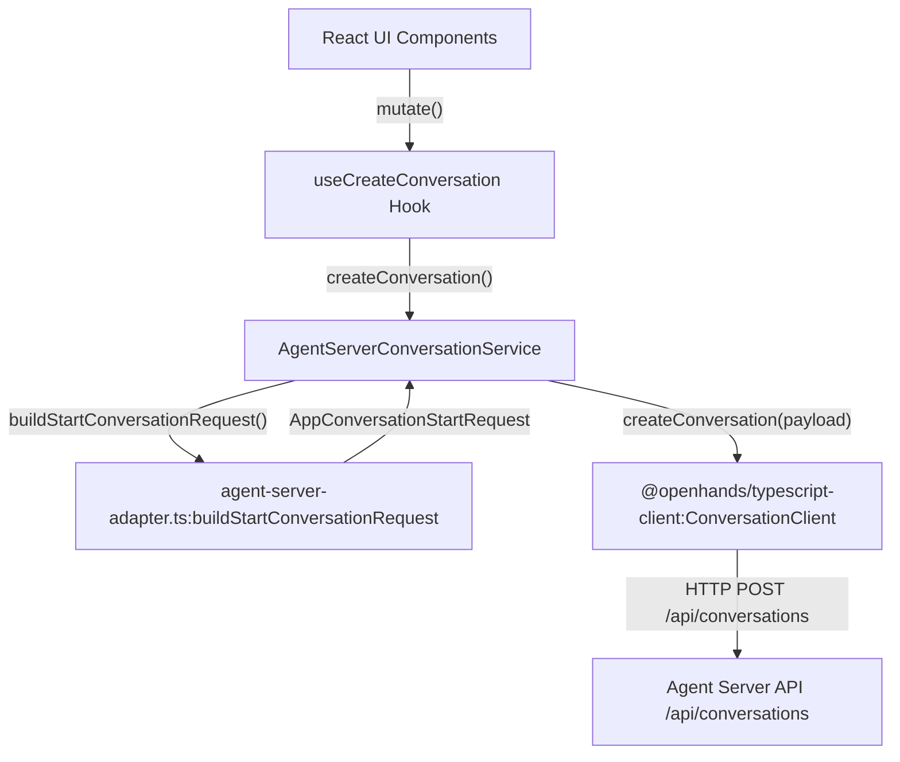
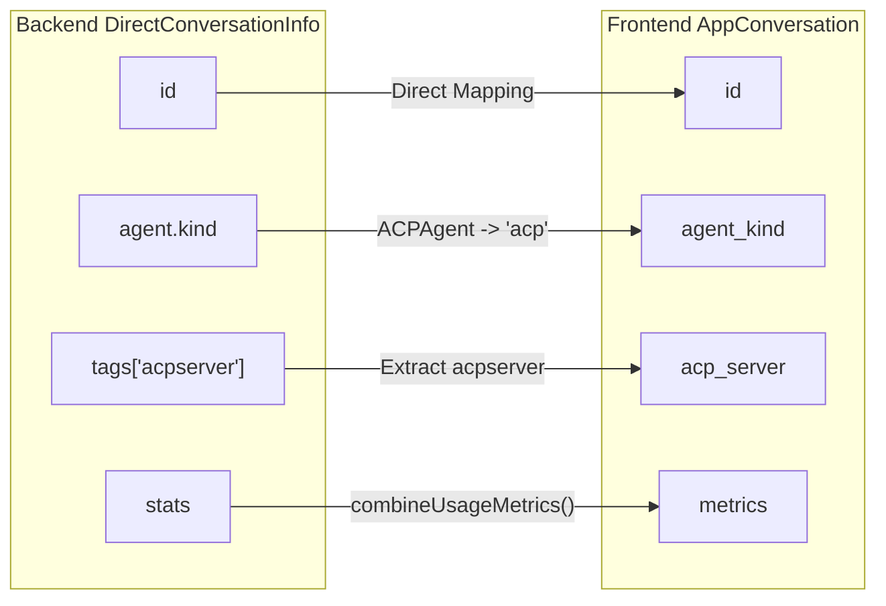

# Agent Server Adapter

Relevant source files

The following files were used as context for generating this wiki page:

- [__tests__/api/agent-server-adapter.test.ts](__tests__/api/agent-server-adapter.test.ts)
- [__tests__/api/agent-server-conversation-service.test.ts](__tests__/api/agent-server-conversation-service.test.ts)
- [__tests__/api/use-create-conversation-metadata.test.ts](__tests__/api/use-create-conversation-metadata.test.ts)
- [__tests__/hooks/mutation/use-create-conversation.test.tsx](__tests__/hooks/mutation/use-create-conversation.test.tsx)
- [__tests__/hooks/mutation/use-switch-llm-profile-and-log.test.tsx](__tests__/hooks/mutation/use-switch-llm-profile-and-log.test.tsx)
- [__tests__/hooks/mutation/use-update-mcp-server.test.ts](__tests__/hooks/mutation/use-update-mcp-server.test.ts)
- [src/api/agent-server-adapter.test.ts](src/api/agent-server-adapter.test.ts)
- [src/api/agent-server-adapter.ts](src/api/agent-server-adapter.ts)
- [src/api/conversation-metadata-store.ts](src/api/conversation-metadata-store.ts)
- [src/api/conversation-service/agent-server-conversation-service.api.ts](src/api/conversation-service/agent-server-conversation-service.api.ts)
- [src/api/conversation-service/agent-server-conversation-service.types.ts](src/api/conversation-service/agent-server-conversation-service.types.ts)
- [src/api/mcp-service/mcp-redacted-credentials.test.ts](src/api/mcp-service/mcp-redacted-credentials.test.ts)
- [src/api/mcp-service/mcp-redacted-credentials.ts](src/api/mcp-service/mcp-redacted-credentials.ts)
- [src/hooks/mutation/use-create-conversation.ts](src/hooks/mutation/use-create-conversation.ts)
- [src/hooks/mutation/use-switch-llm-profile-and-log.ts](src/hooks/mutation/use-switch-llm-profile-and-log.ts)
- [src/i18n/translation.json](src/i18n/translation.json)

## Purpose and Scope

The **Agent Server Adapter** (`src/api/agent-server-adapter.ts`) functions as the core translation layer between the Agent Canvas React frontend and the OpenHands Agent Server API. It normalizes data structures, constructs complex conversation start payloads, and injects runtime service metadata into agent environments.

Key operational responsibilities encompass:
- Constructing `AppConversationStartRequest` payloads via `buildStartConversationRequest` for both OpenHands and ACP (Agent Client Protocol) agent backends [src/api/agent-server-adapter.ts:258-450]().
- Normalizing raw `DirectConversationInfo` objects from the backend into frontend-ready `AppConversation` representations through `toAppConversation` [src/api/agent-server-adapter.ts:81-159](), [src/api/agent-server-adapter.ts:474-566]().
- Injecting client-side tools (`canvas_ui_client_tool`, `launch_child_conversation`, automation form tools) and bundled skills (`SKILLS_CATALOG`) into agent execution contexts [src/api/agent-server-adapter.ts:12-79]().
- Detecting and propagating secret encryption statuses (`secrets_encrypted`) when API keys or MCP headers are encrypted [__tests__/api/agent-server-adapter.test.ts:64-128]().
- Enforcing architectural constraints against direct, untyped agent-server requests [__tests__/api/agent-server-adapter.test.ts:1-21]().

**Sources:** [src/api/agent-server-adapter.ts:1-111](), [src/api/agent-server-adapter.ts:258-450](), [__tests__/api/agent-server-adapter.test.ts:64-128]()

---

## Architectural Constraint: No Direct Calls

The codebase enforces a strict architectural rule: **no UI component or non-adapter service may make direct HTTP requests to the agent-server.** All interaction must transit through the typed `@openhands/typescript-client` or through `AgentServerConversationService`, which delegates payload building to the adapter [src/api/agent-server-adapter.ts:11-15](), [src/api/conversation-service/agent-server-conversation-service.api.ts:9-13]().

This constraint is programmatically verified by architectural tests and static analysis:
- **Vitest Rule**: `__tests__/api/agent-server-adapter.test.ts` and related test suites validate service boundaries and request payloads [__tests__/api/agent-server-adapter.test.ts:1-21]().
- **Typed Client Routing**: All operations utilize methods on `ServerClient`, `ConversationClient`, `FilesClient`, and `ProfilesClient` [src/api/conversation-service/agent-server-conversation-service.api.ts:9-13]().

### Data Flow and Code Entity Architecture

**Sources:** [src/api/conversation-service/agent-server-conversation-service.api.ts:9-13](), [src/hooks/mutation/use-create-conversation.ts:104-120](), [__tests__/api/agent-server-adapter.test.ts:143-151]()

---

## Conversation Start Payload Construction

The `buildStartConversationRequest` function constructs the request payload sent to the agent-server. It branches significantly depending on whether the target agent is a standard **OpenHands** agent or an external **ACP** agent [src/api/agent-server-adapter.ts:258-450]().

### Payload Branches and Features

| Feature | OpenHands Branch (`agent_kind: "openhands"`) | ACP Branch (`agent_kind: "acp"`) |
| :--- | :--- | :--- |
| **Agent Configuration** | Uses `agent_settings.agent` (e.g., `CodeActAgent`) and litellm configs [__tests__/api/agent-server-adapter.test.ts:161-204](). | Uses `acp_server` (e.g., `claude-code`, `codex`) and `acp_command` [__tests__/api/agent-server-adapter.test.ts:98-128](). |
| **Tool Set** | Injects terminal, file editor, and browser tool sets. | Restricts server tools; delegates execution to the ACP subprocess. |
| **Client Tools** | Registers `CANVAS_UI_CLIENT_TOOL` and `LAUNCH_CHILD_CONVERSATION_CLIENT_TOOL` [src/api/agent-server-adapter.ts:62-70](). | Registers client-handled tools via `client_tools` property [src/api/conversation-service/agent-server-conversation-service.types.ts:87]() |
| **Skill Injection** | Bundles `SKILLS_CATALOG` items into `agent_context.skills` [src/api/agent-server-adapter.ts:12-51](). | Bundles `SKILLS_CATALOG` into `agent_context.skills`. |
| **Secret Encryption** | Evaluates LLM keys and MCP headers for `gAAAAA` encryption prefixes [__tests__/api/agent-server-adapter.test.ts:64-128](). | Evaluates MCP headers and auth tokens for `gAAAAA` prefixes [__tests__/api/agent-server-adapter.test.ts:98-128](). |

**Sources:** [src/api/agent-server-adapter.ts:12-79](), [__tests__/api/agent-server-adapter.test.ts:64-128](), [src/api/conversation-service/agent-server-conversation-service.types.ts:67-104]()

---

## Data Normalization (`toAppConversation`)

The agent-server returns raw conversation structures typed as `DirectConversationInfo`. The adapter's `toAppConversation` function normalizes these records into the frontend's `AppConversation` model [src/api/agent-server-adapter.ts:81-159](), [src/api/conversation-service/agent-server-conversation-service.api.ts:149-193]().

### Normalization Logic
- **Agent Kind Mapping**: Translates SDK Pydantic discriminators (`ACPAgent` to `"acp"`, `Agent` to `"openhands"`) [src/api/agent-server-adapter.ts:112-130]().
- **Metrics Combination**: Merges high-level `metrics` and granular `stats` using `combineUsageMetrics` [src/api/agent-server-adapter.ts:38-111]().
- **ACP Server Extraction**: Pulls the ACP provider identity (e.g., `claude-code`) from `tags.acpserver` (`ACP_SERVER_TAG_KEY`) [src/api/agent-server-adapter.ts:138-145]().
- **Local Metadata Merging**: Combines wire data with client-side localStorage metadata (`getStoredConversationMetadata`) to recover workspace modes and plugin references [src/api/conversation-metadata-store.ts:89-100]().

### Entity Mapping Architecture

**Sources:** [src/api/agent-server-adapter.ts:81-159](), [src/api/conversation-service/agent-server-conversation-service.api.ts:149-193](), [src/api/conversation-metadata-store.ts:89-100]()

---

## Runtime Services Injection

To enable agents to interact with sidecar services without discovery probing, the adapter appends environment metadata to the agent's system message via `buildRuntimeServicesSystemSuffix` [src/api/agent-server-adapter.ts:176-182]().

### Runtime Services Data Structures
- `RuntimeServicesInfo`: Defines sandbox URLs, ingress proxy endpoints, and frontend integration targets [src/api/agent-server-adapter.ts:176-182]().
- **System Prompt Suffix**: Wraps runtime metadata in an XML-like `<RUNTIME_SERVICES>` block injected at conversation launch [src/api/agent-server-adapter.ts:636-670]().

**Sources:** [src/api/agent-server-adapter.ts:176-182](), [__tests__/api/agent-server-adapter.test.ts:12-21]()

---

## Key Functions Summary

| Function Name | Location | Primary Role |
| :--- | :--- | :--- |
| `buildStartConversationRequest` | `src/api/agent-server-adapter.ts` | Assembles `AppConversationStartRequest` payloads, applying tool injections, skill catalogues, and encryption markers [src/api/agent-server-adapter.ts:258-450]() |
| `toAppConversation` | `src/api/agent-server-adapter.ts` | Normalizes `DirectConversationInfo` into frontend `AppConversation` objects [src/api/agent-server-adapter.ts:474-566]() |
| `buildRuntimeServicesSystemSuffix` | `src/api/agent-server-adapter.ts` | Generates the `<RUNTIME_SERVICES>` XML suffix for agent system prompts [src/api/agent-server-adapter.ts:636-670]() |
| `fetchBackendRuntimeServicesInfo` | `src/api/agent-server-adapter.ts` | Queries and parses runtime service metadata from active backend servers [src/api/agent-server-adapter.ts:576-620]() |

**Sources:** [src/api/agent-server-adapter.ts:258-670]()