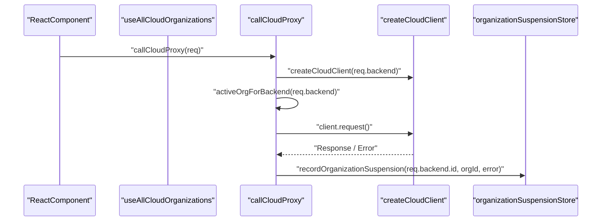
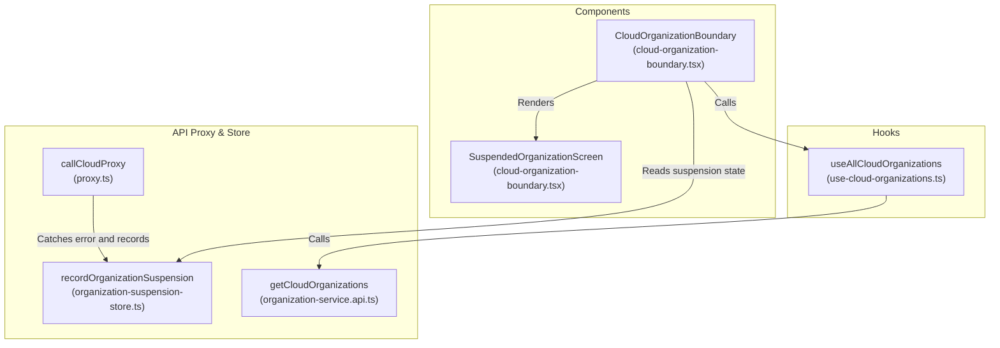

# Cloud API Proxy

Relevant source files

The following files were used as context for generating this wiki page:

- [__tests__/api/cloud/organization-service.test.ts](__tests__/api/cloud/organization-service.test.ts)
- [__tests__/api/cloud/proxy.test.ts](__tests__/api/cloud/proxy.test.ts)
- [__tests__/components/automations/detail/configuration-section.test.tsx](__tests__/components/automations/detail/configuration-section.test.tsx)
- [__tests__/components/backends/cloud-organization-startup.test.tsx](__tests__/components/backends/cloud-organization-startup.test.tsx)
- [__tests__/components/features/sidebar/sidebar-onboarding-checklist.test.tsx](__tests__/components/features/sidebar/sidebar-onboarding-checklist.test.tsx)
- [__tests__/hooks/mutation/use-add-mcp-server.test.ts](__tests__/hooks/mutation/use-add-mcp-server.test.ts)
- [__tests__/hooks/query/use-cloud-organizations.test.tsx](__tests__/hooks/query/use-cloud-organizations.test.tsx)
- [docs/DEVELOPMENT.md](docs/DEVELOPMENT.md)
- [src/api/cloud/client.ts](src/api/cloud/client.ts)
- [src/api/cloud/organization-service.api.ts](src/api/cloud/organization-service.api.ts)
- [src/api/cloud/organization-suspension-store.ts](src/api/cloud/organization-suspension-store.ts)
- [src/api/cloud/proxy.ts](src/api/cloud/proxy.ts)
- [src/api/cloud/setup-state-service.api.ts](src/api/cloud/setup-state-service.api.ts)
- [src/api/cloud/types.ts](src/api/cloud/types.ts)
- [src/components/features/automations/detail/configuration-section.tsx](src/components/features/automations/detail/configuration-section.tsx)
- [src/components/features/backends/cloud-organization-boundary.tsx](src/components/features/backends/cloud-organization-boundary.tsx)
- [src/components/features/setup-guide/super-admin-setup-guide.constants.ts](src/components/features/setup-guide/super-admin-setup-guide.constants.ts)
- [src/components/features/setup-guide/use-super-admin-setup-guide.ts](src/components/features/setup-guide/use-super-admin-setup-guide.ts)
- [src/components/features/sidebar/use-sidebar-onboarding-checklist.ts](src/components/features/sidebar/use-sidebar-onboarding-checklist.ts)
- [src/hooks/query/use-cloud-current-user-id.ts](src/hooks/query/use-cloud-current-user-id.ts)
- [src/hooks/query/use-cloud-org-member.ts](src/hooks/query/use-cloud-org-member.ts)
- [src/hooks/query/use-cloud-organizations.ts](src/hooks/query/use-cloud-organizations.ts)
- [src/utils/automation-export.test.ts](src/utils/automation-export.test.ts)
- [src/utils/automation-export.ts](src/utils/automation-export.ts)
- [src/utils/automation-preset-sources.ts](src/utils/automation-preset-sources.ts)

## Purpose and Scope

The Cloud API Proxy system provides a secure, unified interface for the OpenHands frontend to communicate with All Hands Cloud services. It abstracts the complexities of authentication (`bearer`, `session-api-key`, `none`, or `cookie`), organization-based scoping (`X-Org-Id`), and runtime-specific client routing (`hostOverride`) [src/api/cloud/proxy.ts:10-53](). 

The primary entry point is the `callCloudProxy` function defined in `src/api/cloud/proxy.ts`, which handles request transformation, client instantiation, and error interception for organization suspensions [src/api/cloud/proxy.ts:23-53]().

Sources: [src/api/cloud/proxy.ts:10-53]()

---

## Architecture and Request Flow

The Cloud API Proxy acts as a client-side bridge for all requests targeting cloud backends. When a request is dispatched, `callCloudProxy` resolves whether to create a standard client or a runtime-specific client, attaches organizational headers, and executes the HTTP request.

### Diagram: Natural Language to Code Entity Space for Cloud Request Pipeline

Sources: [src/api/cloud/proxy.ts:23-53](), [src/hooks/query/use-cloud-organizations.ts:28-116](), [src/api/cloud/organization-suspension-store.ts]()

---

## Core Implementation: callCloudProxy

The core function `callCloudProxy` wraps the TypeScript SDK's request mechanisms [src/api/cloud/proxy.ts:23-53](). It accepts a `CloudProxyRequest` interface specifying the target `Backend`, HTTP `method`, `path`, optional `body`, custom `headers`, `timeoutSeconds`, `hostOverride`, `authMode`, `sessionApiKey`, and `responseType` [src/api/cloud/proxy.ts:10-21]().

If `req.hostOverride` is provided, it instantiates a runtime client via `createCloudClientForRuntime`; otherwise, it uses `createCloudClient` [src/api/cloud/proxy.ts:26-28](). Errors thrown during the request are automatically captured by `recordOrganizationSuspension` to track organization-level access suspensions [src/api/cloud/proxy.ts:50-50]().

Sources: [src/api/cloud/proxy.ts:10-53]()

---

## Organization Scoping and X-Org-Id Injection

Cloud operations are strictly bound to an organizational context using the `X-Org-Id` HTTP header. 

1. **Active Org Resolution**: `callCloudProxy` queries `activeOrgForBackend(req.backend)` to retrieve the current organization bound to the target backend [src/api/cloud/proxy.ts:31-31]().
2. **Header Attachment**: If an `orgId` is present, it injects `"X-Org-Id": orgId` into the request headers [src/api/cloud/proxy.ts:32-32](). When targeting an inactive backend (such as during multi-backend discovery fan-outs), `X-Org-Id` is omitted to prevent `403 Forbidden` errors resulting from API key mismatches [__tests__/api/cloud/proxy.test.ts:92-115]().

Sources: [src/api/cloud/proxy.ts:23-33](), [__tests__/api/cloud/proxy.test.ts:61-115]()

---

## Organization Service, Hooks, and Suspension Store

The frontend manages organization state, discovery, and suspension handling via dedicated hooks and storage utilities.

- **`useAllCloudOrganizations`**: Implemented in `src/hooks/query/use-cloud-organizations.ts`, this hook fetches organizations for every registered cloud backend in parallel using `@tanstack/react-query` `useQueries` [src/hooks/query/use-cloud-organizations.ts:28-32](). It filters out invisible workspaces (`is_visible !== false`) and scopes the returned items against the current API key's organizational binding [src/hooks/query/use-cloud-organizations.ts:53-65]().
- **`CloudOrganizationBoundary`**: A guard component (`src/components/features/backends/cloud-organization-boundary.tsx`) that verifies organizational selection validity before mounting child consumers [src/components/features/backends/cloud-organization-boundary.tsx:14-40](). If an organization suspension is detected via `subscribeOrganizationSuspension`, it renders `SuspendedOrganizationScreen` to prompt the user to switch active workspaces [src/components/features/backends/cloud-organization-boundary.tsx:25-48]() [src/components/features/backends/cloud-organization-boundary.tsx:113-154]().

### Diagram: Code Entity Mapping for Cloud Organization & Suspension Boundary

Sources: [src/components/features/backends/cloud-organization-boundary.tsx:14-154](), [src/hooks/query/use-cloud-organizations.ts:28-116](), [src/api/cloud/proxy.ts:23-53](), [src/api/cloud/organization-suspension-store.ts]()