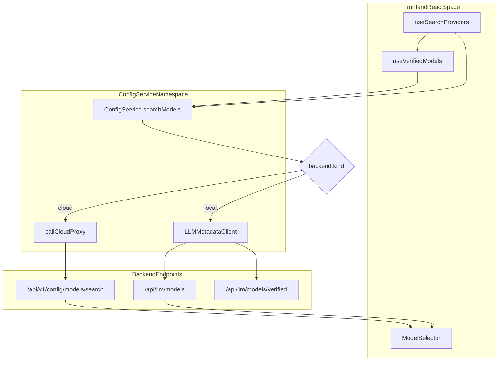
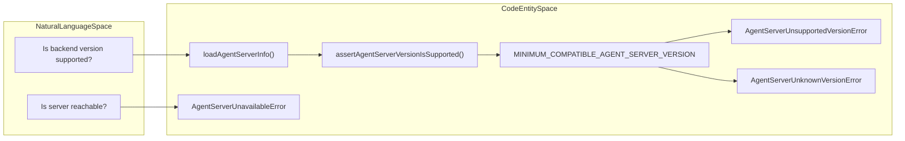

# Config and Option Services

Relevant source files

The following files were used as context for generating this wiki page:

- [.agents/skills/release.md](.agents/skills/release.md)
- [.github/release.yml](.github/release.yml)
- [.github/workflows/npm-publish.yml](.github/workflows/npm-publish.yml)
- [.github/workflows/pr.yml](.github/workflows/pr.yml)
- [.github/workflows/release-ready.yml](.github/workflows/release-ready.yml)
- [.github/workflows/release.yml](.github/workflows/release.yml)
- [__tests__/api/agent-server-compatibility-bundled-pin.test.ts](__tests__/api/agent-server-compatibility-bundled-pin.test.ts)
- [__tests__/api/config-service.test.ts](__tests__/api/config-service.test.ts)
- [__tests__/components/shared/modals/settings/settings-form.test.tsx](__tests__/components/shared/modals/settings/settings-form.test.tsx)
- [__tests__/github-workflows/npm-publish.test.ts](__tests__/github-workflows/npm-publish.test.ts)
- [__tests__/hooks/query/use-search-providers.test.tsx](__tests__/hooks/query/use-search-providers.test.tsx)
- [release-please-config.json](release-please-config.json)
- [src/api/agent-canvas-updates.test.ts](src/api/agent-canvas-updates.test.ts)
- [src/api/agent-canvas-updates.ts](src/api/agent-canvas-updates.ts)
- [src/api/agent-server-compatibility-prerelease.test.ts](src/api/agent-server-compatibility-prerelease.test.ts)
- [src/api/agent-server-compatibility.test.ts](src/api/agent-server-compatibility.test.ts)
- [src/api/config-service/config-service.api.ts](src/api/config-service/config-service.api.ts)
- [src/components/shared/modals/settings/settings-form.tsx](src/components/shared/modals/settings/settings-form.tsx)
- [src/hooks/query/use-latest-agent-canvas-version.ts](src/hooks/query/use-latest-agent-canvas-version.ts)
- [src/hooks/query/use-provider-models.ts](src/hooks/query/use-provider-models.ts)
- [src/hooks/query/use-search-providers.ts](src/hooks/query/use-search-providers.ts)
- [src/hooks/query/use-verified-models.ts](src/hooks/query/use-verified-models.ts)
- [tests/e2e/mock-llm/settings/mock-llm-cloud-providers-pagination.spec.ts](tests/e2e/mock-llm/settings/mock-llm-cloud-providers-pagination.spec.ts)

## Purpose and Scope

This page documents the frontend API services responsible for configuration, model discovery, and backend compatibility in Agent Canvas. These services bridge the React frontend to the OpenHands Agent Server and Cloud APIs, handling feature flags, LLM provider metadata, version validation, and update checks.

Key responsibilities include:
- **Config Service**: Managing feature flags via `use-config` hooks and searching for LLM models/providers across local and cloud backends [src/api/config-service/config-service.api.ts:58-193]().
- **Option Service**: Providing high-level access to server configuration and model lists with compatibility checks [src/api/option-service/option-service.api.ts:1-48]().
- **Compatibility Layer**: Ensuring the connected `agent-server` meets version requirements via version floors (`MINIMUM_COMPATIBLE_AGENT_SERVER_VERSION`) and advertising available toolsets [__tests__/api/agent-server-compatibility-bundled-pin.test.ts:29](), [src/api/agent-server-compatibility.ts:18-29]().
- **Update and Version Services**: Checking for newer Agent Canvas releases or updates [src/api/agent-canvas-updates.ts]().

Sources:
[src/api/config-service/config-service.api.ts:58-193]()
[src/api/option-service/option-service.api.ts:1-48]()
[src/api/agent-server-compatibility.ts:18-29]()
[src/api/agent-canvas-updates.ts]()

---

## Config and Model Discovery

The `ConfigService` handles the retrieval and filtering of LLM models and providers. It implements a dual-path logic depending on whether the active backend is a standard `local` Agent Server or the `cloud` API.

### Model and Provider Search
For `cloud` backends, the service delegates searching to the Cloud Proxy, calling `/api/v1/config/models/search` and `/api/v1/config/providers/search` [src/api/config-service/config-service.api.ts:71-86](). These endpoints return paginated results where "verified" status is already embedded.

For `local` backends, the service reconstructs the model list by:
1. Fetching raw models and providers from the Agent Server via `LLMMetadataClient` [src/api/config-service/config-service.api.ts:93-96]().
2. Fetching the "verified models" map [src/api/config-service/config-service.api.ts:89-92]().
3. Merging these sets and applying frontend-side filtering for queries and verification status [src/api/config-service/config-service.api.ts:120-127]().

### Key Hooks and Feature Flags
- `useSearchProviders`: Fetches all available LLM providers. It deliberately avoids pagination limits to prevent truncating providers like `openrouter` which appear late in alphabetical lists, and handles cursor pagination exhaustion on cloud backends [src/hooks/query/use-search-providers.ts:19-56]().
- `useVerifiedModels`: Caches the mapping of providers to their officially supported models via `fetchVerifiedModelsByProvider` [src/hooks/query/use-verified-models.ts:9-22]().
- `useConfig`: Consumes runtime configuration and feature flags from the web client config endpoints [src/hooks/query/use-config.ts]().

Sources:
[src/api/config-service/config-service.api.ts:65-192]()
[src/hooks/query/use-search-providers.ts:19-86]()
[src/hooks/query/use-verified-models.ts:9-22]()

---

## Option Service (`OptionService`)

The `OptionService` acts as a high-level wrapper for server-wide metadata. It is the primary consumer of the compatibility layer.

- `getConfig()`: Retrieves feature flags and general web-client configuration [src/api/option-service/option-service.api.ts](). It triggers a compatibility check on every call to ensure the backend is reachable and valid.
- `getModels()`: Returns a flattened list of all models, verified models, and verified providers supported by the current backend.

Sources:
[src/api/option-service/option-service.api.ts:1-48]()

---

## Agent Server Compatibility and Version Floors

Agent Canvas enforces a strict version floor to ensure the `agent-server` supports required features, API schemas, and tool definitions.

### Version Validation
The minimum required version is defined as `MINIMUM_COMPATIBLE_AGENT_SERVER_VERSION` [__tests__/api/agent-server-compatibility-bundled-pin.test.ts:29]().
When `loadAgentServerInfo` or `assertAgentServerVersionIsSupported` is called:
1. It probes `/server_info` on the active backend [src/api/agent-server-compatibility.ts]().
2. It evaluates version strings, throwing `AgentServerUnsupportedVersionError` if the backend is older than the floor [src/api/agent-server-compatibility.ts:81-93](), or `AgentServerUnknownVersionError` if the version cannot be parsed [src/api/agent-server-compatibility.ts:53-84]().

### Tool Gating and Capabilities
The server advertises its capabilities and usable tools. The frontend queries these properties to conditionally render UI components and features depending on the connected backend version.

Sources:
[__tests__/api/agent-server-compatibility-bundled-pin.test.ts:29-30]()
[src/api/agent-server-compatibility.ts:18-93]()

---

## Update and Version Services

Agent Canvas includes utility services to query current application versions, check for upgrades, and synchronize client states against release metadata (`src/api/agent-canvas-updates.ts`). These services support desktop and container environments by tracking deployed versions against published registry versions.

Sources:
[src/api/agent-canvas-updates.ts:1-37]()

---

## Data Flow: Model Discovery Architecture

Title: "Model Discovery Data Flow"

Sources:
[src/api/config-service/config-service.api.ts:65-192]()
[src/hooks/query/use-search-providers.ts:58-87]()
[src/hooks/query/use-verified-models.ts:9-22]()

---

## Compatibility and Version Gating Flow

Title: "Agent Server Compatibility Validation Flow"

Sources:
[__tests__/api/agent-server-compatibility-bundled-pin.test.ts:28-30]()
[src/api/agent-server-compatibility.ts:18-93]()