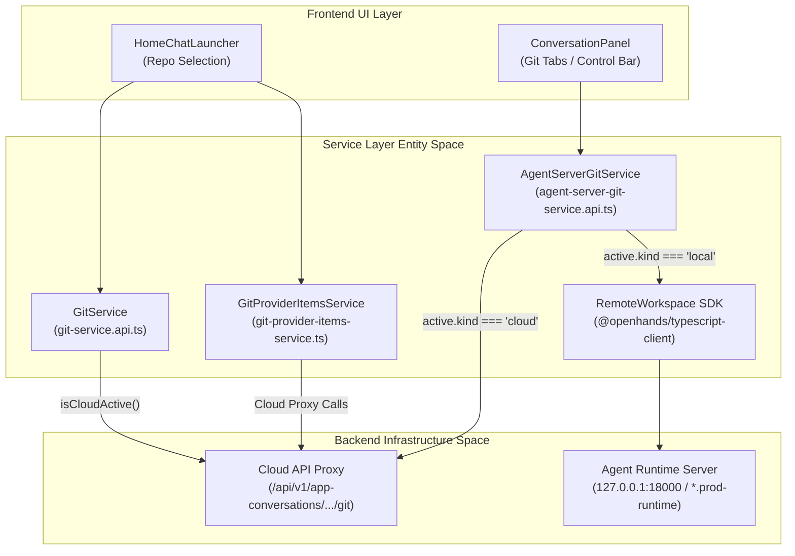
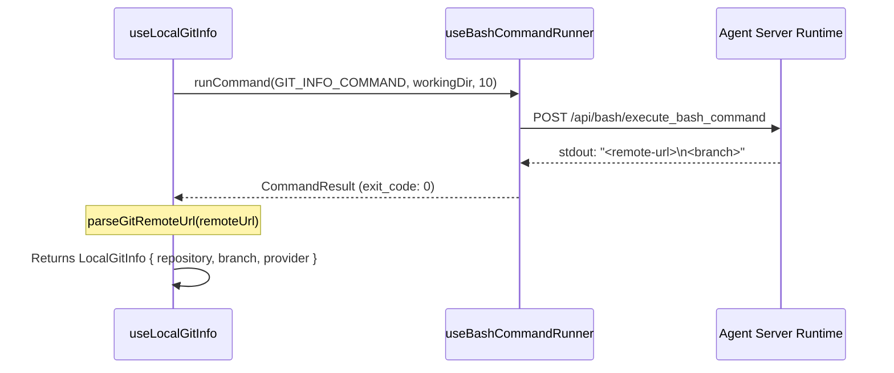
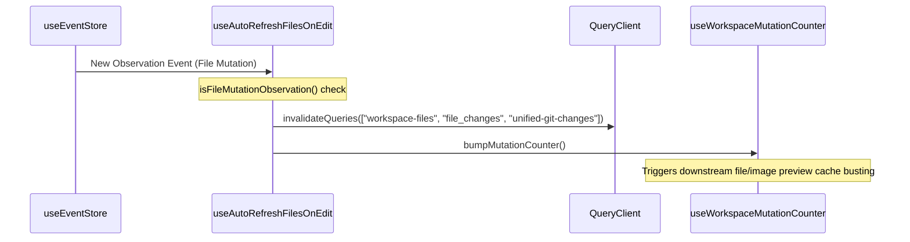

# Git Service API

Relevant source files

The following files were used as context for generating this wiki page:

- [__tests__/api/agent-server-conversation-service-condense.test.ts](__tests__/api/agent-server-conversation-service-condense.test.ts)
- [__tests__/api/agent-server-conversation-service-regressions.test.ts](__tests__/api/agent-server-conversation-service-regressions.test.ts)
- [__tests__/api/agent-server-git-service.test.ts](__tests__/api/agent-server-git-service.test.ts)
- [__tests__/api/automation-setup-handoff-store.test.ts](__tests__/api/automation-setup-handoff-store.test.ts)
- [__tests__/api/bash-service.test.ts](__tests__/api/bash-service.test.ts)
- [__tests__/api/git-provider-items-service.test.ts](__tests__/api/git-provider-items-service.test.ts)
- [__tests__/api/git-service.test.ts](__tests__/api/git-service.test.ts)
- [__tests__/api/runtime-service/agent-server-runtime-service.test.ts](__tests__/api/runtime-service/agent-server-runtime-service.test.ts)
- [__tests__/build-websocket-url.test.ts](__tests__/build-websocket-url.test.ts)
- [__tests__/components/features/home/use-url-search.test.tsx](__tests__/components/features/home/use-url-search.test.tsx)
- [__tests__/hooks/query/use-acp-model-discovery.test.tsx](__tests__/hooks/query/use-acp-model-discovery.test.tsx)
- [__tests__/hooks/query/use-acp-session-models.test.tsx](__tests__/hooks/query/use-acp-session-models.test.tsx)
- [__tests__/hooks/query/use-has-git-commits.test.tsx](__tests__/hooks/query/use-has-git-commits.test.tsx)
- [__tests__/hooks/query/use-local-git-info.test.tsx](__tests__/hooks/query/use-local-git-info.test.tsx)
- [__tests__/hooks/use-auto-refresh-files-on-edit.test.tsx](__tests__/hooks/use-auto-refresh-files-on-edit.test.tsx)
- [__tests__/utils/websocket-url.test.ts](__tests__/utils/websocket-url.test.ts)
- [src/api/automation-setup-handoff-store.ts](src/api/automation-setup-handoff-store.ts)
- [src/api/bash-service/bash-service.api.ts](src/api/bash-service/bash-service.api.ts)
- [src/api/event-service/event-service.api.test.ts](src/api/event-service/event-service.api.test.ts)
- [src/api/git-provider-items-service.ts](src/api/git-provider-items-service.ts)
- [src/api/git-service/agent-server-git-service.api.ts](src/api/git-service/agent-server-git-service.api.ts)
- [src/api/git-service/git-service.api.ts](src/api/git-service/git-service.api.ts)
- [src/api/runtime-service/agent-server-runtime-service.ts](src/api/runtime-service/agent-server-runtime-service.ts)
- [src/components/features/home/git-repo-dropdown/use-url-search.tsx](src/components/features/home/git-repo-dropdown/use-url-search.tsx)
- [src/hooks/query/use-bash-command-logs.ts](src/hooks/query/use-bash-command-logs.ts)
- [src/hooks/query/use-has-git-commits.ts](src/hooks/query/use-has-git-commits.ts)
- [src/hooks/query/use-local-git-info.ts](src/hooks/query/use-local-git-info.ts)
- [src/hooks/use-auto-refresh-files-on-edit.ts](src/hooks/use-auto-refresh-files-on-edit.ts)
- [src/hooks/use-bash-command-runner.ts](src/hooks/use-bash-command-runner.ts)
- [src/utils/websocket-url.ts](src/utils/websocket-url.ts)

The Git Service API layer provides the interface for repository exploration, branch management, user installations, and in-conversation git operations (diffs, changes, and commits). It bridges the frontend application to both the **Cloud API** (for global repository discovery and provider integrations) and the **Agent Server** (for runtime workspace git status and local execution via the SDK).

---

## 1. Architecture and Data Flow

The system separates **Global Git Operations** (repository discovery and installation listings used during onboarding and home screen setup) from **Conversation Git Operations** (interacting with an agent's active workspace runtime).

Sources: [src/api/git-service/git-service.api.ts:60-86](), [src/api/git-service/agent-server-git-service.api.ts:100-130](), [src/api/git-provider-items-service.ts:1-40]()

---

## 2. GitService (Global Operations)

`GitService` handles repository discovery, branch listings, and user installation metadata across supported git providers [src/api/git-service/git-service.api.ts:60-86](). It validates provider values to prevent malformed requests and branches logic based on whether the active backend is configured for local or cloud transport [src/api/git-service/git-service.api.ts:25-86]().

### Key Static Methods
- `searchGitRepositories`: Queries repositories by search string and provider via cloud service or direct `GitClient` on local agent servers [src/api/git-service/git-service.api.ts:61-86]().
- `retrieveUserGitRepositories`: Fetches paginated user repository installations [src/api/git-service/git-service.api.ts:88-110]().
- `getRepositoryBranches`: Retrieves available branches for a given repository [src/api/git-service/git-service.api.ts:132-149]().
- `getUserInstallations`: Lists provider application installations [src/api/git-service/git-service.api.ts:170-183]().

Sources: [src/api/git-service/git-service.api.ts:60-184](), [__tests__/api/git-service.test.ts:96-111]()

---

## 3. AgentServerGitService (Conversation Operations)

`AgentServerGitService` manages git operations scoped to an active agent conversation or sandbox runtime [src/api/git-service/agent-server-git-service.api.ts:33-45](). 

### Implementation Details
- **Path Normalization**: Cloud runtimes require absolute paths (`/workspace/...`), whereas local servers handle relative workspace paths. `toAbsoluteRuntimePath` automatically prepends leading slashes [src/api/git-service/agent-server-git-service.api.ts:54-56]().
- **Cloud vs Local Routing**: In cloud mode, changes and diffs are requested via dedicated app-conversation proxy endpoints (`/api/v1/app-conversations/{id}/git/...`), while commit and runtime operations communicate directly with the container runtime using the session API key [src/api/git-service/agent-server-git-service.api.ts:109-116]().
- **Endpoint Fallback**: `getGitCommits` catches 404 responses (`isEndpointMissingError`), returning `null` when interacting with older agent-server versions that predate the commit endpoint [src/api/git-service/agent-server-git-service.api.ts:93-98](), [src/api/git-service/agent-server-git-service.api.ts:165-192]().

Sources: [src/api/git-service/agent-server-git-service.api.ts:33-192](), [__tests__/api/agent-server-git-service.test.ts:43-114]()

---

## 4. Git Provider Items Service

The `GitProviderItemsService` (`src/api/git-provider-items-service.ts`) coordinates pagination, state caching, and item normalization when rendering dropdown selectors for git organizations, installations, repositories, and branches in the home setup and workspace configuration views.

Sources: [src/api/git-provider-items-service.ts:1-50](), [__tests__/api/git-provider-items-service.test.ts:1-40]()

---

## 5. Unified Git Hooks and Local Git Info

The frontend relies on React hooks powered by TanStack Query to keep UI components updated with the workspace git status.

### `useLocalGitInfo`
The `useLocalGitInfo` hook probes local backends via a single consolidated bash script execution (`GIT_INFO_COMMAND`) to read remote origin URLs and active branch names [src/hooks/query/use-local-git-info.ts:38-95]().

Sources: [src/hooks/query/use-local-git-info.ts:38-75](), [src/hooks/query/use-local-git-info.ts:96-161]()

---

## 6. Auto-Refresh on Edit Architecture

To ensure the file viewer and git status tabs reflect agent modifications without requiring manual reloads, the `useAutoRefreshFilesOnEdit` hook listens to event stream updates and invalidates relevant queries [src/hooks/use-auto-refresh-files-on-edit.ts:1-100]().

Sources: [src/hooks/use-auto-refresh-files-on-edit.ts:40-120]()

---

## 7. Git Repository Mocks and Testing Infrastructure

Automated tests utilize dedicated MSW handlers and unit test suites to simulate git operations and repository browsing.

- **Mock Handlers**: `git-repository-handlers.ts` provides predefined test fixtures for git changes (added, modified, deleted files) and branch queries.
- **Test Suites**: `__tests__/api/git-service.test.ts` and `__tests__/api/agent-server-git-service.test.ts` validate fallback behavior, invalid provider error guards, and correct parameter passing to the typescript client.

Sources: [src/mocks/git-repository-handlers.ts:1-60](), [__tests__/api/git-service.test.ts:1-120](), [__tests__/api/agent-server-git-service.test.ts:1-114]()