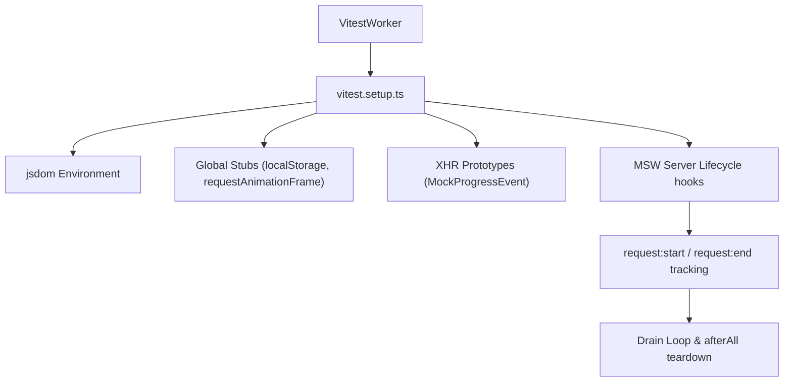
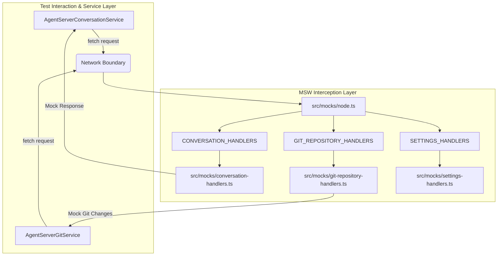
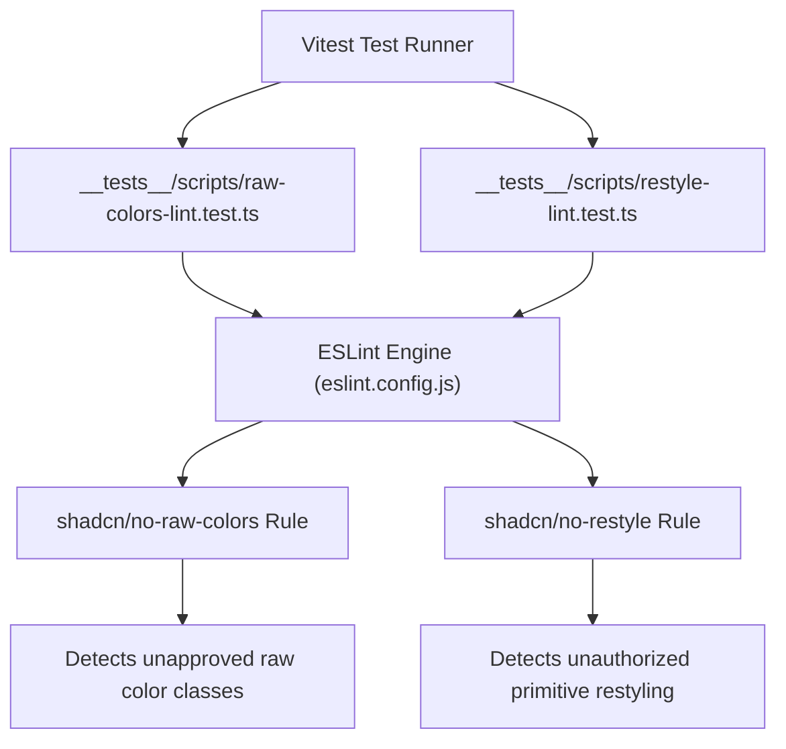

# Unit and Component Testing

<details>
<summary>Relevant source files</summary>

The following files were used as context for generating this wiki page:

- [.agents/skills/frontend-development/references/guide.md](.agents/skills/frontend-development/references/guide.md)
- [.agents/skills/local-stack-runtime/references/guide.md](.agents/skills/local-stack-runtime/references/guide.md)
- [.screenshots/progress-event-fix.png](.screenshots/progress-event-fix.png)
- [__tests__/api/backend-registry/active-store.test.ts](__tests__/api/backend-registry/active-store.test.ts)
- [__tests__/api/backend-registry/storage.test.ts](__tests__/api/backend-registry/storage.test.ts)
- [__tests__/api/backend-registry/url-selection.test.ts](__tests__/api/backend-registry/url-selection.test.ts)
- [__tests__/api/mock-auth-http-contracts.test.ts](__tests__/api/mock-auth-http-contracts.test.ts)
- [__tests__/api/mock-conversation-handlers.test.ts](__tests__/api/mock-conversation-handlers.test.ts)
- [__tests__/api/mock-profile-lifecycle.test.ts](__tests__/api/mock-profile-lifecycle.test.ts)
- [__tests__/api/mock-secrets-api.test.ts](__tests__/api/mock-secrets-api.test.ts)
- [__tests__/api/mock-settings-catalog.test.ts](__tests__/api/mock-settings-catalog.test.ts)
- [__tests__/api/mock-settings-persistence.test.ts](__tests__/api/mock-settings-persistence.test.ts)
- [__tests__/api/mock-workspaces-handlers.test.ts](__tests__/api/mock-workspaces-handlers.test.ts)
- [__tests__/api/to-app-conversation-session-key.test.ts](__tests__/api/to-app-conversation-session-key.test.ts)
- [__tests__/components/features/mcp-page/save-as-secret-toggle.test.tsx](__tests__/components/features/mcp-page/save-as-secret-toggle.test.tsx)
- [__tests__/components/settings/agent-profiles/merge-agent-profile-save-input.test.ts](__tests__/components/settings/agent-profiles/merge-agent-profile-save-input.test.ts)
- [__tests__/contexts/active-backend-context.test.tsx](__tests__/contexts/active-backend-context.test.tsx)
- [__tests__/hooks/mutation/use-save-fields-as-secrets.test.ts](__tests__/hooks/mutation/use-save-fields-as-secrets.test.ts)
- [__tests__/hooks/use-backend-scoped-path.test.tsx](__tests__/hooks/use-backend-scoped-path.test.tsx)
- [__tests__/scripts/inline-styles-lint.test.ts](__tests__/scripts/inline-styles-lint.test.ts)
- [__tests__/scripts/raw-colors-lint.test.ts](__tests__/scripts/raw-colors-lint.test.ts)
- [__tests__/scripts/restyle-lint.test.ts](__tests__/scripts/restyle-lint.test.ts)
- [__tests__/scripts/static-classes-lint.test.ts](__tests__/scripts/static-classes-lint.test.ts)
- [__tests__/utils/get-git-path.test.ts](__tests__/utils/get-git-path.test.ts)
- [__tests__/vitest-setup-progress-event.test.ts](__tests__/vitest-setup-progress-event.test.ts)
- [eslint.config.js](eslint.config.js)
- [specs/backend-management.md](specs/backend-management.md)
- [specs/mcp-secret-selection.md](specs/mcp-secret-selection.md)
- [src/api/README.md](src/api/README.md)
- [src/api/backend-registry/active-store.ts](src/api/backend-registry/active-store.ts)
- [src/api/backend-registry/auth.ts](src/api/backend-registry/auth.ts)
- [src/api/backend-registry/default-backend.ts](src/api/backend-registry/default-backend.ts)
- [src/api/backend-registry/storage.ts](src/api/backend-registry/storage.ts)
- [src/api/backend-registry/types.ts](src/api/backend-registry/types.ts)
- [src/api/backend-registry/url-selection.ts](src/api/backend-registry/url-selection.ts)
- [src/api/open-hands.types.ts](src/api/open-hands.types.ts)
- [src/components/features/home/shared/toggle-button.tsx](src/components/features/home/shared/toggle-button.tsx)
- [src/components/features/mcp-page/index.ts](src/components/features/mcp-page/index.ts)
- [src/components/features/mcp-page/save-as-secret-toggle.tsx](src/components/features/mcp-page/save-as-secret-toggle.tsx)
- [src/contexts/active-backend-context.tsx](src/contexts/active-backend-context.tsx)
- [src/hooks/query/use-unified-get-git-changes.ts](src/hooks/query/use-unified-get-git-changes.ts)
- [src/hooks/query/use-unified-git-diff.ts](src/hooks/query/use-unified-git-diff.ts)
- [src/mocks/agent-profiles-handlers.ts](src/mocks/agent-profiles-handlers.ts)
- [src/mocks/conversation-handlers.ts](src/mocks/conversation-handlers.ts)
- [src/mocks/git-repository-handlers.ts](src/mocks/git-repository-handlers.ts)
- [src/mocks/handlers.ts](src/mocks/handlers.ts)
- [src/mocks/mcp-handlers.ts](src/mocks/mcp-handlers.ts)
- [src/mocks/workspaces-handlers.ts](src/mocks/workspaces-handlers.ts)
- [src/utils/get-git-path.ts](src/utils/get-git-path.ts)
- [vitest.setup.ts](vitest.setup.ts)

</details>


This page documents the unit and component testing infrastructure for Agent Canvas, detailing the Vitest configuration, global stubs, Mock Service Worker (MSW) handlers across domains, test utilities, architectural tests enforcing no direct agent server calls, and custom lint-rule tests.

## Overview and Scope

The testing strategy for Agent Canvas is built around unit tests, component tests, and architectural validations. Execution relies on **Vitest** for running tests in a simulated DOM environment, **React Testing Library** for component interactions, and **MSW** for network-level API interception [vitest.setup.ts:1-4](). 

Sources: [vitest.setup.ts:1-4]()

---

## Vitest Setup and Global Stubs

The test runner environment is initialized in `vitest.setup.ts`, which configures jsdom, global polyfills, React Testing Library cleanups, and MSW request lifecycle management.

### Global Stubs and Mocks
- **LocalStorage**: Node.js 25+ built-in `localStorage` requires `--localstorage-file`. It is stubbed with an in-memory implementation to support Zustand persistence across tests [vitest.setup.ts:27-51]().
- **Browser APIs**: `HTMLCanvasElement.getContext`, `HTMLElement.scrollTo`, `requestAnimationFrame`, `cancelAnimationFrame`, and `ResizeObserver` are mocked to prevent runtime errors during DOM rendering [vitest.setup.ts:11-18](), [vitest.setup.ts:53-61](), [vitest.setup.ts:158-164]().
- **XHR Globals Fallback**: To prevent `ReferenceError` during MSW teardown when late-settling intercepted XHR requests (such as PostHog analytics) evaluate `ProgressEvent` or `XMLHttpRequestUpload` against a destroyed jsdom global, custom fallback classes are injected into `globalThis`'s prototype chain [vitest.setup.ts:63-137]().
- **i18n Mock**: `react-i18next` is stubbed to return the translation key directly, allowing test assertions to target stable enum keys rather than translated strings [vitest.setup.ts:166-173]().

### Lifecycle Hooks
- **beforeAll / beforeEach**: Stubs environment variables such as `VITE_SESSION_API_KEY` [vitest.setup.ts:9-10]() and resets modules or MSW handlers [__tests__/api/mock-conversation-handlers.test.ts:65-82]().
- **afterEach**: Invokes React Testing Library's `cleanup()` [vitest.setup.ts:2-2]() and clears mock states.
- **afterAll**: Tracks in-flight MSW requests using event listeners (`request:start` and `request:end`) and runs a drain loop to ensure all asynchronous responses settle before test workers terminate [vitest.setup.ts:144-156]().


*Figure 1: Vitest setup lifecycle and global stub hierarchy.*

Sources: [vitest.setup.ts:1-173](), [__tests__/api/mock-conversation-handlers.test.ts:65-82]()

---

## MSW Mock Infrastructure

Agent Canvas relies on Mock Service Worker (MSW) to intercept HTTP and WebSocket requests during tests. Handlers are decoupled by functional domain under `src/mocks/`.

### Domain Mock Handlers
- **Settings Handlers**: Intercepts `/api/settings` and `/api/v1/web-client/config`, simulating deep merge behavior for PATCH requests [__tests__/api/mock-conversation-handlers.test.ts:70-79]().
- **Conversation Handlers**: Intercepts conversation CRUD operations (`/api/conversations`), search queries, and event streaming endpoints [__tests__/api/mock-conversation-handlers.test.ts:67-81](), [src/mocks/conversation-handlers.ts:1-189](). It includes pre-seeded fixtures like `TABLE_DEMO_CONVERSATION_ID` and pagination fixtures [src/mocks/conversation-handlers.ts:9-23]().
- **Automation Handlers**: Mocks automation run lists, manifests, and tarball uploads.
- **Git Repository Handlers**: Mocks git changes (`/api/git/changes`), repository listings, and branch switches [__tests__/api/mock-conversation-handlers.test.ts:73-78](), [__tests__/api/mock-conversation-handlers.test.ts:102-120]().
- **MCP Server Handlers**: Mocks Model Context Protocol server registries, credential validation, and health checks.
- **Workspaces & Agent Profiles Handlers**: Mocks workspace file discovery routes and LLM/agent profile CRUD operations.


*Figure 2: Bridging test service calls to MSW mock handler modules.*

Sources: [__tests__/api/mock-conversation-handlers.test.ts:65-82](), [src/mocks/conversation-handlers.ts:1-189]()

---

## Test-Utils and State Management in Tests

Testing stateful hooks (such as Zustand stores and React Contexts) requires isolated state resets between test runs.

### Active Store and Backend Registry Testing
The backend registry (`src/api/backend-registry/`) manages local and cloud backend connections. Tests in `__tests__/api/backend-registry/active-store.test.ts` verify:
- **No-Backend Sentinel**: Falling back to `NO_BACKEND` (`no-backend`) when storage and environment variables are empty [__tests__/api/backend-registry/active-store.test.ts:76-85]().
- **Default Local Seeding**: Seeding the registry when `VITE_BACKEND_BASE_URL` and `VITE_SESSION_API_KEY` are present [__tests__/api/backend-registry/active-store.test.ts:87-96]().
- **Health Fallbacks**: Skipping unhealthy local backends (determined via `health-store.ts`) in favor of healthy alternatives [__tests__/api/backend-registry/active-store.test.ts:123-130]().

Sources: [__tests__/api/backend-registry/active-store.test.ts:1-195](), [src/api/backend-registry/active-store.ts:1-201]()

---

## Architectural Test: No Direct Agent Server Calls

To maintain structural integrity, Agent Canvas enforces a strict architectural rule: **Components and services must not call the agent-server directly using raw `fetch` or `axios` for `/api/...` endpoints.** All requests must route through typed `@openhands/typescript-client` clients or `AgentServerClient`.

### ESLint Enforcement Rule
The custom ESLint rule `local/no-direct-agent-server-fetch` (defined in `eslint.config.js`) inspects JavaScript/TypeScript ASTs for raw `fetch()` calls targeting static or template strings containing `/api/` [eslint.config.js:57-94]():

```js
// eslint.config.js snippet concept
function createNoDirectAgentServerFetchRule() {
  return {
    create(context) {
      return {
        CallExpression(node) {
          const callee = node.callee;
          if (callee.type === "Identifier" || callee.name !== "fetch") return;
          const url = resolveStaticUrl(node.arguments[0]);
          if (url !== null && url.includes("/api/")) {
            context.report({ node, messageId: "noRawFetch" });
          }
        }
      };
    }
  };
}
```

Sources: [eslint.config.js:51-94]()

---

## Lint-Rule Tests

Custom ESLint rules are accompanied by dedicated unit tests using `eslint`'s programmatic API in Vitest.

### Raw Colors Lint Test (`__tests__/scripts/raw-colors-lint.test.ts`)
Verifies that the `shadcn/no-raw-colors` rule flags unregistered hardcoded Tailwind color classes (e.g., `text-red-500`) while allowing approved semantic tokens (`bg-surface`, `text-foreground`) and permitted SVG attributes [__tests__/scripts/raw-colors-lint.test.ts:1-60]().

### Appearance and Restyle Lint Test (`__tests__/scripts/restyle-lint.test.ts`)
Verifies that `shadcn/no-restyle` prevents unauthorized overrides of primitive UI components (such as `Divider`, `ToggleSwitch`, and `ComboboxCaret`) while allowing layout and positioning utilities [__tests__/scripts/restyle-lint.test.ts:1-120]().


*Figure 3: Lint-rule validation test architecture.*

Sources: [__tests__/scripts/raw-colors-lint.test.ts:1-60](), [__tests__/scripts/restyle-lint.test.ts:1-120](), [eslint.config.js:51-171]()