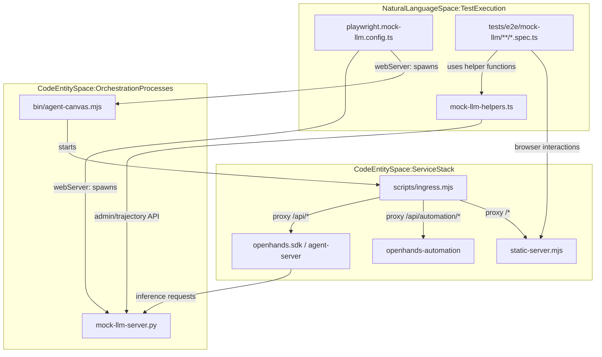
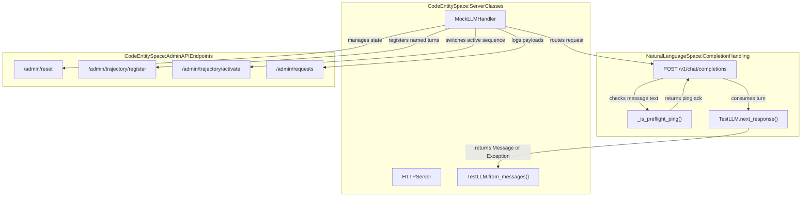

# E2E Testing with Mock LLM

Relevant source files

The following files were used as context for generating this wiki page:

- [.agents/skills/e2e-testing/references/guide.md](.agents/skills/e2e-testing/references/guide.md)
- [.github/workflows/ci.yml](.github/workflows/ci.yml)
- [.github/workflows/docker.yml](.github/workflows/docker.yml)
- [.github/workflows/mock-llm-docker-e2e.yml](.github/workflows/mock-llm-docker-e2e.yml)
- [.github/workflows/mock-llm-e2e.yml](.github/workflows/mock-llm-e2e.yml)
- [.github/workflows/sdk-version-sync.yml](.github/workflows/sdk-version-sync.yml)
- [__tests__/components/features/conversation/right-panel-toggle.test.tsx](__tests__/components/features/conversation/right-panel-toggle.test.tsx)
- [__tests__/e2e/mock-llm-skill-paths.test.ts](__tests__/e2e/mock-llm-skill-paths.test.ts)
- [__tests__/scripts/check-sdk-version-sync.test.ts](__tests__/scripts/check-sdk-version-sync.test.ts)
- [__tests__/scripts/dev-process-utils.test.ts](__tests__/scripts/dev-process-utils.test.ts)
- [docker/Dockerfile](docker/Dockerfile)
- [playwright.live.config.ts](playwright.live.config.ts)
- [playwright.mock-llm-docker.config.ts](playwright.mock-llm-docker.config.ts)
- [playwright.mock-llm.config.ts](playwright.mock-llm.config.ts)
- [scripts/dev-process-utils.mjs](scripts/dev-process-utils.mjs)
- [scripts/docker-build.mjs](scripts/docker-build.mjs)
- [src/components/features/conversation/right-panel-toggle.tsx](src/components/features/conversation/right-panel-toggle.tsx)
- [tests/e2e/live/utils/agent-server-conversation.ts](tests/e2e/live/utils/agent-server-conversation.ts)
- [tests/e2e/mock-llm/automations/mock-llm-automation.spec.ts](tests/e2e/mock-llm/automations/mock-llm-automation.spec.ts)
- [tests/e2e/mock-llm/conversations/mock-llm-conversation.spec.ts](tests/e2e/mock-llm/conversations/mock-llm-conversation.spec.ts)
- [tests/e2e/mock-llm/reporters/done-marker-reporter.ts](tests/e2e/mock-llm/reporters/done-marker-reporter.ts)
- [tests/e2e/mock-llm/scripts/mock-llm-server.py](tests/e2e/mock-llm/scripts/mock-llm-server.py)
- [tests/e2e/mock-llm/scripts/render-mock-llm-report.mjs](tests/e2e/mock-llm/scripts/render-mock-llm-report.mjs)
- [tests/e2e/mock-llm/scripts/test_mock_llm_server.py](tests/e2e/mock-llm/scripts/test_mock_llm_server.py)
- [tests/e2e/mock-llm/settings/mock-llm-acp-agent.spec.ts](tests/e2e/mock-llm/settings/mock-llm-acp-agent.spec.ts)
- [tests/e2e/mock-llm/settings/mock-llm-model-switch.spec.ts](tests/e2e/mock-llm/settings/mock-llm-model-switch.spec.ts)
- [tests/e2e/mock-llm/settings/mock-llm-profile-management.spec.ts](tests/e2e/mock-llm/settings/mock-llm-profile-management.spec.ts)
- [tests/e2e/mock-llm/skills/mock-llm-skills.spec.ts](tests/e2e/mock-llm/skills/mock-llm-skills.spec.ts)
- [tests/e2e/mock-llm/utils/mock-llm-helpers.ts](tests/e2e/mock-llm/utils/mock-llm-helpers.ts)
- [tests/e2e/mock-llm/utils/skill-test-helpers.ts](tests/e2e/mock-llm/utils/skill-test-helpers.ts)

## Purpose and Scope
This page documents the mock-LLM end-to-end (E2E) testing framework used in OpenHands to validate the Agent Canvas frontend, Python `agent-server`, automation backend, and ingress proxy. By substituting real LLM providers with a local Python server implementing the OpenHands `TestLLM` interface (`[tests/e2e/mock-llm/scripts/mock-llm-server.py:1-32]()`), the framework executes deterministic, zero-cost integration and regression tests across both local npm builds (`[playwright.mock-llm.config.ts:1-125]()`) and Docker container deployments (`[playwright.mock-llm-docker.config.ts:1-146]()`).

Sources: `[playwright.mock-llm.config.ts:1-19]`, `[tests/e2e/mock-llm/scripts/mock-llm-server.py:1-32]`, `[playwright.mock-llm-docker.config.ts:1-30]()`

## Architecture and System Data Flow

The mock-LLM E2E architecture coordinates multiple processes through Playwright's `webServer` configuration. The test runner initiates the Python mock LLM server alongside either the local npm stack (`[bin/agent-canvas.mjs]`) or a pre-built Docker container (`[ghcr.io/openhands/agent-canvas]`), routing browser traffic and agent API calls through a unified ingress proxy.

Sources: `[playwright.mock-llm.config.ts:88-166]`, `[tests/e2e/mock-llm/utils/mock-llm-helpers.ts:28-56]`, `[tests/e2e/mock-llm/scripts/mock-llm-server.py:1-102]()`

## Mock LLM Server and Trajectory Engine

The mock LLM server (`[tests/e2e/mock-llm/scripts/mock-llm-server.py:1-491]`) mimics an OpenAI-compatible completion endpoint by leveraging the `TestLLM` class from `openhands.sdk.testing` (`[tests/e2e/mock-llm/scripts/mock-llm-server.py:31-31]()`). It manages scripted conversation trajectories, handles profile pre-flight pings (`[tests/e2e/mock-llm/scripts/mock-llm-server.py:36-39]()`), and provides admin APIs for runtime trajectory registration and resetting.

Sources: `[tests/e2e/mock-llm/scripts/mock-llm-server.py:1-173]()`

## Playwright Configurations

The testing framework provides two distinct Playwright configuration targets depending on whether tests validate the npm executable or the container image:

| Configuration File | Target Runtime | Orchestration Mechanism | Key Environment Variables |
| :--- | :--- | :--- | :--- |
| `[playwright.mock-llm.config.ts:1-199]()` | Local npm build (`bin/agent-canvas.mjs`) | Spawns `mock-llm-server.py` and `bin/agent-canvas.mjs` via `webServer` | `MOCK_LLM_PORT`, `MOCK_LLM_BACKEND_URL`, `OH_CANVAS_SAFE_STATE_DIR` |
| `[playwright.mock-llm-docker.config.ts:1-237]()` | Docker Container Image (`ghcr.io/openhands/agent-canvas`) | Spawns `mock-llm-server.py` and runs Docker container with volume mounts | `MOCK_LLM_DOCKER_IMAGE`, `MOCK_LLM_AGENT_URL`, `MOCK_LLM_DOCKER_MODE` |

Sources: `[playwright.mock-llm.config.ts:1-166]`, `[playwright.mock-llm-docker.config.ts:1-146]()`

## Test Helpers and State Seeding

The helper module `[tests/e2e/mock-llm/utils/mock-llm-helpers.ts:1-1033]` supplies utility functions for browser initialization, authentication header injection, and trajectory manipulation:

*   `[tests/e2e/mock-llm/utils/mock-llm-helpers.ts:96-119]()`: Seeds browser `localStorage` with telemetry consent opt-outs, onboarding completion flags (`openhands-onboarded`), and a pre-configured local backend registry entry.
*   `[tests/e2e/mock-llm/utils/mock-llm-helpers.ts:122-133]()`: Intercepts API requests using `page.route` to automatically inject the `X-Session-API-Key` header (`[tests/e2e/mock-llm/utils/mock-llm-helpers.ts:127-130]()`).
*   `[tests/e2e/mock-llm/utils/mock-llm-helpers.ts:73-94]()`: Performs a direct `PATCH /api/settings` call to configure analytics preferences before UI tests render.
*   Constants like `BASH_TOKEN` (`[tests/e2e/mock-llm/utils/mock-llm-helpers.ts:12-12]()`) and `REPLY_TOKEN` (`[tests/e2e/mock-llm/utils/mock-llm-helpers.ts:13-13]()`) match the scripted behavior expected by the mock server.

Sources: `[tests/e2e/mock-llm/utils/mock-llm-helpers.ts:1-133]()`

## CI Workflows and Execution Suites

Mock-LLM E2E tests run across multiple automated GitHub Actions pipelines:

1.  **Mock-LLM E2E (`[ .github/workflows/mock-llm-e2e.yml:1-213 ]()`)**: Installs dependencies, sets up a Python virtual environment for the mock LLM server using `uv` (`[.github/workflows/mock-llm-e2e.yml:76-79]()`), pre-caches the automation package (`[.github/workflows/mock-llm-e2e.yml:80-89]()`), and runs tests against the npm build path (`[.github/workflows/mock-llm-e2e.yml:115-129]()`).
2.  **Mock-LLM Docker E2E (`[ .github/workflows/mock-llm-docker-e2e.yml:1-291 ]()`)**: Pulls the built GHCR container image and executes the test suite against the packaged multi-service image (`[.github/workflows/mock-llm-docker-e2e.yml:104-110]()`).
3.  **Live E2E (`[ .github/workflows/ci.yml:83-105 ]()`)**: Executes live LLM-backed integration suites against `https://llm-proxy.app.all-hands.dev` for protected main-branch builds (`[.github/workflows/ci.yml:97-98]()`).

Sources: `[.github/workflows/mock-llm-e2e.yml:1-129]`, `[.github/workflows/mock-llm-docker-e2e.yml:1-110]`, `[.github/workflows/ci.yml:83-105]()`

## Test Specifications and Feature Coverage

The test suite covers full feature workflows under `tests/e2e/mock-llm/`:
*   **Automations (`[ tests/e2e/mock-llm/automations/mock-llm-automation.spec.ts:1-759 ]()`)**: Exercises cron automation creation, API run dispatch, polling for `COMPLETED` run status via `[tests/e2e/mock-llm/automations/mock-llm-automation.spec.ts:181-192]()`, and verification of associated conversation links through the UI.
*   **Profile Management (`[ tests/e2e/mock-llm/settings/mock-llm-profile-management.spec.ts:1-522 ]()`)**: Verifies active profile deletion reconciliation (`[tests/e2e/mock-llm/settings/mock-llm-profile-management.spec.ts:79-108]()`), same-model profile identity stamping, and hidden `base_url` preservation when switching between Basic and Advanced profile views.

Sources: `[tests/e2e/mock-llm/automations/mock-llm-automation.spec.ts:1-192]`, `[tests/e2e/mock-llm/settings/mock-llm-profile-management.spec.ts:1-108]()`

## Reporting and PR Renderers

Post-test reporting is managed by custom reporting infrastructure:
*   `[tests/e2e/mock-llm/reporters/done-marker-reporter.ts]()`: A custom Playwright reporter that outputs a `.tests-done` marker file upon suite completion, allowing shell runner scripts in CI to distinguish between active execution and webServer teardown hangs (`[.github/workflows/mock-llm-e2e.yml:135-137]()`).
*   `[tests/e2e/mock-llm/scripts/render-mock-llm-report.mjs]()`: Parses Playwright JSON outputs to generate markdown summaries containing test categorization, execution timing, and workflow artifact links.

Sources: `[tests/e2e/mock-llm/reporters/done-marker-reporter.ts:1-30]`, `[.github/workflows/mock-llm-e2e.yml:135-148]()`

## Summary of E2E Commands

| Purpose | Command / Script Pointer | Description |
| :--- | :--- | :--- |
| Run mock-LLM suite (npm) | `npx playwright test --config=playwright.mock-llm.config.ts` | Executes tests against local npm binary stack. |
| Run mock-LLM suite (Docker) | `npx playwright test --config=playwright.mock-llm-docker.config.ts` | Executes tests against packaged Docker container. |
| Run Mock LLM Python unit tests | `.mock-llm-venv/bin/python3 -m pytest tests/e2e/mock-llm/scripts -q` | Validates the mock server's internal mechanisms. |
| Run Live E2E tests | `npm run test:e2e:live` | Executes live LLM integration tests with real credentials. |

Sources: `[playwright.mock-llm.config.ts:88-102]`, `[playwright.mock-llm-docker.config.ts:142-146]`, `[.github/workflows/mock-llm-e2e.yml:90-92]()`