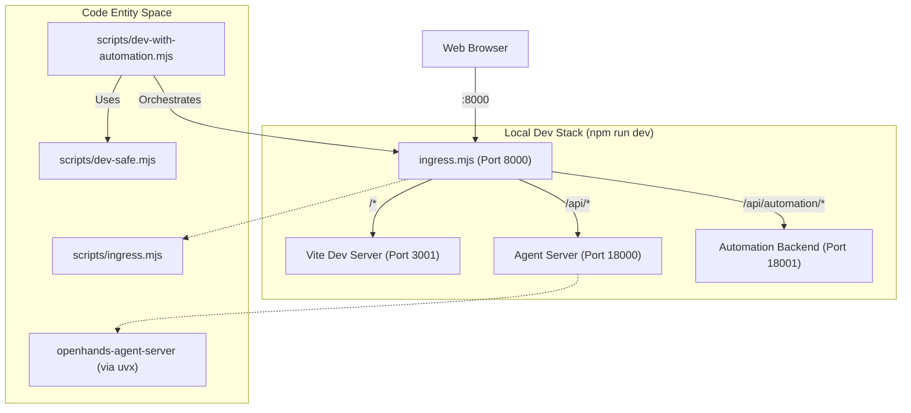
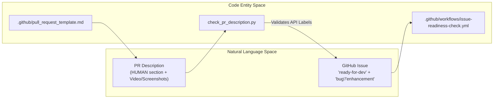

# Development Workflow

Relevant source files

The following files were used as context for generating this wiki page:

- [.agents/skills/custom-codereview-guide.md](.agents/skills/custom-codereview-guide.md)
- [.agents/skills/frontend-development/references/guide.md](.agents/skills/frontend-development/references/guide.md)
- [.agents/skills/pr-design-doc/SKILL.md](.agents/skills/pr-design-doc/SKILL.md)
- [.agents/skills/pr-design-doc/references/html-craft.md](.agents/skills/pr-design-doc/references/html-craft.md)
- [.dockerignore](.dockerignore)
- [.github/ISSUE_TEMPLATE/bug_report.yml](.github/ISSUE_TEMPLATE/bug_report.yml)
- [.github/ISSUE_TEMPLATE/feature_request.yml](.github/ISSUE_TEMPLATE/feature_request.yml)
- [.github/dependabot.yml](.github/dependabot.yml)
- [.github/pull_request_template.md](.github/pull_request_template.md)
- [.github/scripts/check_pr_description.py](.github/scripts/check_pr_description.py)
- [.github/scripts/markdown_sections.py](.github/scripts/markdown_sections.py)
- [.github/scripts/tests/__init__.py](.github/scripts/tests/__init__.py)
- [.github/scripts/tests/test_markdown_sections.py](.github/scripts/tests/test_markdown_sections.py)
- [.github/scripts/tests/test_pr_description.py](.github/scripts/tests/test_pr_description.py)
- [.github/workflows/ci-script-tests.yml](.github/workflows/ci-script-tests.yml)
- [.github/workflows/issue-readiness-check.yml](.github/workflows/issue-readiness-check.yml)
- [.github/workflows/pr-artifacts.yml](.github/workflows/pr-artifacts.yml)
- [.github/workflows/pr-description-check.yml](.github/workflows/pr-description-check.yml)
- [__tests__/api/cloud/proxy.test.ts](__tests__/api/cloud/proxy.test.ts)
- [__tests__/components/backends/cloud-organization-startup.test.tsx](__tests__/components/backends/cloud-organization-startup.test.tsx)
- [__tests__/components/features/mcp-page/save-as-secret-toggle.test.tsx](__tests__/components/features/mcp-page/save-as-secret-toggle.test.tsx)
- [__tests__/hooks/mutation/use-save-fields-as-secrets.test.ts](__tests__/hooks/mutation/use-save-fields-as-secrets.test.ts)
- [__tests__/scripts/inline-styles-lint.test.ts](__tests__/scripts/inline-styles-lint.test.ts)
- [__tests__/scripts/raw-colors-lint.test.ts](__tests__/scripts/raw-colors-lint.test.ts)
- [__tests__/scripts/restyle-lint.test.ts](__tests__/scripts/restyle-lint.test.ts)
- [__tests__/scripts/static-classes-lint.test.ts](__tests__/scripts/static-classes-lint.test.ts)
- [docs/DEVELOPMENT.md](docs/DEVELOPMENT.md)
- [eslint.config.js](eslint.config.js)
- [specs/mcp-secret-selection.md](specs/mcp-secret-selection.md)
- [src/api/cloud/client.ts](src/api/cloud/client.ts)
- [src/api/cloud/organization-suspension-store.ts](src/api/cloud/organization-suspension-store.ts)
- [src/api/cloud/proxy.ts](src/api/cloud/proxy.ts)
- [src/components/features/backends/cloud-organization-boundary.tsx](src/components/features/backends/cloud-organization-boundary.tsx)
- [src/components/features/home/shared/toggle-button.tsx](src/components/features/home/shared/toggle-button.tsx)
- [src/components/features/mcp-page/index.ts](src/components/features/mcp-page/index.ts)
- [src/components/features/mcp-page/save-as-secret-toggle.tsx](src/components/features/mcp-page/save-as-secret-toggle.tsx)

This document describes the day-to-day development workflow for Agent Canvas. It covers local stack orchestration, agent-server version selection environment variables, pull request governance, issue readiness policies, code quality tooling, and release verification checklists.

## Recommended Local Setup

The primary development workflow uses `npm run dev` to launch the full multi-service stack without requiring Docker. This orchestrates the frontend, the agent-server, and the automation backend through a single command.

### Full Stack Orchestration

The dev stack uses `scripts/dev-with-automation.mjs` and `scripts/dev-safe.mjs` to manage the lifecycle of several local processes. It coordinates `uvx` execution of Python backends alongside the Vite dev server [docs/DEVELOPMENT.md:25-29]().

1.  **Ingress Proxy**: A Node.js proxy (`scripts/ingress.mjs`) that routes traffic based on path prefixes:
    *   `/api/automation/*` → Automation Backend (Port 18001)
    *   `/api/*` and `/sockets` → Agent Server (Port 18000)
    *   `/*` → Frontend (Vite dev server on Port 3001)
2.  **Agent Server**: Started via `uvx` or from a local path to ensure a clean, isolated Python environment [docs/DEVELOPMENT.md:56-65]().
3.  **Automation Backend**: Orchestrated alongside the server, using the same session API key for unified authentication [docs/DEVELOPMENT.md:27-29]().
4.  **Vite Dev Server**: Provides hot module replacement (HMR) for the React/TypeScript frontend [docs/DEVELOPMENT.md:27-29]().

Alternative runtime modes are supported for partial or constrained environments:
*   `npm run dev:minimal` runs only the agent-server and Vite without the automation service or ingress proxy, accessible at `http://localhost:3001/` [docs/DEVELOPMENT.md:79-88]().
*   `npm run dev:static` serves a static production frontend build behind the proxy [docs/DEVELOPMENT.md:41-45]().
*   CLI flags allow running isolated partial stacks via `agent-canvas --frontend-only` or `agent-canvas --backend-only` [docs/DEVELOPMENT.md:47-54]().

### Local Stack Architecture

**Authentication Persistence:** To keep the dev environment stable, a cryptographically secure API key is generated and stored in `~/.openhands/agent-canvas/api-key.txt`. This key is automatically injected into the frontend as `VITE_SESSION_API_KEY` and used by the backends via the `X-Session-API-Key` header [docs/DEVELOPMENT.md:56-65]().

Sources: [docs/DEVELOPMENT.md:25-88](), [scripts/dev-safe.mjs:30-89]()

## Agent Server Version Selection

Developers can control which version of the `software-agent-sdk` (agent-server) the local environment uses by setting environment variables before running `npm run dev` [docs/DEVELOPMENT.md:67-78]().

| Variable | Description | Precedence |
| :--- | :--- | :--- |
| `OH_AGENT_SERVER_LOCAL_PATH` | Absolute path to a local SDK checkout. Rebuilds from source and installs as editable. | 1 (Highest) |
| `OH_AGENT_SERVER_GIT_REF` | Uses a specific branch or commit hash from GitHub. | 2 |
| `OH_AGENT_SERVER_VERSION` | Uses a specific version released to PyPI. | 3 |

**Implementation:** The agent server command builder in `scripts/dev-safe.mjs` evaluates these variables to construct the appropriate `uv` or `uvx` invocation [docs/DEVELOPMENT.md:67-78]().

Sources: [docs/DEVELOPMENT.md:67-78](), [scripts/dev-safe.mjs:47-55]()

## PR Governance, Issue Readiness, and Description Validation

The project enforces strict pull request governance, issue traceability, and testing evidence requirements [.github/pull_request_template.md:1-83]().

### Pull Request Template
Every PR must adhere to `.github/pull_request_template.md`, which separates human-verified testing notes from automated agent execution evidence [.github/pull_request_template.md:3-19]():
*   **HUMAN Section**: A brief statement from human contributors about manual testing. AI agents are strictly forbidden from editing this section [.github/pull_request_template.md:3-6]().
*   **AGENT Section**: AI/LLM agents must provide end-to-end execution evidence, logs, reproduction notes, and preview links for any temporary design docs placed under `.pr/` [.github/pull_request_template.md:9-19]().
*   **Linked Issue & Type**: PRs must reference an issue using keywords like `Fixes #123` [.github/pull_request_template.md:30-35](), and check the appropriate type (`Bug fix`, `Feature`, `Refactor`, etc.) [.github/pull_request_template.md:73-80]().

### Automated PR Validation Script
The CI pipeline executes `.github/scripts/check_pr_description.py` via GitHub Actions [.github/workflows/pr-description-check.yml:46-49]() to validate PR descriptions before code review:
1.  **Required Sections**: Verifies the presence of `Why`, `Summary`, and `How to Test` headings [.github/scripts/check_pr_description.py:38-39]().
2.  **Frontend Change Detection**: If files under `src/`, `__tests__/`, or `public/` (or configuration files like `tailwind.config.*` or `vite.config.*`) are touched, the PR description must include visual evidence (screenshots or video recordings) [.github/scripts/check_pr_description.py:49-81]().
3.  **Issue Readiness & Type Matching**: Validates that at least one referenced issue carries the `ready-for-dev` label via GitHub API lookup, and that the checked PR type (`Bug fix` vs `Feature`) aligns with the issue labels (`bug` vs `enhancement`) [.github/scripts/check_pr_description.py:11-17]().

### Issue Readiness Label Policy
The `ready-for-dev` label policy is enforced automatically by `.github/workflows/issue-readiness-check.yml`, which strips the label if applied by a user lacking write, maintain, or admin permissions [.github/workflows/issue-readiness-check.yml:36-43]().

### PR Governance and Validation Pipeline

Sources: [.github/pull_request_template.md:1-83](), [.github/scripts/check_pr_description.py:1-183](), [.github/workflows/issue-readiness-check.yml:1-43](), [.github/workflows/pr-description-check.yml:1-49]()

## Code Quality Standards and Architectural Enforcement

### Linting and Architectural Constraints
*   **ESLint & Custom Rules**: The codebase uses ESLint with flat configuration (`eslint.config.js`). It includes a custom architectural lint rule `createNoDirectAgentServerFetchRule()` which forbids raw `fetch` calls targeting agent-server `/api/...` paths, forcing all API interactions through typed `@openhands/typescript-client` interfaces [eslint.config.js:57-94]().
*   **Repository Boundaries**: The frontend UI is strictly separated from backend logic. Agent behavior and server contracts belong in `software-agent-sdk`, browser typed clients belong in `typescript-client`, automation scheduling belongs in `automation`, and UI integration belongs in `OpenHands/OpenHands` [docs/DEVELOPMENT.md:31-38]().
*   **Dependabot**: Automated dependency updates are grouped by feature ecosystem (e.g., `tailwind`, `tanstack`, `react`, `eslint`, `testing`) with a 7-day cooldown policy to ensure stability [.github/dependabot.yml:24-90]().

Sources: [eslint.config.js:57-94](), [docs/DEVELOPMENT.md:31-40](), [.github/dependabot.yml:24-90]()

## Release Verification Checklist

Before releasing or merging major changes, contributors must complete the verification checklist:
1.  **Build Verification**: Run `npm run build` and `npm run build:lib` to ensure application and library bundles compile cleanly [docs/DEVELOPMENT.md:41-45]().
2.  **Static Stack Test**: Run `npm run dev:static` to verify production-mode routing behind the ingress proxy [docs/DEVELOPMENT.md:41-45]().
3.  **SDK Version Sync**: Ensure `config/defaults.json` version pins match intended SDK and automation releases [docs/DEVELOPMENT.md:106-114]().
4.  **E2E Testing**: Execute Playwright test suites against `mock-llm-server.py` to validate end-to-end conversation flows.

Sources: [docs/DEVELOPMENT.md:41-45](), [docs/DEVELOPMENT.md:106-114]()