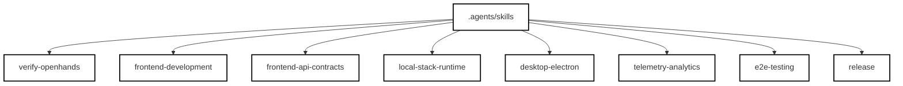
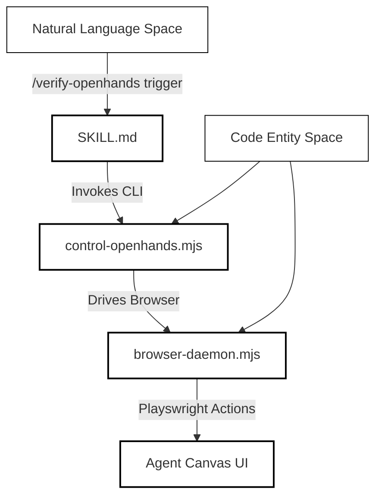
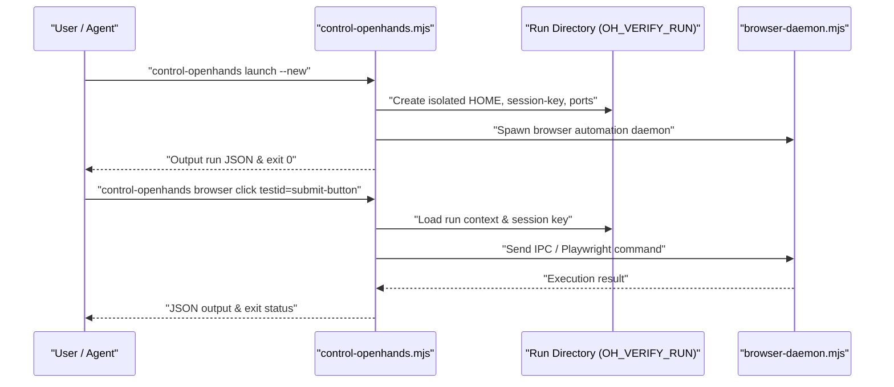
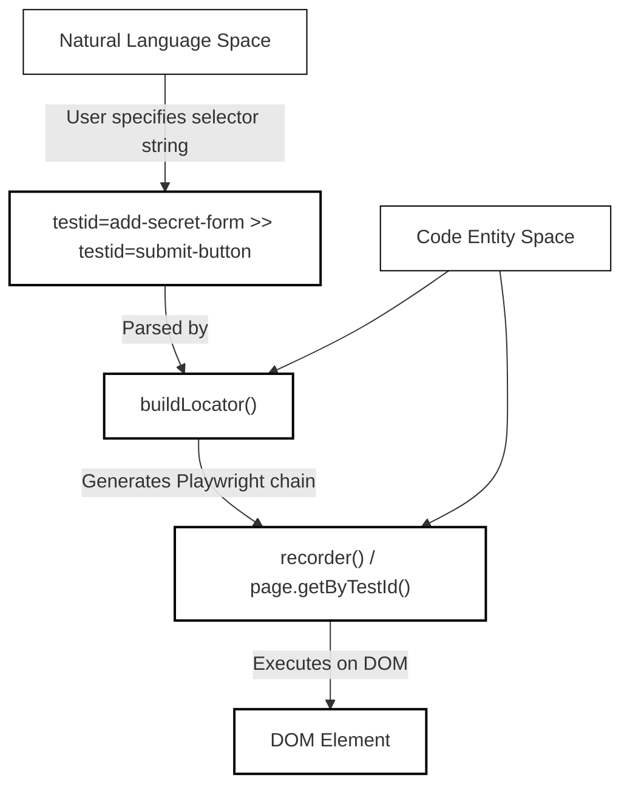

# Agent Skills and Verification Harness

Relevant source files

The following files were used as context for generating this wiki page:

- [.agents/skills/desktop-electron/SKILL.md](.agents/skills/desktop-electron/SKILL.md)
- [.agents/skills/desktop-electron/references/guide.md](.agents/skills/desktop-electron/references/guide.md)
- [.agents/skills/e2e-testing/SKILL.md](.agents/skills/e2e-testing/SKILL.md)
- [.agents/skills/frontend-api-contracts/SKILL.md](.agents/skills/frontend-api-contracts/SKILL.md)
- [.agents/skills/frontend-development/SKILL.md](.agents/skills/frontend-development/SKILL.md)
- [.agents/skills/local-stack-runtime/SKILL.md](.agents/skills/local-stack-runtime/SKILL.md)
- [.agents/skills/telemetry-analytics/SKILL.md](.agents/skills/telemetry-analytics/SKILL.md)
- [.agents/skills/verify-openhands/SKILL.md](.agents/skills/verify-openhands/SKILL.md)
- [.agents/skills/verify-openhands/references/adaptation.md](.agents/skills/verify-openhands/references/adaptation.md)
- [.agents/skills/verify-openhands/references/daily.md](.agents/skills/verify-openhands/references/daily.md)
- [.agents/skills/verify-openhands/references/feature-map/F01-first-run-and-sign-in.md](.agents/skills/verify-openhands/references/feature-map/F01-first-run-and-sign-in.md)
- [.agents/skills/verify-openhands/references/feature-map/F02-app-shell.md](.agents/skills/verify-openhands/references/feature-map/F02-app-shell.md)
- [.agents/skills/verify-openhands/references/feature-map/F03-home.md](.agents/skills/verify-openhands/references/feature-map/F03-home.md)
- [.agents/skills/verify-openhands/references/feature-map/F04-conversation-list.md](.agents/skills/verify-openhands/references/feature-map/F04-conversation-list.md)
- [.agents/skills/verify-openhands/references/feature-map/F05-composer.md](.agents/skills/verify-openhands/references/feature-map/F05-composer.md)
- [.agents/skills/verify-openhands/references/feature-map/F06-agent-activity.md](.agents/skills/verify-openhands/references/feature-map/F06-agent-activity.md)
- [.agents/skills/verify-openhands/references/feature-map/F07-conversation-page.md](.agents/skills/verify-openhands/references/feature-map/F07-conversation-page.md)
- [.agents/skills/verify-openhands/references/feature-map/F08-workspace-files-and-changes.md](.agents/skills/verify-openhands/references/feature-map/F08-workspace-files-and-changes.md)
- [.agents/skills/verify-openhands/references/feature-map/F10-llm-profiles.md](.agents/skills/verify-openhands/references/feature-map/F10-llm-profiles.md)
- [.agents/skills/verify-openhands/references/feature-map/F11-provider-connections.md](.agents/skills/verify-openhands/references/feature-map/F11-provider-connections.md)
- [.agents/skills/verify-openhands/references/feature-map/F13-agent-profiles.md](.agents/skills/verify-openhands/references/feature-map/F13-agent-profiles.md)
- [.agents/skills/verify-openhands/references/feature-map/F16-application-settings.md](.agents/skills/verify-openhands/references/feature-map/F16-application-settings.md)
- [.agents/skills/verify-openhands/references/feature-map/F17-mcp-servers.md](.agents/skills/verify-openhands/references/feature-map/F17-mcp-servers.md)
- [.agents/skills/verify-openhands/references/feature-map/F18-skills.md](.agents/skills/verify-openhands/references/feature-map/F18-skills.md)
- [.agents/skills/verify-openhands/references/feature-map/F19-plugins.md](.agents/skills/verify-openhands/references/feature-map/F19-plugins.md)
- [.agents/skills/verify-openhands/references/feature-map/F20-canvas-apps.md](.agents/skills/verify-openhands/references/feature-map/F20-canvas-apps.md)
- [.agents/skills/verify-openhands/references/feature-map/F21-automations-dashboard.md](.agents/skills/verify-openhands/references/feature-map/F21-automations-dashboard.md)
- [.agents/skills/verify-openhands/references/feature-map/F22-automation-creation.md](.agents/skills/verify-openhands/references/feature-map/F22-automation-creation.md)
- [.agents/skills/verify-openhands/references/feature-map/F23-automation-detail.md](.agents/skills/verify-openhands/references/feature-map/F23-automation-detail.md)
- [.agents/skills/verify-openhands/references/feature-map/F24-git-sync.md](.agents/skills/verify-openhands/references/feature-map/F24-git-sync.md)
- [.agents/skills/verify-openhands/references/feature-map/F25-backends-and-cloud.md](.agents/skills/verify-openhands/references/feature-map/F25-backends-and-cloud.md)
- [.agents/skills/verify-openhands/references/feature-map/F26-runtime-variants.md](.agents/skills/verify-openhands/references/feature-map/F26-runtime-variants.md)
- [.agents/skills/verify-openhands/references/feature-map/F27-workspace-tools.md](.agents/skills/verify-openhands/references/feature-map/F27-workspace-tools.md)
- [.agents/skills/verify-openhands/references/feature-map/README.md](.agents/skills/verify-openhands/references/feature-map/README.md)
- [.agents/skills/verify-openhands/references/maintenance.md](.agents/skills/verify-openhands/references/maintenance.md)
- [.agents/skills/verify-openhands/references/mapping.md](.agents/skills/verify-openhands/references/mapping.md)
- [.agents/skills/verify-openhands/scripts/browser-daemon.mjs](.agents/skills/verify-openhands/scripts/browser-daemon.mjs)
- [.agents/skills/verify-openhands/scripts/control-openhands.mjs](.agents/skills/verify-openhands/scripts/control-openhands.mjs)
- [.agents/skills/verify-openhands/scripts/control-openhands.test.mjs](.agents/skills/verify-openhands/scripts/control-openhands.test.mjs)
- [docs/SELF_HOSTING.md](docs/SELF_HOSTING.md)
- [scripts/download-node.mjs](scripts/download-node.mjs)

This wiki page documents the architecture, directory layout, and implementation of the `.agents/skills` repository workspace within OpenHands. Specifically, it covers the collection of domain guides (`frontend-development`, `frontend-api-contracts`, `local-stack-runtime`, `desktop-electron`, `telemetry-analytics`, `e2e-testing`, `release`) and details the `verify-openhands` verification skill, featuring its feature map, exit code taxonomy, and browser automation harness (`control-openhands.mjs` and `browser-daemon.mjs`).

---

## 1. Domain Guides Architecture

The `.agents/skills` directory contains specialized domain knowledge guides and operational harnesses used by both human developers and autonomous agents to interact with, test, and maintain the OpenHands codebase.

Each domain guide defines constraints, architectural boundaries, and recipes for specific subsystems:
- **`frontend-development`**: Guides React/TypeScript component authoring, state management via Zustand and TanStack Query, routing rules, and styling conventions under Tailwind CSS [.agents/skills/verify-openhands/SKILL.md:1-119]().
- **`frontend-api-contracts`**: Documents the structural requirements for communicating with backend services, serialization boundaries, and type safety constraints.
- **`local-stack-runtime`**: Details the multi-service local stack orchestration scripts (`dev-with-automation.mjs`, `dev-safe.mjs`) and ingress routing proxies [.agents/skills/verify-openhands/references/feature-map/F26-runtime-variants.md:1-45]().
- **`desktop-electron`**: Covers Electron desktop app bundling, main process entry points (`electron/main.mjs`), and bundled binaries.
- **`telemetry-analytics`**: Specifies PostHog integration, instance isolation, and telemetry consent persistence [.agents/skills/verify-openhands/references/feature-map/F01-first-run-and-sign-in.md:1-44]().
- **`e2e-testing`**: Documents Vitest, Playwright configurations, and MSW mock handlers [.agents/skills/verify-openhands/scripts/control-openhands.test.mjs:1-214]().
- **`release`**: Outlines version synchronization, Docker multi-arch image builds, and npm publishing pipelines.

*Figure 1: Domain Guides and Skill Hierarchy*

**Sources:** [.agents/skills/verify-openhands/SKILL.md:1-119](), [.agents/skills/verify-openhands/references/feature-map/F26-runtime-variants.md:1-45]()

---

## 2. The `verify-openhands` Skill Architecture

The `verify-openhands` skill (`.agents/skills/verify-openhands/SKILL.md`) provides an end-to-end verification harness designed to prove user-facing behavior in real, isolated Agent Canvas instances rather than relying solely on headless unit tests [.agents/skills/verify-openhands/SKILL.md:16-30]().

### Core Components
1. **The Lever (`control-openhands`)**: A Node.js CLI script that launches an isolated checkout stack (Agent Server, automation backend, static frontend, and ingress proxy), managing process lifecycles and maintaining browser state across commands [.agents/skills/verify-openhands/SKILL.md:21-25]().
2. **The Feature Map**: Maintained markdown documents under `.agents/skills/verify-openhands/references/feature-map/` that map feature IDs (e.g., `F01`, `F05`, `F17`) to exact verification commands, preconditions, and observable results [.agents/skills/verify-openhands/references/feature-map/README.md:1-103]().
3. **Evidence Ledger**: Screenshots, ARIA snapshots, and pass/fail/blocked ledgers stored in run-specific directories [.agents/skills/verify-openhands/SKILL.md:26-30]().

*Figure 2: Bridging Natural Language Space to Code Entity Space for Verification*

**Sources:** [.agents/skills/verify-openhands/SKILL.md:16-30](), [.agents/skills/verify-openhands/scripts/control-openhands.mjs:1-76]()

---

## 3. Control Harness (`control-openhands.mjs`)

The `control-openhands` CLI (`.agents/skills/verify-openhands/scripts/control-openhands.mjs`) is implemented as an executable Node.js script. It parses arguments, manages isolated run directories under `OH_VERIFY_HOME`, and delegates browser commands [.agents/skills/verify-openhands/scripts/control-openhands.mjs:1-127]().

### Execution Flow and Exit Codes
Every command outputs a single JSON object to `stdout` and exits with one of the following standard codes:
- `0`: Success [.agents/skills/verify-openhands/scripts/control-openhands.mjs:65-67]().
- `1`: Action or assertion failure [.agents/skills/verify-openhands/scripts/control-openhands.mjs:65-67]().
- `2`: Bad usage / parsing error [.agents/skills/verify-openhands/scripts/control-openhands.mjs:65-67]().
- `3`: Environment or doctor failure [.agents/skills/verify-openhands/scripts/control-openhands.mjs:65-67]().

*Figure 3: Control Harness Execution Sequence*

### Key Implementation Functions
- `parseArgs(argv)`: Parses positional arguments and flags, supporting repeatable flags like `--artifact` [.agents/skills/verify-openhands/scripts/control-openhands.mjs:86-117]().
- `resolveRunDir(flags)`: Resolves active verification directories, ensuring safety checks when multiple runs are active concurrently [.agents/skills/verify-openhands/scripts/control-openhands.mjs:146-176]().
- `liveRuns()`: Scans `OH_VERIFY_HOME` for active runs by inspecting `run.json` and checking process group liveness (`groupAlive`) [.agents/skills/verify-openhands/scripts/control-openhands.mjs:131-144]().

**Sources:** [.agents/skills/verify-openhands/scripts/control-openhands.mjs:1-184]()

---

## 4. Browser Automation & Daemon (`browser-daemon.mjs`)

Browser control is executed via a persistent automation daemon (`browser-daemon.mjs`) interacting with Playwright. It resolves custom locator syntax and handles complex UI interactions.

### Locator Syntax and Selectors
The harness supports a powerful selector chaining syntax using `>>` [reference/feature-map/README.md:34-36]():
- `testid=...`: Resolves to `page.getByTestId(...)` [reference/feature-map/README.md:34-36]()
- `role=...`: Resolves to `page.getByRole(...)` with options for exact matches, names, and states [control-openhands.test.mjs:111-136]()
- `text=...`: Resolves to `page.getByText(...)` [control-openhands.test.mjs:148-161]()
- Chaining with `>>`: Combines locators hierarchically (e.g., `testid=add-secret-form >> testid=submit-button`) [control-openhands.test.mjs:100-109]()

*Figure 4: Selector Translation from Natural Language to Playwright Code Entities*

**Sources:** [.agents/skills/verify-openhands/references/feature-map/README.md:34-36](), [.agents/skills/verify-openhands/scripts/control-openhands.test.mjs:100-161]()

---

## 5. Testing & Verification Workflow

Verification scripts and unit tests for the harness itself are validated via Vitest (`control-openhands.test.mjs`) without requiring a live browser instance [.agents/skills/verify-openhands/scripts/control-openhands.test.mjs:1-4]().

### Test Suite Structure
The test suite validates selector parsing, environment configuration, credential redaction, and CLI usage validation:
- `scoped testid chain builds nested locators`: Ensures `buildLocator` correctly constructs Playwright locator calls [.agents/skills/verify-openhands/scripts/control-openhands.test.mjs:100-110]().
- `role selectors carry name, exactness and state options`: Validates robust parsing of accessibility roles and attributes [control-openhands.test.mjs:111-136]().
- `keys are refused on argv before any request is made`: Security test preventing sensitive keys from being exposed via command-line arguments [control-openhands.test.mjs:190-210]().

| Test Case | Target Function / Module | Exit / Result Criteria |
| :--- | :--- | :--- |
| Selector Chain Parsing | `buildLocator()` | Returns expected nested locator path array |
| Role Attribute Parsing | `parseRole()` | Extracts correct role name, exactness, and state options |
| CLI Help & Usage | `parseArgs()` / `usage()` | Exits with status `2` and provides descriptive hints |
| Key Security Enforcement | CLI Validation | Refuses raw API keys on `argv`, exits with status `2` |

**Sources:** [.agents/skills/verify-openhands/scripts/control-openhands.test.mjs:1-214]()