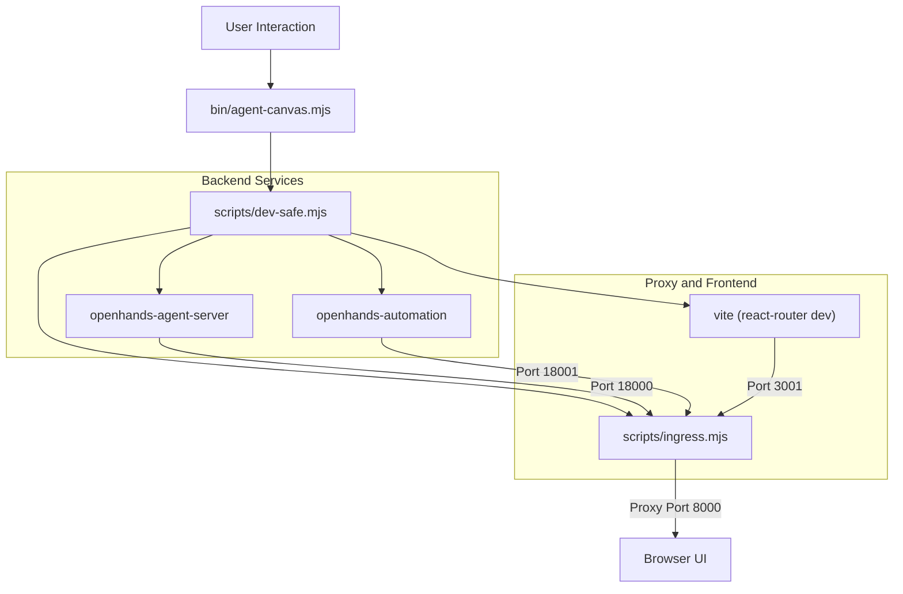
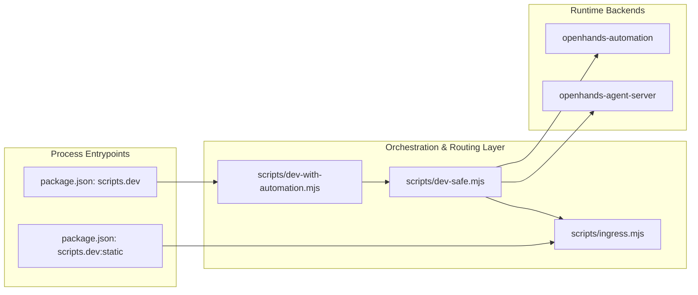

# Getting Started

Relevant source files

The following files were used as context for generating this wiki page:

- [.release-please-manifest.json](.release-please-manifest.json)
- [AGENTS.md](AGENTS.md)
- [README.md](README.md)
- [README.windows.md](README.windows.md)
- [__tests__/scripts/dev-safe.test.ts](__tests__/scripts/dev-safe.test.ts)
- [config/defaults.json](config/defaults.json)
- [helm/agent-canvas/Chart.yaml](helm/agent-canvas/Chart.yaml)
- [package-lock.json](package-lock.json)
- [package.json](package.json)
- [scripts/check-sdk-version-sync.mjs](scripts/check-sdk-version-sync.mjs)
- [scripts/dev-safe.mjs](scripts/dev-safe.mjs)

This guide walks through setting up and running **Agent Canvas** for the first time. It covers system prerequisites, installation paths, initial configuration, runtime modes, and agent onboarding. Agent Canvas serves as the React/TypeScript developer control center for OpenHands agents and automations [README.md:5-7]().

For detailed installation instructions across npm, Docker, Electron, and Helm, see [Installation](#2.1). For configuration files and authentication models, see [Configuration Basics](#2.2). For running scripts and runtime modes, see [Running Agent Canvas](#2.3). For configuring external ACP-compatible agents, see [ACP Agent Setup](#2.4).

Sources: [README.md:5-7](), [package.json:16-18](), [config/defaults.json:1-7]()

## System Prerequisites and Overview

Agent Canvas requires specific runtime environments depending on the chosen distribution method. Node.js `>=24` is required for running the npm package or building from source [package.json:19-21](), while the Python `uv` utility manages the underlying `agent-server` and automation backends [README.md:68](), [scripts/dev-safe.mjs:48-56](). For sandboxed container execution, Docker or Docker Desktop is required [README.md:84-86]().

The following diagram maps the high-level system components to their respective code entities and entrypoints:

Sources: [README.md:68-80](), [package.json:16-18](), [scripts/dev-safe.mjs:32-56]()

## Installation Summary

Agent Canvas can be installed via multiple channels depending on whether you want a local bare-metal setup, a secure Docker container, a native desktop application, or a Kubernetes deployment [README.md:33-40](). 

- **npm Package**: Installs globally via `npm install -g @openhands/agent-canvas` and runs via the `agent-canvas` CLI binary [README.md:70-73]().
- **Docker Image**: Runs inside an isolated container using `ghcr.io/openhands/agent-canvas` with mounted projects directories [README.md:95-100]().
- **Electron Desktop App**: Provides a native desktop application wrapper built around the frontend and bundled binaries [package.json:111-112]().
- **Helm Chart**: Deploys the stack onto Kubernetes clusters using the `helm/agent-canvas` chart [helm/agent-canvas/Chart.yaml:3-6]().

For detailed instructions, see [Installation](#2.1).

Sources: [README.md:70-100](), [package.json:111-112](), [helm/agent-canvas/Chart.yaml:3-6]()

## Configuration Basics

The system relies on centralized configuration defaults and environment variables to manage security tokens, encryption keys, and service ports [config/defaults.json:1-46](), [scripts/dev-safe.mjs:32-106](). 

- **Version Synchronization**: The single source of truth for version pins (`agentServer`, `agentCanvas`, and `automation`) is maintained in `config/defaults.json` [config/defaults.json:3-7]().
- **Session API Keys**: Session authentication is handled via `LOCAL_BACKEND_API_KEY` or persisted automatically in `~/.openhands/agent-canvas/api-key.txt` [scripts/dev-safe.mjs:68-85]().
- **Encryption**: Sensitive settings and secrets are secured using `OH_SECRET_KEY`, stored in `~/.openhands/agent-canvas/secret-key.txt` [scripts/dev-safe.mjs:97-102]().

For comprehensive configuration options, build-time `VITE_*` variables, and authentication models, see [Configuration Basics](#2.2).

Sources: [config/defaults.json:1-46](), [scripts/dev-safe.mjs:32-106]()

## Running Agent Canvas

Runtime execution is governed by specific script targets defined in `package.json` [package.json:75-96]() and orchestrated by process managers [scripts/dev-safe.mjs:1-24](). 

The execution routing and process orchestration flow can be visualized as follows:

- **Runtime Modes**: Supports full development (`npm run dev`), minimal bare-metal (`npm run dev:minimal`), static distribution (`npm run dev:static`), and mock data mode (`npm run dev:mock`) [package.json:75-81]().
- **Port Management**: Default ports are allocated for the ingress proxy (`8000`), agent server (`18000`), and automation backend (`18001`) [config/defaults.json:15-18]().

For detailed script workflows and environment variables, see [Running Agent Canvas](#2.3).

Sources: [package.json:75-96](), [scripts/dev-safe.mjs:1-24](), [config/defaults.json:15-18]()

## ACP Agent Setup

Agent Canvas natively supports the open-source OpenHands agent but extends its architecture to any third-party coding agent that conforms to the **Agent-Client Protocol (ACP)** [README.md:37-46](). This includes integrations for tools such as Claude Code, Codex, Gemini CLI, Pi, and OpenCode [README.md:10]().

- **Protocol Integration**: Configures client tool mapping and authentication parameters through the agent server adapter layer [src/api/agent-server-adapter.ts]().
- **Authentication Modes**: Supports provider-specific API keys, environment injections, and onboarding workflows for external containerized ACP agents [README.md:10]().

For step-by-step onboarding, provider configuration, and Docker-based ACP examples, see [ACP Agent Setup](#2.4).

Sources: [README.md:10-46](), [src/api/agent-server-adapter.ts]()