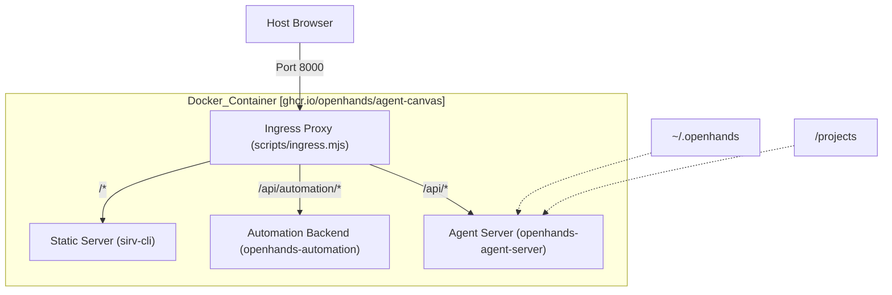
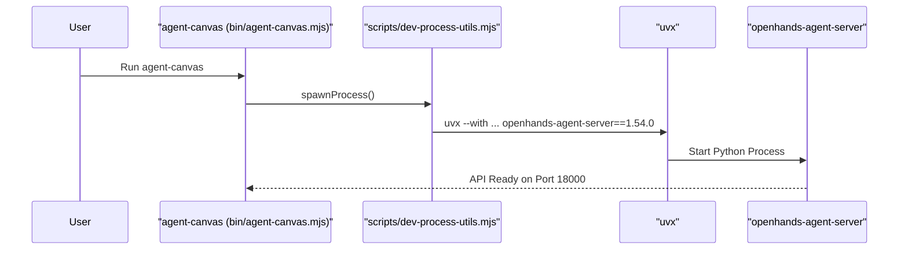

# Installation

<details>
<summary>Relevant source files</summary>

The following files were used as context for generating this wiki page:

- [.github/workflows/desktop-linux.yml](.github/workflows/desktop-linux.yml)
- [.github/workflows/desktop-macos.yml](.github/workflows/desktop-macos.yml)
- [.github/workflows/desktop-windows.yml](.github/workflows/desktop-windows.yml)
- [.gitignore](.gitignore)
- [.release-please-manifest.json](.release-please-manifest.json)
- [AGENTS.md](AGENTS.md)
- [README.md](README.md)
- [README.windows.md](README.windows.md)
- [__tests__/electron/lib/bundled-runtime-dir.test.ts](__tests__/electron/lib/bundled-runtime-dir.test.ts)
- [__tests__/scripts/dev-safe.test.ts](__tests__/scripts/dev-safe.test.ts)
- [__tests__/scripts/download-arch-utils.test.ts](__tests__/scripts/download-arch-utils.test.ts)
- [__tests__/scripts/download-node.test.ts](__tests__/scripts/download-node.test.ts)
- [__tests__/scripts/download-uv.test.ts](__tests__/scripts/download-uv.test.ts)
- [__tests__/scripts/electron-builder-config.test.ts](__tests__/scripts/electron-builder-config.test.ts)
- [config/defaults.json](config/defaults.json)
- [electron-builder.config.mjs](electron-builder.config.mjs)
- [electron/loading.html](electron/loading.html)
- [electron/main.mjs](electron/main.mjs)
- [electron/package.json](electron/package.json)
- [electron/preload.cjs](electron/preload.cjs)
- [helm/agent-canvas/Chart.yaml](helm/agent-canvas/Chart.yaml)
- [package-lock.json](package-lock.json)
- [package.json](package.json)
- [scripts/brand-dev-electron.mjs](scripts/brand-dev-electron.mjs)
- [scripts/check-sdk-version-sync.mjs](scripts/check-sdk-version-sync.mjs)
- [scripts/dev-safe.mjs](scripts/dev-safe.mjs)
- [scripts/download-uv.mjs](scripts/download-uv.mjs)

</details>


## Purpose and Scope
This page covers the technical setup and installation methods for Agent Canvas across multiple deployment targets: global npm CLI, Docker sandboxed environments, Electron desktop applications, and Kubernetes clusters via Helm. It details the runtime requirements, including Node.js version constraints and Python `uv`/`uvx` package management dependencies.

---

## Prerequisites

*   **Node.js**: Version `24` or later is strictly required for running the frontend orchestration scripts and the local stack [package.json:19-21]().
*   **Python Package Manager (`uv`)**: The Python backend (`openhands-agent-server`) is managed via `uv`. Launch scripts utilize `uvx` to execute the server without requiring manual virtual environment configuration [README.md:68]().
*   **Docker**: Required for local or production containerized deployments to protect the host filesystem inside an isolated sandbox [README.md:84-88]().

Sources: [package.json:19-21](), [README.md:68-88]()

---

## Installation Methods

### Method 1: NPM (Global CLI)
The quickest local setup method installs Agent Canvas globally from the npm registry, exposing the `agent-canvas` binary.

```sh
npm install -g @openhands/agent-canvas
agent-canvas
```

**Implementation Details:**
The CLI binary entry point maps to `bin/agent-canvas.mjs` [package.json:16-18](). When executed, it bootstraps the multi-service local stack:
1.  **Ingress Proxy**: Routes incoming HTTP and WebSocket traffic [scripts/ingress.mjs]().
2.  **Agent Server**: Downloads and launches `openhands-agent-server` [config/defaults.json:32]() dynamically via `uvx`.
3.  **Automation Backend**: Starts the background worker service `openhands-automation` [config/defaults.json:33]().
4.  **Frontend**: Serves the built React application using `sirv-cli` [package.json:84]().

Sources: [package.json:16-18](), [package.json:84](), [README.md:70-80](), [config/defaults.json:31-36]()

### Method 2: Docker (Sandboxed)
For secure isolation, the unified Docker image bundles the frontend, ingress proxy, agent-server, and automation backend into a single container.

```sh
export PROJECTS_PATH="$HOME/projects"
mkdir -p "$PROJECTS_PATH" "$HOME/.openhands"

docker run -it --rm \
  -p 127.0.0.1:8000:8000 \
  -e AGENT_CANVAS_ALLOW_LAN_SESSION_KEY=true \
  -v "$HOME/.openhands:/home/openhands/.openhands" \
  -v "${PROJECTS_PATH}:/projects" \
  ghcr.io/openhands/agent-canvas:1.27.0
```

Windows PowerShell instructions are detailed separately in [README.windows.md:14-26]().

Title: Stack Component Routing Architecture

Sources: [README.md:89-101](), [config/defaults.json:11-21](), [README.windows.md:14-26]()

### Method 3: Electron Desktop App
Agent Canvas compiles into a native desktop wrapper for macOS and Windows.

**Build and Packaging Flow:**
1.  **Frontend Compile**: `npm run build:app` generates production static assets [package.json:106]().
2.  **Runtime Fetching**: `scripts/download-uv.mjs` and `scripts/download-node.mjs` pull platform-specific binaries into resources [package.json:114-115]().
3.  **Electron Builder**: `electron-builder` packages the application bundle using [electron-builder.config.mjs]() [package.json:112]().

The desktop shell executes [electron/main.mjs](), presenting [electron/loading.html]() while the local agent server process spins up.

Sources: [package.json:106-115](), [electron/main.mjs]()

### Method 4: Helm Chart (Kubernetes)
For multi-user or enterprise setups, the Helm chart located under `helm/agent-canvas/` deploys the stack to Kubernetes.

*   **StatefulSet**: Manages persistent storage claims for conversation histories and workspace volumes [helm/agent-canvas/Chart.yaml:1-6]().
*   **Ingress**: Exposes the unified proxy service to external networks.
*   **RBAC**: Grants scoped permissions if agents interact directly with the Kubernetes API.

Sources: [helm/agent-canvas/Chart.yaml:1-28]()

---

## Service Orchestration & Dependencies

### Version Matrix
The version pins and dependency specifications are centrally managed in `config/defaults.json`:

| Component | Default Version | Package Identifier |
|-----------|-----------------|--------------------|
| Agent Server | `1.54.0` | `openhands-agent-server` [config/defaults.json:4](), [config/defaults.json:32]() |
| Automation | `1.19.3` | `openhands-automation` [config/defaults.json:6](), [config/defaults.json:33]() |
| Agent Canvas | `1.27.0` | `@openhands/agent-canvas` [config/defaults.json:5]() |

Sources: [config/defaults.json:1-46]()

### Python Execution via `uvx`
The CLI orchestration scripts construct `uvx` execution commands to spin up the Python backend safely without polluting global Python environments.

Title: CLI Startup Sequence

Sources: [scripts/dev-safe.mjs:1-1232](), [config/defaults.json:1-46]()