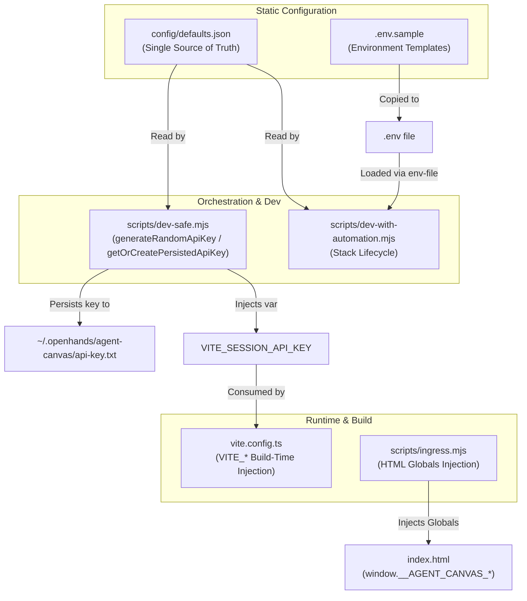
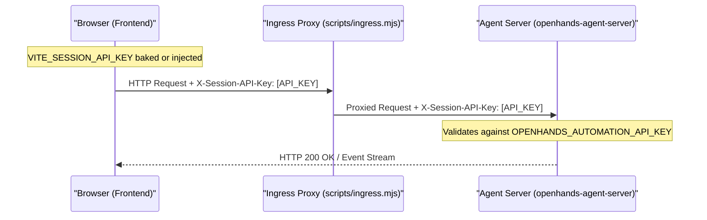

# Configuration Basics

Relevant source files

The following files were used as context for generating this wiki page:

- [.env.sample](.env.sample)
- [.release-please-manifest.json](.release-please-manifest.json)
- [AGENTS.md](AGENTS.md)
- [README.md](README.md)
- [README.windows.md](README.windows.md)
- [__tests__/api/agent-server-config.test.ts](__tests__/api/agent-server-config.test.ts)
- [__tests__/scripts/dev-safe.test.ts](__tests__/scripts/dev-safe.test.ts)
- [config/defaults.json](config/defaults.json)
- [helm/agent-canvas/Chart.yaml](helm/agent-canvas/Chart.yaml)
- [package-lock.json](package-lock.json)
- [package.json](package.json)
- [scripts/check-sdk-version-sync.mjs](scripts/check-sdk-version-sync.mjs)
- [scripts/dev-safe.mjs](scripts/dev-safe.mjs)
- [src/api/agent-server-config.ts](src/api/agent-server-config.ts)

This page documents the configuration system for Agent Canvas, covering environment variables, centralized defaults, build-time `VITE_*` variables, agent-server configuration parameters, and the `LOCAL_BACKEND_API_KEY` / public mode authentication model.

## Configuration Architecture

Agent Canvas employs a multi-layered configuration strategy spanning build-time compilation (Vite), orchestration scripts, and runtime environment parameters.

Sources: [config/defaults.json:1-46](), [scripts/dev-safe.mjs:31-103](), [.env.sample:1-46]()

## Centralized Defaults (`config/defaults.json`)

The `config/defaults.json` file acts as the single source of truth for version pins, port mappings, and state directory paths across npm, Docker, and Helm installations [config/defaults.json:1-46]().

| Category | Key | Value | Description |
| :--- | :--- | :--- | :--- |
| **Versions** | `agentServer` | `1.54.0` | Pinned version of the Python backend service [config/defaults.json:4-4]() |
| | `agentCanvas` | `1.27.0` | Pinned version of Agent Canvas frontend [config/defaults.json:5-5]() |
| | `automation` | `1.19.3` | Pinned version of the automation backend [config/defaults.json:6-6]() |
| **Ports** | `proxy` | `8000` | Ingress proxy port serving the unified stack [config/defaults.json:18-18]() |
| | `agentServer` | `18000` | Internal default port for `agent-server` [config/defaults.json:16-16]() |
| | `automation` | `18001` | Internal default port for the automation service [config/defaults.json:17-17]() |
| | `vscode` | `8001` | Internal port for the bundled code server [config/defaults.json:20-20]() |
| **Paths** | `stateSubdir` | `agent-canvas` | Subdirectory under `~/.openhands` for local state [config/defaults.json:23-23]() |
| | `vscodeBasePath`| `/vscode` | Path prefix for the embedded VS Code editor [config/defaults.json:29-29]() |

Sources: [config/defaults.json:1-46]()

## Environment Variables and `.env.sample`

Environment configurations are templated in `.env.sample` and loaded during development scripts using Node's built-in `--env-file-if-exists` option [package.json:76-79]().

### Backend and Proxy Connection
*   `VITE_BACKEND_HOST`: Host and port used by the Vite dev proxy (default: `"127.0.0.1:8000"`) [.env.sample:6-6]().
*   `VITE_BACKEND_BASE_URL`: Base URL used by browser-side direct requests [.env.sample:7-7]().
*   `VITE_FRONTEND_PORT`: Port to run the local frontend application (default: `"3001"`) [.env.sample:16-16]().
*   `VITE_USE_TLS`: Enables HTTPS/WSS for proxied backend connections [.env.sample:17-17]().
*   `VITE_INSECURE_SKIP_VERIFY`: Skips TLS certificate verification for proxied backend requests [.env.sample:18-18]().

### Build-Time Variables (`VITE_*`)
Variables prefixed with `VITE_` are baked into the frontend bundle at build time:
*   `VITE_SESSION_API_KEY`: Authentication key matched against the backend session key [.env.sample:11-11]().
*   `VITE_WORKING_DIR`: Base directory for per-conversation working directories [.env.sample:12-12]().
*   `VITE_ENABLE_BROWSER_TOOLS`: Controls whether the agent-server launches with the browser tool set enabled [.env.sample:13-13]().
*   `VITE_MOCK_API`: Enables API mocking via MSW [.env.sample:36-36]().

### Orchestration and Local SDK Settings
*   `OH_CANVAS_SAFE_BACKEND_PORT`: Port the spawned `agent-server` listens on in safe dev mode [.env.sample:39-39]().
*   `OH_AGENT_SERVER_LOCAL_PATH`: Absolute path to a local `software-agent-sdk` checkout for editable development [.env.sample:44-44]().
*   `OH_AGENT_SERVER_GIT_REF`: Specific git commit SHA or branch name for the agent server [.env.sample:45-45]().
*   `OH_AGENT_SERVER_VERSION`: Specific PyPI version of the agent server [.env.sample:46-46]().

Sources: [.env.sample:1-46](), [package.json:76-79]()

## Authentication Model: `LOCAL_BACKEND_API_KEY` & Public Mode

Agent Canvas secures communication between the frontend, ingress proxy, and backend agent servers using session API keys passed via headers or query tokens.

### Key Generation and Persistence
The orchestration layer manages session keys using utility functions defined in `scripts/dev-safe.mjs`:
*   `generateRandomApiKey()`: Generates a cryptographically secure 256-bit hex string (64 characters) via `crypto.randomBytes` [scripts/dev-safe.mjs:68-70]().
*   `getOrCreatePersistedApiKey()`: Reads or generates a fallback API key stored at `~/.openhands/agent-canvas/api-key.txt` with restricted file permissions (`0o600`) [scripts/dev-safe.mjs:80-176]().
*   `DEFAULT_SECRET_KEY_PATH`: Defines the path for `OH_SECRET_KEY` persistence under `~/.openhands/agent-canvas/secret-key.txt` to share encryption keys between local dev and Docker sandboxes [scripts/dev-safe.mjs:97-102]().

### Public Mode and LAN Access
When publishing ports on local network interfaces, `AGENT_CANVAS_ALLOW_LAN_SESSION_KEY=true` must be set alongside a securely configured `LOCAL_BACKEND_API_KEY` to prevent unauthorized cluster access [README.windows.md:32-32]().

Sources: [scripts/dev-safe.mjs:68-102](), [README.windows.md:20-33]()