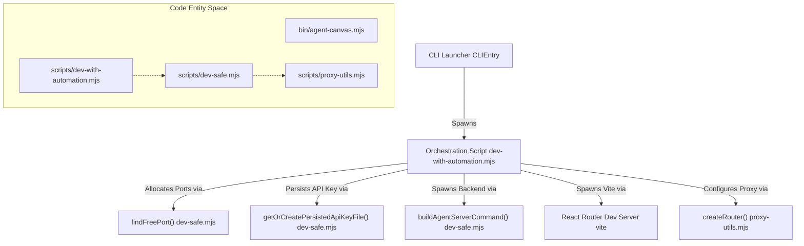
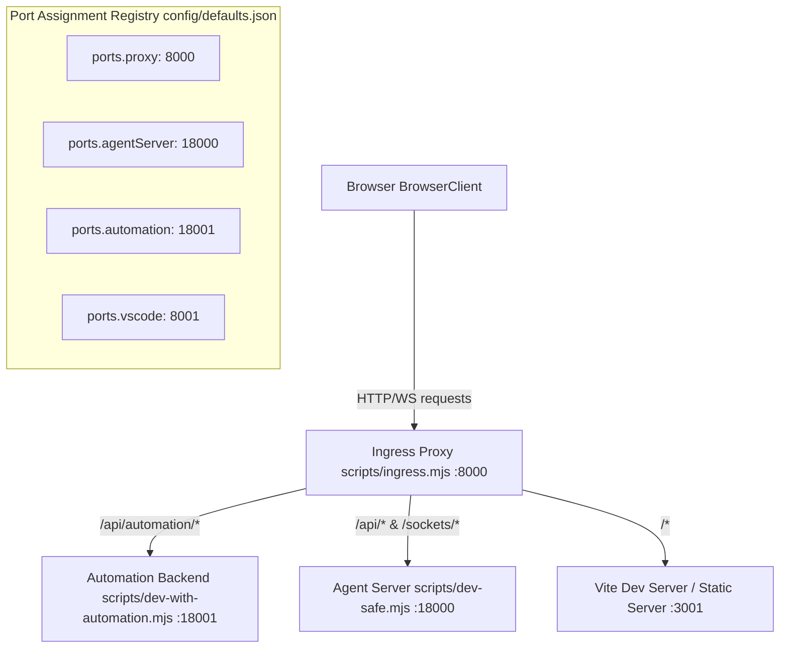

# Running Agent Canvas

Relevant source files

The following files were used as context for generating this wiki page:

- [.release-please-manifest.json](.release-please-manifest.json)
- [AGENTS.md](AGENTS.md)
- [README.md](README.md)
- [README.windows.md](README.windows.md)
- [__tests__/scripts/dev-safe.test.ts](__tests__/scripts/dev-safe.test.ts)
- [__tests__/scripts/dev-static.test.ts](__tests__/scripts/dev-static.test.ts)
- [__tests__/scripts/dev-with-automation.test.ts](__tests__/scripts/dev-with-automation.test.ts)
- [__tests__/scripts/ingress.test.ts](__tests__/scripts/ingress.test.ts)
- [__tests__/scripts/static-server.test.ts](__tests__/scripts/static-server.test.ts)
- [config/defaults.json](config/defaults.json)
- [docker/entrypoint.sh](docker/entrypoint.sh)
- [helm/agent-canvas/Chart.yaml](helm/agent-canvas/Chart.yaml)
- [package-lock.json](package-lock.json)
- [package.json](package.json)
- [scripts/check-sdk-version-sync.mjs](scripts/check-sdk-version-sync.mjs)
- [scripts/dev-safe.mjs](scripts/dev-safe.mjs)
- [scripts/dev-static.mjs](scripts/dev-static.mjs)
- [scripts/dev-with-automation.mjs](scripts/dev-with-automation.mjs)
- [scripts/ingress.mjs](scripts/ingress.mjs)
- [scripts/proxy-utils.mjs](scripts/proxy-utils.mjs)
- [scripts/runtime-services-info.mjs](scripts/runtime-services-info.mjs)
- [scripts/static-server.mjs](scripts/static-server.mjs)

This page documents all runtime modes and execution environments for Agent Canvas (`@openhands/agent-canvas`), covering local development (`dev`, `dev:minimal`, `dev:static`, `dev:mock`), desktop packaging (`desktop`), containerized deployments (`Docker`), port allocations, ingress proxy routing, session API keys, and UI access patterns.

## Runtime Modes Overview

Agent Canvas provides multiple execution modes tailored for different development workflows, resource constraints, and deployment topologies [README.md:59-62](). All local and production runtimes rely on an ingress proxy to consolidate services under a single port [scripts/dev-with-automation.mjs:9-15]().

| Runtime Mode | NPM Script / Command | Target Use Case | Orchestration Script / Binary |
|---|---|---|---|
| **Full Dev** | `npm run dev` | Local development with automation backend | `scripts/dev-with-automation.mjs` [package.json:76]() |
| **Minimal Dev** | `npm run dev:minimal` | Resource-constrained or agent-server-only work | `scripts/dev-safe.mjs` [package.json:79]() |
| **Static Dev** | `npm run dev:static` | Production build testing with live backend | `scripts/dev-static.mjs` [package.json:77]() |
| **Mock Dev** | `npm run dev:mock` | Frontend-only UI design with MSW | `package.json` [package.json:81]() |
| **Desktop** | `npm run desktop` | Standalone native execution | `electron electron` [package.json:111]() |
| **Docker** | `docker run ...` | Isolated self-hosted production deployment | `docker/entrypoint.sh` [README.md:95-101]() |

Sources: [package.json:76-81](), [package.json:111](), [README.md:59-62](), [scripts/dev-with-automation.mjs:9-15]()

---

## Development Stack Orchestration & Code Entities

The development runtimes are coordinated by Node.js orchestration scripts that perform port discovery [__tests__/scripts/dev-safe.test.ts:63-67](), cryptographic session key generation [scripts/dev-safe.mjs:68-70](), process tree supervision [scripts/dev-safe.mjs:21-24](), and environment injection [scripts/dev-with-automation.mjs:55-65]().

### Key Functions and Lifecycle Management
- **Port Discovery**: `findFreePort` and `findFreePorts` verify availability on preferred ports (defined in `config/defaults.json`), automatically falling back to OS-assigned ephemeral ports if collisions occur [__tests__/scripts/dev-safe.test.ts:63-98]().
- **Authentication Seeding**: `getOrCreatePersistedApiKeyFile` generates a 256-bit hex string stored in `~/.openhands/agent-canvas/api-key.txt` with `0o600` permissions, ensuring stable session tokens across `npm run dev` restarts [scripts/dev-safe.mjs:68-85]().
- **Process Supervision**: Shutdown hook registries monitor child process lifecycles, ensuring Python backends spawned via `uvx` or `uv run` are cleanly terminated when the Node.js parent exits [scripts/dev-safe.mjs:21-24](), [scripts/dev-with-automation.mjs:67-72]().

Sources: [scripts/dev-safe.mjs:21-85](), [__tests__/scripts/dev-safe.test.ts:63-98](), [scripts/dev-with-automation.mjs:67-72]()

---

## Ingress Proxy and Port Assignments

Agent Canvas centralizes ingress through a single port (default `8000`), routing requests to underlying services based on URL path prefixes [scripts/dev-with-automation.mjs:9-15]().

### Port Assignments (`config/defaults.json`)
The single source of truth for port definitions is located in `config/defaults.json`:

| Service Name | Default Port | Config Path Key | Description |
|---|---|---|---|
| **Ingress Proxy** | `8000` | `ports.proxy` [config/defaults.json:18]() | Unified entry point for UI, APIs, and WebSockets. |
| **Agent Server** | `18000` | `ports.agentServer` [config/defaults.json:16]() | Python backend managing agent execution and LLM interactions. |
| **Automation Backend** | `18001` | `ports.automation` [config/defaults.json:17]() | Python backend handling scheduled tasks and webhook triggers. |
| **VS Code Server** | `8001` (Internal) | `ports.vscode` [config/defaults.json:20]() | Embedded code editor served via path prefix `/vscode` [config/defaults.json:29](). |

Sources: [config/defaults.json:15-30](), [scripts/dev-with-automation.mjs:9-15]()

---

## Production Runtimes: Docker and Desktop

### Docker Container Stack
When running via Docker, `docker/entrypoint.sh` initializes the runtime environment:
- Reads or generates the encryption secret key (`OH_SECRET_KEY`) in the shared state directory [docker/entrypoint.sh:35-36]().
- Normalizes `VSCODE_BASE_PATH` and `AGENT_CANVAS_BASE_PATH` to prevent proxy routing collisions [docker/entrypoint.sh:97-120]().
- Launches the ingress proxy, agent-server, and automation backend using exported environment variables derived from `config/defaults.json` [docker/entrypoint.sh:62-71]().

### Electron Desktop App (`npm run desktop`)
The desktop build bundles Node.js and `uv` binaries to run the agent stack locally without external developer prerequisites [package.json:111-112](). Managed by `electron/main.mjs`, the application spawns the local agent server and static ingress server as child processes, attaching the React UI window directly to `http://localhost:8000` [electron/main.mjs:87-124]().

Sources: [package.json:111-112](), [docker/entrypoint.sh:35-120](), [README.md:95-101]()