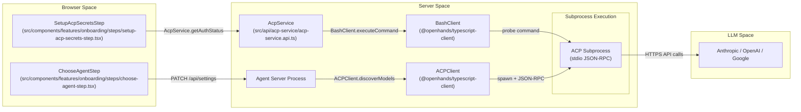

# ACP Agent Setup

<details>
<summary>Relevant source files</summary>

The following files were used as context for generating this wiki page:

- [__tests__/api/acp-service/acp-service.api.test.ts](__tests__/api/acp-service/acp-service.api.test.ts)
- [__tests__/components/onboarding/choose-agent-step.test.tsx](__tests__/components/onboarding/choose-agent-step.test.tsx)
- [__tests__/components/onboarding/onboarding-progress-bar.test.tsx](__tests__/components/onboarding/onboarding-progress-bar.test.tsx)
- [__tests__/components/onboarding/setup-acp-secrets-step.test.tsx](__tests__/components/onboarding/setup-acp-secrets-step.test.tsx)
- [__tests__/components/onboarding/use-onboarding-completion.test.tsx](__tests__/components/onboarding/use-onboarding-completion.test.tsx)
- [__tests__/components/settings/acp-auth-status-banner.test.tsx](__tests__/components/settings/acp-auth-status-banner.test.tsx)
- [__tests__/components/settings/acp-credentials-section-cloud.test.tsx](__tests__/components/settings/acp-credentials-section-cloud.test.tsx)
- [__tests__/components/settings/acp-credentials-section.test.tsx](__tests__/components/settings/acp-credentials-section.test.tsx)
- [__tests__/constants/acp-providers.test.ts](__tests__/constants/acp-providers.test.ts)
- [__tests__/hooks/query/use-acp-auth-status.test.tsx](__tests__/hooks/query/use-acp-auth-status.test.tsx)
- [__tests__/utils/acp-auth-display.test.ts](__tests__/utils/acp-auth-display.test.ts)
- [docs/ACP_AGENTS.md](docs/ACP_AGENTS.md)
- [docs/README.md](docs/README.md)
- [src/api/acp-service/acp-service.api.ts](src/api/acp-service/acp-service.api.ts)
- [src/components/features/onboarding/onboarding-progress-bar.tsx](src/components/features/onboarding/onboarding-progress-bar.tsx)
- [src/components/features/onboarding/steps/choose-agent-step.tsx](src/components/features/onboarding/steps/choose-agent-step.tsx)
- [src/components/features/onboarding/steps/setup-acp-secrets-step.tsx](src/components/features/onboarding/steps/setup-acp-secrets-step.tsx)
- [src/components/features/settings/acp-auth-status-banner.tsx](src/components/features/settings/acp-auth-status-banner.tsx)
- [src/components/features/settings/acp-credentials-section.tsx](src/components/features/settings/acp-credentials-section.tsx)
- [src/constants/acp-providers.test.ts](src/constants/acp-providers.test.ts)
- [src/constants/acp-providers.ts](src/constants/acp-providers.ts)
- [src/hooks/use-acp-credential-form.ts](src/hooks/use-acp-credential-form.ts)
- [src/hooks/use-save-acp-secrets.ts](src/hooks/use-save-acp-secrets.ts)

</details>


The purpose of this page is to explain the Agent Client Protocol (ACP), supported providers, authentication modes, onboarding workflows for ACP agents, Docker-based deployments, and container examples.

The Agent Client Protocol (ACP) is a JSON-RPC based standard for communication between a client (Agent Canvas) and a coding agent [docs/ACP_AGENTS.md:10-15](). Unlike the default OpenHands agent, which is orchestrated directly by the Agent Server, ACP agents run as external subprocesses (e.g., Claude Code, Codex, Gemini CLI, Pi, or OpenCode) [docs/ACP_AGENTS.md:3-5](). The Agent Server spawns these processes and relays conversation turns between the frontend and the agent's stdio stream [docs/ACP_AGENTS.md:12-15]().

## System Architecture and Data Flow

In an ACP configuration, the Agent Server acts as a proxy, managing the lifecycle of the ACP subprocess and handling credential injection into the subprocess environment [docs/ACP_AGENTS.md:29-32]().

### ACP Communication Flow

Sources: [docs/ACP_AGENTS.md:17-27](), [src/api/acp-service/acp-service.api.ts:110-134](), [src/components/features/onboarding/steps/choose-agent-step.tsx:103-146]()

## Supported Providers

Provider configurations are defined in the Python SDK registry (`openhands.sdk.settings.acp_providers`, mirrored into `@openhands/typescript-client`) and enriched with UI metadata in `src/constants/acp-providers.ts` [docs/ACP_AGENTS.md:35-39](). 

| Provider | Key | Default Command | Local Only |
| :--- | :--- | :--- | :--- |
| **Claude Code** | `claude-code` | `npx -y @agentclientprotocol/claude-agent-acp` | No |
| **Codex** | `codex` | `npx -y @agentclientprotocol/codex-acp` | No |
| **Gemini CLI** | `gemini-cli` | `npx -y @google/gemini-cli --acp` | No |
| **Pi** | `pi` | `npx -y --package=pi-acp --package=@earendil-works/pi-coding-agent pi-acp` | Yes |
| **OpenCode** | `opencode` | `npx -y opencode-ai acp` | Yes |

Pi and OpenCode are offered on **local** backends only; OpenHands Cloud runs only Claude Code, Codex, and Gemini CLI [docs/ACP_AGENTS.md:49-51]().

Sources: [src/constants/acp-providers.ts:133-155](), [docs/ACP_AGENTS.md:41-48]()

## Authentication Modes

ACP agents support two primary authentication paths. The Agent Server prioritizes existing sessions on the host machine over provided API keys [docs/ACP_AGENTS.md:60-66]().

1. **Subscription Login (Priority):** Reuses credentials from the provider's native CLI (e.g., `~/.claude/.credentials.json`, macOS Keychain, or `~/.codex/auth.json`) [docs/ACP_AGENTS.md:68-82](). When the Agent Server runs on the same machine, `AcpService.getAuthStatus` detects these automatically [src/api/acp-service/acp-service.api.ts:110-118]().
2. **API Key / Secrets:** Used when no host login is found (common in Docker/Cloud). Secrets are stored as global secrets in the Agent Server and exported as environment variables to the ACP subprocess [docs/ACP_AGENTS.md:72-74]().

### Credential Requirements per Provider
The frontend collects specific credentials required for containerized environments via `useAcpCredentialForm` [__tests__/constants/acp-providers.test.ts:88-132]().

| Provider | Primary Secret (Env Var) | Secondary / Container Secrets |
| :--- | :--- | :--- |
| **Claude Code** | `ANTHROPIC_API_KEY` | `CLAUDE_CODE_OAUTH_TOKEN`, `ANTHROPIC_BASE_URL` |
| **Codex** | `OPENAI_API_KEY` | `CODEX_AUTH_JSON`, `OPENAI_BASE_URL` |
| **Gemini CLI** | `GEMINI_API_KEY` | `GOOGLE_APPLICATION_CREDENTIALS_JSON`, `GOOGLE_CLOUD_PROJECT`, `GOOGLE_CLOUD_LOCATION` |
| **Pi** | `ANTHROPIC_API_KEY` | `PI_AUTH_JSON` |
| **OpenCode** | `OPENCODE_API_KEY` | `OPENCODE_AUTH_CONTENT` |

Sources: [src/constants/acp-providers.ts:129-155](), [__tests__/constants/acp-providers.test.ts:93-131]()

## Onboarding Flow

The onboarding modal guides users through ACP setup via a multi-step wizard [src/components/features/onboarding/steps/choose-agent-step.tsx:103-146]().

### ACP Onboarding State Machine
```mermaid
stateDiagram-v2
    [*] --> ChooseAgentStep: "User selects agent kind"
    
    state ChooseAgentStep {
        ChooseAgentStep --> SaveSettings: "buildAcpAgentSettingsDiff"
    }

    ChooseAgentStep --> SetupAcpSecretsStep: "If ACP provider chosen"
    
    state SetupAcpSecretsStep {
        direction TB
        Probe: "AcpService.getAuthStatus<br/>(src/api/acp-service/acp-service.api.ts)"
        Form: "useAcpCredentialForm<br/>(src/hooks/use-acp-credential-form.ts)"
        Gate: "backendRequiresAcpCredentials<br/>(src/components/features/onboarding/steps/setup-acp-secrets-step.tsx)"
        Probe --> Gate
        Form --> Gate
    }

    SetupAcpSecretsStep --> SayHelloStep: "Secrets saved via SecretsService"
    SayHelloStep --> [*]: "Conversation initialized"
```
Sources: [src/components/features/onboarding/steps/choose-agent-step.tsx:121-146](), [src/components/features/onboarding/steps/setup-acp-secrets-step.tsx:58-135](), [src/api/acp-service/acp-service.api.ts:110-118]()

### Key Components
* **`ChooseAgentStep`**: Renders agent options derived from the registry and persists selection using `buildAcpAgentSettingsDiff` [src/components/features/onboarding/steps/choose-agent-step.tsx:81-124]().
* **`SetupAcpSecretsStep`**: Uses `useAcpAuthStatus` to probe the backend for existing logins [src/components/features/onboarding/steps/setup-acp-secrets-step.tsx:68-71](). If `backendRequiresAcpCredentials` returns true, the "Next" button is blocked until credentials are provided [src/components/features/onboarding/steps/setup-acp-secrets-step.tsx:94-117]().
* **`useAcpCredentialForm`**: Manages credential input states and coordinates saving them to the `SecretsService` [src/components/features/onboarding/steps/setup-acp-secrets-step.tsx:73-84]().

## Docker-based ACP Agents

For containerized environments where host logins are unavailable, users must provide multiline file-content blobs (e.g., Service Account JSONs or `auth.json`) during onboarding [src/components/features/onboarding/steps/setup-acp-secrets-step.tsx:37-45]().

### Implementation Details
* **Credential Injection**: Multiline secrets are rendered as textareas and flagged as `multiline` in the registry configuration [__tests__/constants/acp-providers.test.ts:133-145]().
* **File Credentials**: Backends that cannot materialize file secrets warn the user that credentials might be orphaned [src/components/features/onboarding/steps/setup-acp-secrets-step.tsx:101-103]().
* **Docker Templates**: The `examples/acp-docker/` directory contains reference configurations and compose files for running ACP agents in isolated container environments [docs/README.md:1-12]().

Sources: [src/components/features/onboarding/steps/setup-acp-secrets-step.tsx:37-57](), [__tests__/constants/acp-providers.test.ts:133-146]()

## Configuration and Overrides

Advanced users can customize ACP behavior through settings and preferences:
* **Custom Commands**: Users can select custom parameters or scripts where supported [__tests__/constants/acp-providers.test.ts:23-28]().
* **Model Selection**: `resolveEffectiveAcpModel` determines the active model, prioritizing runtime fields from the SDK over user-configured settings [src/constants/acp-providers.ts:54-71]().
* **Vertex AI for Gemini**: Gemini CLI uses `ACP_VERTEX_SAFE_MODEL` by default to ensure compatibility with Vertex AI environments [__tests__/constants/acp-providers.test.ts:6-12]().
* **Conflict Warnings**: The UI warns users if conflicting credentials are set (e.g., both a subscription token and incompatible base URLs) [src/components/features/settings/acp-credentials-section.tsx:76-76]().

Sources: [src/constants/acp-providers.ts:54-71](), [src/components/features/settings/acp-credentials-section.tsx:19-78]()