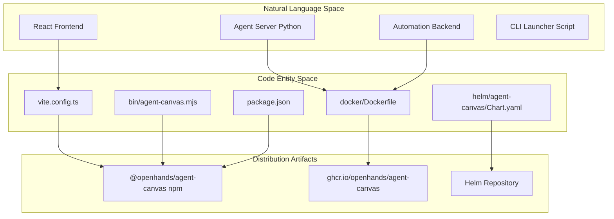
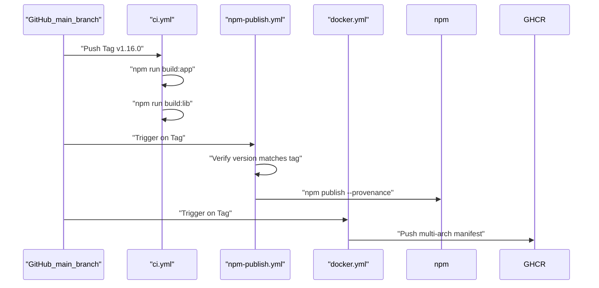

# Build and Deployment

Relevant source files

The following files were used as context for generating this wiki page:

- [.github/workflows/ci.yml](.github/workflows/ci.yml)
- [.github/workflows/docker.yml](.github/workflows/docker.yml)
- [.github/workflows/mock-llm-docker-e2e.yml](.github/workflows/mock-llm-docker-e2e.yml)
- [.github/workflows/mock-llm-e2e.yml](.github/workflows/mock-llm-e2e.yml)
- [.github/workflows/sdk-version-sync.yml](.github/workflows/sdk-version-sync.yml)
- [__tests__/scripts/check-sdk-version-sync.test.ts](__tests__/scripts/check-sdk-version-sync.test.ts)
- [docker/Dockerfile](docker/Dockerfile)
- [playwright.mock-llm-docker.config.ts](playwright.mock-llm-docker.config.ts)
- [playwright.mock-llm.config.ts](playwright.mock-llm.config.ts)
- [scripts/docker-build.mjs](scripts/docker-build.mjs)
- [tests/e2e/mock-llm/automations/mock-llm-automation.spec.ts](tests/e2e/mock-llm/automations/mock-llm-automation.spec.ts)
- [tests/e2e/mock-llm/reporters/done-marker-reporter.ts](tests/e2e/mock-llm/reporters/done-marker-reporter.ts)
- [tests/e2e/mock-llm/scripts/render-mock-llm-report.mjs](tests/e2e/mock-llm/scripts/render-mock-llm-report.mjs)
- [tests/e2e/mock-llm/utils/mock-llm-helpers.ts](tests/e2e/mock-llm/utils/mock-llm-helpers.ts)

This page documents the build system, Docker image construction, CI/CD pipeline, and deployment strategies for **Agent Canvas** (`@openhands/agent-canvas`). It covers how the multi-service stack (frontend, agent-server, and automation) is unified into distributable formats including npm packages, Docker images, Electron desktop apps, and Helm charts.

For details on setting up a local development environment, see [Getting Started](#2). For details on the scripts that orchestrate the services, see [Stack Orchestration](#4).

## Overview

Agent Canvas uses a multi-layered build and packaging strategy to support diverse runtime environments. The system transitions from source code to artifacts through automated pipelines that handle linting, testing, and multi-arch compilation.

### Build Artifact Mapping
The following diagram bridges the natural language concepts of the system components to their concrete implementation code entities and distribution channels.

**Sources**: [package.json:2-18](), [docker/Dockerfile:1-20](), [vite.config.ts:1-20](), [helm/agent-canvas/Chart.yaml:1-16]()

## Docker Image Building

Agent Canvas is distributed as an all-in-one Docker image that bundles the three primary services: the **Frontend** (React SPA), the **Agent Server** (Python SDK), and the **Automation Backend**.

The `docker/Dockerfile` uses a multi-stage build process:
1.  **frontend-build**: Compiles the TypeScript React application using Node.js [docker/Dockerfile:28-49]().
2.  **config-gen**: Extracts version pins and default values from `config/defaults.json` into a shell-sourceable `defaults.env` file to minimize runtime dependencies [docker/Dockerfile:52-71]().
3.  **final**: Uses the upstream `AGENT_SERVER_IMAGE` as a base, installs the `openhands-automation` Python package via `pip`/`uv`, and copies the frontend artifacts [docker/Dockerfile:73-150]().

Local builds are simplified via `scripts/docker-build.mjs`, which reads defaults directly from `config/defaults.json` [scripts/docker-build.mjs:22-28]().

For details, see [Docker Image Building](#3.1).

**Sources**: [docker/Dockerfile:1-155](), [config/defaults.json:1-45](), [scripts/docker-build.mjs:1-78]()

## CI/CD Pipeline

The project uses GitHub Actions workflows defined in `.github/workflows/` to automate the software development lifecycle, ensuring code quality and dependable artifact distribution.

### Key Workflows
*   **CI (`ci.yml`)**: Triggered on every pull request and push to `main` or release branches, executing linting, unit tests, and application builds [package.json:71-78](), [.github/workflows/ci.yml:1-82]().
*   **Docker (`docker.yml`)**: Builds multi-arch (`linux/amd64` and `linux/arm64`) container images and pushes them to GHCR [.github/workflows/docker.yml:45-70]().
*   **npm Publish (`npm-publish.yml`)**: Publishes `@openhands/agent-canvas` to the npm registry with provenance [.github/workflows/npm-publish.yml:1-148]().
*   **Mock-LLM E2E (`mock-llm-e2e.yml`)**: Runs Playwright end-to-end tests against a Python mock LLM server (`tests/e2e/mock-llm/scripts/mock-llm-server.py`) to validate full stack integration [tests/e2e/mock-llm/utils/mock-llm-helpers.ts:11-15](), [.github/workflows/mock-llm-e2e.yml:1-115]().

For details, see [CI/CD Pipeline](#3.2).

**Sources**: [.github/workflows/ci.yml:1-82](), [.github/workflows/docker.yml:1-170](), [.github/workflows/mock-llm-e2e.yml:1-120]()

## Release Orchestration

Agent Canvas follows a trunk-based release process where `package.json` serves as the primary version source of truth.

### Release Pipeline Flow

**Sources**: [package.json:3-3](), [.github/workflows/docker.yml:5-8]()

## Electron Desktop App

The Electron desktop application provides a native desktop experience for macOS and Windows by bundling the complete Agent Canvas service stack.

*   **Main Process**: `electron/main.mjs` manages lifecycle events, window creation, and backend process spawning.
*   **Configuration**: `electron-builder.config.mjs` dictates packaging rules for platform installers.
*   **Binaries**: Utilizes helper scripts to package required Node and Python `uv` runtimes locally.

For details, see [Electron Desktop App](#3.3).

**Sources**: [package.json:109-113]()

## Helm Chart and Kubernetes

For cloud-native deployments, the `helm/agent-canvas` chart packages Agent Canvas for Kubernetes clusters [helm/agent-canvas/Chart.yaml:1-16]().

*   **Architecture**: Deploys the unified container image as a `StatefulSet` with persistent volume claims for conversation and workspace state.
*   **Ingress**: Exposes the unified proxy port (`8000` by default) via configurable Ingress objects [docker/Dockerfile:11-16]().

For details, see [Helm Chart and Kubernetes Deployment](#3.4).

**Sources**: [helm/agent-canvas/Chart.yaml:1-28](), [docker/Dockerfile:11-16]()

## Self-Hosting

Agent Canvas supports self-hosting on private virtual machines or physical infrastructure using either Docker images or the `agent-canvas` CLI binary.

*   **Security**: Requires setting `LOCAL_BACKEND_API_KEY` for secured API endpoints [playwright.mock-llm.config.ts:42-46]().
*   **Networking**: Relies on the ingress proxy (`scripts/ingress.mjs`) to unify frontend routing and backend API endpoints under a single port.

For details, see [Self-Hosting Guide](#3.5).

**Sources**: [playwright.mock-llm.config.ts:42-46]()