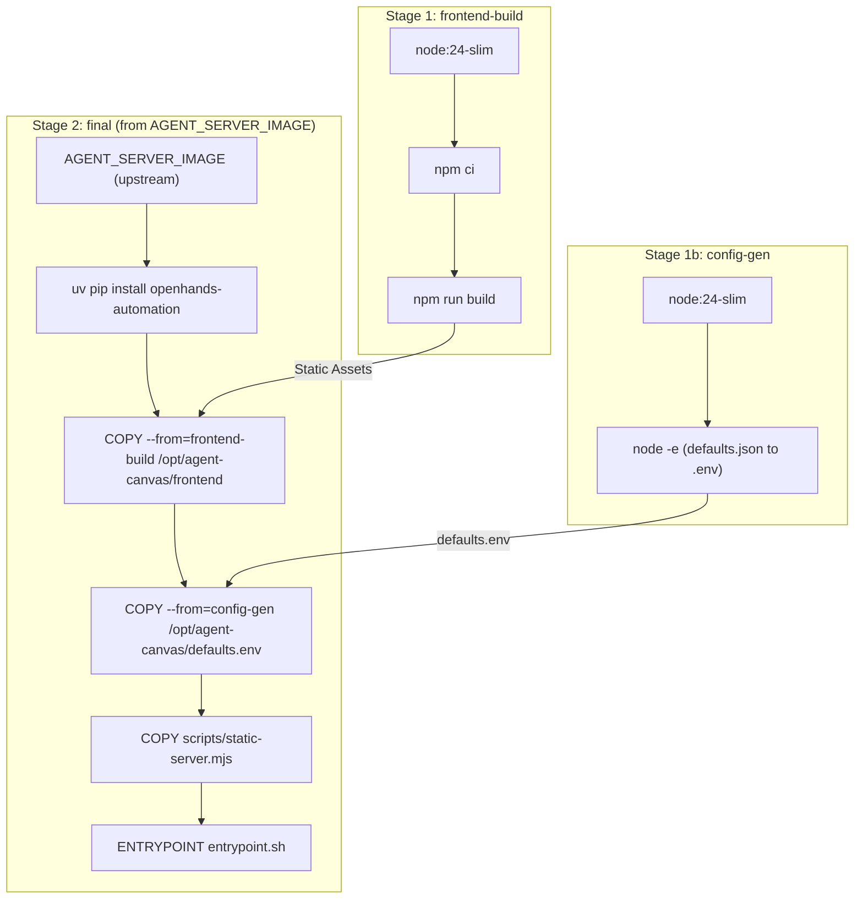
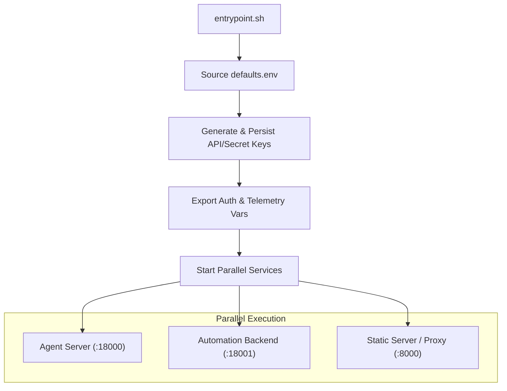

# Docker Image Building

Relevant source files

The following files were used as context for generating this wiki page:

- [.github/workflows/ci.yml](.github/workflows/ci.yml)
- [.github/workflows/docker.yml](.github/workflows/docker.yml)
- [.github/workflows/mock-llm-docker-e2e.yml](.github/workflows/mock-llm-docker-e2e.yml)
- [.github/workflows/mock-llm-e2e.yml](.github/workflows/mock-llm-e2e.yml)
- [.github/workflows/sdk-version-sync.yml](.github/workflows/sdk-version-sync.yml)
- [__tests__/scripts/check-sdk-version-sync.test.ts](__tests__/scripts/check-sdk-version-sync.test.ts)
- [__tests__/scripts/dev-static.test.ts](__tests__/scripts/dev-static.test.ts)
- [__tests__/scripts/dev-with-automation.test.ts](__tests__/scripts/dev-with-automation.test.ts)
- [__tests__/scripts/ingress.test.ts](__tests__/scripts/ingress.test.ts)
- [__tests__/scripts/static-server.test.ts](__tests__/scripts/static-server.test.ts)
- [docker/Dockerfile](docker/Dockerfile)
- [docker/entrypoint.sh](docker/entrypoint.sh)
- [playwright.mock-llm-docker.config.ts](playwright.mock-llm-docker.config.ts)
- [playwright.mock-llm.config.ts](playwright.mock-llm.config.ts)
- [scripts/dev-static.mjs](scripts/dev-static.mjs)
- [scripts/dev-with-automation.mjs](scripts/dev-with-automation.mjs)
- [scripts/docker-build.mjs](scripts/docker-build.mjs)
- [scripts/ingress.mjs](scripts/ingress.mjs)
- [scripts/proxy-utils.mjs](scripts/proxy-utils.mjs)
- [scripts/runtime-services-info.mjs](scripts/runtime-services-info.mjs)
- [scripts/static-server.mjs](scripts/static-server.mjs)
- [tests/e2e/mock-llm/automations/mock-llm-automation.spec.ts](tests/e2e/mock-llm/automations/mock-llm-automation.spec.ts)
- [tests/e2e/mock-llm/reporters/done-marker-reporter.ts](tests/e2e/mock-llm/reporters/done-marker-reporter.ts)
- [tests/e2e/mock-llm/scripts/render-mock-llm-report.mjs](tests/e2e/mock-llm/scripts/render-mock-llm-report.mjs)
- [tests/e2e/mock-llm/utils/mock-llm-helpers.ts](tests/e2e/mock-llm/utils/mock-llm-helpers.ts)

This page documents the multi-stage Docker build process for the OpenHands Agent Canvas application image (`docker/Dockerfile`). It explains how the frontend, agent-server, and automation components are bundled into a single, production-ready container, along with the build orchestration (`docker-build.mjs`) and container entrypoint orchestration (`docker/entrypoint.sh`).

## Image Architecture

The OpenHands Docker image (`docker/Dockerfile`) uses a multi-stage build to bundle three primary services and an ingress proxy into a unified runtime environment.

### Service Stack and Data Flow

Sources: [docker/Dockerfile:26-143]()

## Build Configuration

The build process is parameterized to allow versioning and customization without hardcoding values in the Dockerfile.

### Build Arguments
| Argument | Description | Source |
| :--- | :--- | :--- |
| `AGENT_SERVER_IMAGE` | The base image containing the Python SDK environment. | `config/defaults.json` |
| `AUTOMATION_VERSION` | Version of `openhands-automation` to install via pip. | `config/defaults.json` |
| `VITE_POSTHOG_API_KEY` | Public client key for frontend telemetry. | GitHub Vars / CI |
| `VITE_BASE_PATH` | URL subpath where Canvas is served (default: `/canvas`). | `config/defaults.json` |
| `AGENT_CANVAS_VERSION` | The version string for the image label. | `package.json` |

Sources: [docker/Dockerfile:23-24](), [docker/Dockerfile:73-80](), [.github/workflows/docker.yml:86-99]()

### Build Orchestration (`docker-build.mjs`)
While `docker build` can be called directly, the project provides `scripts/docker-build.mjs` to automate the extraction of versions from `config/defaults.json` and pass them as `--build-arg` flags.
Sources: [scripts/docker-build.mjs:1-50]()

## Stage Details

### 1. Frontend Build
The `frontend-build` stage compiles the React application into static assets.
- **Base Image:** `node:24-slim` [docker/Dockerfile:27]()
- **Operations:**
    - Installs dependencies using `npm ci` [docker/Dockerfile:33]().
    - Bakes `VITE_POSTHOG_API_KEY` and `VITE_BASE_PATH` into the bundle via environment variables [docker/Dockerfile:43-47]().
    - Generates the production build in `/build/build` [docker/Dockerfile:47]().
Sources: [docker/Dockerfile:27-47]()

### 2. Configuration Generation (`config-gen`)
To avoid requiring heavy JSON parsers like `jq` or `python` at container runtime, this stage converts `config/defaults.json` into a shell-sourceable `.env` file.
- **Output:** `/opt/agent-canvas/defaults.env` [docker/Dockerfile:67]().
- **Keys Mapped:** Includes `CONFIG_AGENT_SERVER_PORT`, `CONFIG_AUTOMATION_PORT`, `CONFIG_PROXY_PORT`, and telemetry settings [docker/Dockerfile:54-67]().
Sources: [docker/Dockerfile:51-68]()

### 3. Final Image Assembly
The final stage uses the `AGENT_SERVER_IMAGE` as a base, which already contains the `openhands-sdk` and its Python dependencies.
- **Automation Installation:** Installs `openhands-automation` using `uv pip install --system` [docker/Dockerfile:106]().
- **Static Server:** Copies `scripts/static-server.mjs` and its minimal runtime dependencies (`httpxy`, `sirv`, `@polka`) to serve as the ingress proxy [docker/Dockerfile:122-128]().
- **Persistence Setup:** Pre-creates directories for `conversations`, `bash_events`, and `automation` DBs under `/home/openhands/.openhands` with correct ownership [docker/Dockerfile:149-153]().
Sources: [docker/Dockerfile:71-155]()

## Runtime Configuration (`entrypoint.sh`)

The `entrypoint.sh` script orchestrates the startup of the multi-service stack.

### Entrypoint Logic Flow

Sources: [docker/entrypoint.sh:44-180]()

### Key Behaviors:
- **Key Generation:** If `LOCAL_BACKEND_API_KEY` or `OH_SECRET_KEY` are not provided, the script generates random hex strings and persists them to `/home/openhands/.openhands/agent-canvas/*.txt` to ensure security across restarts [docker/entrypoint.sh:73-103]().
- **Auth Synchronization:** The script ensures that both the Agent Server and Automation backend share the same `X-Session-API-Key` by exporting `OPENHANDS_AUTOMATION_API_KEY` and `OH_SESSION_API_KEYS_0` from the same effective key [docker/entrypoint.sh:108-115]().
- **Unified Ingress:** The `static-server.mjs` is started on the primary `PORT` (default 8000). It routes:
    - `/api/automation/*` to the Automation service [docker/entrypoint.sh:176]().
    - `/api/*` and `/sockets` to the Agent Server [docker/entrypoint.sh:177-179]().
    - All other requests to the static frontend [docker/entrypoint.sh:180]().
Sources: [docker/entrypoint.sh:1-180](), [scripts/static-server.mjs:21-28]()

## CI/CD Pipeline Integration

The `docker.yml` workflow automates the building and publishing of these images to the GitHub Container Registry (GHCR).

- **Multi-Arch Support:** Builds for both `linux/amd64` and `linux/arm64` using native runners [.github/workflows/docker.yml:53-63]().
- **Tagging Strategy:**
    - `sha-<short-sha>-<arch>` for every commit [.github/workflows/docker.yml:133]().
    - Branch names (e.g., `main-amd64`) [.github/workflows/docker.yml:141]().
    - SemVer tags (e.g., `1.2.3`, `1.2`, `1`, `latest`) for releases [.github/workflows/docker.yml:149-168]().
- **Manifest Merging:** A final `merge-manifests` job creates the multi-arch manifest, allowing users to `docker pull ghcr.io/openhands/agent-canvas:latest` regardless of their CPU architecture [.github/workflows/docker.yml:256-310]().

Sources: [.github/workflows/docker.yml:1-310]()