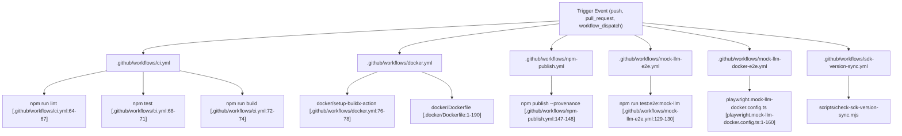

# CI/CD Pipeline

Relevant source files

The following files were used as context for generating this wiki page:

- [.agents/skills/release.md](.agents/skills/release.md)
- [.github/release.yml](.github/release.yml)
- [.github/workflows/ci.yml](.github/workflows/ci.yml)
- [.github/workflows/docker.yml](.github/workflows/docker.yml)
- [.github/workflows/mock-llm-docker-e2e.yml](.github/workflows/mock-llm-docker-e2e.yml)
- [.github/workflows/mock-llm-e2e.yml](.github/workflows/mock-llm-e2e.yml)
- [.github/workflows/npm-publish.yml](.github/workflows/npm-publish.yml)
- [.github/workflows/pr.yml](.github/workflows/pr.yml)
- [.github/workflows/release-ready.yml](.github/workflows/release-ready.yml)
- [.github/workflows/release.yml](.github/workflows/release.yml)
- [.github/workflows/sdk-version-sync.yml](.github/workflows/sdk-version-sync.yml)
- [__tests__/github-workflows/npm-publish.test.ts](__tests__/github-workflows/npm-publish.test.ts)
- [__tests__/scripts/check-sdk-version-sync.test.ts](__tests__/scripts/check-sdk-version-sync.test.ts)
- [docker/Dockerfile](docker/Dockerfile)
- [playwright.mock-llm-docker.config.ts](playwright.mock-llm-docker.config.ts)
- [playwright.mock-llm.config.ts](playwright.mock-llm.config.ts)
- [release-please-config.json](release-please-config.json)
- [scripts/docker-build.mjs](scripts/docker-build.mjs)
- [src/api/agent-canvas-updates.test.ts](src/api/agent-canvas-updates.test.ts)
- [src/api/agent-canvas-updates.ts](src/api/agent-canvas-updates.ts)
- [src/hooks/query/use-latest-agent-canvas-version.ts](src/hooks/query/use-latest-agent-canvas-version.ts)
- [tests/e2e/mock-llm/automations/mock-llm-automation.spec.ts](tests/e2e/mock-llm/automations/mock-llm-automation.spec.ts)
- [tests/e2e/mock-llm/reporters/done-marker-reporter.ts](tests/e2e/mock-llm/reporters/done-marker-reporter.ts)
- [tests/e2e/mock-llm/scripts/render-mock-llm-report.mjs](tests/e2e/mock-llm/scripts/render-mock-llm-report.mjs)
- [tests/e2e/mock-llm/utils/mock-llm-helpers.ts](tests/e2e/mock-llm/utils/mock-llm-helpers.ts)

This page documents the continuous integration and continuous deployment (CI/CD) infrastructure for OpenHands. It covers GitHub Actions workflows (`ci`, `docker`, `npm-publish`, `mock-llm e2e`, `sdk-version-sync`, `pr-artifacts`), the tagging strategy, multi-arch manifest merging, and automated publishing pipelines.

## Overview and Scope

The OpenHands CI/CD pipeline automates code validation, testing, container packaging, and library distribution across the React frontend and Python backend components.

1.  **Workflows**: Automated orchestration via GitHub Actions (`.github/workflows/ci.yml`, `.github/workflows/docker.yml`, `.github/workflows/npm-publish.yml`, `.github/workflows/mock-llm-e2e.yml`, `.github/workflows/mock-llm-docker-e2e.yml`, `.github/workflows/sdk-version-sync.yml`, `.github/workflows/pr-artifacts.yml`) [.github/workflows/ci.yml:1-15](), [.github/workflows/docker.yml:1-25](), [.github/workflows/npm-publish.yml:1-13](), [.github/workflows/mock-llm-e2e.yml:1-7](), [.github/workflows/mock-llm-docker-e2e.yml:1-22]().
2.  **Testing**: Matrix testing on `ubuntu-24.04` and `windows-latest` via `.github/workflows/ci.yml`, alongside mock-LLM E2E suites running via Playwright (`playwright.mock-llm.config.ts`, `playwright.mock-llm-docker.config.ts`) [.github/workflows/ci.yml:37-46](), [playwright.mock-llm.config.ts:88-115](), [playwright.mock-llm-docker.config.ts:142-160]().
3.  **Docker Packaging**: Multi-arch builds (`linux/amd64`, `linux/arm64`) using native runners and manifest merging via `.github/workflows/docker.yml` [.github/workflows/docker.yml:45-64]().
4.  **Publishing**: OIDC trusted publishing to npm (`npm-publish.yml`) and container publishing to GHCR (`docker.yml`) [.github/workflows/npm-publish.yml:18-21](), [.github/workflows/docker.yml:31-34]().

Sources: [.github/workflows/ci.yml:1-46](), [.github/workflows/docker.yml:1-64](), [.github/workflows/npm-publish.yml:1-21](), [.github/workflows/mock-llm-e2e.yml:1-7](), [playwright.mock-llm.config.ts:88-115](), [playwright.mock-llm-docker.config.ts:142-160]()

## GitHub Actions Workflows

### Workflow Orchestration and Code Entity Mapping

The following diagram bridges natural language workflow names to their underlying GitHub Actions workflow files and execution scripts.

Sources: [.github/workflows/ci.yml:64-74](), [.github/workflows/docker.yml:76-78](), [.github/workflows/npm-publish.yml:147-148](), [.github/workflows/mock-llm-e2e.yml:129-130](), [.docker/Dockerfile:1-190](), [playwright.mock-llm-docker.config.ts:1-160]()

### CI Workflow (`ci.yml`)
The `.github/workflows/ci.yml` file defines the primary validation pipeline for pull requests and pushes to `main` [.github/workflows/ci.yml:1-10]().
*   **Concurrency**: Uses a conditional concurrency group that isolates push runs per commit (preventing cancellation of release-please checkpoints) while cancelling outdated PR runs [.github/workflows/ci.yml:16-23]().
*   **Matrix Testing**: Dynamically generates a test matrix via `prepare-test-matrix` covering `ubuntu-24.04` (full checks) and `windows-latest` (basic build checks) [.github/workflows/ci.yml:28-46]().
*   **Execution Steps**: Installs dependencies via `npm ci` using Node.js `24.15`, runs linter checks, executes Vitest unit tests, and compiles both the app bundle and library entrypoints [.github/workflows/ci.yml:52-78]().

Sources: [.github/workflows/ci.yml:1-78]()

### Mock-LLM E2E Workflows (`mock-llm-e2e.yml` and `mock-llm-docker-e2e.yml`)
End-to-end testing against agent-server and automation backends is driven by mock-LLM workflows:
*   **`mock-llm-e2e.yml`**: Spawns a Python mock LLM server (`tests/e2e/mock-llm/scripts/mock-llm-server.py`), pre-warms the `uvx` automation cache, and runs Playwright tests against the local build path (`bin/agent-canvas.mjs`) [.github/workflows/mock-llm-e2e.yml:80-130]().
*   **`mock-llm-docker-e2e.yml`**: Triggers automatically on `workflow_run` completion from the Docker build pipeline or via `workflow_dispatch`, pulling the pre-built GHCR image and executing E2E tests inside containerized environments (`playwright.mock-llm-docker.config.ts`) [.github/workflows/mock-llm-docker-e2e.yml:12-21](), [.github/workflows/mock-llm-docker-e2e.yml:104-110]().

Sources: [.github/workflows/mock-llm-e2e.yml:80-130](), [.github/workflows/mock-llm-docker-e2e.yml:12-21](), [.github/workflows/mock-llm-docker-e2e.yml:104-110]()

### SDK Version Synchronization (`sdk-version-sync.yml`)
The `.github/workflows/sdk-version-sync.yml` workflow ensures that package declarations and Python SDK version constraints in `config/defaults.json` remain synchronized across repository updates.

Sources: [.github/workflows/sdk-version-sync.yml:1-39]()

### PR Artifacts Management (`pr-artifacts.yml`)
The `.github/workflows/pr-artifacts.yml` workflow manages test reports and build outputs uploaded during pull request verification, applying retention limits (`LIVE_E2E_PR_ARTIFACT_KEEP_RUNS`) [.github/workflows/ci.yml:103]().

Sources: [.github/workflows/ci.yml:103]()

## Docker Build Pipeline and Tagging Strategy

The `.github/workflows/docker.yml` workflow handles multi-architecture image construction for `linux/amd64` (on `ubuntu-24.04`) and `linux/arm64` (on `ubuntu-24.04-arm`) [.github/workflows/docker.yml:45-64]().

### Tagging Strategy
The metadata preparation step (`prep` job) computes tags based on git refs, commit SHAs, and release tags [.github/workflows/docker.yml:101-172]().
*   **SHA Tags**: Always constructs architecture-suffixed short SHA tags (e.g., `ghcr.io/openhands/agent-canvas:sha-abc1234-amd64`) [.github/workflows/docker.yml:128-133]().
*   **Branch Tags**: Sanitizes branch names for Docker compatibility (e.g., `main`) [.github/workflows/docker.yml:136-142]().
*   **PR Tags**: Assigns `pr-<number>` tags for pull requests [.github/workflows/docker.yml:144-146]().
*   **Release Tags**: Parses `refs/tags/v*` triggers to publish semantic version tags, major/minor abbreviations (`major.minor`, `major`), and `latest` for stable releases [.github/workflows/docker.yml:148-170]().

Sources: [.github/workflows/docker.yml:45-172]()

### Multi-Arch Manifest Merging
To combine architecture-specific images into a unified multi-arch manifest:
1.  Individual runner jobs build and push `arch`-suffixed images (`amd64` and `arm64`) to GHCR [.github/workflows/docker.yml:45-64]().
2.  A subsequent manifest merge step executes Docker manifest commands or buildx multi-arch annotation tools to bind them under the primary unsuffixed tag.

Sources: [.github/workflows/docker.yml:45-64]()

### Dockerfile Architecture
The all-in-one container image (`docker/Dockerfile`) combines three services:
1.  **Frontend**: Static React build served via Node.js static scripts (`scripts/static-server.mjs`) [.docker/Dockerfile:27-48](), [.docker/Dockerfile:137-149]().
2.  **Agent Server**: Upstream Python SDK container (`ghcr.io/openhands/agent-server`) [.docker/Dockerfile:73-74]().
3.  **Automation Backend**: Installed via `uv pip` / `pip` from `openhands-automation` and `openhands-tools` matching `config/defaults.json` version pins [.docker/Dockerfile:123-128]().

Sources: [.docker/Dockerfile:1-150]()

## Release Strategy and Automated Versioning

Releases are trunk-based and managed by `release-please` via conventional commits (`feat`, `fix`, `chore`, etc.) [.agents/skills/release.md:16-25]().

*   **Version Surfaces**: `release-please-config.json` coordinates version bumps across `package.json`, `config/defaults.json` (`versions.agentCanvas`), and Helm chart metadata (`helm/agent-canvas/Chart.yaml`) [release-please-config.json:6-25]().
*   **Trusted Publishing (`npm-publish.yml`)**: Publishes `@openhands/agent-canvas` to the public npm registry using OIDC token exchange (`id-token: write`) with cryptographic provenance (`--provenance`) and dynamic `dist-tag` resolution (`latest`, `alpha`, `beta`, `rc`) [.github/workflows/npm-publish.yml:18-21](), [.github/workflows/npm-publish.yml:123-148]().

Sources: [.agents/skills/release.md:12-30](), [release-please-config.json:1-27](), [.github/workflows/npm-publish.yml:1-148]()