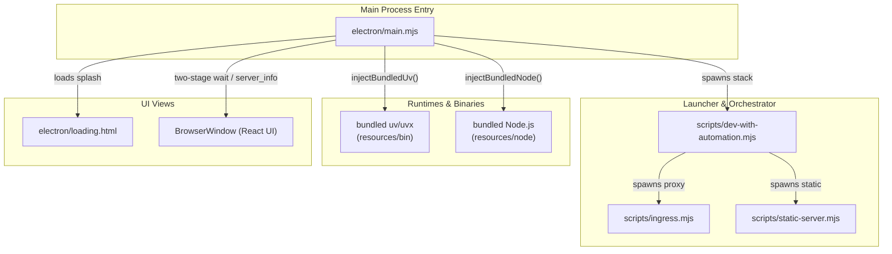
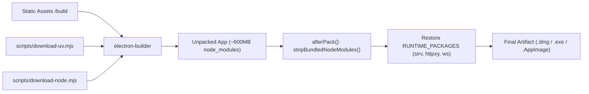

# Electron Desktop App

Relevant source files

The following files were used as context for generating this wiki page:

- [.agents/skills/desktop-electron/SKILL.md](.agents/skills/desktop-electron/SKILL.md)
- [.agents/skills/desktop-electron/references/guide.md](.agents/skills/desktop-electron/references/guide.md)
- [.agents/skills/e2e-testing/SKILL.md](.agents/skills/e2e-testing/SKILL.md)
- [.agents/skills/frontend-api-contracts/SKILL.md](.agents/skills/frontend-api-contracts/SKILL.md)
- [.agents/skills/frontend-development/SKILL.md](.agents/skills/frontend-development/SKILL.md)
- [.agents/skills/local-stack-runtime/SKILL.md](.agents/skills/local-stack-runtime/SKILL.md)
- [.agents/skills/telemetry-analytics/SKILL.md](.agents/skills/telemetry-analytics/SKILL.md)
- [.github/workflows/desktop-linux.yml](.github/workflows/desktop-linux.yml)
- [.github/workflows/desktop-macos.yml](.github/workflows/desktop-macos.yml)
- [.github/workflows/desktop-windows.yml](.github/workflows/desktop-windows.yml)
- [.gitignore](.gitignore)
- [__tests__/electron/lib/bundled-runtime-dir.test.ts](__tests__/electron/lib/bundled-runtime-dir.test.ts)
- [__tests__/scripts/download-arch-utils.test.ts](__tests__/scripts/download-arch-utils.test.ts)
- [__tests__/scripts/download-node.test.ts](__tests__/scripts/download-node.test.ts)
- [__tests__/scripts/download-uv.test.ts](__tests__/scripts/download-uv.test.ts)
- [__tests__/scripts/electron-builder-config.test.ts](__tests__/scripts/electron-builder-config.test.ts)
- [docs/SELF_HOSTING.md](docs/SELF_HOSTING.md)
- [electron-builder.config.mjs](electron-builder.config.mjs)
- [electron/loading.html](electron/loading.html)
- [electron/main.mjs](electron/main.mjs)
- [electron/package.json](electron/package.json)
- [electron/preload.cjs](electron/preload.cjs)
- [scripts/brand-dev-electron.mjs](scripts/brand-dev-electron.mjs)
- [scripts/download-node.mjs](scripts/download-node.mjs)
- [scripts/download-uv.mjs](scripts/download-uv.mjs)

The Electron desktop application provides a native, single-window wrapper for the OpenHands Agent Canvas stack. It orchestrates the full three-service architecture—frontend, agent-server, and automation backend—within a local environment, managing process lifecycles, path resolution, bundled runtimes, and packaging configurations for both development and production modes [electron/main.mjs:1-39]().

## 1. Architecture and Process Lifecycle

The desktop app follows a launcher model where the Electron **Main Process** (`electron/main.mjs`) is responsible for spawning backend services, managing environment variables, and coordinating the startup sequence before rendering the main UI window [electron/main.mjs:1-39]().

### Startup Sequence and Two-Stage Wait
To prevent race conditions where the frontend attempts to communicate with an agent-server that is still downloading or cold-starting via `uvx`, the startup logic utilizes a robust two-stage wait procedure [.agents/skills/desktop-electron/references/guide.md:3-3]():
1. **Stage 1 (`waitForUrl`)**: Confirms that the ingress proxy service (orchestrated via `scripts/dev-with-automation.mjs`) is up and responding on its port [electron/main.mjs:324-345]().
2. **Stage 2 (`waitForAgentServer`)**: Hits `${ingress}/server_info` and accepts only `200` (or `401`, which verifies the proxy has successfully routed to a live agent-server instance) before allowing the `BrowserWindow` to load [.agents/skills/desktop-electron/references/guide.md:3-3]().

The following diagram maps the natural language architecture to precise code entities in the Electron main process and script modules:

**Desktop Architecture to Code Entities**

Sources: [electron/main.mjs:1-39](), [electron/main.mjs:104-143](), [.agents/skills/desktop-electron/references/guide.md:3-3]()

Sources: [electron/main.mjs:1-39](), [electron/main.mjs:104-143](), [.agents/skills/desktop-electron/references/guide.md:3-3]()

---

## 2. Path Resolution and Bundling

Path resolution dynamically adapts depending on whether the app runs in development mode (`npm run desktop`) or inside a packaged `.app` / installer bundle [electron/main.mjs:63-74]().

| Entity | Development Path | Packaged Production Path |
| :--- | :--- | :--- |
| **Project Root (`projectRoot`)** | `<repo>/` (one level up from `electron/`) | `Contents/Resources/app/` (sibling of `main.mjs`) |
| **Frontend Build (`buildDir`)** | `<repo>/build` | `Resources/app/build` |
| **Backend Scripts (`scriptsDir`)** | `<repo>/scripts` | `Resources/app/scripts` |
| **Bundled Runtimes** | System `PATH` (`uvx`, `node`) | `Contents/Resources/bin/` and `Contents/Resources/node/` |

Sources: [electron/main.mjs:63-74](), [electron/main.mjs:100-143]()

### Bundled Binaries and Runtime Directories
* **`uv` / `uvx`**: Bundled via `scripts/download-uv.mjs` into `resources/bin/` (or arch-tagged directories for universal macOS builds) [electron/main.mjs:104-143](), [scripts/download-uv.mjs:3-16](). `injectBundledUv()` prepends this directory to `process.env.PATH` so that Python environment provisioning succeeds without host prerequisites [electron/main.mjs:104-143]().
* **Node.js**: A standalone Node distribution is bundled via `scripts/download-node.mjs` to ensure `npx` is available for stdio-based MCP servers (e.g., Slack, GitHub) which otherwise fail in GUI-launched macOS bundles due to restricted minimal default paths [electron/main.mjs:159-162](), [scripts/download-node.mjs:3-16]().
* **Multi-Arch Resolution**: `electron/lib/bundled-runtime-dir.mjs` resolves arch-tagged directories (`bin-arm64`, `bin-x64`) matching `process.arch` under universal builds, falling back to legacy flat directories [.agents/skills/desktop-electron/references/guide.md:9-9]().

Sources: [electron/main.mjs:104-162](), [scripts/download-uv.mjs:3-16](), [scripts/download-node.mjs:3-16](), [.agents/skills/desktop-electron/references/guide.md:9-9]()

---

## 3. Build and Packaging Configuration

Packaging is configured through `electron-builder.config.mjs` and managed by `electron-builder` [electron-builder.config.mjs:1-62]().

### The `afterPack` Optimization Hook
Because `electron-builder` automatically walks the workspace and hoists node modules (copying ~600MB of development dependencies like Vite and Monaco into `Resources/app/node_modules/`), a custom `afterPack` hook (`stripBundledNodeModules`) is executed [electron-builder.config.mjs:16-35](). 

This hook removes the bulky directory and restores only the minimal dependency closure defined in `RUNTIME_PACKAGES` (`sirv`, `httpxy`, `ws`), reducing the runtime application footprint down to ~7MB [electron-builder.config.mjs:31-34](), [electron-builder.config.mjs:88-88]().

**Packaging and Optimization Pipeline**

Sources: [electron-builder.config.mjs:30-88](), [electron-builder.config.mjs:121-145]()

Sources: [electron-builder.config.mjs:30-88](), [electron-builder.config.mjs:121-145]()

---

## 4. Loading Screen and Diagnostics

The loading window (`electron/loading.html`) provides immediate user feedback and diagnostic logging during startup [electron/loading.html:1-35]().

* **Status Updates**: The main process injects status updates into the loading view via `window.__setLoadingStatus()` [electron/main.mjs:628-634]().
* **Startup Console**: Backend stdout/stderr streams are captured and funneled through IPC channels to populate an interactive console log drawer in `electron/loading.html` [electron/loading.html:157-198]().
* **Error Handling**: If a timeout or fatal initialization failure occurs, the splash window displays diagnostic error banners and exposes a quit action [electron/loading.html:211-230]().

Sources: [electron/loading.html:1-230](), [electron/main.mjs:605-634]()

---

## 5. Desktop Build Workflows and CI/CD

Automated builds for desktop platforms are defined under GitHub Actions workflows:
* **macOS (`.github/workflows/desktop-macos.yml`)**: Builds native arm64 and Intel x64 DMGs on pull requests, and produces a unified universal binary (`ELECTRON_ARCH=universal`) upon release publication [.github/workflows/desktop-macos.yml:1-50]().
* **Windows (`.github/workflows/desktop-windows.yml`)**: Builds the Windows NSIS installer (`.exe`) via `windows-latest` runners [.github/workflows/desktop-windows.yml:1-40]().
* **Linux (`.github/workflows/desktop-linux.yml`)**: Produces both AppImage and `.deb` distribution packages on Ubuntu runners [.github/workflows/desktop-linux.yml:1-45]().

Sources: [.github/workflows/desktop-macos.yml:1-50](), [.github/workflows/desktop-windows.yml:1-40](), [.github/workflows/desktop-linux.yml:1-45]()