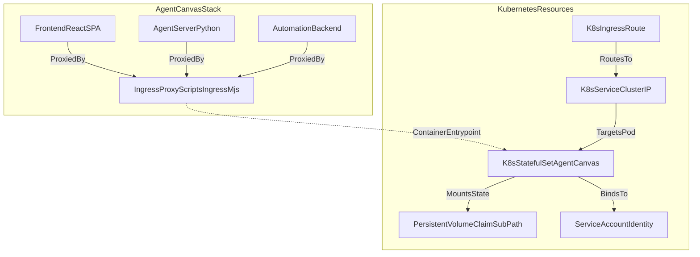

# Helm Chart and Kubernetes Deployment

Relevant source files

The following files were used as context for generating this wiki page:

- [.release-please-manifest.json](.release-please-manifest.json)
- [AGENTS.md](AGENTS.md)
- [README.md](README.md)
- [README.windows.md](README.windows.md)
- [__tests__/scripts/dev-safe.test.ts](__tests__/scripts/dev-safe.test.ts)
- [config/defaults.json](config/defaults.json)
- [helm/agent-canvas/Chart.yaml](helm/agent-canvas/Chart.yaml)
- [package-lock.json](package-lock.json)
- [package.json](package.json)
- [scripts/check-sdk-version-sync.mjs](scripts/check-sdk-version-sync.mjs)
- [scripts/dev-safe.mjs](scripts/dev-safe.mjs)

## Purpose and Scope

This page documents the deployment of Agent Canvas on Kubernetes using the provided Helm chart located in `helm/agent-canvas/`. Agent Canvas is packaged as an all-in-one container image (`ghcr.io/openhands/agent-canvas`) comprising the React frontend, the Python `agent-server`, and the automation backend [helm/agent-canvas/Chart.yaml:3-6](). The Helm chart facilitates deploying this stack as a `StatefulSet` to ensure stable network identifiers and persistent storage for agent workspaces, conversation history, and automation databases [helm/agent-canvas/Chart.yaml:3-6]().

For details on the container build process, see [Docker Image Building](3.1). For information on the multi-service orchestration logic, see [Stack Orchestration](4).

Sources: [helm/agent-canvas/Chart.yaml:1-6](), [config/defaults.json:1-7]()

## Helm Chart Architecture

The `agent-canvas` Helm chart is designed to turn a Kubernetes cluster into a shared, always-on Agent Canvas backend [helm/agent-canvas/Chart.yaml:3-6](). It is optimized for single-tenant or experimental cluster deployments [helm/agent-canvas/Chart.yaml:3-6]().

### Component Mapping

The following diagram illustrates how the logical services defined in the codebase map to Kubernetes resources deployed by the Helm chart.

Sources: [helm/agent-canvas/Chart.yaml:1-6](), [config/defaults.json:15-30]()

### StatefulSet and Persistence
Agent Canvas requires persistent storage to maintain state across pod restarts and image upgrades. The Helm chart utilizes a `StatefulSet` and a single `PersistentVolumeClaim` (PVC) per pod [helm/agent-canvas/Chart.yaml:3-6]().

The chart mounts the PVC at well-known subdirectories of the user's HOME (`/home/openhands`) via `subPath` [config/defaults.json:22-30]():
*   **`~/.openhands`**: Stores agent-server settings, encrypted secrets, conversation history, the session API key, and the automation SQLite database [config/defaults.json:22-30]().
*   **`~/workspace`**: The default working directory for agent execution, including cloned repositories and worktrees [config/defaults.json:22-30]().

Sources: [helm/agent-canvas/Chart.yaml:1-6](), [config/defaults.json:22-30]()

## Configuration and Versions

The Helm chart versioning is synchronized with the application release cycle. The `appVersion` in `Chart.yaml` pins the specific container image tag published to GHCR, which is kept in sync by `release-please` [helm/agent-canvas/Chart.yaml:10-16]().

| Parameter | Default Value | Description |
|-----------|---------------|-------------|
| `appVersion` | `1.27.0` | The version of `ghcr.io/openhands/agent-canvas` image [helm/agent-canvas/Chart.yaml:16]() |
| `agentServer` | `1.54.0` | The internal version of the agent-server package [config/defaults.json:4]() |
| `automation` | `1.19.3` | The internal version of the automation package [config/defaults.json:6]() |
| `proxyPort` | `8000` | The primary port for the ingress proxy [config/defaults.json:18]() |

Sources: [helm/agent-canvas/Chart.yaml:9-17](), [config/defaults.json:3-23]()

## Ingress and Routing

The deployment relies on an internal Ingress Proxy (`scripts/ingress.mjs`) that handles path-based routing within the pod [config/defaults.json:18-21](). The Kubernetes `Ingress` resource should point to the service port (default `8000`) and handle WebSocket traffic on `/sockets` [config/defaults.json:18-21]().

### Path-Based Routing Logic
The proxy service within the container routes traffic as follows:
*   `/api/automation/*` → Automation Backend (Port 18001) [config/defaults.json:16-17]()
*   `/api/*` → Agent Server (Port 18000) [config/defaults.json:15-16]()
*   `/vscode` → Bundled Editor (Port 8001) [config/defaults.json:19-20]()
*   `/*` → Static Frontend Assets served under `canvasBasePath` [config/defaults.json:27-29]()

Sources: [config/defaults.json:15-30]()

## Security Considerations

### RBAC and Cluster Access
RBAC is disabled by default in the chart configuration [helm/agent-canvas/Chart.yaml:1-6](). If enabled, the chart creates `RoleBinding` resources referencing built-in cluster roles to allow agents to manage resources directly from the UI when necessary [helm/agent-canvas/Chart.yaml:1-6]().

### Authentication and Ingress
Agent Canvas operates as an unauthenticated single-tenant application at the container layer [helm/agent-canvas/Chart.yaml:3-6](). It is strongly recommended to place the deployment behind an authenticated ingress controller (such as OIDC or HTTP Basic Auth) before exposing it externally [helm/agent-canvas/Chart.yaml:3-6]().

Sources: [helm/agent-canvas/Chart.yaml:1-6]()

## Relationship to OpenHands Enterprise

The Helm chart provides a self-hosted, single-tenant setup where all agents share the same pod filesystem and PVC [helm/agent-canvas/Chart.yaml:3-6](). 

For multi-user requirements, **OpenHands Enterprise (OHE)** provides the productized upgrade path featuring:
*   **Authentication**: Native SSO/SAML/OIDC integration [helm/agent-canvas/Chart.yaml:3-6]().
*   **Multi-tenancy**: Isolated user spaces and organizational boundaries [helm/agent-canvas/Chart.yaml:3-6]().
*   **Isolated Sandboxes**: Dedicated ephemeral containers per agent run instead of shared pod file systems [helm/agent-canvas/Chart.yaml:3-6]().

Sources: [helm/agent-canvas/Chart.yaml:1-6]()