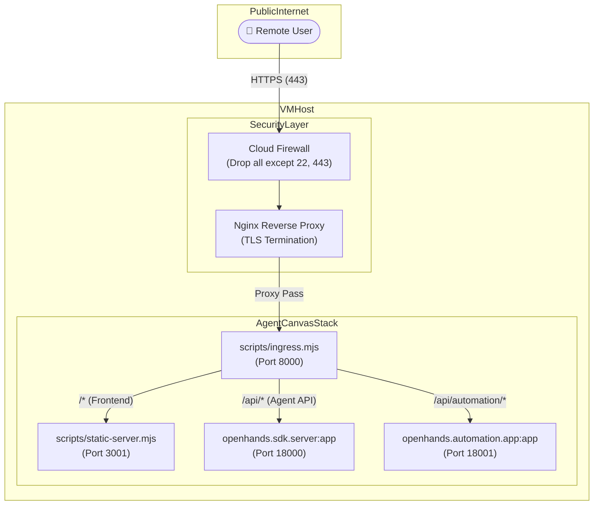
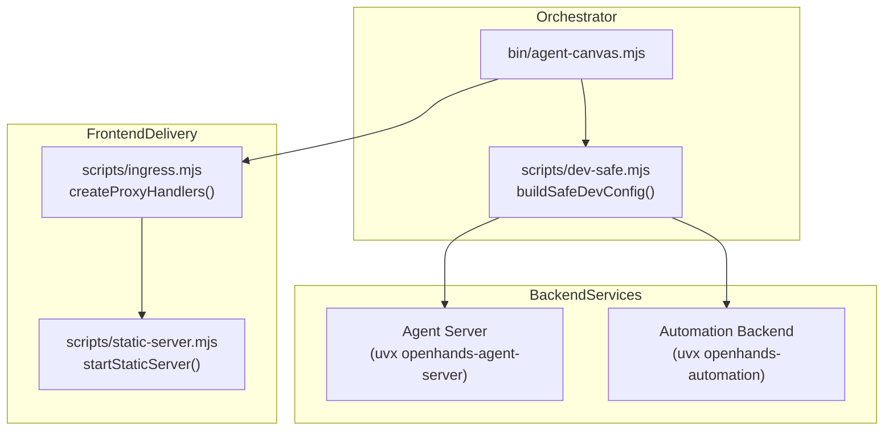

# Self-Hosting Guide

Relevant source files

The following files were used as context for generating this wiki page:

- [.agents/skills/desktop-electron/SKILL.md](.agents/skills/desktop-electron/SKILL.md)
- [.agents/skills/desktop-electron/references/guide.md](.agents/skills/desktop-electron/references/guide.md)
- [.agents/skills/e2e-testing/SKILL.md](.agents/skills/e2e-testing/SKILL.md)
- [.agents/skills/frontend-api-contracts/SKILL.md](.agents/skills/frontend-api-contracts/SKILL.md)
- [.agents/skills/frontend-development/SKILL.md](.agents/skills/frontend-development/SKILL.md)
- [.agents/skills/local-stack-runtime/SKILL.md](.agents/skills/local-stack-runtime/SKILL.md)
- [.agents/skills/telemetry-analytics/SKILL.md](.agents/skills/telemetry-analytics/SKILL.md)
- [docs/SELF_HOSTING.md](docs/SELF_HOSTING.md)
- [scripts/download-node.mjs](scripts/download-node.mjs)

## Purpose and Scope

This guide documents the technical implementation and operational requirements for self-hosting **Agent Canvas** on a Virtual Machine (VM). Self-hosting allows users to expose the Agent Canvas stack—comprising the React frontend, Python Agent Server, and Automation backend—via a public URL while maintaining a secure security posture.

This document covers provisioning, machine hardening, the `--public` runtime mode, and the ingress proxy architecture. For details on Docker-based deployments, see [Docker Image Building](3.1). For external agent configuration, see [ACP Agent Setup](2.4). Reference documentation is also available in `docs/SELF_HOSTING.md`.

Sources: [docs/SELF_HOSTING.md:1-20]()

## Deployment Architecture

The self-hosting model relies on a single-host multi-service stack orchestrated by an ingress proxy. The `npx @openhands/agent-canvas --public` command manages the lifecycle of primary backends routed through path-based rules.

### System Data Flow

The following diagram illustrates request routing from a remote user through host networking layers to code entities:

**Self-Hosted Request Routing**

Sources: [docs/SELF_HOSTING.md:25-41](), [scripts/ingress.mjs:1-30](), [scripts/static-server.mjs:1-20]()

## Security Posture and Public Mode

When self-hosting, the application transitions from "Local Mode" (where keys are auto-injected) to **Public Mode**, enforcing UI-level authentication.

### LOCAL_BACKEND_API_KEY Implementation

The security model centers on a shared secret defined by the `LOCAL_BACKEND_API_KEY` environment variable [docs/SELF_HOSTING.md:123-125]().

1. **Key Generation**: A cryptographically random 256-bit key is generated via `openssl rand -base64 32` or stored locally [docs/SELF_HOSTING.md:123-125]().
2. **Authentication Header**: Every request to backends must carry the `X-Session-API-Key` header [docs/SELF_HOSTING.md:57-59]().
3. **Public Flag**: The `--public` flag instructs `scripts/static-server.mjs` to inject an `authRequired` indicator into `index.html`.
4. **UI Enforcement**: The frontend detects the `authRequired` state and requires users to manually provide the `LOCAL_BACKEND_API_KEY` before interacting with agents [docs/SELF_HOSTING.md:48-51]().

### Security Layers Table

| Layer | Implementation | Purpose |
| :--- | :--- | :--- |
| **Network Firewall** | Cloud Security Groups / UFW | Restrict inbound traffic to SSH (22) and HTTPS (443) only [docs/SELF_HOSTING.md:82-88](). |
| **Transport Security** | Nginx + Let's Encrypt | Provide TLS termination and domain-based routing [docs/SELF_HOSTING.md:18-30](). |
| **API Authentication** | `LOCAL_BACKEND_API_KEY` | Validate `X-Session-API-Key` at the Agent Server and Automation boundaries [docs/SELF_HOSTING.md:57-59](). |
| **Workspace Scoping** | Filesystem Permissions | Confine agent file operations to specific persistent directories [docs/SELF_HOSTING.md:7-11](). |

Sources: [docs/SELF_HOSTING.md:43-60](), [scripts/static-server.mjs:159-170]()

## Service Orchestration

Self-hosting leverages orchestration logic configured for production stability. The stack can be launched directly using Node.js or wrapped in a process manager like `tmux` or `systemd` [docs/SELF_HOSTING.md:135-170]().

### Component Interaction Diagram

This diagram maps service names to specific implementation files and classes.

**Code Entity Orchestration**

Sources: [docs/SELF_HOSTING.md:120-135](), [scripts/dev-safe.mjs:20-60](), [scripts/ingress.mjs:1-40]()

### Provisioning Steps

1. **Machine Preparation**: Install `uv` and `Node.js` on an always-on Linux or macOS host [docs/SELF_HOSTING.md:108-118]().
2. **Environment Setup**: Export `LOCAL_BACKEND_API_KEY` securely [docs/SELF_HOSTING.md:123-125]().
3. **Process Management**: Configure a `systemd` unit file at `/etc/systemd/system/agent-canvas.service` to ensure automatic restarts on failure [docs/SELF_HOSTING.md:145-162]().
4. **Version Pins**: Rely on `config/defaults.json` for pinned server and automation dependencies [config/defaults.json:3-10]().

Sources: [docs/SELF_HOSTING.md:100-170](), [config/defaults.json:1-15]()