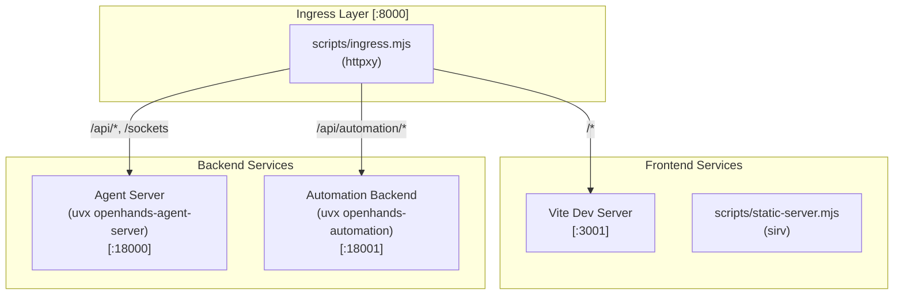
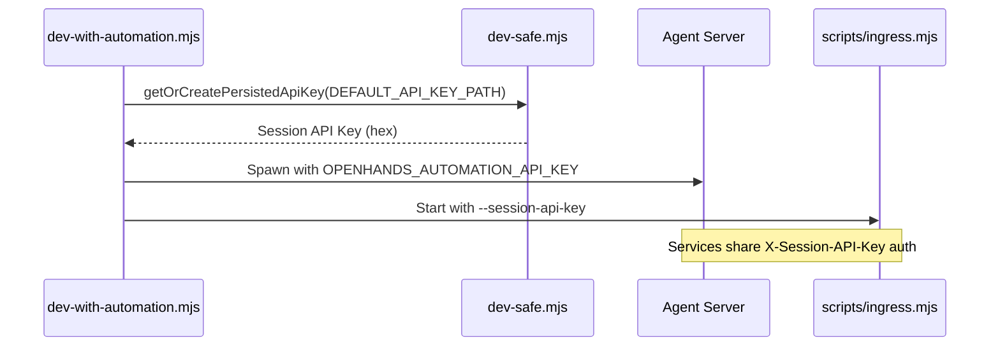

# Stack Orchestration

Relevant source files

The following files were used as context for generating this wiki page:

- [__tests__/scripts/dev-static.test.ts](__tests__/scripts/dev-static.test.ts)
- [__tests__/scripts/dev-with-automation.test.ts](__tests__/scripts/dev-with-automation.test.ts)
- [__tests__/scripts/ingress.test.ts](__tests__/scripts/ingress.test.ts)
- [__tests__/scripts/static-server.test.ts](__tests__/scripts/static-server.test.ts)
- [docker/entrypoint.sh](docker/entrypoint.sh)
- [scripts/dev-static.mjs](scripts/dev-static.mjs)
- [scripts/dev-with-automation.mjs](scripts/dev-with-automation.mjs)
- [scripts/ingress.mjs](scripts/ingress.mjs)
- [scripts/proxy-utils.mjs](scripts/proxy-utils.mjs)
- [scripts/runtime-services-info.mjs](scripts/runtime-services-info.mjs)
- [scripts/static-server.mjs](scripts/static-server.mjs)

The Agent Canvas stack is a multi-service architecture comprising the React frontend, a Python-based agent-server, and an automation backend. Orchestration is handled by a suite of Node.js scripts that manage process lifecycles, port discovery, and secure communication between services via an ingress proxy.

For detailed documentation on the individual orchestration scripts and process utilities, see [Dev Stack Scripts](#4.1).

## System Architecture

The stack uses a "sidecar" model where the frontend communicates with multiple backends through a centralized ingress proxy. This allows for path-based routing and seamless injection of runtime metadata.

### Stack Architecture and Routing Flow

**Sources**: [scripts/dev-with-automation.mjs:9-22](), [scripts/dev-safe.mjs:39-45](), [docker/entrypoint.sh:5-10]()

## Key Orchestration Components

| Component | Code Entity | Responsibility |
|-----------|-------------|----------------|
| **Dev Orchestrator** | `scripts/dev-with-automation.mjs` | Primary entry point for local development; spawns all services. |
| **Safe Launcher** | `scripts/dev-safe.mjs` | Handles port discovery and agent-server lifecycle via `uvx`. |
| **Ingress Proxy** | `scripts/ingress.mjs` | Routes traffic and injects `runtime_services` into `/server_info`. |
| **Process Manager** | `scripts/dev-process-utils.mjs` | Manages cross-platform process trees and graceful shutdowns. |
| **Static Server** | `scripts/static-server.mjs` | Serves production builds with runtime global injection. |
| **Runtime Info** | `scripts/runtime-services-info.mjs` | Generates the `runtime_services` JSON block for UI capability discovery. |

**Sources**: [scripts/dev-with-automation.mjs:47-72](), [scripts/dev-safe.mjs:19-28](), [scripts/static-server.mjs:37-43](), [scripts/dev-process-utils.mjs:1-10]()

## Service Connectivity and Security

Orchestration scripts ensure secure local communication by generating and synchronizing session keys. The `getOrCreatePersistedApiKey` function persists keys in `~/.openhands/agent-canvas/api-key.txt` to ensure stability across restarts.

### Session Key Synchronization Flow

**Sources**: [scripts/dev-safe.mjs:72-89](), [scripts/dev-safe.mjs:148-180](), [scripts/dev-with-automation.mjs:38-45](), [scripts/dev-with-automation.mjs:197-205]()

### Port Management
The stack defaults to port `8000` for the ingress proxy, `18000` for the agent-server, and `18001` for automations. The `findFreePorts` utility in `dev-safe.mjs` (tested in `__tests__/scripts/dev-safe.test.ts`) prevents collisions by scanning for available ports if defaults are occupied.

**Sources**: [scripts/dev-safe.mjs:39-45](), [__tests__/scripts/dev-safe.test.ts:100-142]()

### Runtime Metadata Injection
The orchestration layer injects a `runtime_services` block into the frontend. This JSON block informs the UI which features (like automations or specific agent capabilities) are active in the current environment. 

In development, `scripts/dev-with-automation.mjs` builds this info using `buildRuntimeServicesInfo` and passes it to the ingress proxy. In production and Docker environments, `docker/entrypoint.sh` invokes the same logic to inject globals into `index.html`.

For details on how this is injected into HTML and API responses, see [Ingress Proxy and Static Server](#4.2).

**Sources**: [scripts/dev-safe.mjs:24-27](), [scripts/dev-with-automation.mjs:61-65](), [docker/entrypoint.sh:162-175]()

## Build and Environment Configuration

The orchestration scripts rely on `config/defaults.json` as the single source of truth for version pins and service names. During development, Vite handles frontend hot-reloading, while `uvx` ensures the Python backends align with the versions specified in the project manifest.

For details on Vite-specific proxying, dependency pre-bundling, and library entrypoint builds, see [Vite Build Configuration](#4.3).

**Sources**: [scripts/dev-safe.mjs:30-65](), [vite.config.ts:91-118]()

## Child Pages
- [Dev Stack Scripts](#4.1) — Detailed documentation of `dev-with-automation.mjs`, `dev-safe.mjs`, and process lifecycle management.
- [Ingress Proxy and Static Server](#4.2) — Technical details on `scripts/ingress.mjs` routing, `/server_info` interception, and production serving.
- [Vite Build Configuration](#4.3) — Documentation of `vite.config.ts` including WebSocket proxying and library build modes.