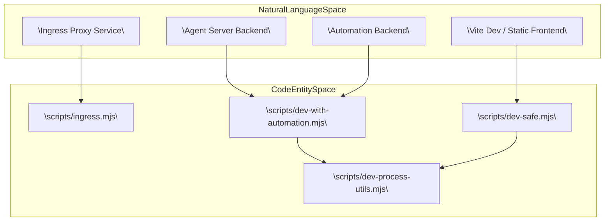
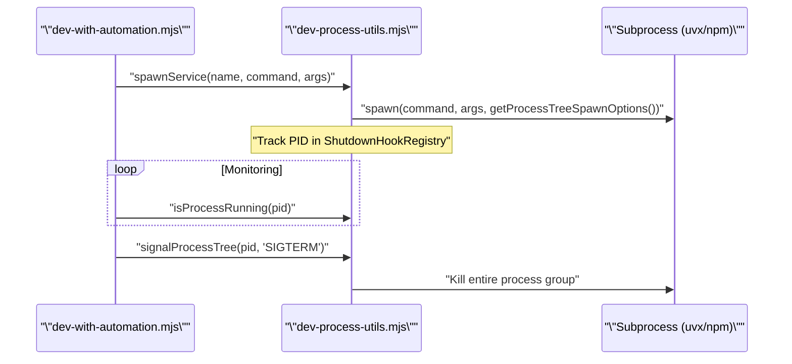

# Dev Stack Scripts

Relevant source files

The following files were used as context for generating this wiki page:

- [.release-please-manifest.json](.release-please-manifest.json)
- [AGENTS.md](AGENTS.md)
- [README.md](README.md)
- [README.windows.md](README.windows.md)
- [__tests__/components/features/conversation/right-panel-toggle.test.tsx](__tests__/components/features/conversation/right-panel-toggle.test.tsx)
- [__tests__/scripts/dev-process-utils.test.ts](__tests__/scripts/dev-process-utils.test.ts)
- [__tests__/scripts/dev-safe.test.ts](__tests__/scripts/dev-safe.test.ts)
- [__tests__/scripts/dev-static.test.ts](__tests__/scripts/dev-static.test.ts)
- [__tests__/scripts/dev-with-automation.test.ts](__tests__/scripts/dev-with-automation.test.ts)
- [__tests__/scripts/ingress.test.ts](__tests__/scripts/ingress.test.ts)
- [__tests__/scripts/static-server.test.ts](__tests__/scripts/static-server.test.ts)
- [config/defaults.json](config/defaults.json)
- [docker/entrypoint.sh](docker/entrypoint.sh)
- [helm/agent-canvas/Chart.yaml](helm/agent-canvas/Chart.yaml)
- [package-lock.json](package-lock.json)
- [package.json](package.json)
- [scripts/check-sdk-version-sync.mjs](scripts/check-sdk-version-sync.mjs)
- [scripts/dev-process-utils.mjs](scripts/dev-process-utils.mjs)
- [scripts/dev-safe.mjs](scripts/dev-safe.mjs)
- [scripts/dev-static.mjs](scripts/dev-static.mjs)
- [scripts/dev-with-automation.mjs](scripts/dev-with-automation.mjs)
- [scripts/ingress.mjs](scripts/ingress.mjs)
- [scripts/proxy-utils.mjs](scripts/proxy-utils.mjs)
- [scripts/runtime-services-info.mjs](scripts/runtime-services-info.mjs)
- [scripts/static-server.mjs](scripts/static-server.mjs)
- [src/components/features/conversation/right-panel-toggle.tsx](src/components/features/conversation/right-panel-toggle.tsx)
- [tests/e2e/mock-llm/conversations/mock-llm-conversation.spec.ts](tests/e2e/mock-llm/conversations/mock-llm-conversation.spec.ts)
- [tests/e2e/mock-llm/settings/mock-llm-acp-agent.spec.ts](tests/e2e/mock-llm/settings/mock-llm-acp-agent.spec.ts)
- [tests/e2e/mock-llm/settings/mock-llm-profile-management.spec.ts](tests/e2e/mock-llm/settings/mock-llm-profile-management.spec.ts)

The Agent Canvas development stack is orchestrated by a set of Node.js scripts that manage the lifecycle of the frontend (`Vite`), the agent-server (`Python SDK`), the automation backend, and an ingress proxy. These scripts automate port discovery, dependency validation, and environment configuration to provide a seamless "one-command" development experience.

## Orchestration Overview

The development environment consists of three primary entry points:
1. **`dev-with-automation.mjs`**: The standard development script that launches the full stack, including the automation backend [scripts/dev-with-automation.mjs:4-7]().
2. **`dev-safe.mjs`**: A "minimal" version that skips the automation backend, focusing only on the frontend and agent-server [scripts/dev-safe.mjs:79]().
3. **`dev-static.mjs`**: Serves a production build of the frontend while still orchestrating the live backends [scripts/dev-static.mjs:1-5]().

### System Architecture and Code Mapping

The stack uses a path-based routing model managed by an ingress proxy to consolidate multiple services under a single origin (`localhost:8000`).

Sources: [scripts/dev-with-automation.mjs:4-22](), [scripts/dev-safe.mjs:78-80](), [scripts/dev-static.mjs:1-5]()

---

## Configuration and Port Discovery

The scripts rely on `config/defaults.json` as the single source of truth for version pins, default ports, and package names [scripts/dev-safe.mjs:31-38]().

### Key Functions and Data Flow
- **`buildSafeDevConfigAsync`**: Orchestrates the initial setup by finding free ports and generating session keys [__tests__/scripts/dev-safe.test.ts:202-205]().
- **`findFreePorts`**: Scans the host system to find available ports, preferring the defaults defined in `SHARED_DEFAULTS` [__tests__/scripts/dev-safe.test.ts:111-125]().
- **`assertPortsFree`**: Validates that required ports are not already occupied by lingering processes [scripts/dev-safe.mjs:56-65]().

| Service | Default Port | Config Key |
| :--- | :--- | :--- |
| Ingress Proxy | 8000 | `ports.proxy` |
| Agent Server | 18000 | `ports.agentServer` |
| Automation | 18001 | `ports.automation` |
| Vite Dev | 3001 | `DEFAULT_VITE_PORT` |

Sources: [scripts/dev-safe.mjs:31-47](), [config/defaults.json:15-21](), [__tests__/scripts/dev-safe.test.ts:110-125]()

---

## Session API Keys and Security Model

To ensure secure communication between the frontend, agent-server, and automation backends without manual credential entry during local development, the stack generates and persists session API keys.

### Key Management Functions
- **`getOrCreatePersistedApiKey`**: Ensures a stable `X-Session-API-Key` is generated and stored in `~/.openhands/agent-canvas/api-key.txt` [scripts/dev-safe.mjs:144-176]().
- **`DEFAULT_API_KEY_PATH`**: Points to `path.join(homedir(), ".openhands", "agent-canvas", "api-key.txt")` [scripts/dev-safe.mjs:80-85]().
- **`DEFAULT_SECRET_KEY_PATH`**: Points to `path.join(homedir(), ".openhands", "agent-canvas", "secret-key.txt")` for `OH_SECRET_KEY` encryption shared across dev and Docker modes [scripts/dev-safe.mjs:97-102]().

Sources: [scripts/dev-safe.mjs:68-102](), [scripts/dev-safe.mjs:144-176]()

---

## Process Lifecycle and Subprocess Management

Stack orchestration requires managing multiple long-running subprocesses safely. The logic in `scripts/dev-process-utils.mjs` provides robust handling for process trees.

### Process Management Flow

Sources: [scripts/dev-process-utils.mjs:1-50](), [scripts/dev-with-automation.mjs:66-72]()

### Key Code Entities
- **`createShutdownHookRegistry`**: A registry that ensures all spawned backends are killed when the main Node process exits (e.g., via `Ctrl+C`) [scripts/dev-with-automation.mjs:67-72]().
- **`signalProcessTree`**: Sends signals to an entire process group, preventing orphaned Python processes when `uvx` is interrupted [scripts/dev-process-utils.mjs:22-23]().
- **`getProcessTreeSpawnOptions`**: Configures platform-specific spawn options (such as detached process groups on POSIX) to enable clean child process termination [scripts/dev-safe.mjs:21-24]().

Sources: [scripts/dev-process-utils.mjs:1-60](), [scripts/dev-safe.mjs:20-24](), [scripts/dev-with-automation.mjs:66-72]()