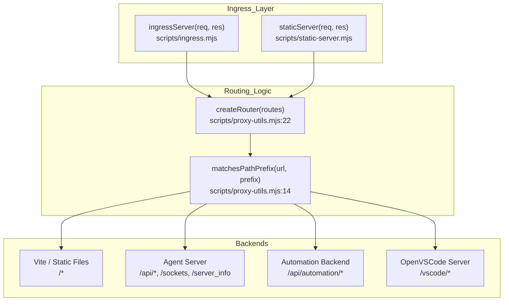
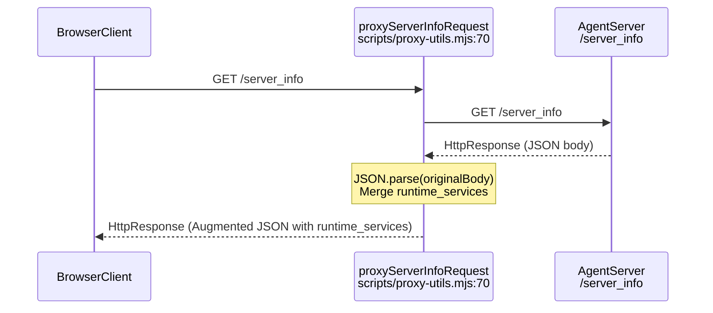

# Ingress Proxy and Static Server

Relevant source files

The following files were used as context for generating this wiki page:

- [__tests__/scripts/dev-static.test.ts](__tests__/scripts/dev-static.test.ts)
- [__tests__/scripts/dev-with-automation.test.ts](__tests__/scripts/dev-with-automation.test.ts)
- [__tests__/scripts/ingress.test.ts](__tests__/scripts/ingress.test.ts)
- [__tests__/scripts/static-server.test.ts](__tests__/scripts/static-server.test.ts)
- [docker/entrypoint.sh](docker/entrypoint.sh)
- [scripts/dev-static.mjs](scripts/dev-static.mjs)
- [scripts/dev-with-automation.mjs](scripts/dev-with-automation.mjs)
- [scripts/ingress.mjs](scripts/ingress.mjs)
- [scripts/proxy-utils.mjs](scripts/proxy-utils.mjs)
- [scripts/runtime-services-info.mjs](scripts/runtime-services-info.mjs)
- [scripts/static-server.mjs](scripts/static-server.mjs)

The Agent Canvas stack uses a path-based routing model to orchestrate traffic between the frontend and multiple backend services. This is implemented via two primary scripts: `scripts/ingress.mjs`, used in development to proxy multiple live services, and `scripts/static-server.mjs`, used in production and Docker environments to serve the pre-built frontend while proxying backend requests and injecting runtime window globals.

Sources: [scripts/ingress.mjs:1-38](), [scripts/static-server.mjs:1-28]()

## Routing Architecture

The system uses a single entry point (typically port `8000`) that routes traffic based on URL path prefixes using helper functions defined in `scripts/proxy-utils.mjs`. This allows the frontend to communicate with both the OpenHands Agent Server and the Automation Backend through the same origin, simplifying authentication and avoiding Cross-Origin Resource Sharing (CORS) complexities.

Title: Path-based Routing Architecture and Code Mapping

**Figure 1: Path-based Routing Architecture and Code Mapping**

The routing priority is determined by sorting route prefixes by length in descending order, ensuring that more specific routes take precedence [scripts/proxy-utils.mjs:22-25](). For example, `/api/automation` matches before `/api`.

Sources: [scripts/proxy-utils.mjs:14-35](), [scripts/ingress.mjs:174-195](), [scripts/static-server.mjs:15-28]()

## Ingress Proxy (`ingress.mjs`)

The `scripts/ingress.mjs` script is a standalone Node.js HTTP reverse proxy. It is used by the development launchers (`dev-with-automation.mjs`) to unify the multi-service development stack.

### Key Functions and Lifecycle
*   `parseArgs()`: Parses command-line options such as `--port`, `--host`, `--route`, `--default`, and `--runtime-services-info` [scripts/ingress.mjs:43-95]().
*   `buildConfig(args, env)`: Merges command-line configuration with environment variables (`INGRESS_PORT`, `INGRESS_ROUTES`, `INGRESS_DEFAULT`, `INGRESS_RUNTIME_SERVICES_INFO`) [scripts/ingress.mjs:146-168]().
*   `startIngress(config)`: Binds the HTTP server, initializes `createRouter` and `createProxyHandlers`, and registers WebSocket upgrade handlers [scripts/ingress.mjs:174-322]().

Sources: [scripts/ingress.mjs:43-168](), [scripts/ingress.mjs:174-322](), [scripts/proxy-utils.mjs:22-35]()

## Static Server (`static-server.mjs`)

In production or Docker environments, `scripts/static-server.mjs` replaces the Vite dev server. It serves pre-built assets from the designated directory (default `build/`) using `sirv` while maintaining identical proxy routing logic [scripts/static-server.mjs:4-36]().

### Single Page Application (SPA) Support
The server handles SPA navigation by falling back to `index.html` for requests that do not match a static file extension (e.g., `.js`, `.css`, `.png`) and are not caught by a backend proxy route [scripts/static-server.mjs:51-76]().

### HTML Injection of Window Globals
A critical capability of `static-server.mjs` is intercepting requests for `index.html` and injecting runtime configuration directly into window globals before rendering. This permits dynamic configuration of pre-built frontend bundles.

| Injected Global Property | CLI Flag / Source | Purpose |
| :--- | :--- | :--- |
| `window.__AGENT_CANVAS_SESSION_API_KEY__` | `--session-api-key` | Auto-authenticates the UI to the backend in local mode [scripts/static-server.mjs:137-139](). |
| `window.__AGENT_CANVAS_AUTH_REQUIRED__` | `--auth-required` | Forces the API key entry screen in public/multi-user mode [scripts/static-server.mjs:161-163](). |
| `window.__AGENT_CANVAS_RUNTIME_SERVICES_INFO__` | `--runtime-services-info` | Injects metadata about available sandbox services [scripts/static-server.mjs:140-142](). |
| `window.__AGENT_CANVAS_VSCODE_BASE_PATH__` | `--vscode-base-path` | Configures the path prefix for the embedded editor [scripts/static-server.mjs:149-158](). |

Sources: [scripts/static-server.mjs:30-46](), [scripts/static-server.mjs:88-196]()

## Runtime Services and `/server_info` Injection

Both ingress and static servers implement a mechanism to intercept and augment the Agent Server's `/server_info` response via `proxyServerInfoRequest` [scripts/proxy-utils.mjs:70-186]().

### Data Flow and Code Execution
When a client requests `/server_info`, the proxy fetches the response from the Agent Server, parses the JSON payload, and merges in a `runtime_services` block generated by `buildRuntimeServicesInfo` [scripts/runtime-services-info.mjs:60-149]().

Title: Server Info and Runtime Services Injection Flow

**Figure 2: Server Info and Runtime Services Injection Flow**

This `runtime_services` metadata block informs the agent about reachable internal URLs (such as the automation service and agent server API endpoints) without requiring runtime probing [scripts/runtime-services-info.mjs:1-22]().

Sources: [scripts/proxy-utils.mjs:70-186](), [scripts/runtime-services-info.mjs:60-149]()

## Docker Entrypoint Orchestration

In the official Docker image, `docker/entrypoint.sh` coordinates the startup of the multi-service stack using `static-server.mjs` as the outer ingress layer.

*   It generates and persists a session API key if not explicitly supplied [docker/entrypoint.sh:35-42]().
*   It invokes `static-server.mjs` with `--session-api-key`, `--route` mappings for the agent server and automation backend, and `--runtime-services-info` [docker/entrypoint.sh:3-56]().
*   It performs base path normalization to prevent path collisions between `AGENT_CANVAS_BASE_PATH` and `VSCODE_BASE_PATH` [docker/entrypoint.sh:98-115]().

Sources: [docker/entrypoint.sh:1-118]()