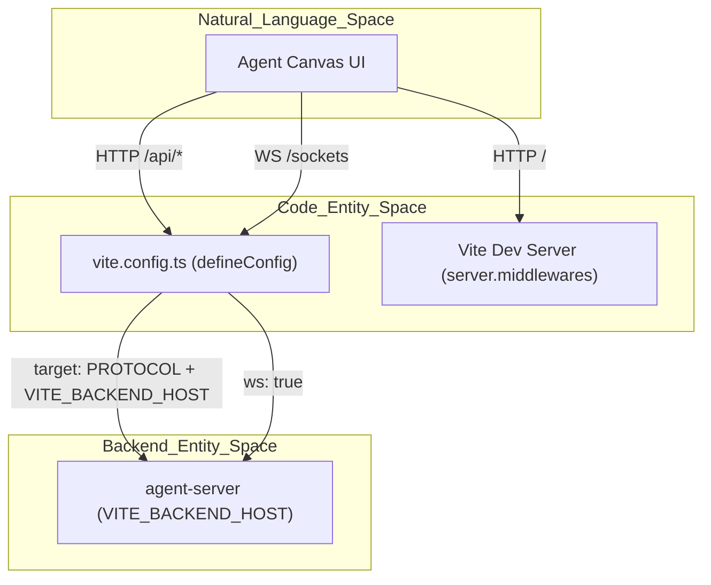
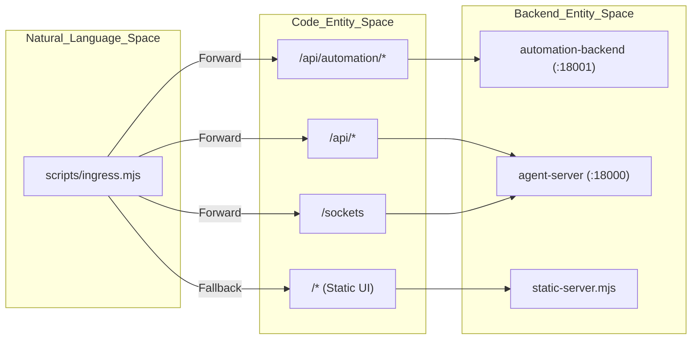

# Vite Build Configuration

Relevant source files

The following files were used as context for generating this wiki page:

- [.github/pr-assets/pr-17556-node-env-pilot-timings.png](.github/pr-assets/pr-17556-node-env-pilot-timings.png)
- [__tests__/components/onboarding/onboarding-preview.test.ts](__tests__/components/onboarding/onboarding-preview.test.ts)
- [__tests__/components/shared/modals/modal-backdrop.test.tsx](__tests__/components/shared/modals/modal-backdrop.test.tsx)
- [__tests__/hooks/use-telemetry.test.tsx](__tests__/hooks/use-telemetry.test.tsx)
- [__tests__/vite-config.test.ts](__tests__/vite-config.test.ts)
- [public/mockServiceWorker.js](public/mockServiceWorker.js)
- [specs/canvas-extensions.md](specs/canvas-extensions.md)
- [src/api/canvas-extensions-service.test.ts](src/api/canvas-extensions-service.test.ts)
- [src/api/canvas-extensions-service.ts](src/api/canvas-extensions-service.ts)
- [src/components/features/analytics/telemetry-consent-banner.tsx](src/components/features/analytics/telemetry-consent-banner.tsx)
- [src/components/features/canvas-extensions/canvas-extension-card.tsx](src/components/features/canvas-extensions/canvas-extension-card.tsx)
- [src/components/features/canvas-extensions/canvas-extensions-runtime.test.tsx](src/components/features/canvas-extensions/canvas-extensions-runtime.test.tsx)
- [src/components/features/canvas-extensions/canvas-extensions-runtime.tsx](src/components/features/canvas-extensions/canvas-extensions-runtime.tsx)
- [src/components/features/onboarding/onboarding-preview.ts](src/components/features/onboarding/onboarding-preview.ts)
- [src/components/shared/modals/modal-backdrop.tsx](src/components/shared/modals/modal-backdrop.tsx)
- [src/fixtures/canvas-extensions/demo-page/extension.js](src/fixtures/canvas-extensions/demo-page/extension.js)
- [src/hooks/use-telemetry.ts](src/hooks/use-telemetry.ts)
- [src/lib/index.ts](src/lib/index.ts)
- [src/stores/btw-store.ts](src/stores/btw-store.ts)
- [src/types/canvas-extension.ts](src/types/canvas-extension.ts)
- [tests/e2e/mock-llm/canvas-extensions/mock-llm-canvas-extensions.spec.ts](tests/e2e/mock-llm/canvas-extensions/mock-llm-canvas-extensions.spec.ts)
- [vite.config.ts](vite.config.ts)

This page documents the Vite build configuration (`vite.config.ts`) for Agent Canvas, detailing proxy settings for development, dependency pre-bundling strategies for browser compatibility,Rolldown-based code splitting for application builds, and library entrypoints for npm distribution.

---

## Proxy Configuration

The Vite development server acts as a reverse proxy routing requests to backend services. This is configured directly within `vite.config.ts` during local development when running `vite serve` [vite.config.ts:103-120]().

### Routing Model and Data Flow
The proxy intercepts HTTP API requests and WebSocket streams, forwarding them to the configured backend host (typically the ingress proxy or `agent-server`).

**Sources:** [vite.config.ts:103-120](), [__tests__/vite-config.test.ts:9-23]()

### Implementation Details
Environment variables are loaded via `loadEnv` to configure backend connection parameters:
- **`VITE_BACKEND_HOST`**: Defaults to `127.0.0.1:8000` [vite.config.ts:105]().
- **`VITE_USE_TLS` / `VITE_INSECURE_SKIP_VERIFY`**: Handles secure/insecure upstream connections [vite.config.ts:106-109]().
- **Runtime Services Injection**: Metadata defined by `VITE_RUNTIME_SERVICES_INFO` is merged into proxied `/server_info` responses [vite.config.ts:113-118]().

**Sources:** [vite.config.ts:103-120]()

---

## Dependency Pre-bundling Strategy

To prevent browser connection throttling and "504 Gateway Timeout" errors during initial loads (particularly in Safari), Vite's dependency optimization is explicitly tuned.

### Optimization Configuration
- **`optimizeDeps.include`**: Pre-bundles core framework and routing packages such as `react`, `react/jsx-runtime`, `react-dom/client`, and `react-router/dom` [__tests__/vite-config.test.ts:9-23]().
- **Module Resolution**: Relies on Vite's native `tsconfigPaths` integration for path aliases without requiring external plugins [__tests__/vite-config.test.ts:75-86]().

**Sources:** [__tests__/vite-config.test.ts:9-86]()

---

## Build Configurations

Agent Canvas supports two distinct build targets controlled by environment flags: **App Build** and **Library Build**.

### App Build (Rolldown & Code Splitting)
Production application builds leverage Rolldown output groups to segment vendor chunks and avoid circular dependency evaluation crashes (such as `TypeError: s is not a function` in HeroUI or markdown engines) [vite.config.ts:59-101]().

| Group Name | Chunk Matcher | Purpose |
|------------|---------------|---------|
| `vendor-styling` | `@heroui`, `tailwind-variants`, `tailwind-merge`, `clsx` | Keeps styling core initialization intact in a single chunk [vite.config.ts:72-74](). |
| `vendor-markdown` | `react-syntax-highlighter`, `refractor`, `unified`, `micromark`, etc. | Prevents interop shims from failing across route boundaries [vite.config.ts:87-89](). |
| `vendor` | General `node_modules` | Sliced with `maxSize` capped at `450KB` [vite.config.ts:91-96](). |

**Sources:** [vite.config.ts:59-101](), [__tests__/vite-config.test.ts:88-117]()

### Library Build (`build:lib`)
When `BUILD_LIB=true` is set, Vite switches to library mode to compile the `@openhands/agent-canvas` package [vite.config.ts:121]() [__tests__/vite-config.test.ts:119-148]().

- **Library Entrypoint**: Points to `src/index.ts` [vite.config.ts:18](), [src/lib/index.ts:1-75]().
- **External Dependencies**: Excludes React and React Router (`react`, `react-dom`, `react-router`) from the bundle [vite.config.ts:19-25](), [__tests__/vite-config.test.ts:129-131]().
- **Preserved Modules**: Generates both ES and CJS formats with `preserveModules: true` and `preserveModulesRoot: "src"` to support granular tree-shaking by consumers [__tests__/vite-config.test.ts:132-146]().

**Sources:** [vite.config.ts:18-25](), [src/lib/index.ts:1-75](), [__tests__/vite-config.test.ts:119-148]()

---

## Static Server and Ingress Proxy Integration

**Sources:** [scripts/ingress.mjs:1-50](), [scripts/static-server.mjs:1-28]()

- **`scripts/static-server.mjs`**: Handles SPA routing fallbacks and injects runtime window globals (`window.__AGENT_CANVAS_SESSION_API_KEY__`, etc.) into compiled HTML assets [scripts/static-server.mjs:1-28]().
- **`scripts/ingress.mjs`**: Coordinates path-based routing between the automation backend, agent server, and static frontend server [scripts/ingress.mjs:1-50]().

**Sources:** [scripts/ingress.mjs:1-50](), [scripts/static-server.mjs:1-28]()