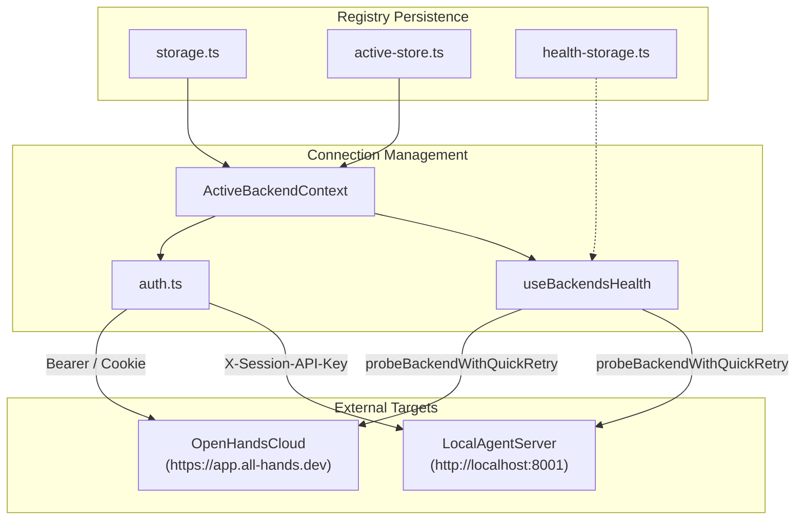
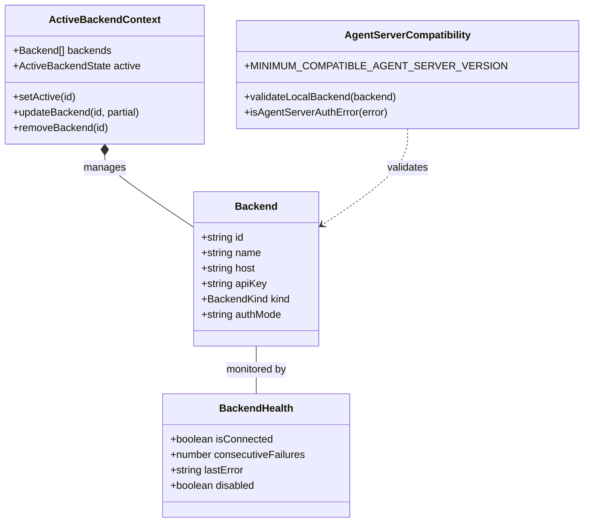

# Backend Registry and Connection Management

Relevant source files

The following files were used as context for generating this wiki page:

- [.screenshots/progress-event-fix.png](.screenshots/progress-event-fix.png)
- [__tests__/api/backend-registry/active-store.test.ts](__tests__/api/backend-registry/active-store.test.ts)
- [__tests__/api/backend-registry/storage.test.ts](__tests__/api/backend-registry/storage.test.ts)
- [__tests__/api/backend-registry/url-selection.test.ts](__tests__/api/backend-registry/url-selection.test.ts)
- [__tests__/api/option-service.test.ts](__tests__/api/option-service.test.ts)
- [__tests__/api/to-app-conversation-session-key.test.ts](__tests__/api/to-app-conversation-session-key.test.ts)
- [__tests__/components/backends/add-backend-modal.test.tsx](__tests__/components/backends/add-backend-modal.test.tsx)
- [__tests__/components/backends/backend-form-modal.test.tsx](__tests__/components/backends/backend-form-modal.test.tsx)
- [__tests__/components/backends/manage-backends-modal.test.tsx](__tests__/components/backends/manage-backends-modal.test.tsx)
- [__tests__/contexts/active-backend-context.test.tsx](__tests__/contexts/active-backend-context.test.tsx)
- [__tests__/hooks/query/use-backends-health.test.tsx](__tests__/hooks/query/use-backends-health.test.tsx)
- [__tests__/hooks/use-backend-scoped-path.test.tsx](__tests__/hooks/use-backend-scoped-path.test.tsx)
- [__tests__/root.test.tsx](__tests__/root.test.tsx)
- [__tests__/vitest-setup-progress-event.test.ts](__tests__/vitest-setup-progress-event.test.ts)
- [specs/backend-management.md](specs/backend-management.md)
- [src/api/agent-server-compatibility.ts](src/api/agent-server-compatibility.ts)
- [src/api/backend-registry/active-store.ts](src/api/backend-registry/active-store.ts)
- [src/api/backend-registry/auth.ts](src/api/backend-registry/auth.ts)
- [src/api/backend-registry/default-backend.ts](src/api/backend-registry/default-backend.ts)
- [src/api/backend-registry/storage.ts](src/api/backend-registry/storage.ts)
- [src/api/backend-registry/types.ts](src/api/backend-registry/types.ts)
- [src/api/backend-registry/url-selection.ts](src/api/backend-registry/url-selection.ts)
- [src/api/option-service/option-service.api.ts](src/api/option-service/option-service.api.ts)
- [src/components/features/backends/backend-form-modal.tsx](src/components/features/backends/backend-form-modal.tsx)
- [src/components/features/backends/backend-row.tsx](src/components/features/backends/backend-row.tsx)
- [src/components/features/backends/backend-version.tsx](src/components/features/backends/backend-version.tsx)
- [src/components/features/backends/manage-backends-modal.tsx](src/components/features/backends/manage-backends-modal.tsx)
- [src/contexts/active-backend-context.tsx](src/contexts/active-backend-context.tsx)
- [src/hooks/query/use-backends-health.ts](src/hooks/query/use-backends-health.ts)
- [src/hooks/query/use-config.ts](src/hooks/query/use-config.ts)
- [src/root.tsx](src/root.tsx)
- [vitest.setup.ts](vitest.setup.ts)

The Backend Registry system manages the lifecycle of connections between the Agent Canvas frontend and multiple agent-server instances. It handles URL resolution, persistent storage of backend configurations, authentication header injection, and real-time health monitoring for both Local and Cloud environments.

For details on the core architecture and storage mechanisms, see [Backend Registry Architecture](#5.1).

## System Overview

The backend registry bridges the "Natural Language Space" of user-defined environments (e.g., "Local Dev", "Production Cloud") to the "Code Entity Space" of API clients and connection state.

### Backend Connection Flow

**Sources:** [src/contexts/active-backend-context.tsx:1-40](), [src/hooks/query/use-backends-health.ts:150-173](), [src/api/backend-registry/health-storage.ts:1-15]()

### Core Entities and Symbols

The registry distinguishes between different `BackendKind` types and manages their unique authentication requirements and version compatibility.

**Sources:** [src/api/backend-registry/types.ts:1-23](), [src/hooks/query/use-backends-health.ts:175-185](), [src/contexts/active-backend-context.tsx:15-35](), [src/api/agent-server-compatibility.ts:20-25]()

## Connection Subsystems

### Backend Registry Architecture
The registry uses persistence layers to manage known backends in `localStorage` [src/api/backend-registry/storage.ts:1-15](). The `ActiveBackendContext` provides a unified provider for the application to consume the currently selected backend, handling default backend initialization and managing `ActiveBackendState` which includes cloud organization scopes [src/api/backend-registry/types.ts:15-30]().
For details, see [Backend Registry Architecture](#5.1).

### Backend Health Monitoring
Connectivity is maintained via the `useBackendsHealth` hook, which performs polling at regular intervals to track state [src/hooks/query/use-backends-health.ts:28-36](). It utilizes a `probeBackendWithQuickRetry` strategy with retry limits to absorb transient network blips [src/hooks/query/use-backends-health.ts:160-173](). The system tracks consecutive failures and manages circuit breaking thresholds [src/api/backend-registry/health-storage.ts:1-15]().
For details, see [Backend Health Monitoring](#5.2).

### Backend UI and Authentication
The user interface for connection management includes the `BackendSelector` for switching environments and the `ManageBackendsModal` for CRUD operations [src/components/features/backends/manage-backends-modal.tsx:72-115](). Authentication for Cloud backends is handled via `DeviceFlowAuth`, implementing the OAuth 2.0 Device Authorization Grant [src/components/features/backends/device-flow-auth.tsx:1-25](). The `BackendFormModal` provides URL normalization, such as prepending schemes for local and remote hosts [src/components/features/backends/backend-form-modal.tsx:112-130]().
For details, see [Backend UI: Selector, Forms, and Auth](#5.3).

## Bootstrapping and Recovery

When the application starts, the `root.tsx` layout acts as a guard. If the active backend is unreachable, requires authentication, or is running an incompatible version, the app renders specialized recovery screens instead of the main dashboard [src/root.tsx:138-164]().

| Component | Trigger | Role |
| :--- | :--- | :--- |
| `OnboardingModal` | No backends configured | Guided first-run setup [src/root.tsx:78-85]() |
| `ManageBackendsModal` | Active backend offline | Recovery interface to switch/fix hosts [src/root.tsx:138-164]() |
| `ApiKeyEntryScreen` | HTTP 401 (Public Mode) | Prompt for `X-Session-API-Key` [src/root.tsx:74-76]() |
| `BackendFormModal` | Locked-to-Cloud first run | Direct Cloud login gate [src/root.tsx:182-195]() |

**Sources:** [src/root.tsx:65-95](), [src/api/agent-server-compatibility.ts:44-62](), [src/api/agent-server-compatibility.ts:75-87]()