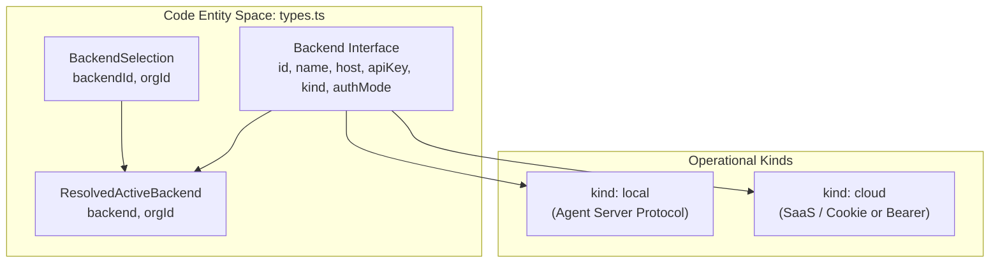
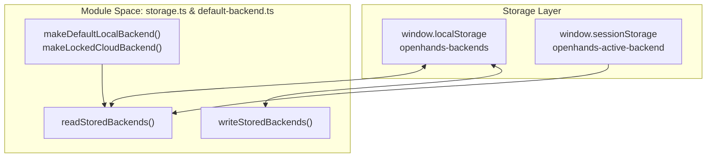
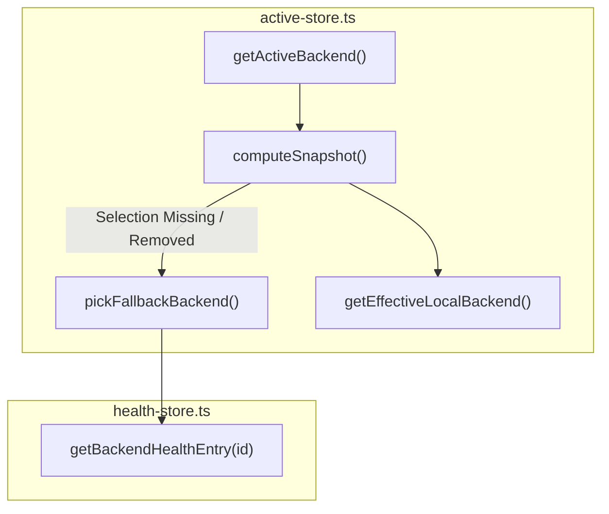
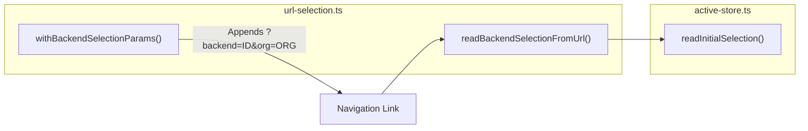

# Backend Registry Architecture

Relevant source files

The following files were used as context for generating this wiki page:

- [.screenshots/progress-event-fix.png](.screenshots/progress-event-fix.png)
- [__tests__/api/backend-registry/active-store.test.ts](__tests__/api/backend-registry/active-store.test.ts)
- [__tests__/api/backend-registry/storage.test.ts](__tests__/api/backend-registry/storage.test.ts)
- [__tests__/api/backend-registry/url-selection.test.ts](__tests__/api/backend-registry/url-selection.test.ts)
- [__tests__/api/to-app-conversation-session-key.test.ts](__tests__/api/to-app-conversation-session-key.test.ts)
- [__tests__/contexts/active-backend-context.test.tsx](__tests__/contexts/active-backend-context.test.tsx)
- [__tests__/hooks/use-backend-scoped-path.test.tsx](__tests__/hooks/use-backend-scoped-path.test.tsx)
- [__tests__/vitest-setup-progress-event.test.ts](__tests__/vitest-setup-progress-event.test.ts)
- [specs/backend-management.md](specs/backend-management.md)
- [src/api/backend-registry/active-store.ts](src/api/backend-registry/active-store.ts)
- [src/api/backend-registry/auth.ts](src/api/backend-registry/auth.ts)
- [src/api/backend-registry/default-backend.ts](src/api/backend-registry/default-backend.ts)
- [src/api/backend-registry/storage.ts](src/api/backend-registry/storage.ts)
- [src/api/backend-registry/types.ts](src/api/backend-registry/types.ts)
- [src/api/backend-registry/url-selection.ts](src/api/backend-registry/url-selection.ts)
- [src/contexts/active-backend-context.tsx](src/contexts/active-backend-context.tsx)
- [vitest.setup.ts](vitest.setup.ts)

The Backend Registry system (`src/api/backend-registry/`) manages the lifecycle, persistence, health-aware fallback, and connection configuration for multiple agent-server instances. It allows Agent Canvas to transparently switch between local development servers, cloud-hosted production instances, and managed tunnels while maintaining isolated state, authentication, and query caches per environment.

Sources: [src/api/backend-registry/active-store.ts:1-20](), [src/contexts/active-backend-context.tsx:1-40]()

---

## 1. Backend Types and Data Models

The registry models all endpoints as `Backend` objects, supporting two primary operational kinds: `local` (direct agent-server protocol or local port forwards) and `cloud` (multi-tenant SaaS infrastructure) [src/api/backend-registry/types.ts:1-23]().

| Field | Type | Description |
|-------|------|-------------|
| `id` | `string` | Unique identifier (e.g., UUID generated via `generateId()` or `SEEDED_DEFAULT_BACKEND_ID`) [src/api/backend-registry/types.ts:5](), [src/contexts/active-backend-context.tsx:44-52]() |
| `name` | `string` | Human-readable label displayed in `BackendSelector` [src/api/backend-registry/types.ts:6]() |
| `host` | `string` | Base URL of the target agent-server or cloud tenant origin [src/api/backend-registry/types.ts:7]() |
| `apiKey` | `string` | Session token or bearer credential for the backend [src/api/backend-registry/types.ts:8]() |
| `kind` | `"local" \| "cloud"` | Operational tier controlling API protocol capabilities and UI affordances [src/api/backend-registry/types.ts:9]() |
| `authMode` | `"api-key" \| "cookie"` | Mechanism used for request authorization (`api-key` header vs HTTP-only cookies) [src/api/backend-registry/types.ts:10]() |
| `connectionRevision` | `number` | Increments whenever host or credentials change, invalidating dependent React Query caches [src/api/backend-registry/types.ts:11-12]() |
| `marsSessionId` | `string` | Optional DigitalOcean MARS tunnel identifier for managed agent sessions [src/api/backend-registry/types.ts:13-19]() |

Sources: [src/api/backend-registry/types.ts:1-32]()

---

## 2. Storage and Automatic Seeding

Persistence is handled by `src/api/backend-registry/storage.ts`, which serializes the registered backend array to `localStorage` under `BACKENDS_STORAGE_KEY` (`openhands-backends`) and active selection state to `sessionStorage` under `ACTIVE_BACKEND_STORAGE_KEY` (`openhands-active-backend`) [src/api/backend-registry/storage.ts:13-14]().

### Seeding Strategies (`default-backend.ts`)
When storage is empty or uninitialized, the registry consults `src/api/backend-registry/default-backend.ts` to provision initial backends:
- **Default Local Seed**: If `VITE_BACKEND_BASE_URL` and `VITE_SESSION_API_KEY` are provided at build/runtime, `makeDefaultLocalBackend()` seeds a local backend with ID `default-local` (`SEEDED_DEFAULT_BACKEND_ID`) [src/api/backend-registry/storage.ts:122-128]().
- **Locked Cloud Seed**: If `window.__AGENT_CANVAS_LOCK_TO_CLOUD__` is set, `makeLockedCloudBackend()` forces the registry into a single cookie-auth cloud mode (`LOCKED_CLOUD_BACKEND_ID`), overriding local entries [src/api/backend-registry/storage.ts:108-116]().

**Storage and Seeding Architecture**

Sources: [src/api/backend-registry/storage.ts:13-14](), [src/api/backend-registry/storage.ts:104-149]()

---

## 3. Active Store and Resolution Logic (`active-store.ts`)

The `src/api/backend-registry/active-store.ts` module manages the synchronous in-memory `Snapshot` containing the registered backends, active selection, and resolved active backend [src/api/backend-registry/active-store.ts:18-22]().

### Fallback Selection on Removal
When an active backend is deleted or removed from the registry, `computeSnapshot()` invokes `pickFallbackBackend()` [src/api/backend-registry/active-store.ts:54-95](). This algorithm prioritizes **healthy local backends** (consulting the health store via `getBackendHealthEntry()`) over cloud or dead local backends, ensuring that the user does not land on an unreachable instance [src/api/backend-registry/active-store.ts:54-64]().

### Effective Local Backend
Services implementing the local agent-server protocol (such as conversation CRUD, MCP configuration, and secrets management) invoke `getEffectiveLocalBackend()` [src/api/backend-registry/active-store.ts:148-152](). This function returns the active backend *only* if its `kind` is `"local"` and it is not the `NO_BACKEND` sentinel, returning `null` when a cloud backend is active [src/api/backend-registry/active-store.ts:31-41](), [src/api/backend-registry/active-store.ts:148-152]().

**Selection Resolution Flow**

Sources: [src/api/backend-registry/active-store.ts:31-95](), [src/api/backend-registry/active-store.ts:148-152]()

---

## 4. React Integration via `ActiveBackendContext`

The React component layer interacts with the store through `ActiveBackendProvider` and the `useActiveBackendContext` hook defined in `src/contexts/active-backend-context.tsx` [src/contexts/active-backend-context.tsx:32-42](). It uses `React.useSyncExternalStore` to subscribe to store mutations without triggering unnecessary React re-renders [src/contexts/active-backend-context.tsx:77-81]().

### Context Operations
- **`setActive(backendId, orgId)`**: Updates active storage, clears cached compatibility info via `clearCachedAgentServerInfo()`, and updates telemetry context [src/contexts/active-backend-context.tsx:83-122]().
- **`addBackend(backend)`**: Generates a unique UUID, appends the entry to registered backends, and automatically switches the active selection to the new backend (`BM-001`) [src/contexts/active-backend-context.tsx:44-52](), [src/contexts/active-backend-context.tsx:124-140]().
- **`updateBackend(id, patch)`**: Updates metadata and increments `connectionRevision` when hosts or API keys change, triggering health reprobing [src/contexts/active-backend-context.tsx:142-183]().
- **`removeBackend(id)`**: Deletes a backend entry and safely tears down associated MARS tunnel sessions if applicable [src/contexts/active-backend-context.tsx:185-201]().

Sources: [src/contexts/active-backend-context.tsx:72-205]()

---

## 5. URL Selection and Cross-Tab Context

To ensure links opened in new tabs (via middle-click or `Ctrl`/`Cmd`-click) resolve against the correct backend rather than falling back to `localStorage`'s last-used global, `src/api/backend-registry/url-selection.ts` injects query parameters [src/api/backend-registry/url-selection.ts:7-17]().

### Query Parameters
- `backend`: Pins the target `backend.id` [src/api/backend-registry/url-selection.ts:18]().
- `org`: Pins the active organization ID for cloud backends [src/api/backend-registry/url-selection.ts:19]().

Functions like `withBackendSelectionParams()` decorate outgoing paths, while `readBackendSelectionFromUrl()` inspects search parameters upon tab boot to seed `sessionStorage` [src/api/backend-registry/url-selection.ts:26-78]().

**URL Pinning and Navigation**

Sources: [src/api/backend-registry/url-selection.ts:26-78]()

---

## 6. Authentication Header Injection

The `src/api/backend-registry/auth.ts` module bridges backend records to HTTP client requests. Depending on the backend `kind` and `authMode`, it injects appropriate headers:
- For `local` or `api-key` authentication, it injects `X-Session-API-Key` using the backend's `apiKey`.
- For `cloud` or `cookie` authentication, authorization relies on cookies or `Authorization: Bearer` headers managed by proxy layers.

Sources: [src/api/backend-registry/auth.ts:1-18](), [src/api/backend-registry/types.ts:1-10]()