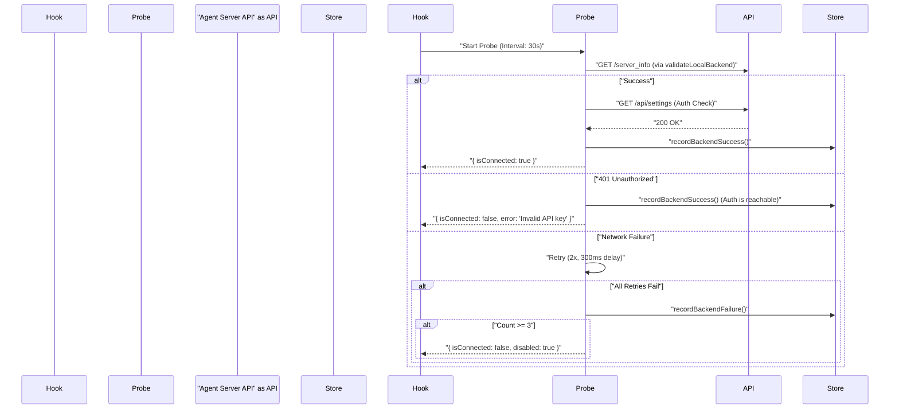
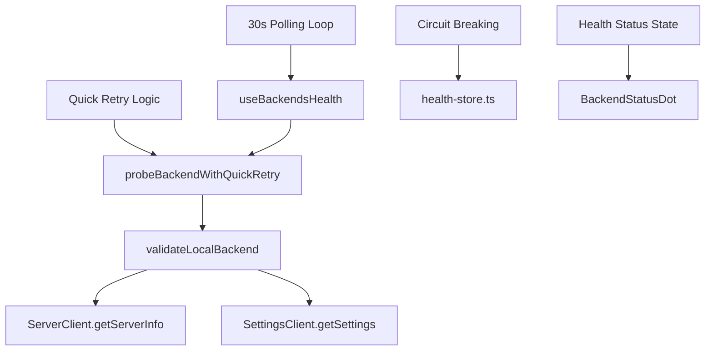

# Backend Health Monitoring

Relevant source files

The following files were used as context for generating this wiki page:

- [__tests__/api/agent-server-compatibility-bundled-pin.test.ts](__tests__/api/agent-server-compatibility-bundled-pin.test.ts)
- [__tests__/api/option-service.test.ts](__tests__/api/option-service.test.ts)
- [__tests__/components/backends/add-backend-modal.test.tsx](__tests__/components/backends/add-backend-modal.test.tsx)
- [__tests__/components/backends/backend-form-modal.test.tsx](__tests__/components/backends/backend-form-modal.test.tsx)
- [__tests__/components/backends/manage-backends-modal.test.tsx](__tests__/components/backends/manage-backends-modal.test.tsx)
- [__tests__/hooks/query/use-backends-health.test.tsx](__tests__/hooks/query/use-backends-health.test.tsx)
- [__tests__/root.test.tsx](__tests__/root.test.tsx)
- [src/api/agent-server-compatibility-prerelease.test.ts](src/api/agent-server-compatibility-prerelease.test.ts)
- [src/api/agent-server-compatibility.test.ts](src/api/agent-server-compatibility.test.ts)
- [src/api/agent-server-compatibility.ts](src/api/agent-server-compatibility.ts)
- [src/api/option-service/option-service.api.ts](src/api/option-service/option-service.api.ts)
- [src/components/features/backends/backend-form-modal.tsx](src/components/features/backends/backend-form-modal.tsx)
- [src/components/features/backends/backend-row.tsx](src/components/features/backends/backend-row.tsx)
- [src/components/features/backends/backend-version.tsx](src/components/features/backends/backend-version.tsx)
- [src/components/features/backends/manage-backends-modal.tsx](src/components/features/backends/manage-backends-modal.tsx)
- [src/hooks/query/use-backends-health.ts](src/hooks/query/use-backends-health.ts)
- [src/hooks/query/use-config.ts](src/hooks/query/use-config.ts)
- [src/root.tsx](src/root.tsx)

This page documents the `useBackendsHealth` hook and the surrounding infrastructure used to monitor the connectivity and compatibility of agent-server instances. The system employs a polling strategy with transient error handling and circuit breaking to ensure the UI accurately reflects the state of all registered backends.

## Overview

Backend health monitoring is responsible for verifying that the frontend can communicate with its configured agent-servers. It tracks three primary states:
- **Connected**: The backend is reachable, authorized, and running a compatible version.
- **Disconnected**: The backend is reachable but has a configuration issue (e.g., invalid API key or version mismatch).
- **Unavailable**: The backend is network-unreachable or has exceeded the failure threshold.

Sources: [src/hooks/query/use-backends-health.ts:175-190](), [src/components/features/backends/backend-status-dot.tsx:1-15]()

## Implementation Details

### The `useBackendsHealth` Hook
The core logic resides in the `useBackendsHealth` hook, which manages a TanStack Query-based polling loop via `useQueries`. It accepts an array of `Backend` objects and returns a mapping of backend IDs to their current `BackendHealth` status.

- **Polling Interval**: Health checks are performed every 30 seconds for local backends (`REFRESH_INTERVAL_MS`), while cloud probes use a 5-minute interval (`CLOUD_REFRESH_INTERVAL_MS`) [src/hooks/query/use-backends-health.ts:31-35]().
- **Quick Retry Strategy**: When a probe fails, the system uses `probeBackendWithQuickRetry` to perform immediate, rapid retries (up to 2 times with a 300ms delay) to distinguish transient network blips from hard failures [src/hooks/query/use-backends-health.ts:126-127](), [src/hooks/query/use-backends-health.ts:160-173]().
- **Circuit Breaking**: The system tracks consecutive failures in `health-store.ts`. If a backend fails `MAX_CONSECUTIVE_FAILURES` (default 3) times, it is marked as disabled to prevent the UI from flickering during unstable connections [src/api/backend-registry/health-storage.ts:10-15](), [src/api/backend-registry/health-store.ts:1-25]().

Sources: [src/hooks/query/use-backends-health.ts:1-180](), [src/api/backend-registry/health-store.ts:1-25]()

### Health Probe Logic
The probe sequence differs by backend kind:
1. **Local agent-server**: Calls `validateLocalBackend`, which performs a timeout-guarded check against `/api/settings` (to validate the session API key) and `/server_info` (to validate version compatibility) [src/hooks/query/use-backends-health.ts:118](), [src/api/agent-server-compatibility.ts:1-40]().
2. **Cloud**: Calls `getCloudOrganizations` (cookie auth) or `getCurrentCloudApiKey` (API key auth) directly against the cloud host [src/hooks/query/use-backends-health.ts:98-102]().

Sources: [src/hooks/query/use-backends-health.ts:91-120](), [src/api/agent-server-compatibility.ts:1-40](), [src/api/backend-registry/health-store.ts:1-25]()

## UI Components

### BackendStatusDot
A low-profile indicator used in the sidebar and backend lists to show connectivity at a glance. It maps the `BackendHealth` state to specific visual states.

| `isConnected` | Dot State | Description |
| :--- | :--- | :--- |
| `true` | Connected | Green: Backend is reachable and compatible. |
| `false` | Disconnected | Amber: Reachable but configuration issue (Auth/Version). |
| `unavailable` | Unavailable | Red: Network unreachable or timed out. |
| `null` | Loading | Gray: Probe in progress. |

Sources: [src/components/features/backends/backend-status-dot.tsx:1-45](), [src/components/features/backends/backend-status-label.ts:1-40]()

### Backend Selector Integration
The backend UI components consume health data to annotate environment switchers and management modals. Cloud backends receive a single health verdict for the host, which is then applied across associated organization metadata [src/components/features/backends/manage-backends-modal.tsx:55-70]().

When a user switches backends, the router redirect helpers ensure the active session state and queries update cleanly [src/components/features/backends/manage-backends-modal.tsx:119-131]().

Sources: [src/components/features/backends/manage-backends-modal.tsx:55-146](), [src/hooks/query/use-backends-health.ts:175-210]()

## Data Flow: Code Entity Space

The following diagram bridges the natural language concepts of "Health Monitoring" to the specific classes and functions in the codebase.

Sources: [src/hooks/query/use-backends-health.ts:1-180](), [src/api/backend-registry/health-store.ts:1-25](), [src/api/agent-server-compatibility.ts:1-40]()

## Error Handling and Recovery

### Recovery Mode
When the active backend becomes unreachable, the application root (`root.tsx`) intercepts the error and displays the `MissingAgentServerScreen` [src/root.tsx:138-164](). This forces the `ManageBackendsModal` into `recoveryMode`, where the user must either fix the connection or select a different backend to proceed.

- **Manual Re-probing**: Selecting a backend in the recovery modal calls `clearCachedAgentServerInfo()` and invalidates the `WEB_CLIENT_CONFIG` query to force an immediate health check [src/root.tsx:145-152]().
- **Version Mismatch**: If a backend is reachable but below the version floor defined by `MINIMUM_COMPATIBLE_AGENT_SERVER_VERSION`, the UI displays a specific error message guiding the user to upgrade [src/api/agent-server-compatibility.ts:20-25](), [__tests__/hooks/query/use-backends-health.test.tsx:102-120]().

Sources: [src/root.tsx:138-164](), [src/api/agent-server-compatibility.ts:20-105](), [src/components/features/backends/manage-backends-modal.tsx:30-40]()