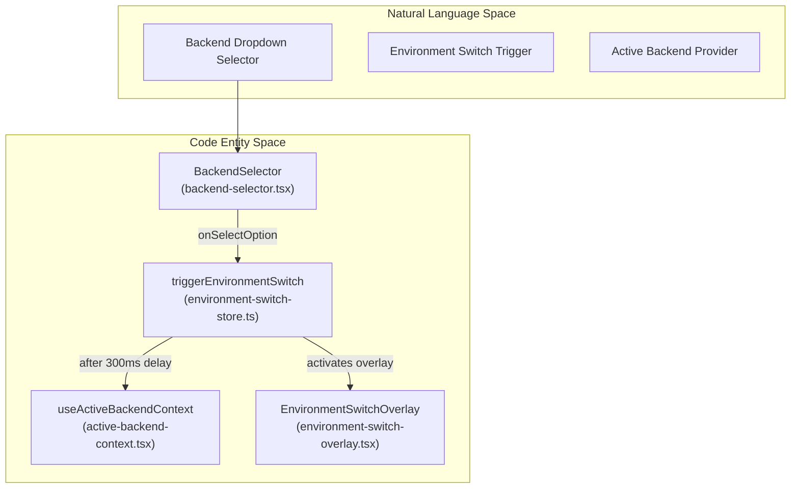
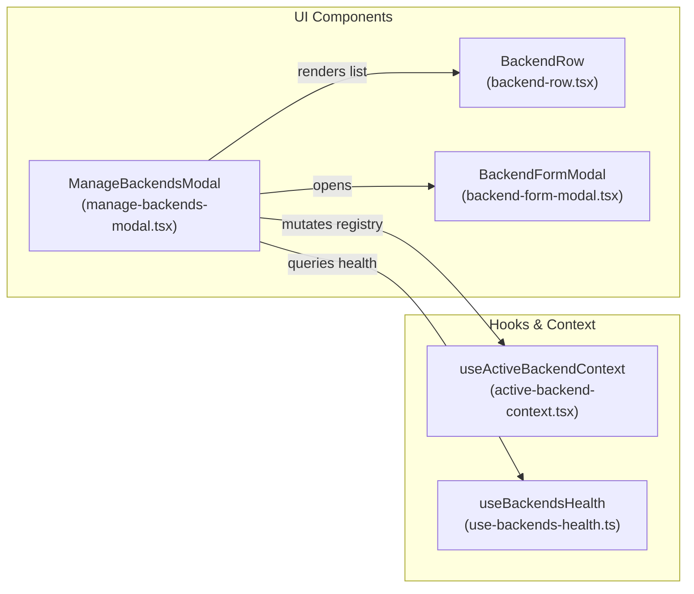

# Backend UI: Selector, Forms, and Auth

Relevant source files

The following files were used as context for generating this wiki page:

- [.github/pr-assets/pr-17571-test-results.svg](.github/pr-assets/pr-17571-test-results.svg)
- [__tests__/api/cloud/proxy.test.ts](__tests__/api/cloud/proxy.test.ts)
- [__tests__/api/option-service.test.ts](__tests__/api/option-service.test.ts)
- [__tests__/components/backends/add-backend-modal.test.tsx](__tests__/components/backends/add-backend-modal.test.tsx)
- [__tests__/components/backends/backend-form-modal.test.tsx](__tests__/components/backends/backend-form-modal.test.tsx)
- [__tests__/components/backends/backend-selector.test.tsx](__tests__/components/backends/backend-selector.test.tsx)
- [__tests__/components/backends/cloud-organization-startup.test.tsx](__tests__/components/backends/cloud-organization-startup.test.tsx)
- [__tests__/components/backends/manage-backends-modal.test.tsx](__tests__/components/backends/manage-backends-modal.test.tsx)
- [__tests__/components/features/sidebar/sidebar-cloud-settings.test.tsx](__tests__/components/features/sidebar/sidebar-cloud-settings.test.tsx)
- [__tests__/components/features/sidebar/sidebar.test.tsx](__tests__/components/features/sidebar/sidebar.test.tsx)
- [__tests__/hooks/query/use-backends-health.test.tsx](__tests__/hooks/query/use-backends-health.test.tsx)
- [__tests__/root.test.tsx](__tests__/root.test.tsx)
- [__tests__/routes/root-layout.test.tsx](__tests__/routes/root-layout.test.tsx)
- [__tests__/utils/desktop-shell.test.ts](__tests__/utils/desktop-shell.test.ts)
- [docs/DEVELOPMENT.md](docs/DEVELOPMENT.md)
- [electron/preload-main.cjs](electron/preload-main.cjs)
- [src/api/agent-server-compatibility.ts](src/api/agent-server-compatibility.ts)
- [src/api/cloud/client.ts](src/api/cloud/client.ts)
- [src/api/cloud/organization-suspension-store.ts](src/api/cloud/organization-suspension-store.ts)
- [src/api/cloud/proxy.ts](src/api/cloud/proxy.ts)
- [src/api/option-service/option-service.api.ts](src/api/option-service/option-service.api.ts)
- [src/components/features/backends/backend-form-modal.tsx](src/components/features/backends/backend-form-modal.tsx)
- [src/components/features/backends/backend-row.tsx](src/components/features/backends/backend-row.tsx)
- [src/components/features/backends/backend-selector.tsx](src/components/features/backends/backend-selector.tsx)
- [src/components/features/backends/backend-version.tsx](src/components/features/backends/backend-version.tsx)
- [src/components/features/backends/cloud-organization-boundary.tsx](src/components/features/backends/cloud-organization-boundary.tsx)
- [src/components/features/backends/manage-backends-modal.tsx](src/components/features/backends/manage-backends-modal.tsx)
- [src/components/features/sidebar/sidebar-nav-link.tsx](src/components/features/sidebar/sidebar-nav-link.tsx)
- [src/components/features/sidebar/sidebar-rail-body.tsx](src/components/features/sidebar/sidebar-rail-body.tsx)
- [src/components/features/sidebar/sidebar.tsx](src/components/features/sidebar/sidebar.tsx)
- [src/hooks/query/use-backends-health.ts](src/hooks/query/use-backends-health.ts)
- [src/hooks/query/use-config.ts](src/hooks/query/use-config.ts)
- [src/hooks/use-desktop-full-screen.ts](src/hooks/use-desktop-full-screen.ts)
- [src/root.tsx](src/root.tsx)
- [src/routes/root-layout.tsx](src/routes/root-layout.tsx)
- [src/utils/desktop-shell.ts](src/utils/desktop-shell.ts)

## Purpose and Scope

This document details the user interface components, validation logic, and state orchestration responsible for managing connections to OpenHands backend instances (`agent-server`). It covers the `BackendSelector` component and environment switch lifecycle [src/components/features/backends/backend-selector.tsx:142-150](), the `BackendFormModal` connection testing and URL normalization engine [src/components/features/backends/backend-form-modal.tsx:49-58](), the `ManageBackendsModal` registry CRUD operations [src/components/features/backends/manage-backends-modal.tsx:72-76](), OAuth 2.0 Device Flow authentication (`DeviceFlowAuth`) [src/components/features/backends/device-flow-auth.tsx](), and the `CloudOrganizationBoundary` scoping layer [src/routes/root-layout.tsx:116-122]().

---

## 1. BackendSelector and Environment Switching

The `BackendSelector` [src/components/features/backends/backend-selector.tsx:142-150]() serves as the primary navigation dropdown for switching between registered backend instances and organization workspaces. It is embedded within the sidebar component [src/components/features/sidebar/sidebar.tsx:50]() and supports both expanded and collapsed rail viewports.

### Dropdown Construction and Organization Scoping

The component aggregates local backends and cloud backends using `useActiveBackendContext()` [src/components/features/backends/backend-selector.tsx:152]() and `useAllCloudOrganizations()` [src/components/features/backends/backend-selector.tsx:153](). For cloud backends, it generates distinct entries per organization workspace, designating personal workspaces via `useCloudCurrentUserId()` [src/components/features/backends/backend-selector.tsx:96-100]().

- **Option Value Serialization**: Options encode both backend IDs and organization scopes using a delimiter (`::`) [src/components/features/backends/backend-selector.tsx:40-52]().
- **Health Indicators**: Each row is prefixed with a `BackendStatusDot` reflecting live health telemetry [src/components/features/backends/backend-selector.tsx:54-60]().

### Environment Switch Lifecycle

When a user selects an alternate backend or workspace, the system executes an asynchronous transition guard to prevent race conditions and layout jitter:

1. **Trigger**: Selecting an option invokes `triggerEnvironmentSwitch()` from the environment switch store [src/components/features/backends/backend-selector.tsx:24]().
2. **Overlay Activation**: This sets an attribute on `document.body`, mounting a full-screen transition overlay (`EnvironmentSwitchOverlay`) [src/routes/root-layout.tsx:34-36]().
3. **Delay and Mutation**: After a 300ms delay (`ENVIRONMENT_SWITCH_SETACTIVE_DELAY_MS`), `setActive(backendId, orgId)` updates the active state in `ActiveBackendContext` [src/components/features/backends/backend-selector.tsx:152]().
4. **Navigation Reset**: The application navigates to the base route (`/`) or preserves context according to policy, re-running health probes and bootstrap data queries [src/components/features/backends/backend-selector.tsx:157]().

**Diagram: Backend Selection to Code Entities**

Sources: [src/components/features/backends/backend-selector.tsx:142-230](), [src/components/features/backends/environment-switch-store.ts:22-25](), [src/contexts/active-backend-context.tsx]()

---

## 2. BackendFormModal: URL Normalization and Validation

The `BackendFormModal` [src/components/features/backends/backend-form-modal.tsx:60-69]() provides the interface for adding new agent-server connections or editing existing parameters.

### URL Normalization

User-supplied host entries are parsed and sanitized via `normalizeHost()` [src/components/features/backends/backend-form-modal.tsx:112-129]():
- Strips trailing slashes and whitespace.
- Inspects the hostname for local loopback signatures or private network CIDRs (`isLocalAddress()`) [src/components/features/backends/backend-form-modal.tsx:89-110]() to automatically prepend `http://` for local nodes or `https://` for remote hosts.

### Host Validation

Before committing credentials or saving to the backend registry, inputs pass through `isValidHostUrl()` [src/components/features/backends/backend-form-modal.tsx:140-156](), which enforces:
1. Non-empty string after trimming.
2. Absence of whitespace characters.
3. Successful parse via the global `URL` constructor with `http:` or `https:` protocols.

### Connection Probing and Version Compatibility

Upon submission, the form tests connectivity by instantiating `ServerClient` and querying `getServerInfo()` [src/components/features/backends/backend-form-modal.tsx:45-47](). It validates compatibility against `MINIMUM_COMPATIBLE_AGENT_SERVER_VERSION` [src/api/agent-server-compatibility.ts:20-21](), throwing an `AgentServerUnsupportedVersionError` if the remote agent-server lags behind the frontend build constraints [src/api/agent-server-compatibility.ts:75-87]().

Sources: [src/components/features/backends/backend-form-modal.tsx:60-156](), [src/api/agent-server-compatibility.ts:1-40]()

---

## 3. ManageBackendsModal and CRUD Management

The `ManageBackendsModal` [src/components/features/backends/manage-backends-modal.tsx:72-76]() acts as the central hub for registry management, allowing users to inspect, edit, test, or remove registered backends.

### Component Architecture and State

- **Backend List**: Renders registered entries using `BackendRow` [src/components/features/backends/manage-backends-modal.tsx:24](), displaying their respective health statuses via `useBackendsHealth()` [src/components/features/backends/manage-backends-modal.tsx:80-82]().
- **Recovery Mode**: When activated in `MissingAgentServerScreen` (triggered when the active backend is unreachable during application bootstrap), close buttons and backdrop dismissals are disabled to mandate recovery [src/components/features/backends/manage-backends-modal.tsx:74-76](), [src/root.tsx:138-164]().

**Diagram: Backend Management Data Flow**

Sources: [src/components/features/backends/manage-backends-modal.tsx:72-185](), [src/hooks/query/use-backends-health.ts](), [src/root.tsx:138-164]()

---

## 4. DeviceFlowAuth and Cloud Authentication

For Cloud backends, OpenHands utilizes the OAuth 2.0 Device Authorization Grant workflow (`DeviceFlowAuth`), enabling secure authentication without handling raw user passwords in the browser client.

### Authentication Lifecycle

1. **Initialization**: The component invokes `startDeviceFlow(host)` to request a verification URI and user code [src/components/features/backends/device-flow-auth.tsx]() (mocked or executed via device flow API bindings).
2. **User Authorization**: Renders the user code and a button linking to the verification URI.
3. **Polling**: Automatically polls `pollForToken` at regular intervals until the authorization grant is completed or expired.
4. **Credential Storage**: Upon receiving an access token, the token is saved as the `apiKey` property of the target cloud backend record via `updateBackend()` [src/components/features/backends/manage-backends-modal.tsx:133-138]().

Sources: [src/components/features/backends/device-flow-auth.tsx](), [src/components/features/backends/manage-backends-modal.tsx:133-138]()

---

## 5. Cloud Organization Boundary and Root Layout Integration

Cloud deployments rely on organization scoping boundaries (`CloudOrganizationBoundary`) mounted at the root router level [src/routes/root-layout.tsx:116-122]() to ensure that API requests carry proper tenant headers (`X-Org-Id`) and organization membership stores are synchronized before rendering application subroutes.

Sources: [src/routes/root-layout.tsx:116-122](), [src/components/features/backends/cloud-organization-boundary.tsx]()