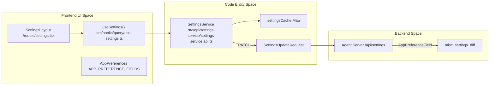
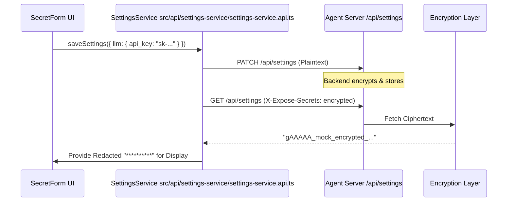

# Settings System

Relevant source files

The following files were used as context for generating this wiki page:

- [__tests__/api/cloud/settings-service.test.ts](__tests__/api/cloud/settings-service.test.ts)
- [__tests__/api/settings-service.test.ts](__tests__/api/settings-service.test.ts)
- [__tests__/components/features/settings/mcp-settings/mcp-server-form.validation.test.tsx](__tests__/components/features/settings/mcp-settings/mcp-server-form.validation.test.tsx)
- [__tests__/components/features/settings/settings-layout.test.tsx](__tests__/components/features/settings/settings-layout.test.tsx)
- [__tests__/components/features/skills/extensions-mobile-hub.test.tsx](__tests__/components/features/skills/extensions-mobile-hub.test.tsx)
- [__tests__/components/features/skills/extensions-navigation.test.tsx](__tests__/components/features/skills/extensions-navigation.test.tsx)
- [__tests__/routes/mcp-page.test.tsx](__tests__/routes/mcp-page.test.tsx)
- [__tests__/routes/settings.test.tsx](__tests__/routes/settings.test.tsx)
- [__tests__/utils/mcp-config.test.ts](__tests__/utils/mcp-config.test.ts)
- [specs/llm-defaults.md](specs/llm-defaults.md)
- [src/api/cloud/settings-service.api.ts](src/api/cloud/settings-service.api.ts)
- [src/api/settings-service/settings-service.api.ts](src/api/settings-service/settings-service.api.ts)
- [src/components/features/automations/built-in-integration-choice-modal.tsx](src/components/features/automations/built-in-integration-choice-modal.tsx)
- [src/components/features/settings/settings-desktop-sidebar.tsx](src/components/features/settings/settings-desktop-sidebar.tsx)
- [src/components/features/settings/settings-layout.tsx](src/components/features/settings/settings-layout.tsx)
- [src/components/features/skills/extensions-navigation.tsx](src/components/features/skills/extensions-navigation.tsx)
- [src/components/shared/compact-section-navigation.tsx](src/components/shared/compact-section-navigation.tsx)
- [src/components/shared/modals/confirmation-modal.tsx](src/components/shared/modals/confirmation-modal.tsx)
- [src/hooks/query/use-native-git-integrations.ts](src/hooks/query/use-native-git-integrations.ts)
- [src/mocks/settings-handlers.ts](src/mocks/settings-handlers.ts)
- [src/routes/canvas-extensions.tsx](src/routes/canvas-extensions.tsx)
- [src/routes/mcp.tsx](src/routes/mcp.tsx)
- [src/routes/settings.tsx](src/routes/settings.tsx)
- [src/routes/skills-plugins.tsx](src/routes/skills-plugins.tsx)
- [src/routes/skills-settings.tsx](src/routes/skills-settings.tsx)
- [src/services/settings.ts](src/services/settings.ts)
- [src/types/mcp-server.ts](src/types/mcp-server.ts)
- [src/types/settings.ts](src/types/settings.ts)
- [src/utils/mcp-config.ts](src/utils/mcp-config.ts)
- [src/utils/mcp-installed-servers.ts](src/utils/mcp-installed-servers.ts)
- [src/utils/mcp-server-name.ts](src/utils/mcp-server-name.ts)
- [tests/e2e/mock-llm/mcp/mock-llm-mcp-github.spec.ts](tests/e2e/mock-llm/mcp/mock-llm-mcp-github.spec.ts)
- [tests/e2e/support/onboarding-helpers.ts](tests/e2e/support/onboarding-helpers.ts)

The Settings System manages the configuration of the OpenHands environment, ranging from user-facing application preferences and LLM profiles to technical agent-server parameters and Model Context Protocol (MCP) servers. It provides a unified interface for both local and cloud backends, ensuring that sensitive credentials (secrets) are handled securely through encryption and redaction.

## Settings Architecture

The system is centered around the `SettingsService`, which orchestrates data retrieval and persistence [src/api/settings-service/settings-service.api.ts:4-16](). It handles the complexity of merging incremental updates (PATCH) and manages a two-tier cache to distinguish between UI-safe (redacted) data and conversation-ready (encrypted) data [src/api/settings-service/settings-service.api.ts:187-203]().

*   **Normalization:** The frontend treats settings as a flat structure, while the backend may store them in nested blocks like `agent_settings`, `conversation_settings`, and `misc_settings` [src/api/settings-service/settings-service.api.ts:66-76]().
*   **App Preferences:** A subset of settings designated as `APP_PREFERENCE_FIELDS` (e.g., `language`, `git_user_name`, `disabled_skills`) are routed specifically into the `misc_settings.app_preferences` container [src/api/settings-service/settings-service.api.ts:33-49]().
*   **Security:** API calls use the `X-Expose-Secrets` header to control whether the backend returns redacted strings or encrypted tokens [src/api/settings-service/settings-service.api.ts:131-135]().

**Entity Mapping: Settings Data Flow**

**Sources:** [src/api/settings-service/settings-service.api.ts:33-97](), [src/api/settings-service/settings-service.api.ts:187-203](), [src/routes/settings.tsx:33-53]()

For details, see [Settings Architecture](#6.1).

---

## LLM Profiles and Model Management

LLM Profiles are named configurations that bundle a specific model, API key, and base URL. This allows users to quickly switch between different model providers or configurations without re-entering credentials.

*   **Profiles Service:** Manages CRUD operations for profiles, saving configurations, and handling profile switching [src/api/settings-service/settings-service.api.ts:3-16]().
*   **Onboarding Defaults:** The system enforces a default model (`openai/gpt-5.6-sol`) during initial setup to ensure a functional baseline [src/services/settings.ts:6-6]().
*   **Free Models:** OpenHands provides several models and flags them in the UI to inform users when tokens or personal API keys are managed [src/services/settings.ts:36-59]().

**Sources:** [src/api/settings-service/settings-service.api.ts:3-16](), [src/services/settings.ts:6-59](), [src/mocks/settings-handlers.ts:94-110]()

For details, see [LLM Profiles and Model Management](#6.2).

---

## Agent Profiles and Settings

Agent Profiles define the "personality" and capability set of the AI, including the `agent_kind` (OpenHands vs. ACP), tool configurations, and sub-agent delegation.

*   **Agent Server Schema:** The UI for agent settings is driven by a schema returned by the server (`agent_settings_schema`), allowing for dynamic form generation for settings like `tool_concurrency_limit` [src/mocks/settings-handlers.ts:67-92]().
*   **Agent Kind:** Supports both `openhands` (default) and `acp` (external protocol) agent types, determining which configuration blocks (`llm` vs command/args) are active [src/types/settings.ts:113]().
*   **Settings Routing:** Manages agent settings through dedicated routes and layout components [src/routes/settings.tsx:111-137]().

**Sources:** [src/services/settings.ts:35-52](), [src/types/settings.ts:111-112](), [src/mocks/settings-handlers.ts:67-92]()

For details, see [Agent Profiles and Settings](#6.3).

---

## MCP Server Management

The Model Context Protocol (MCP) allows OpenHands to connect to external tools and data sources. The settings system manages the installation and configuration of these servers through a dedicated management interface and API.

*   **Configuration:** MCP settings are stored within the `agent_settings` block under `mcp_config` and managed via `/mcp` routes [src/routes/mcp.tsx:42-58]().
*   **Normalization:** The system uses utilities to parse and flatten MCP configurations (`parseMcpConfig`, `flattenMcpConfig`), ensuring stable identities for servers across transport types [src/routes/mcp.tsx:55-58]().
*   **Sparse Patches:** Updates to MCP servers use sparse patches (`useUpdateMcpServer`) to preserve existing redacted credentials while updating fields like command arguments or URLs [src/routes/mcp.tsx:44-95]().

**Sources:** [src/routes/mcp.tsx:42-95](), [src/api/settings-service/settings-service.api.ts:1-13](), [src/services/settings.ts:28-28]()

For details, see [MCP Server Management](#6.4).

---

## Secrets Management

Secrets are sensitive strings (API keys, tokens) that require special handling. The system uses a dedicated service to ensure these values are encrypted when sent to the backend and never displayed in plaintext in the UI.

*   **Expose Secrets Mode:** The `ExposeSecretsMode` type controls whether the backend returns redacted placeholders, cipher-encrypted values for round-tripping, or plaintext [src/api/settings-service/settings-service.api.ts:131-135]().
*   **Encrypted Payloads:** When starting a conversation, the system retrieves settings with encrypted secrets, allowing the frontend to securely pass credentials to the agent-server [src/api/settings-service/settings-service.api.ts:140-148]().

**Entity Mapping: Secret Resolution Lifecycle**

**Sources:** [src/api/settings-service/settings-service.api.ts:131-148](), [src/api/settings-service/settings-service.api.ts:100-117](), [src/mocks/settings-handlers.ts:111-126]()

For details, see [Secrets Management](#6.5).

---

## Meta LLM Profiles and Routing

The Meta LLM Profile system enables advanced model routing and management per task, allowing users to configure multi-model setups where different tasks leverage distinct specialized profiles.

*   **Configuration:** Relies on profile editors and views (`title_llm_profile`) to assign fallback or task-specific models [src/services/settings.ts:34-34]().
*   **Router Execution:** Controls router execution behaviors via flags like `run_router_at_conversation_start`, determining whether incoming prompts pass through the model router before execution [src/services/settings.ts:24-24]().

**Sources:** [src/services/settings.ts:24-34](), [src/types/settings.ts:146-146]()

For details, see [Meta LLM Profiles and Routing](#6.6).