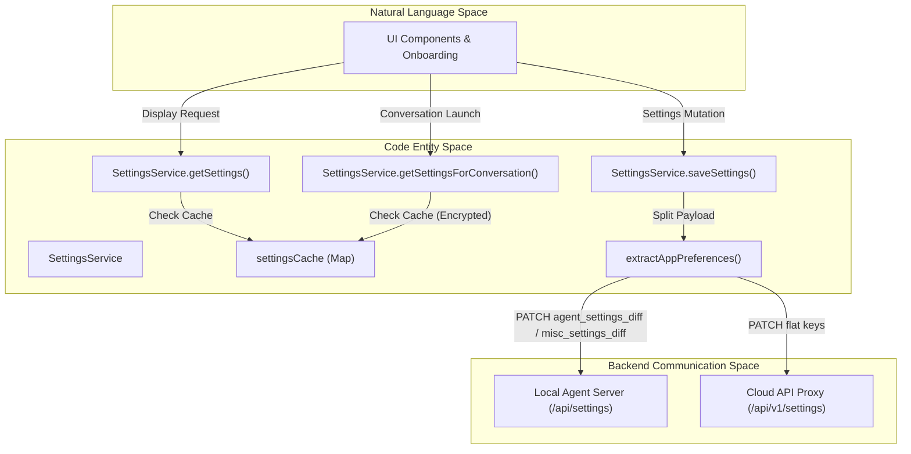
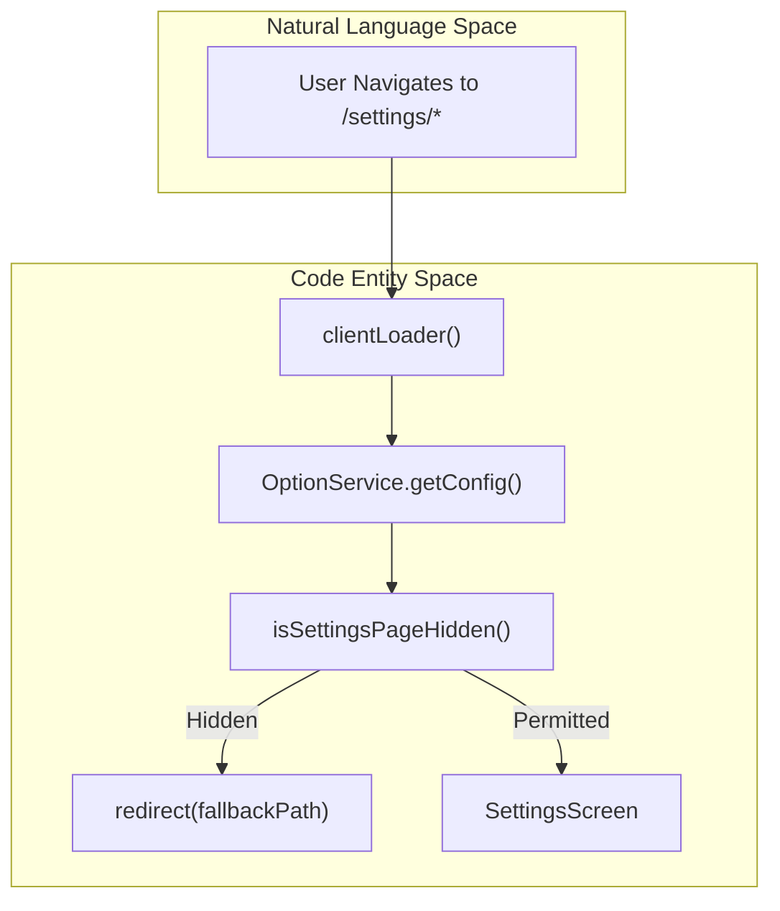

# Settings Architecture

Relevant source files

The following files were used as context for generating this wiki page:

- [__tests__/api/cloud/settings-service.test.ts](__tests__/api/cloud/settings-service.test.ts)
- [__tests__/api/settings-service.test.ts](__tests__/api/settings-service.test.ts)
- [__tests__/components/features/settings/mcp-settings/mcp-server-form.validation.test.tsx](__tests__/components/features/settings/mcp-settings/mcp-server-form.validation.test.tsx)
- [__tests__/components/features/settings/settings-layout.test.tsx](__tests__/components/features/settings/settings-layout.test.tsx)
- [__tests__/components/features/skills/extensions-mobile-hub.test.tsx](__tests__/components/features/skills/extensions-mobile-hub.test.tsx)
- [__tests__/components/features/skills/extensions-navigation.test.tsx](__tests__/components/features/skills/extensions-navigation.test.tsx)
- [__tests__/routes/extensions-hub.test.tsx](__tests__/routes/extensions-hub.test.tsx)
- [__tests__/routes/mcp-page.test.tsx](__tests__/routes/mcp-page.test.tsx)
- [__tests__/routes/settings.test.tsx](__tests__/routes/settings.test.tsx)
- [__tests__/utils/mcp-config.test.ts](__tests__/utils/mcp-config.test.ts)
- [specs/llm-defaults.md](specs/llm-defaults.md)
- [src/api/cloud/settings-service.api.ts](src/api/cloud/settings-service.api.ts)
- [src/api/settings-service/settings-service.api.ts](src/api/settings-service/settings-service.api.ts)
- [src/components/features/automations/built-in-integration-choice-modal.tsx](src/components/features/automations/built-in-integration-choice-modal.tsx)
- [src/components/features/manifest/manifest-subpage-layout.tsx](src/components/features/manifest/manifest-subpage-layout.tsx)
- [src/components/features/settings/settings-desktop-sidebar.tsx](src/components/features/settings/settings-desktop-sidebar.tsx)
- [src/components/features/settings/settings-layout.tsx](src/components/features/settings/settings-layout.tsx)
- [src/components/features/settings/settings-mobile-hub.tsx](src/components/features/settings/settings-mobile-hub.tsx)
- [src/components/features/skills/extensions-mobile-hub.tsx](src/components/features/skills/extensions-mobile-hub.tsx)
- [src/components/features/skills/extensions-navigation.tsx](src/components/features/skills/extensions-navigation.tsx)
- [src/components/shared/compact-section-navigation.tsx](src/components/shared/compact-section-navigation.tsx)
- [src/components/shared/modals/confirmation-modal.tsx](src/components/shared/modals/confirmation-modal.tsx)
- [src/hooks/query/use-native-git-integrations.ts](src/hooks/query/use-native-git-integrations.ts)
- [src/hooks/use-breakpoint.ts](src/hooks/use-breakpoint.ts)
- [src/mocks/settings-handlers.ts](src/mocks/settings-handlers.ts)
- [src/routes/canvas-extensions.tsx](src/routes/canvas-extensions.tsx)
- [src/routes/extensions-hub.tsx](src/routes/extensions-hub.tsx)
- [src/routes/mcp.tsx](src/routes/mcp.tsx)
- [src/routes/settings-index.tsx](src/routes/settings-index.tsx)
- [src/routes/settings.tsx](src/routes/settings.tsx)
- [src/routes/skills-plugins.tsx](src/routes/skills-plugins.tsx)
- [src/routes/skills-settings.tsx](src/routes/skills-settings.tsx)
- [src/services/settings.ts](src/services/settings.ts)
- [src/types/mcp-server.ts](src/types/mcp-server.ts)
- [src/types/settings.ts](src/types/settings.ts)
- [src/utils/mcp-config.ts](src/utils/mcp-config.ts)
- [src/utils/mcp-installed-servers.ts](src/utils/mcp-installed-servers.ts)
- [src/utils/mcp-server-name.ts](src/utils/mcp-server-name.ts)
- [tests/e2e/mock-llm/mcp/mock-llm-mcp-github.spec.ts](tests/e2e/mock-llm/mcp/mock-llm-mcp-github.spec.ts)
- [tests/e2e/support/onboarding-helpers.ts](tests/e2e/support/onboarding-helpers.ts)

## Purpose and Scope

The Settings Architecture provides a unified system for managing user preferences, LLM configurations, agent selection, integration tokens, and security settings across OpenHands. It abstracts the differences between local agent-server instances (using a nested structure with `misc_settings.app_preferences`) and cloud backends (using flat top-level keys). The architecture leverages `SettingsService` for incremental `PATCH` updates, a two-tier cache scoped by backend connection revisions and exposure modes, and robust route layouts.

---

## SettingsService API and Data Flow

The `SettingsService` static class (`[src/api/settings-service/settings-service.api.ts]()`) acts as the primary interface for fetching, caching, and updating user and system settings.

### Key Functions

*   **`getSettings()`**: Fetches user settings for UI display. By default, it requests redacted secrets via the `X-Expose-Secrets` header being omitted (`undefined`), returning masked values such as `"**********"` for sensitive fields (`[src/api/settings-service/settings-service.api.ts:118-134]()`).
*   **`getSettingsForConversation()`**: Fetches settings specifically for starting a conversation session. It specifies `ExposeSecretsMode = "encrypted"`, instructing the backend to return cipher-encrypted secrets that the frontend can safely forward without exposing them in plaintext (`[src/api/settings-service/settings-service.api.ts:130-148]()`).
*   **`saveSettings(diff)`**: Performs incremental updates by splitting incoming keys via `extractAppPreferences` and sending structured diffs (`agent_settings_diff`, `conversation_settings_diff`, and `misc_settings_diff`) to the backend via `PATCH /api/settings` (`[src/api/settings-service/settings-service.api.ts:89-125]()`).

**Sources:**
*   [src/api/settings-service/settings-service.api.ts:79-148]()
*   [__tests__/api/settings-service.test.ts:77-148]()

---

## Two-Tier Cache and ExposeSecretsMode

To eliminate redundant HTTP roundtrips, `SettingsService` maintains an in-memory cache (`settingsCache`) with a 5-minute TTL (`[src/api/settings-service/settings-service.api.ts:170-188]`).

### Cache Scoping and Security Modes

Cache keys are constructed via `getSettingsCacheKey(backendId, connectionRevision, exposureMode)` (`[src/api/settings-service/settings-service.api.ts:189-200]()`), ensuring that:
1.  **Backend Isolation**: Switching between local and cloud backends never cross-contaminates cached settings (`[__tests__/api/settings-service.test.ts:169-192]()`).
2.  **Exposure Mode Separation**: Redacted UI settings are never conflated with encrypted conversation settings.

| Exposure Mode (`ExposeSecretsMode`) | Value Behavior | Primary Use Case |
| :--- | :--- | :--- |
| `undefined` | Returns masked secrets (`"**********"`) | General UI rendering, settings screens |
| `"encrypted"` | Returns cipher-encrypted credentials | Starting conversations (`getSettingsForConversation`) |
| `"plaintext"` | Returns raw secret values | Internal backend routines only |

**Sources:**
*   [src/api/settings-service/settings-service.api.ts:130-203]()
*   [__tests__/api/settings-service.test.ts:130-192]()

---

## Local vs. Cloud Normalization and AppPreferences

The frontend standardizes configuration around a flat `Settings` interface (`[src/types/settings.ts:113-169]()`), while underlying backends differ in structure.

### AppPreferences

Frontend-owned properties that the agent kernel does not interpret are grouped under `AppPreferences` (`[src/api/settings-service/settings-service.api.ts:33-49]()`). These include:
*   `language` (`[src/api/settings-service/settings-service.api.ts:34]()`)
*   `user_consents_to_analytics` (`[src/api/settings-service/settings-service.api.ts:35]()`)
*   `enable_sound_notifications` (`[src/api/settings-service/settings-service.api.ts:36]()`)
*   `git_user_name` and `git_user_email` (`[src/api/settings-service/settings-service.api.ts:37-38]()`)
*   `disabled_skills` and `enabled_skills` (`[src/api/settings-service/settings-service.api.ts:40-41]()`)
*   `workspace_file_discovery` (`[src/api/settings-service/settings-service.api.ts:43]()`)

On local backends, these fields reside inside `misc_settings.app_preferences` (`[src/api/settings-service/settings-service.api.ts:28-31]()`). Cloud backends accept them as top-level keys, with `SettingsService` automatically mapping shapes during fetch and save operations (`[src/api/cloud/settings-service.api.ts:71-123]()`).

**Sources:**
*   [src/api/settings-service/settings-service.api.ts:33-60]()
*   [src/types/settings.ts:113-169]()

---

## Settings Routes and Layouts

Settings screens are orchestrated by React Router under the `/settings` path hierarchy (`[src/routes/settings.tsx:33-53]()`).

### Route Loader and Feature Flag Guard

Before rendering, the `clientLoader` queries the web client configuration (`OptionService.getConfig`) to validate feature flags (`[src/routes/settings.tsx:37-43]()`). If a user attempts to access a restricted or hidden settings sub-route, `clientLoader` redirects them to the first available permitted path (`[src/routes/settings.tsx:45-50]`).

### Settings Screen Layout

`SettingsScreen` (`[src/routes/settings.tsx:55-137]`) wraps child pages inside `SettingsLayout` (`[src/routes/settings.tsx:116]`), supplying a centralized header provider (`SettingsSectionHeaderProvider` at `[src/routes/settings.tsx:113]`) and handling responsive mobile drawer vs. desktop sidebar navigation.

**Sources:**
*   [src/routes/settings.tsx:33-137]()
*   [__tests__/routes/settings.test.tsx:62-138]()